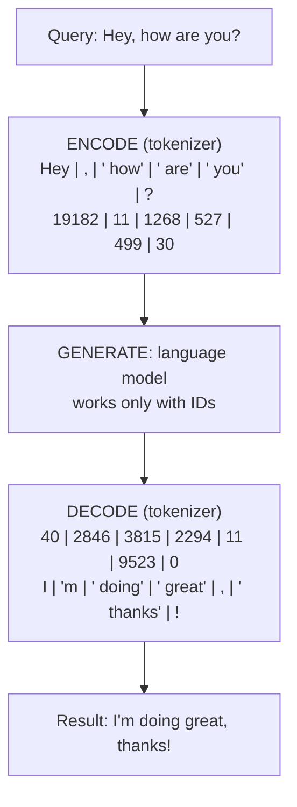
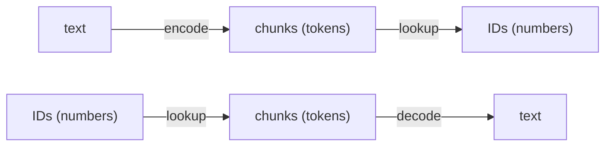

# 01 · Tokenizer: Encoder and Decoder

## Idea
- LLMs don't see words, they see **tokens**: chunks of text.
- LLMs work with numbers, so text is **encoded** into numbers (token IDs) and the output is **decoded** back into text.
- A **tokenizer** assigns an identifier to each chunk. Chunks are chosen by a process that optimizes both the number of chunks in the dictionary and their size.
- Theo: the model doesn't see the paragraph we send. It gets chunks of text and guesses what is most likely next.

## Round trip (lesson example, `cl100k_base`)

## Encoder vs decoder

## Details from the lecture
- Tokens can include dots, spaces, or letters, sometimes yes, sometimes no. These are details of how each tokenizer is implemented.
- Some tokenizers work better for code than others. A lot of innovation happened here in recent years.
- Beyond "the model sees chunks, not paragraphs", you don't need to know more for now.
- Try it: paste a sentence into *Tokenization round trip*, then add an emoji or use another language and watch the token count grow.
- Deeper resource suggested: "Let's build the GPT Tokenizer".
