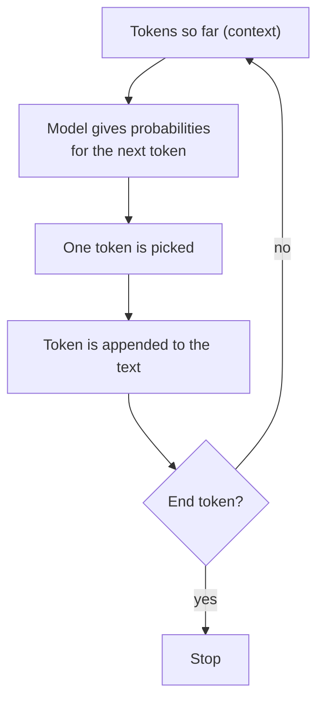
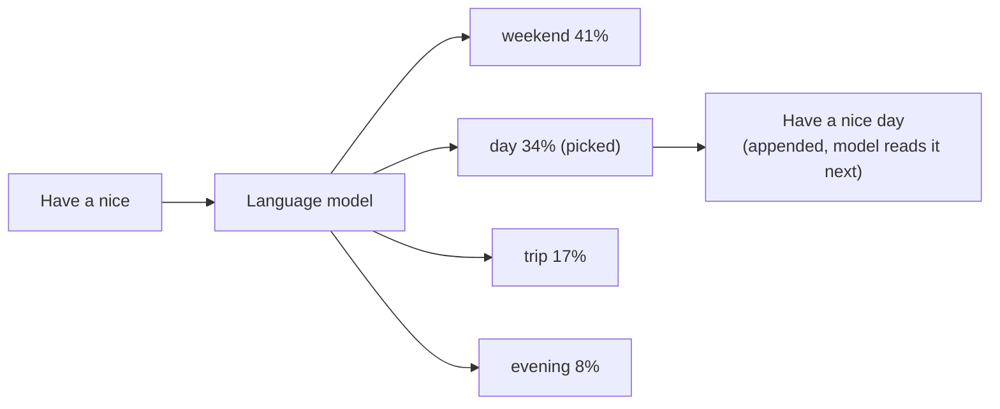

# 02 · Predicting the Next Token

## Idea
- An LLM is effectively **autocomplete**. It doesn't generate the perfect message for the history, it generates the **perfect next token based on prior tokens**.
- It repeats this until it selects a special **end token** (stop).
- Nobody can tell exactly what the output will be or why particular tokens are selected.

## Generation loop

## Lesson example: "Have a nice"
Input tokens: `Have` (12389), ` a` (264), ` nice` (6555).

The picked token is not necessarily the most probable one.

## Theo's demo (Qwen, ChatML prompt)
Prompt: *"Write a JavaScript function that checks if a number is even. Only code."*

| Step | Model's pick | Confidence |
|---|---|---|
| 1 | "certainly" | 66% |
| 1 (alt) | "sure" | 14% |
| 1 (alt) | three backticks (code) | 14% |
| 2 | "!" | ~92% |

- Percentages show how confident the model is in a given pick.
- Theo preferred the backticks (we said "only code"), but the model wanted to be a helpful assistant.
- Random number demo: 8 (20%), 7 (18%), 9 (16%)... its "random" isn't our "random".

## No going back
- The model outputs one token at a time and appends it to the history. It **can't edit** earlier tokens.
- Demo: `console.log(isEven(7))` came out as `true`, which is wrong. It can only keep adding text.
- Lesson: one poor token can hurt later tokens, and the effect adds up.

## Non-determinism
- Same input can give different output (lesson example: prime number between 10 and 20 gives 13, 17, 15, and 15 is wrong).
- Not only the model and settings: hardware also plays a role.
- Via API we can set **temperature** and **top_p**. `temperature = 0` picks the most probable tokens, but this doesn't guarantee repeatable output.
- So we can never be fully sure of the result.
