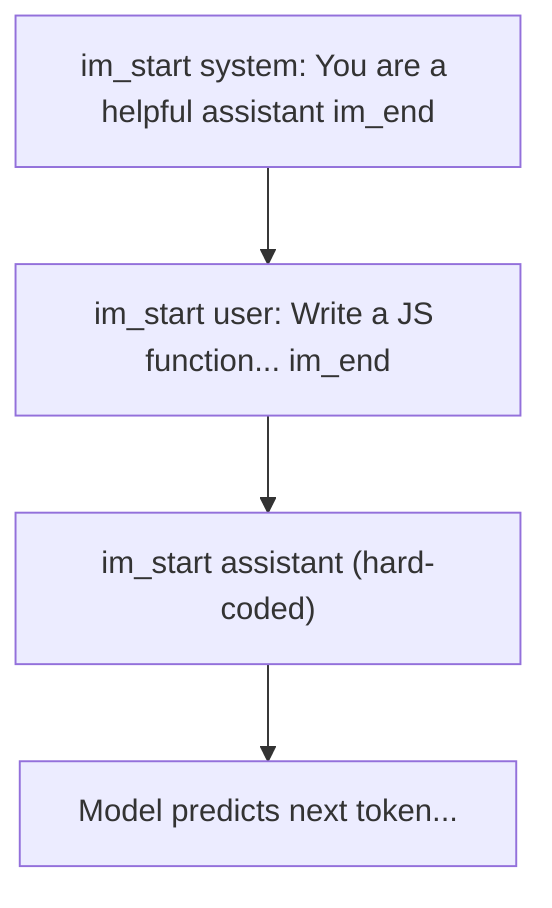
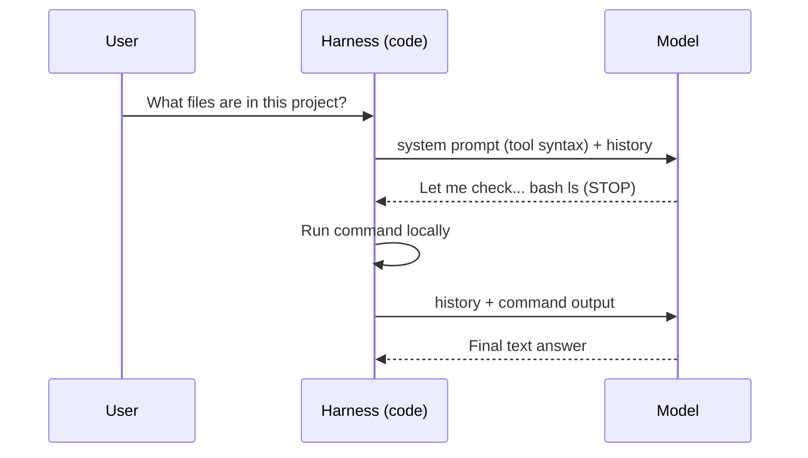
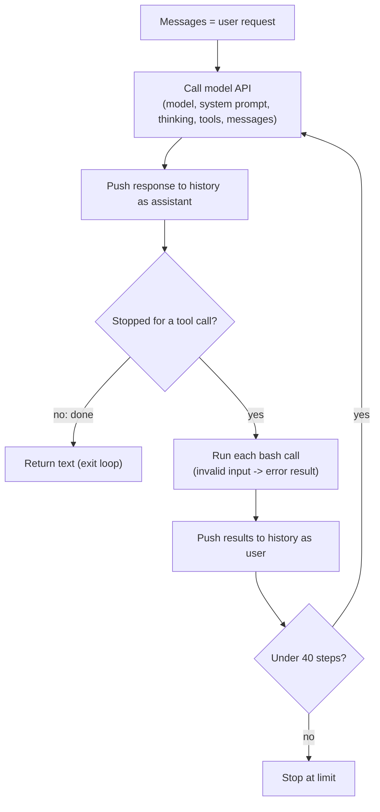

# 03 · The Video: ChatML, Tools and the Agent Loop

Follows Theo's video in order. Tokenizer and next-token prediction are in files 01 and 02.

## 1. ChatML and special tokens
- The model doesn't get the JSON message array. It gets one text in a format like **ChatML** (also used in training).
- Special tokens like `<|im_start|>` and `<|im_end|>` mark who is speaking: system, user, assistant.
- The prompt ends with a hard-coded `<|im_start|>assistant`, so the model knows to generate the next turn.
- Lesson: from the model's view, chat messages are just text. A user typing `<|im_end|>` gets ordinary tokens, so they can't close their own turn.

## 2. Knowledge cutoff, and why tools exist
- The model can answer from training ("Who was president in 1952?").
- It can't know today's date or the latest package version. That data changed after training.
- Claude Code-like tools avoid this problem because the model gets data through **tools**, not training.

## 3. Stop sequence -> tool call
- The model must stop eventually. It stops when done, or to ask for a tool call.
- Theo's example: stop sequence is the closing tag of the bash syntax. The model writes `bash ls close-bash`, generation stops, the code extracts the command and runs it.
- The model doesn't know about a tool unless **the system prompt tells it**. Without that, it said "I can't see your file system". With the tool prompt added, it ran commands and described the project.

## 4. System prompt and hidden context
- Saying "hi" to Claude used about 21,000 tokens, not 3.
- Reasons: system prompt, tool info (tool search on), a CLAUDE.md file (that's how it knows Theo's name), git status run before the request.
- Every API call includes the whole chat history, because the model needs it to generate the next tokens.

## 5. Thinking
- A modern reasoning model can think before answering.
- It can't fix an earlier output token, but in its thinking trace it can correct itself ("No, that's not right"). The final output is then more likely to be correct.

## 6. Agent = a loop
- An agent is a system that lets an LLM run in a **loop**, making tool calls to get info and make changes.
- Theo's code: a `for` loop with a limit of 40 turns (he'd call them steps).

- Demo: a broken app with failing tests. With only bash and the loop, the model ran commands, found two bugs (discount didn't divide by 100), fixed them with `sed`, and all 5 tests passed.

## 7. Takeaways (Theo)
- Models don't respond to messages. They **auto-complete text from the history**.
- If something isn't in the history or the weights, the model can't use it.
- Text output can request tools: fetch data, run commands, edit files.
- Most of the context isn't what we wrote: it's the system prompt plus what the model gathers through tool calls.
- Model + tool calls + loop = **agent**.
