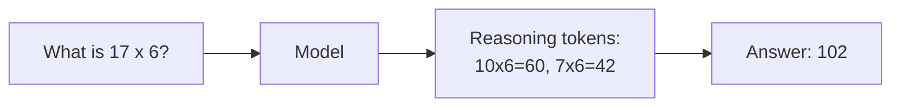
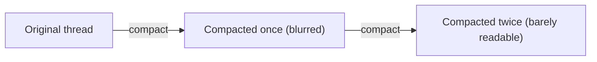
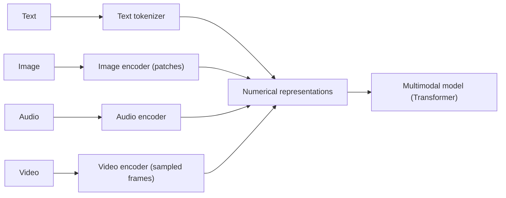
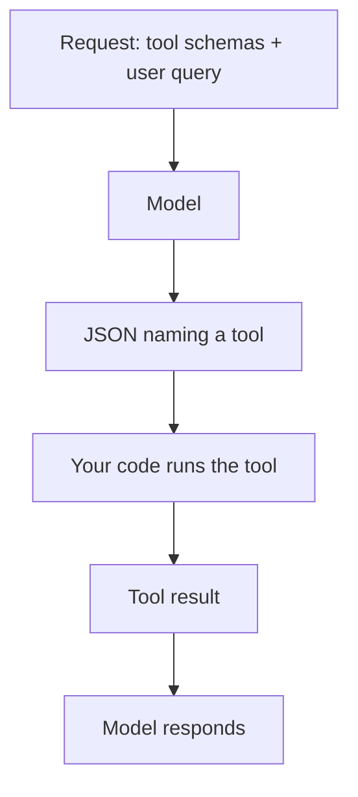
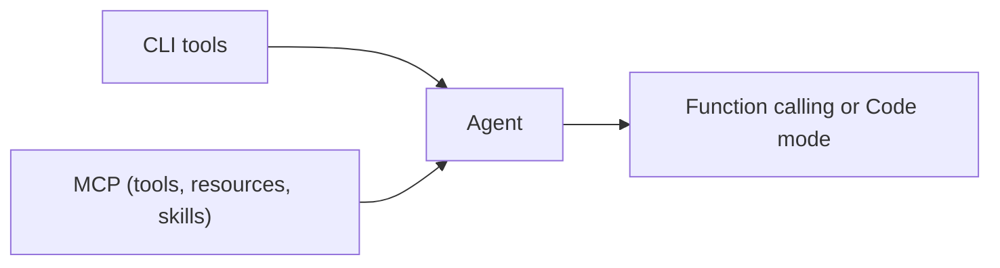

# 04 · Lesson Page: Model Mechanics and Tools

From the written lesson: how models behave and how they get tools.

## Confabulation (hallucinations)
- Models are trained on vast but limited data and produce results from probabilities. Knowledge is limited in time (**knowledge cutoff**).
- Mistakes happen. Working with models is about increasing the chance of the result we want. No full fix exists.
- Example: "Tell me about Alice." with no context. The answer is right only by chance (the book character).

## Reasoning
- Two ways to "think": **visibly** (thinking tokens before the answer) and **silently** (inside one forward pass, via the "J-space").
- More thinking often gives better results but costs more time and money. The right setting depends on model and task.
- Premise order can matter: smaller models can fail just because information is presented in a different order.

## Request (Responses API)
- A request = **context** (array of messages) + **settings** (model, reasoning level, tools, platform fields).
- The response `output` is a list, not one string (e.g. tool call -> tool result -> final message). Check `usage` too.

## Context window and compaction
- Limit is roughly 250k-1M tokens, depending on the model. Tools use auto-compaction.
- Not everything in a thread is sent to the model, so long conversations are **lossy**.
- Compacting several times loses facts (example: "Keep existing routes", "Never log secrets").
- Rule of thumb: models perform best under 30-40% of the context limit. Retrieval from long text is fine on the latest models, reasoning drops.

## Multimodality
- Images, audio, video are tokenized too (differently), then processed by the model.
- Models process **numbers, not real information**, so they can miss details like overlapping elements, exact colors, or the time on a clock.

## Structured outputs
- A model can return JSON for easy processing in code: extract info from documents, use LLMs in app logic.
- A schema controls the **shape** of the answer, not its truth (works for Kyoto and for the fake city Tarvenmoor).
- Invoice example: vendor, city, total come from the document. Country and currency come from base knowledge.

## Function calling
- One returned JSON field can be a **function name**. Your code runs the tool with the payload and feeds the result back.

## Code mode
- Function calling needs all schemas in context (wasteful). Instead give the model two tools, **find** and **execute**, and let it write code.
- More efficient in almost every aspect, but harder to deploy (needs sandboxes like Daytona or Cloudflare). Easy locally.
- Example: function calling spent ~2,300 of 3,000 input tokens on schemas. A one-call task ("Who am I?") can cost more in code mode.

## Agents, CLI and MCP
- Agent: the model decides to use a tool and keep working, or responds with text, which ends the loop.
- Tools come from native harness tools, CLI (best locally) or **MCP** (better for production, widely supported, e.g. Playwright MCP). MCP can also expose resources and skills.
- Either way, tools are used through function calling or code mode.

