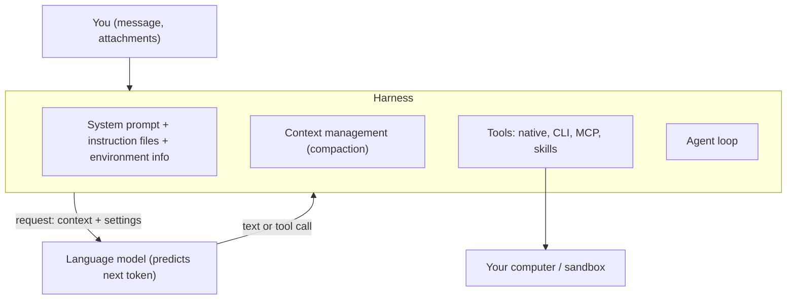
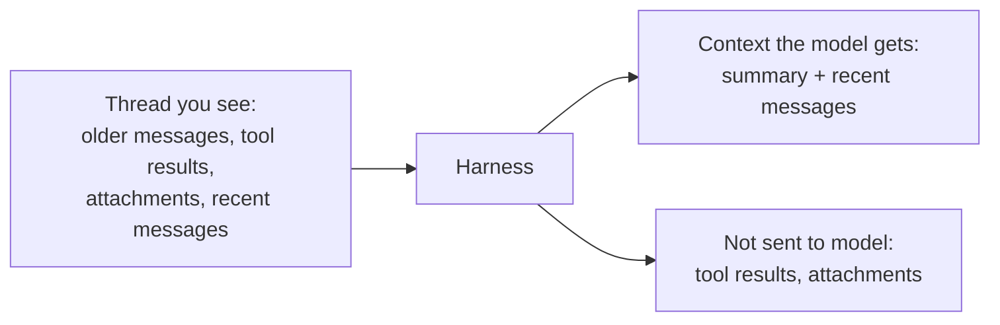
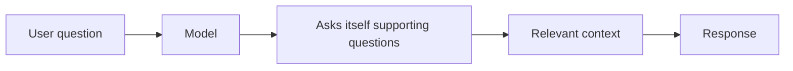

# 05 · Lesson Page: Harnesses, Providers and Steering

From the written lesson: the tools around the model and how to steer them.

## What is a harness?
- Tools like Cursor, Claude Code, Pi or T3 Code all share the same foundation: **a language model**. The difference is the "package" around it: how it uses the model's strengths, covers its weaknesses, and how that affects UX and efficiency. That package is the **harness**.
- The model only predicts the next token. Everything else is done by the harness (Theo's video: the code that runs the loop, runs the tools, and builds the prompt).

### What a harness consists of (as mentioned in the lecture)

| Part | What it does | Where it appears |
|---|---|---|
| **Agent loop** | Calls the model again and again until it answers with text instead of a tool call (step limit, e.g. 40) | Video, agent loop |
| **Request building** | Sends context + settings (model, reasoning level, tools) in the provider's API format | Lesson, Responses API |
| **System prompt** | Instructions from the tool's developers. Also tells the model which tools exist and how to call them | Video, system prompt |
| **Tool definitions** | Native tools (e.g. bash) plus CLI and MCP tools, used via function calling or code mode | Video, lesson |
| **Tool execution** | Runs the tool on the local machine (or a sandbox) and appends the result to the history | Video, tool calls |
| **Context management** | Auto-compaction: summarizing and trimming the thread to fit the context window | Lesson, auto compaction |
| **Instruction files** | CLAUDE.md-style files (who you are, rules) added to the prompt | Video, "say hi" demo |
| **Environment info** | Things like git status, added before the request via `<system-reminder>` blocks | Video and lesson, environment |
| **Skills** | Instruction files loaded into context, picked by name and description | Lesson, skills |
| **Plan mode, attachments** | Workflow features and file handling built on top | Lesson |
| **UI / UX** | What you see: the thread, attachments, files | Lesson, "thread you see" |

Why it matters: your message is not the only thing the model gets. The harness adds a lot, and its choices affect the results you get.

## Platforms and harnesses
Harnesses hide mechanics for convenience, which requires generalization.

- **Auto compaction**: the model gets only a summary + recent messages. Tool results are dropped and attachments set aside, so the agent may see only a small part of the thread.
- **Plan mode**: helps unless the plan is too broad or detailed. Models struggle to follow all rules in one thread. Splitting into smaller tasks helps, but coordination costs time.
- **Skills**: files with instructions/scripts. Once enabled they stay in context until compaction or a new thread. The model picks a skill only by its name and description, and may pick wrongly.
- **Attachments**: files and folders shown in the UI are not necessarily visible to the model. Content is loaded only when the AI loads it, sometimes partially.
- **Environment**: files and git change during work, but instructions can't be modified (caching), so the harness adds `<system-reminder>` blocks. Your message is not the only thing the model gets.

## Providers
- **OpenAI**: GPT, wide multimodal range, ChatGPT, Responses API.
- **Anthropic**: Claude, text generation and image understanding, Claude and Claude Code.
- **xAI**: full multimodal aim, Grok and Grok Bot.
- **DeepMind / Google**: full multimodal incl. video understanding, Interactions API.
- **OpenRouter**: access to many models.
- Best model changes often, so avoid vendor lock-in. Use different models per task (cost/speed) or several for one task (quality). Use the best models by default, then try lower reasoning or smaller models for tasks run at scale.
- The course suggests harness-agnostic tools: Pi, OpenCode, T3 Code, Superset.

## Generalized steering
Guide the model toward behaviors rather than give precise instructions.

- **Different perspectives**: ask several models, or use **subagents** in separate threads. In the lesson's runs, one subagent per contract got 79-80 of 80 fields right, vs 75-79 for one agent holding all sixteen.
- **Self-querying**: the model asks itself supporting questions first, building context before answering.
- **Memory**: each thread starts from scratch, so the agent needs a way to access needed info (example: "Email the report to Anna" -> search knowledge base -> address).
- **Self-management**: agents change their own settings in place (Pi, OpenCode 2). Agents become first-class citizens in software.
- **Ambient, durable agents**: remote agents started by schedule or event, running in sandboxes with dedicated accounts and limited human contact.

## Lesson takeaways
- A broad overview of the core of generative AI. Not everything needs to be clear yet.
- Models progressed mostly by scaling, not architecture changes, so this knowledge stays valid.
- Understanding the basics helps reason from first principles and tell hype from value.
