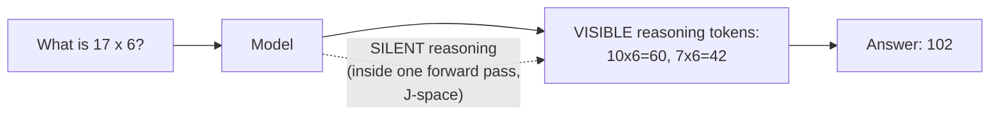
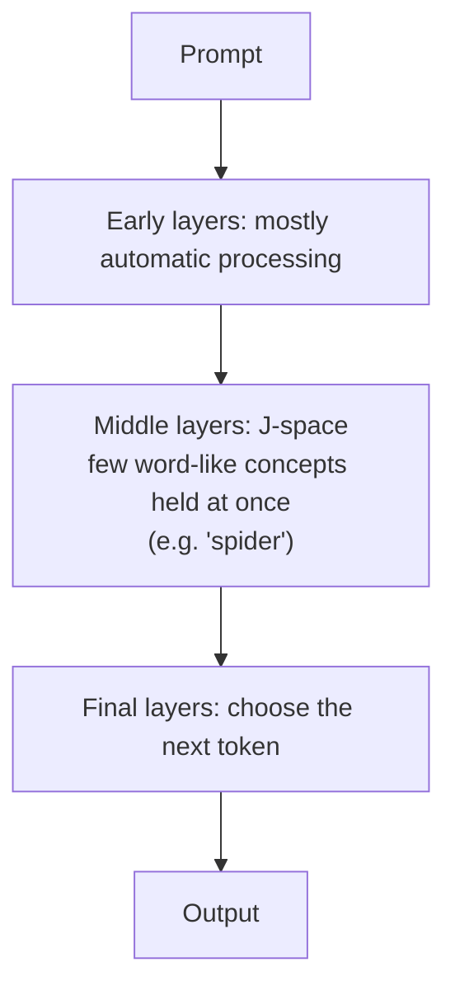

# 06 · Reasoning: Visible and Silent

## Idea (from the lesson)
- Language models "think" in two ways:
  - **Visibly**: they generate "thinking" tokens before the answer.
  - **Silently**: inside a single forward pass, without writing anything out.
- More thinking often gives better answers, but takes **more time and costs more**.
- Reasoning settings differ by provider and can often be adjusted. The right setting depends on the model and the task.

## Why visible thinking helps (from the video)
- The model can't edit a token it already produced.
- In its thinking trace it *can* correct itself ("No, that's not right"), so the final answer is more likely correct.

## Silent reasoning and the J-space
The lesson cites Anthropic's paper *"Verbalizable Representations Form a Global Workspace in Language Models"* (Transformer Circuits, July 2026).

- Silent thinking goes through the **J-space**: a small set of **word-like representations**, concepts the model is "poised to say", but hasn't said.
- Think of it as an internal **dictionary / working set of words** the model reasons with.
- Compared to the **global workspace of the human brain**: a limited-capacity shared space where information becomes reportable and usable by many processes, while most processing stays automatic.

### Findings from the paper (simplified)
- **It's causal.** Example: asked how many legs a web-spinning animal has, the model internally uses "spider". Swapping in "ant" changes the answer from 8 to 6.
- **Intermediate steps appear in order.** In arithmetic, intermediate results (21, 42, 49) show up at successively later layers.
- **Small capacity.** Only about 25 concepts are meaningfully active at once, mostly in the middle layers.
- **Automatic vs flexible tasks.** Simple tasks (continuing text, one-step recall) work without it. Multi-hop reasoning and translation suffer when it is removed.
- **Visible thinking offloads it.** With chain-of-thought, intermediate steps are written on the page, so the model depends less on its internal workspace.

### Where it differs from the brain (paper)
- No recurrent loops, and it all happens in one pass over the layers.
- The authors take no position on subjective experience.

## Reasoning isn't quite what we expect
- Smaller models can fail a task only because the information is in a different **order** (*Premise Order Matters*).

## Try it (from the lesson)
- *Reasoning effort* example: one checkable task at each effort level, compare reasoning tokens, time, cost and correctness. Compare with a smaller model to find the lowest level that still gets it right. How model tier and effort combine, and what the vendors say about effort levels, is in [Lecture 4: 16 SOTA and reasoning effort](../Lecture_4_Harness/16_SOTA_And_Reasoning_Effort.md).

## Sources
- Primary paper: [Verbalizable Representations Form a Global Workspace in Language Models](https://transformer-circuits.pub/2026/workspace/index.html)
- Commentary: [No Space Like J-Space](https://thezvi.substack.com/p/no-space-like-j-space)

> Note: the paper summary comes from the first part of the page only (about a third of it was read) and is simplified. Check the paper for details.
