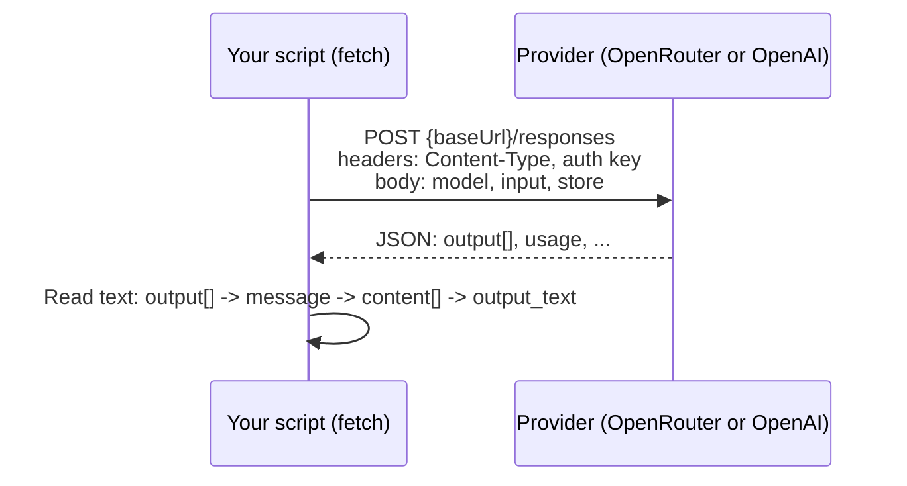
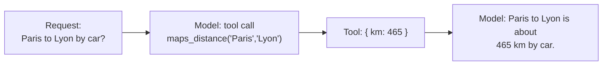

# 07 · Example: Responses API Request

Lesson example `responses-request`. Run: `npx mex run responses-request ["your prompt"] [--provider openrouter|openai] [--model id]`

## Idea (from the lesson)
- Each request to an LLM = **context** + **settings**.
- The example makes the request **by hand with `fetch`**, so you see every part. Other examples use the same request through a shared helper.
- It's a plain REST call: send JSON, get JSON back.
- What to look at in the output: find `usage`, and notice that `output` is a **list**, not a single string.



## The request body: three parameters

| Parameter | Value in the example | Meaning |
|---|---|---|
| `model` | `--model` flag, or the provider's default | Which model answers |
| `input` | your words, default `Hey, how are you?` | The context to complete |
| `store` | `false` | Keep nothing on the provider's side (OpenRouter's Responses API requires it) |

```json
{
  "model": "<model id>",
  "input": "Hey, how are you?",
  "store": false
}
```

This is the minimal valid request. The lesson figure shows a richer one: model, reasoning effort, a tool (`maps_distance`) and the user message "Paris to Lyon by car?".

## The response
- `output` is a **list of items**, not one string.
- The text is nested: `output[]` -> item with `type: message` -> `content[]` -> part with `type: output_text` -> `text`. The example's `outputText()` function does exactly this filtering. SDKs hide it behind an `output_text` helper.
- With tools, the list holds several turns (figure example):



## Code flow in the example
1. Read CLI args (prompt words, `--provider`, `--model`).
2. Pick provider: OpenRouter if its key is set, otherwise OpenAI (`--provider` overrides).
3. Build URL (`baseUrl/responses`) and headers (JSON + auth).
4. Build body (`model`, `input`, `store: false`) and print the request.
5. `fetch` with POST, parse JSON, print the response. Exit with an error code if the status is not OK.
6. Print the text from `output`.

## Takeaway
Behind every chat UI or agent is an ordinary HTTP call: settings + context in, a list of output items out.
