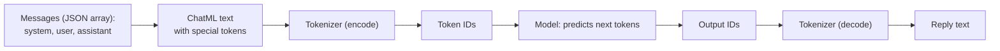

# 08 · ChatML

## In one line
ChatML is the text format that turns a chat (system, user, assistant messages) into **one text** the model can autocomplete. Special tokens mark where each message starts and ends.

## Why it exists
- The model is only an autocomplete: it predicts the next token.
- The chat is an illusion built from this format, which the model also saw in training.
- From the model's perspective, **chat messages are just text**.

## What the model actually reads

```
<|im_start|>system
Answer briefly.<|im_end|>
<|im_start|>user
Hi<|im_end|>
<|im_start|>assistant
Hello<|im_end|>
<|im_start|>assistant
```

| Piece | Meaning |
|---|---|
| `<\|im_start\|>` | A message starts |
| `system` / `user` / `assistant` | Role, written right after the start token |
| `<\|im_end\|>` | The message ends (the model emits it to stop its turn) |
| Last `<\|im_start\|>assistant` | **Hard-coded** open turn: tells the model it is its turn to write |

- Without that open turn, the model wouldn't know what to do after the user message (Theo).
- Newer formats exist (Theo mentions Harmony), but the idea is the same.

## How it relates to the tokenizer



- ChatML is applied **before** the tokenizer. The tokenizer then encodes the whole text into IDs, as in [01](01_tokenizer_encoder_decoder.md).
- Special tokens like `<|im_start|>` become **single reserved tokens** (one ID each), not several pieces of text.
- Lesson example: the thread above is about **20 tokens**: content is split with `cl100k_base`, and each special token counts as one.

## Good to know
- If a user types `<|im_end|>` in their message, it is encoded as **six ordinary tokens**, not the special token. So a user cannot close their own turn.
- The API takes JSON messages, but the model never sees that JSON. It gets this text format instead (Theo).
- The system prompt, tool info and history are all part of this one text, so they all count toward the context window.

## Try it
- *Chat template* example (`npx mex run chat-template`): shows the thread as text with special tokens. Type `<|im_end|>` in a user message to see the six ordinary tokens.
- Tiktokenizer (linked in the lesson): paste a ChatML text and see each token and ID.
