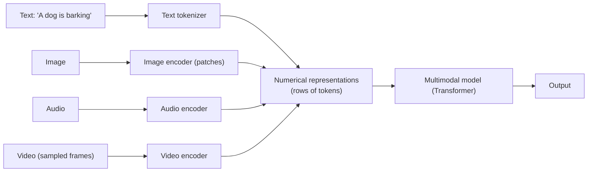
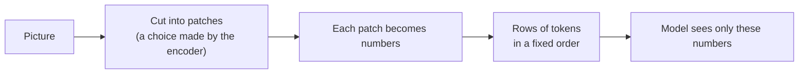

# 09 · Multimodality

## Idea (from the lesson)
- Some models process not only text but also **images, audio and sometimes video**.
- To make that possible, the data is **tokenized too, but in a different way**, and then processed by the model.
- Key point: **models process numbers, not actual information.** So they perceive images, audio and even text differently from how we expect.

## Each input type has its own encoder

- Every encoder outputs a short row of tokens. The rows look the same to the model (numbers), only the source differs.
- The text row in the figure has 5 tokens (`cl100k_base` splits the phrase into A, dog, is, b, arking). The other token counts are examples.
- The lesson notes this is a **conceptual architecture; implementations vary.**
- Image encoder: works on **patches**. Video encoder: works on **sampled frames** (so not every frame is seen).

## Where models struggle (from the lesson)
Models often fail to understand details such as:
- **overlapping elements**
- **exact colors**
- **the time on a clock** (the lesson links the ClockBench paper, and an *image detail probe* example)

## Why? (our reading, not stated in the lesson)
The lesson only says the cause is that models get numbers, not the real picture. The explanation below is a plausible reading of the figure, not a claim from the lecture:

- **Patches:** the image is cut into pieces. A detail that spans several patches (a clock hand, an overlap edge) is split across tokens.
- **Compression:** an encoder turns a patch into a few numbers. Fine details like an exact shade may not survive.
- **Order:** patches become a row of tokens, so 2D layout has to be recovered from a 1D sequence.
- **Video:** frames are sampled, so something between frames is never seen.

So your hypothesis (how we encode, how the window is chosen, how tokens are placed in a row) fits the lesson's picture. Treat it as an intuition, not a proven cause.

## Takeaway
- "The model sees the image" is a simplification. It sees an encoder's numbers.
- Don't assume it caught small details (colors, overlaps, clock times). Verify them.
- Same logic as text: the model gets tokens, not words ([01](01_tokenizer_encoder_decoder.md)).
