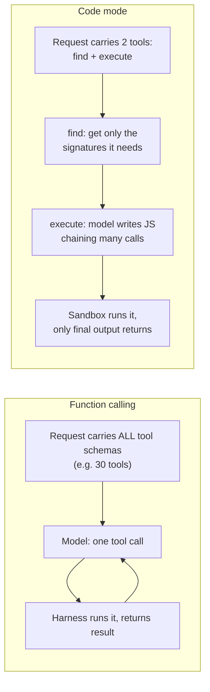
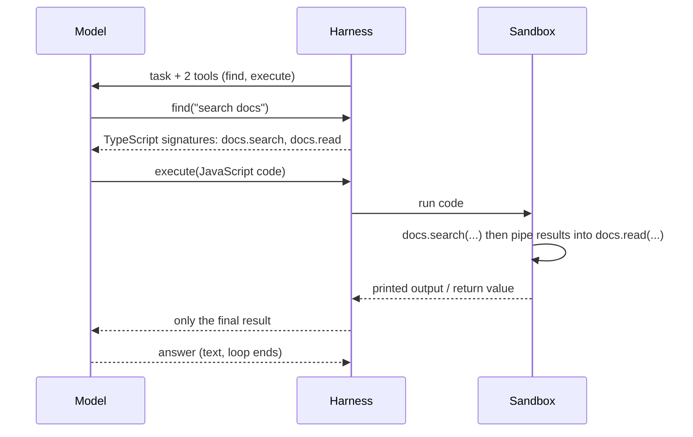

# 10 · Code Mode

## In one line
Instead of giving the model 30 tools (function calling), give it **two**: `find` (look up what's available) and `execute` (run code it writes). The model calls your API by **writing code**, not by emitting one tool call per action.

It is not a grammar or output format (not BNF-like). It's a **harness pattern**: tools + docs + a sandbox + the loop that connects them.

## The problem it solves
- Function calling needs **all tool schemas in the context**, in every request, so the model can pick one.
- The context window is limited, so this wastes space when the task doesn't need most tools.
- Latest models are very good at writing code, so let them write code against the API instead.

## Function calling vs code mode

## How it works (lesson figure + the example's code)

1. **`find(query)`**: returns the **TypeScript signatures** that match, so the model reads only the docs it needs.
2. **`execute(code)`**: runs JavaScript the model wrote. Inside, it calls the API (`api.docs.search(...)`), can chain calls, and prints only what matters.
3. Only the **printed text and return value** go back to the model. Intermediate results stay in the sandbox, not in the context.

## What you need to build it
| Part | Role |
|---|---|
| **Capability catalog** | The API functions, each with a signature and a short description |
| **`find` tool** | Searches the catalog, returns signatures |
| **`execute` tool** | Sends the code to a sandbox |
| **Sandbox** | Runs untrusted model-written code safely, with limits |
| **Harness / agent loop** | Same loop as before: tool call keeps going, text ends it |
| **System prompt** | Tells the model to use `find` then `execute`, and to chain calls in few executions |

## The sandbox (why it's harder in production)
- The code is written by a model, so it must run in an isolated environment, with no free access to the machine.
- Production options named in the lesson: **Daytona**, **Cloudflare**.
- The example's demo sandbox: code runs in a Node worker with `node:vm`, sees only `api` and `console.log` (no `require`, `process`, imports, network), stops after 2 seconds. The example's README says clearly that **`node:vm` is not a real security boundary**. It's a local demo with fake data.
- For coding agents on your own computer it's easier: they just run scripts locally.

## Numbers from the lesson example (`code-mode`)
- Same task twice: 30 function tools vs only `find` + `execute`.
- Function calling spent about **2,300 of its 3,000 input tokens on tool schemas**. In code mode, the schemas are 2 tools, plus the signatures loaded by `find`.
- Not always cheaper: a one-call task like **"Who am I?"** can cost more in code mode, because `find` adds a step.

## Trade-offs
| | Function calling | Code mode |
|---|---|---|
| Context cost | Grows with number of tools | Small and fixed schemas, load docs on demand |
| Many chained calls | One round trip per call | Many calls in one `execute` |
| Setup | Simple | Needs a sandbox, harder to deploy to production |
| Tiny tasks | Fine | May cost more (extra `find` step) |
| Security | The model only picks from fixed tools. Your code runs them | The model's own **code is executed for real**, so isolation is critical |
| Control / audit | Each call is a separate, visible step you can approve | One `execute` can bundle many actions, harder to review |
| Errors | Bad arguments | Bugs, timeouts and crashes in model-written code |
| Model dependence | Works with most models | Needs a model that writes good code |

> The security, control, errors and model rows are **our reasoning, not from the lecture**. The lecture only says code mode is harder to deploy because it needs sandboxes.

## Securing it (beyond the lecture)
Why it's hard: the code is written by a model, and the model's input can include untrusted text (a doc page, an email, a tool result) that may steer it to write harmful code (prompt injection). That code then runs for real.

What a real sandbox has to do:
- **Isolate** the code from the host: no free access to files, processes or secrets.
- **Limit the network**: none, or only allowed destinations.
- **Limit resources**: CPU, memory and run time (the demo stops after 2 seconds).
- **Control the bridge**: expose only the `api` functions the task needs, with minimal credentials, and prefer read-only where possible.
- **Handle failure**: return errors and timeouts to the model so the loop can recover.

Real options named in the lesson: Cloudflare (isolates) and Daytona (containers). The demo's `node:vm` is **not** a security boundary.

### Possible exercise
Build the smallest safe version: run the generated code in a container with no network, CPU and time limits, and a read-only `api` bridge that exposes only allowed functions.

## Related
Related: function calling in [04](04_lesson_model_mechanics_and_tools.md); CLI/MCP tools can be used through either mechanism.
