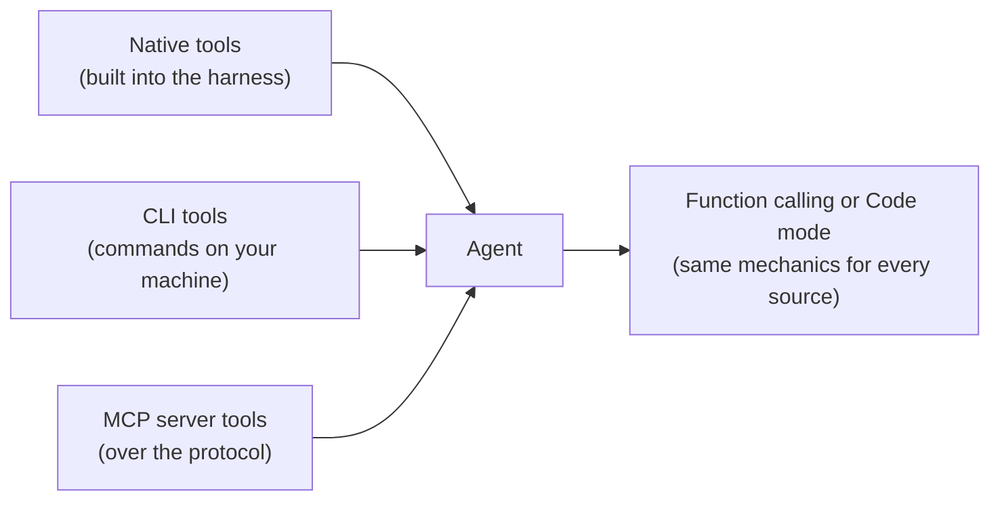
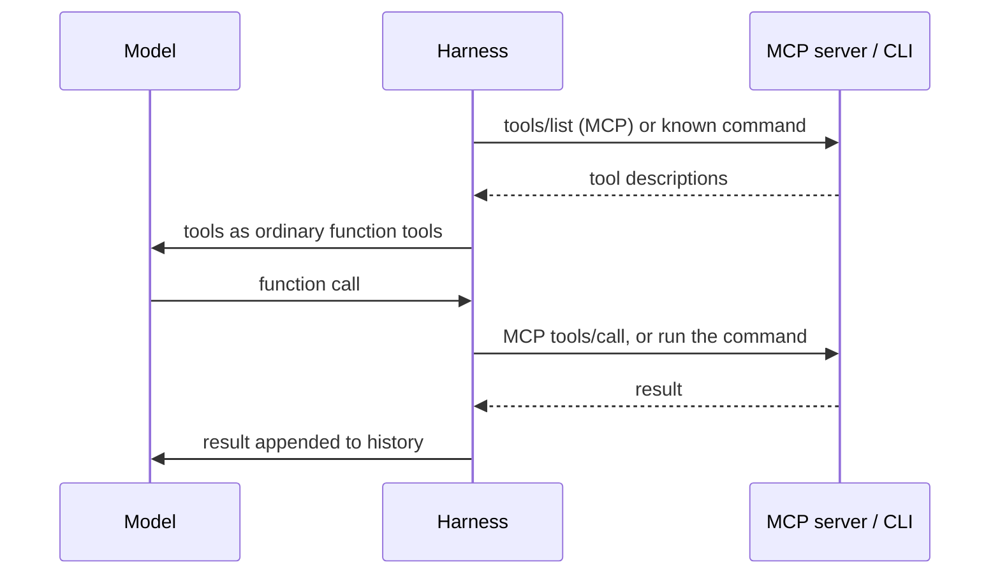

# 11 · CLI and MCP Tools

## In one line
CLI and MCP are two ways to **give an agent more tools**. Whichever you use, the model still gets them through **function calling or code mode**.

Resources and skills, the other things an MCP server can expose, are in [12](12_mcp_resources_and_skills.md). This note is about tools.

## Where tools come from



| Source | Notes (from the lesson) |
|---|---|
| **Native tools** | Exposed by the harness itself |
| **CLI** | Well-known command-line tools. Work best **locally** |
| **MCP** (Model Context Protocol) | Much better for **production**. Widely used and supported by nearly all tools (Claude, ChatGPT, Grok Bot and others) |

Example: **Playwright MCP** lets the agent interact with a browser.

## CLI vs MCP

| | CLI | MCP |
|---|---|---|
| Best for | Local use | Production |
| Who runs the tool | The harness runs the command on your machine | The MCP server runs it (server side) |
| How the model learns usage | Needs to discover it, e.g. by calling `--help` | Server sends a **schema** for each tool |
| Support | Whatever is installed locally | Widely supported across tools |

## The key point: the model can't tell the difference
The model never sees MCP or the CLI. It gets **function tools** and sends **function calls**. The harness does the rest:



From the lesson example (`mcp-tool-bridge`):
- The harness starts the MCP server and sends JSON-RPC requests `initialize` and `tools/list`, then turns each tool into a function tool.
- Each function call becomes a JSON-RPC `tools/call` request to the server.
- The CLI version uses one `run_command` tool, and the harness runs only the allowed command.
- Both versions answer the same question over the same data.

## Confusing point: CLI is not code mode
In our run, the CLI version called `--help` and then `lookup atlas`. That looks like `find` then `execute`, but it is **not code mode**:
- The model had one ordinary function tool, `run_command`, with a string of arguments.
- The harness ran only the bundled `team-directory` command. The model wrote no code, and nothing ran in a sandbox.
- `--help` first is a CLI convention (and the instructions told the model to do it). It isn't `find`.

Two separate questions: **where tools come from** (native, CLI, MCP) and **how the model uses them** (function calling or code mode). The CLI run used function calling. Details and a comparison table: [10](10_code_mode.md).

## Takeaways
- MCP and CLI change **what** tools exist, not **how** the model uses them.
- This is why the mechanics in [04](04_lesson_model_mechanics_and_tools.md) (function calling) and [10](10_code_mode.md) (code mode) matter: they stay the same whatever the tool source.
- Many MCP tools means many schemas in the context. This is the same cost problem that code mode addresses.

## Our run (`npx mex run mcp-tool-bridge`, project `atlas`)
Question: "Who owns project atlas, and what is its route?" Right answer: owner Mira, route west. Model `openai/gpt-6-luna`, reasoning effort low.

| | MCP server | Local CLI |
|---|---|---|
| Correct | yes | yes |
| Steps | 2 | 3 |
| Tool | `team_lookup` | `run_command` |
| Tool calls | 1: `team_lookup {"project":"atlas"}` | 2: `--help`, then `lookup atlas` |
| Tool schema size (estimate) | ~73 tokens per request | ~88 tokens per request |
| Tokens | 217 in, 35 out | 458 in, 55 out |
| Cost | $0.000039 | $0.000073 |

### Second run: project `cedar`
Right answer: owner Jules, route north. Same model and settings.

| | MCP server | Local CLI |
|---|---|---|
| Correct | yes | yes |
| Steps | 2 | 3 |
| Tool calls | 1: `team_lookup {"project":"cedar"}` | 2: `--help`, then `lookup cedar` |
| Tokens | 219 in, 36 out | 459 in, 55 out |
| Cost | $0.000040 | $0.000073 |

The two runs are almost identical (atlas: 217/458 in, cedar: 219/459 in). The pattern repeats: MCP takes one call, the CLI takes `--help` first, and input tokens double. Only the project name changes.

What it shows:
- **MCP was direct.** The schema already says what the tool needs (`project`: atlas, cedar or ember), so the model called it once.
- **CLI needed discovery.** The model first called `--help` to learn the usage, then ran `lookup atlas`. The extra step added another request and carried the history again, so input tokens roughly doubled (458 vs 217) and cost was about 1.9x.
- **Both are plain function tools.** The two requests differ only in the tool definition. The model can't see which one is MCP, and the harness does the routing (`tools/call` vs running the command).
- **The model was steered.** The CLI instructions said to use `--help` first ("Use run_command --help to learn the directory command..."). Without that, the model might have guessed a command.
- **Small scale.** Both cost a fraction of a cent. Schema sizes are an estimate from characters (4 characters per token), not a tokenizer count. This is one run, with a tiny tool, so don't generalize the numbers. The pattern is what matters.

## Try it
```powershell
npx mex run mcp-tool-bridge
npx mex run mcp-tool-bridge cedar
```
Open "Tool schemas" in each run: both are plain function tools, and the model can't see which one is MCP. It's a paid call on your own key.
