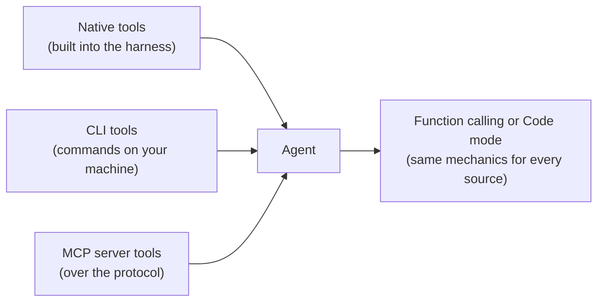
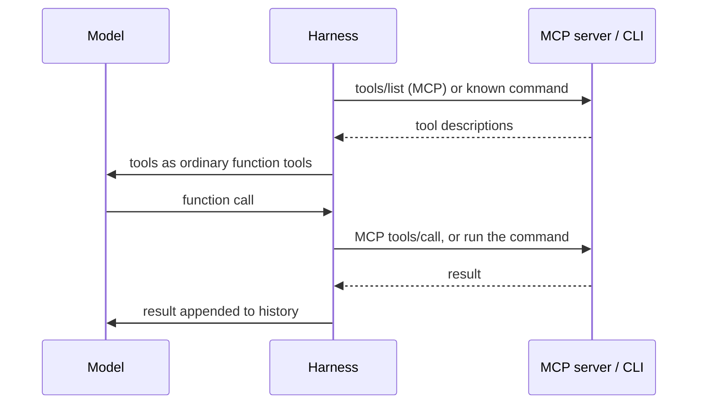

# 11 · CLI and MCP Tools

## In one line
CLI and MCP are two ways to **give an agent more tools**. Whichever you use, the model still gets them through **function calling or code mode**.

Resources and skills, the other things an MCP server can expose, are in [12](12_mcp_resources_and_skills.md). This note is about tools.

## Where tools come from



| Source | Notes (from the lesson) |
|---|---|
| **Native tools** | Exposed by the harness itself |
| **CLI** | Well-known command-line tools. Work best **locally** |
| **MCP** (Model Context Protocol) | Much better for **production**. Widely used and supported by nearly all tools (Claude, ChatGPT, Grok Bot and others) |

Example: **Playwright MCP** lets the agent interact with a browser.

## CLI vs MCP

| | CLI | MCP |
|---|---|---|
| Best for | Local use | Production |
| Who runs the tool | The harness runs the command on your machine | The MCP server runs it (server side) |
| How the model learns usage | Needs to discover it, e.g. by calling `--help` | Server sends a **schema** for each tool |
| Support | Whatever is installed locally | Widely supported across tools |

## The key point: the model can't tell the difference
The model never sees MCP or the CLI. It gets **function tools** and sends **function calls**. The harness does the rest:



From the lesson example (`mcp-tool-bridge`):
- The harness starts the MCP server and sends JSON-RPC requests `initialize` and `tools/list`, then turns each tool into a function tool.
- Each function call becomes a JSON-RPC `tools/call` request to the server.
- The CLI version uses one `run_command` tool, and the harness runs only the allowed command.
- Both versions answer the same question over the same data.

## Takeaways
- MCP and CLI change **what** tools exist, not **how** the model uses them.
- This is why the mechanics in [04](04_lesson_model_mechanics_and_tools.md) (function calling) and [10](10_code_mode.md) (code mode) matter: they stay the same whatever the tool source.
- Many MCP tools means many schemas in the context. This is the same cost problem that code mode addresses.

## Try it
```powershell
npx mex run mcp-tool-bridge
npx mex run mcp-tool-bridge cedar
```
Open "Tool schemas" in each run: both are plain function tools, and the model can't see which one is MCP. It's a paid call on your own key.
