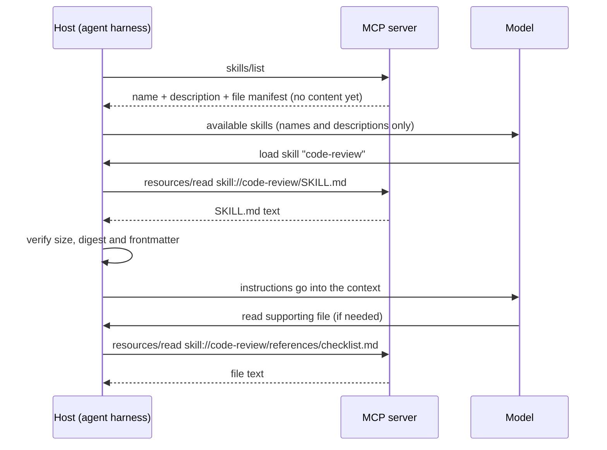
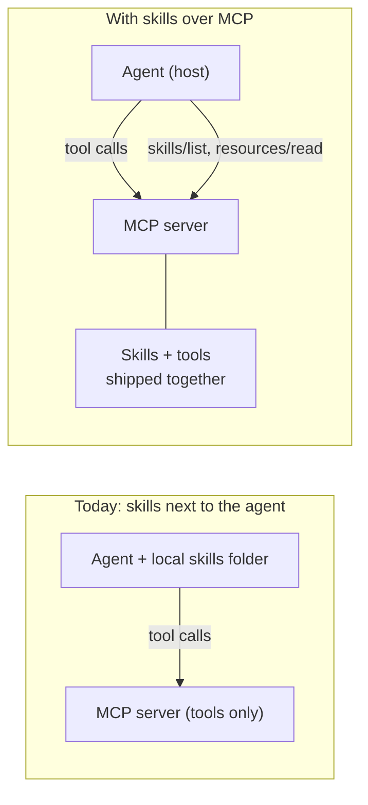

# 12 · MCP: Resources and Skills

Follow-up to [11](11_cli_and_mcp.md). Tools run on the MCP side and are well known. This note is about the two other things an MCP server can expose: **resources** and **skills**.

**Source split:** the lecture only says "MCP can also expose resources and skills". Everything below is from the MCP documentation (links at the end), not from the course.

## The three things in one table

| | **Tool** | **Resource** | **Skill** |
|---|---|---|---|
| What it is | An action the model can call | Data the app can read (files, records, docs), addressed by a URI | Instructions (a `SKILL.md` folder) that steer the model |
| Who decides to use it | The **model** | The **application** (host) | The **model** (by name/description) or the **user** |
| Runs where | Server side, returns a result | Nothing runs: content is just read | Nothing runs on the server: text goes into the model's context |
| Methods | `tools/list`, `tools/call` | `resources/list`, `resources/read` | `skills/list`, `skills/get`, then `resources/read` |

Key idea: **a resource is data, a skill is guidance.** Neither "executes" on the MCP side.

## Resources (core MCP)
- Read-only content with a URI. The host decides when to fetch it and what to put into the context.
- Not every client supports resources, even if it supports MCP. Check support before relying on them.
- Useful when you want to hand the model *information* without making it call a tool (and without paying for a tool schema in every request).

## Skills over MCP
Official extension (`io.modelcontextprotocol/skills`). SEP-2640 is marked Final, but the docs say SDK and host support is still being implemented, so check the client support matrix.

- A skill is the same as a local one: a directory with `SKILL.md` (frontmatter `name` and `description`) plus optional files.
- The server serves it **through the Resources primitive**, with URIs like `skill://code-review/SKILL.md`.
- Where it lives is the difference: next to the **service it describes**, on the MCP server, not in a folder next to your agent.

How it connects to the lecture's skills ([05](05_lesson_harnesses_providers_steering.md)):
- The model picks a skill **by name and description only**. Same here: `skills/list` gives metadata first.
- Content loads **on demand**: `SKILL.md` first, supporting files only when needed. The spec says hosts must not fetch files ahead of need.
- Once loaded, the skill stays in the context like any other skill.

## Your current setup vs skills on the MCP side

Why you might want it (reasoning from the docs):
- The workflow instructions travel **with the service**. Update the server and every agent gets the new instructions.
- Good for reusable workflows that combine several tools, or need reference files (the docs' examples: code review, document processing).
- No need to copy skill folders to every agent or machine.

Trade-offs to keep in mind:
- Needs host support for the extension. Client support is still growing.
- **Skill text is untrusted input.** It steers the model, so a remote server can steer your agent. The spec requires: approval before loading, size and SHA-256 digest checks, the server's identity attached to the content, and explicit per-skill approval for anything that runs code or grants permissions like `allowed-tools`.
- Same-name skills from different servers must not silently replace each other.

## See also
- [Lecture 2, 5 Skills: "Docs by pointer"](../Lecture_2_Context_Agents_md_Skills_Tools/5_skills.md): why a skill should point to docs instead of embedding them, and how skills over MCP fit as one variant. Includes an experiment to measure the token saving.

## Open questions
- Which of the hosts I use support the Skills extension today? (See the client matrix.)
- Which of my current local skills describe how to use one particular MCP server's tools? Those are candidates to move to that server.
- Which data I currently fetch with a tool could be a resource instead?
- How would I approve and review remote skills in my own agent?

## Sources
- [Skills extension overview (modelcontextprotocol.io)](https://modelcontextprotocol.io/extensions/skills/overview.md)
- [SEP-2640: Skills extension](https://modelcontextprotocol.io/seps/2640-skills-extension)
- [ext-skills repository](https://github.com/modelcontextprotocol/ext-skills)
- Resources vs tools vs prompts (secondary): [wati.io](https://www.wati.io/en/blog/mcp-tools-vs-resources-vs-prompts/), [DEV Community](https://dev.to/webbywisp/mcp-server-patterns-tools-vs-resources-vs-prompts-when-to-use-each-5bgp)

> Status of the extension and client support changes quickly. Verify on modelcontextprotocol.io before relying on it. The "your setup" comparison and the open questions are our own reasoning.
