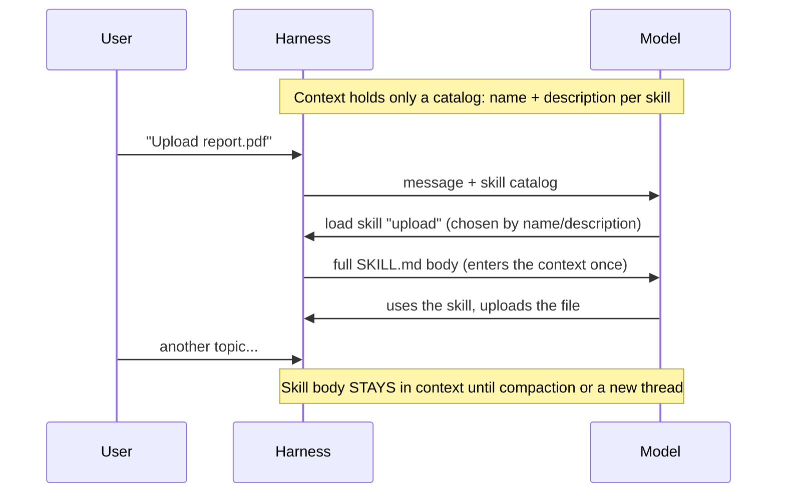
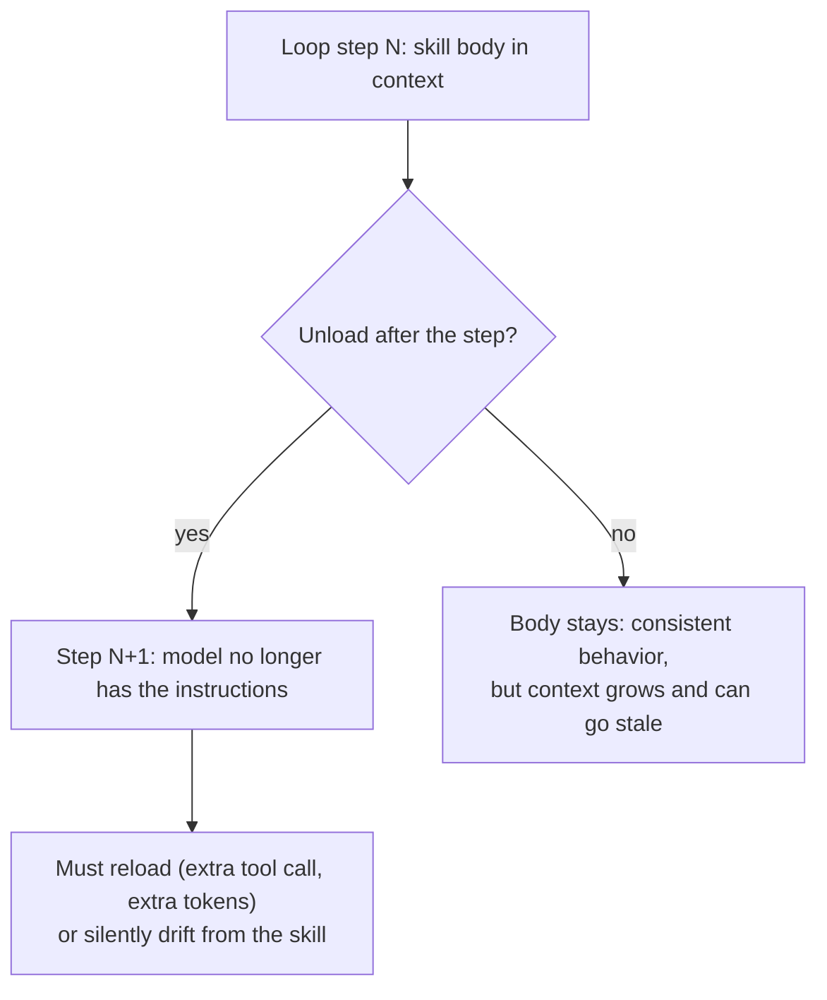

# 13 · Skills: Loading, Context and Unloading

## Idea (from the lesson)
- **Skills** are files (or folders) with instructions, and sometimes scripts, that steer a model toward certain behaviors.
- Once enabled, a skill often **stays in the context** until compaction removes it or you start a new thread.
- The model can trigger a skill **on its own**, but it chooses **only from the skill's name and description**. All skills can't be injected into the context at once.

Related: skills in the harness list in [05](05_lesson_harnesses_providers_steering.md); skills served over MCP in [12](12_mcp_resources_and_skills.md).

## How a skill reaches the model



- Lesson figure: the skill enters the context **once, as one copy**, and a line runs from it to the end of the conversation.
- So there are two parts: a short **catalog** (always there) and the **body** (loaded on demand).

## Selection depends on the description
From the `skill-selection` example (six skills shown as names and descriptions only, 15 test requests):
- Most requests succeed, but sometimes a skill **isn't picked when it should be**, or **is picked when it's not needed**.
- Outcomes it scores: hit, correct none, miss, wrong skill, unneeded skill.
- Weak or overlapping descriptions cause the errors. The README's advice: when a skill loads too often or too rarely, fix the **description**, not add more instructions.
- Results vary by run and model (13, 13 and 14 of 15 correct in the author's three runs).

## Three ways to give skills to a model (from the example)
| Strategy | What's in the context up front | Notes |
|---|---|---|
| All bodies in the instructions | Everything | Grows with every skill |
| Catalog + load on demand | Names and descriptions | What Claude Code, Codex and Pi do |
| One router skill | One line, maps tasks to sub-skills | Stays small as skills grow |

## What "unloading" costs (our reasoning, not from the lecture)
A common pattern is to remove loaded skills at the end of each agent loop iteration, so context stays small. Think about what that does:



Problems with unloading every loop:
- **Lost guidance mid-task.** A multi-step task that depends on the skill's rules loses them after one step.
- **Reload cost.** The model has to ask again, which adds a step, tokens and another chance to pick the wrong skill (see selection errors above).
- **Cache breaks.** The lesson says the harness can't modify the instructions because of caching, so it adds changes as `<system-reminder>` blocks instead. The `prompt-cache-prefix` example shows the provider reuses a request only **up to the first changed token**. Removing a body from earlier in the history changes everything after that point, so those tokens can't come from the cache. (Whether this applies depends on where your skill text sits in the request.)
- **Unstable behavior.** The same task can behave differently depending on whether the skill happened to be loaded.

Problems with never unloading (the lesson's default):
- Context fills up and **stale instructions** linger.
- Once enabled it stays until compaction, and compaction is lossy (see [04](04_lesson_model_mechanics_and_tools.md)).

## Better options to consider (our reasoning)
- **Keep the catalog stable** in the fixed part of the request (names and descriptions), so the cache prefix doesn't change.
- **Append bodies at the end** (as a tool result), not in the early prefix, so adding a skill doesn't invalidate what came before.
- **Unload at task boundaries** (task done, topic changed, or at compaction), not every loop.
- **Unload by relevance**, not by time: drop a skill when its task finishes, keep it while the task continues.
- **Keep bodies short**, and split big skills so only the needed part loads (router idea).
- **Write precise descriptions** and measure selection with a set of test requests, like the example does.
- **Retain a short note** when removing a body ("skill X was used, rules Y apply") if later steps depend on it.

## Review checklist
- [ ] Which skills are in the catalog, and are the descriptions distinct and specific?
- [ ] Where does the skill body enter the request (early prefix or at the end)?
- [ ] When is it removed: every loop, task end, or compaction?
- [ ] Do multi-step tasks need the skill beyond the first step?
- [ ] What is the cache hit rate before and after changing the unload rule? (Providers report cached tokens in `usage`.)
- [ ] Are there test requests that check hits, misses and unneeded loads?

## Try it
```powershell
npx mex run skill-selection
npx mex run skill-selection --repeats 3
npx mex run prompt-cache-prefix
```
Paid calls on your own key. `skill-selection`: edit a weak description and rerun to see the score change. `prompt-cache-prefix`: see how a change at the start loses the cache.

> The sections "What unloading costs" and "Better options" are **our reasoning**, not from the lecture. Verify them against your own measurements (cached tokens, step counts, selection errors) before changing a solution.
