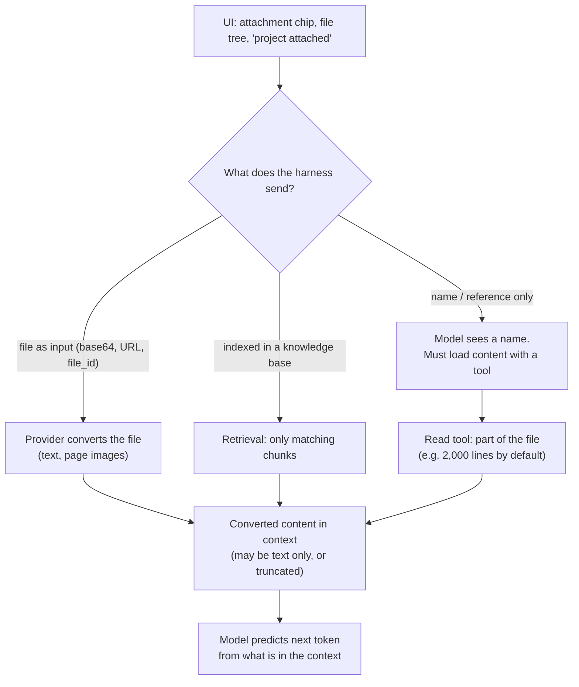

# 14 · Attachments: What the Model Actually Sees

## What the lecture says
> Attachments like images or any other files, or even references to them, are often presented as if they are entirely visible to a model. But they almost never are. Their content has to be loaded by AI, and sometimes it gets loaded only partially. [...] The same applies to the entire codebase or any kind of knowledge base.

Lesson figure: a thread has the message "Review src/auth.ts" and an attachment `project.zip`. The model context gets the message as text and the attachment **only as a name**. File contents enter the context only when the AI loads them, and sometimes only in part.

**Precision on the claim.** The lecture does *not* say "only the header is uploaded". It says: the UI suggests visibility, but the content has to be *loaded*, and the load can be partial. Those are different situations (see below). I checked them against vendor docs.

## Where "visible" can break: layers

| Path | Does the whole file reach the context? |
|---|---|
| Reference/name only (zip, folder, path) | **No**. Only a name. Content loads on demand |
| File sent in the request (base64, URL, `file_id`) | **Mostly yes**, but converted and limited (see next section) |
| Read tool on a file | **Partly**, in windows (Claude Code's Read tool: up to 2,000 lines by default, with offset and limit) |
| Knowledge base / file search | **No**. Only retrieved chunks |
| After compaction | **No**. The lesson's figure: attachments are set aside and not sent |

## Base64: your presumption
Short answer: **yes, with base64 the file travels inside the request, and the provider puts (a converted version of) all of it into the context.** That's the opposite case from a reference. But "whole file" has caveats.

Base64 is only the **transport**. The provider decodes it, then processes the file:

### PDF
- **Claude API:** the system extracts the contents, converts **each page into an image**, and provides the **extracted text alongside each page's image**. Claude analyzes both.
  - Cost: text about **1,500-3,000 tokens per page**, plus the usual image token cost for each page.
  - Limits: **128 MB** request size on the first-party API, **600 pages per request (100 when the request's context window is under 1M tokens)**.
  - Docs warn that dense PDFs (small fonts, complex tables, heavy graphics) **can fill the context window before reaching the page limit**, and large requests can fail.
- **OpenAI API:** on vision-capable models, the API extracts **both text and a page image** and sends both to the model. `detail` (`auto`/`low`/`high`) controls only the page images. Limit: **50 MB** per file and per request. Docs warn token use can rise.

### Non-PDF files (OpenAI Responses API docs)
- `.docx`, `.pptx`, `.txt`, code: **text extraction only**. Embedded images and charts are **not** extracted (convert to PDF to keep visuals).
- Spreadsheets (`.xlsx`, `.csv`, `.tsv`): the API parses **up to the first 1,000 rows per sheet** and adds a generated summary and header metadata. This is a real case of a **partial** load, even when the file is sent whole.
- For large corpora, the docs recommend **File Search** over passing whole files.

### So for base64
| Question | Answer |
|---|---|
| Is the file in the context? | Yes, as converted content (text and/or page images) |
| Is it *byte-for-byte* what you uploaded? | No: converted, sometimes text only, sometimes truncated (spreadsheet rows) |
| Is it free? | No: tokens per page, plus the per-model limits |
| Can it overflow? | Yes: page limits and context size |
| Does the model "read" it perfectly? | No: models process numbers, not information (see [09](09_multimodality.md)), and long contexts reduce reasoning quality (see [04](04_lesson_model_mechanics_and_tools.md)) |

## Tools reading files (harness level)
- Coding agents don't put a repository in the context. They search and **read files with tools**, in pieces.
- Claude Code's Read tool: the tool description in this session says it reads **up to 2,000 lines by default**, with `offset` and `limit` for the rest. Third-party sources agree and mention long-line truncation (not confirmed in official docs).
- Same for "the entire codebase or knowledge base" in the lecture: the model sees what it opened, plus search results.

## Knowledge bases / retrieval
- Typical pipeline: extract text, **split into chunks**, embed, and return the **most relevant chunks** for a query. Documented for OpenAI file search and for Gemini File Search.
- A third-party note: automatic chunking can split tables and forms in ways that hurt quality.
- I did **not** find official docs on how the consumer ChatGPT app handles uploads (full text vs retrieval). Don't assume.

## Verdict on the lecturer's words

| Claim | Check |
|---|---|
| UI may suggest files are visible, but they're not necessarily | **Confirmed** for references, zips, folders, and knowledge bases |
| Content must be loaded by the AI, sometimes partially | **Confirmed**: Read tool windows, retrieval chunks, spreadsheet 1,000-row cap |
| "Almost never entirely visible" | **Mostly true** for references and tools. **Not true** for files sent as base64/URL/`file_id` to a PDF-capable API: there the provider loads all pages (within limits), as text and images |
| "Only a header and a piece" (a common reading) | **Not what the lecture says**, and not accurate for API file inputs |

## How to check it yourself
- Look at the real request with the lesson's **Request inspector**: is the file content in it, or only a name?
- Compare `usage.input_tokens` with and without the file.
- Ask the model to quote something from the **end** of the file, or to count pages or rows.
- Compare answers with the whole file given vs a retrieval setup.

## Sources
- [Claude: PDF support](https://platform.claude.com/docs/en/build-with-claude/pdf-support)
- [OpenAI: File inputs](https://developers.openai.com/api/docs/guides/file-inputs)
- [OpenAI community: file search chunking](https://community.openai.com/t/file-search-vector-store-confusion/729536/2), [Gemini File Search](https://ai.google.dev/gemini-api/docs/file-search)
- Read tool limits: tool description in this session; secondary: [GitHub issue](https://github.com/anthropics/claude-code/issues/20223)

> Limits and token figures change often. Check the live docs before relying on them. Consumer chat apps may behave differently from the APIs. The "How to check" section is our suggestion.
