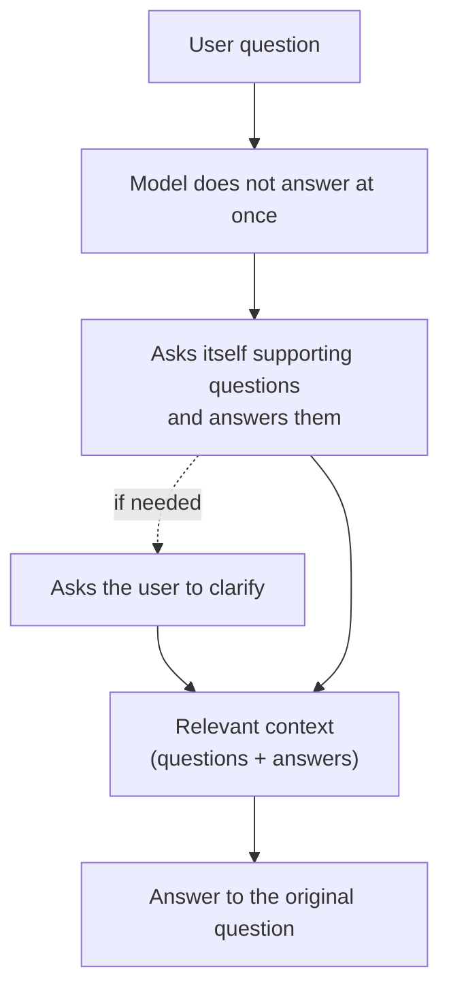

# 15 · Self-Querying

## Idea (from the lesson)
- LLMs hold vast knowledge, but it often stays **out of reach of the current interaction**, the "working memory" (the context).
- We can ask the model a few questions before the actual task, or ask the model to **ask itself questions**, answer them, and only then answer the original question.
- Why it works: the model predicts the next token from what is in its context ([02](02_next_token_prediction.md)). Facts it wrote down are in the context when it writes the answer.



## The course example (`self-querying`)
Question: *"What is the sum of the atomic numbers of the elements with the symbols Fe, Au, W and K?"* Right answer: 26 + 79 + 74 + 19 = **198**.

| Mode | What the model gets |
|---|---|
| **A: direct** | The question alone, "Reply with the answer only: one number." |
| **B step 1** | "Before you answer, recall the facts you need. Write one short question per fact and answer it. Do not answer the main question yet." |
| **B step 2** | The question + the questions and answers from step 1, same answer instruction as A |

The only difference between A and B is the text before the answer.

Step 1 output looks like: *"What is the atomic number of W? 74"*.

### Results the course author reports (OpenAI `gpt-6-luna`, October 2026, reasoning effort `none`)
| Symbols | Direct: right | Self-querying: right |
|---|---|---|
| Fe, Au, W, K | 0 of 120 | 110 of 110 |
| Hg, Sb, Cu, Sn | 0 of 50 | 50 of 50 |
| H, C, N, O (well-known elements) | 36 of 50 | 50 of 50 |

- Direct answers were wrong and different each time (119, 128, 137, 153, 159): the four numbers weren't in the context.
- Asked one at a time, the model knew each fact. With the facts in context, step 2 only had to add.
- Helps most **when the model knows the facts but doesn't have them at hand**.
- At reasoning effort `low`, direct was right every time (about 22 hidden reasoning tokens). **Reasoning is also a form of self-querying**: the hidden tokens recall the facts, like step 1. See [06](06_reasoning_visible_and_silent.md).
- Results vary by run and model. These are the author's numbers, I didn't run them.

## Is this known outside the course?
The lesson doesn't name it, but similar techniques exist in research (found via web search):
- **Self-ask** (Press et al., 2022, *Measuring and Narrowing the Compositionality Gap*): the model generates **follow-up questions** and answers them before the final answer. The paper reports that the "compositionality gap" (answering sub-questions right but the combined question wrong) stays at about 40% regardless of model size, and that prompts like chain of thought and self-ask narrow it. Self-ask can also plug in a **search engine** to answer the follow-ups.
- **Step-back prompting** (Zheng et al., Google DeepMind, 2023): first derive a higher-level principle or concept from the specific question, then reason from it. Gains were largest on multi-step reasoning tasks.

## Using it in an agent (our reasoning, not from the lecture)
- **Add a "supporting questions" step** before the real task: for knowledge-heavy questions, or tasks that combine several facts.
- **Answer the questions with tools when memory isn't enough.** The model's own answers can be wrong, and a wrong fact in the context misleads the final answer (the example colors wrong facts red for this reason). Search, retrieval or an API give grounded answers.
- **Ask the user** when a supporting question can't be answered from knowledge or tools (the lesson's figure includes this step).
- **Cost and latency:** one extra call (or more tokens), as in mode B's two requests. Not worth it for simple questions.
- **Check whether reasoning already does it.** With a reasoning model and a medium effort, the benefit may already be there (see the `low` result above).
- **Measure it.** Compare answers with and without the step over several runs against a known-correct answer, like the example does.

## Try it
```powershell
npx mex run self-querying
npx mex run self-querying H C N O
npx mex run self-querying --runs 10 --effort low
```
Paid calls on your own key (the default is 16 small requests, under 0.1 cent). Read the questions the model wrote in step 1, and compare the scores.

## Sources
- Course example: `examples/self-querying/README.md` (cloned repo) and the lesson text
- [Press et al., Measuring and Narrowing the Compositionality Gap in Language Models](https://arxiv.org/abs/2210.03350)
- [Zheng et al., Take a Step Back: Evoking Reasoning via Abstraction](https://arxiv.org/pdf/2310.06117v2.pdf)

> The "Using it in an agent" section is our own reasoning. Search results are secondary summaries, so check the papers before relying on the figures.
