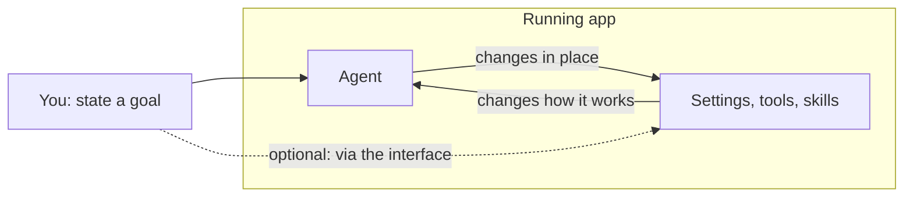

# 16 · Self-Management

## Idea (from the lesson)
- Software is heading toward **self-configuration**, even **self-evolution**.
- Examples: **Pi** and **OpenCode 2**. Their agents can manage **all the settings without reloading the environment**.
- This changes how we work with agents and how we build software: **agents become first-class citizens in software**.
- As users, we should think about how agents can work on our behalf and **manage themselves** with minimal involvement from us.

Lesson figure: you state a goal. The agent and the settings sit inside **one running app**. The agent changes the settings **in place**, the settings change how the agent works, so the agent manages itself. A path through the UI to the settings stays optional.



## What it's called
There's no single official term in the lesson. In the sources you'll see:
- **Hot reload / live reload**: changes apply immediately, without restarting or opening a new session.
- **Self-modifying / self-configuring agent**: the agent edits its own settings, tools or extensions.
- **Agents as first-class citizens** (the lesson's phrase): the software is built so the agent can use and change its own configuration through the same interfaces a user would.

## How the two examples do it (from their own sites)
**Pi** ([pi.dev](https://pi.dev)):
- "If you need a command, tool, provider, workflow, or UI tweak, just ask Pi to build it." Pi "will customize itself on the fly."
- Extensions are TypeScript modules with access to tools, commands, events and the UI. Skills load on demand. Packages can be installed from npm or git.
- Flow: ask Pi to change itself, run `/reload`, keep going. So Pi still has a reload command, but it's cheap and part of the same session.

**OpenCode 2** ([article](https://anoma.ly/notes/opencode-reloaded/)):
- "Any changes will immediately take effect across every session." It can create a tool and use it in the same turn, without quitting, typing `/reload`, or starting a new session.
- Plugins assemble the environment (models, tools, agents, skills). Each plugin registers a **transformation**, and the catalog is rebuilt by running them in order (`ctx.catalog.reload()`). The first design, where plugins edited a shared catalog directly, caused bugs like lost changes.
- The article says avoiding restarts also avoids "busting the cache". This fits the cache point in [13](13_skills_and_context.md).
- Demo: the agent adds a `word_count` tool and a `reading_time` tool through a plugin file, and installs a skill.

## Course example: `self-configuring-agent`
The agent sets up a made-up harness (Tarnwick, 43 settings) from six plain-language wishes. Three modes:

| | No docs | Docs as tools | Docs + validator |
|---|---|---|---|
| Wishes met per run | 0 of 6 | 6 of 6 in 16 of 17 runs | 6 of 6 in 16 of 17 runs |
| Invented keys per run | 7 to 10 | 0 | 0 |
| Tokens per run | ~1,100 | ~7,900 | ~12,200 |

(Course author's numbers, October 2026, default model. I haven't run them.)

What it shows:
- Without docs, the agent **writes settings that look right and don't exist**, with confidence.
- With the harness's **documentation exposed as tools**, it configures the harness correctly.
- The validator changed nothing here, and a validator checks what the schema says, not what the user meant (`10` passes as a number even if the unit is seconds).

So for an agent to manage itself, the harness has to give it **docs and a way to apply changes**.

## About env vars and running code (your note)
Passing environment variables when running code (for example starting `python.exe` with `API_KEY=...` set) is a related but different idea:
- It's about the **tool execution environment**: what a spawned process inherits.
- Self-management, as the lesson uses it, is about the agent changing **its own harness** (settings, tools, skills), and applying that without a restart.
- They meet when the agent changes the environment its tools run in. The lesson doesn't name that pattern.

## Design questions for our own agents (our reasoning, not from the lecture)
- Which settings can the agent change, and which are protected? (Pi's site notes it has no permission popups and expects you to build confirmation with extensions.)
- Can changes apply **live**, or do they need a restart? Live changes keep sessions, but need an apply step that is safe to run mid-turn.
- Where is the **documentation** the agent reads to configure itself? Without it, invented settings.
- Is there a **validator** and a **rollback** for bad config?
- Does a change **break the prompt cache** (instructions changing mid-session)? Prefer adding changes at the end.
- Who approves what? Self-changing code and permission changes deserve explicit approval (compare the sandbox points in [10](10_code_mode.md)).
- Is the change **auditable** (a diff, a log)?

## Try it
```powershell
npx mex run self-configuring-agent
npx mex run self-configuring-agent --mode nodocs --settings
```
Paid calls on your own key (about 33 requests, under half a cent).

## Sources
- Lesson text and figure (self-management)
- [Pi](https://pi.dev), [OpenCode Reloaded](https://anoma.ly/notes/opencode-reloaded/)
- Course example: `examples/self-configuring-agent/README.md`

> The OpenCode article was truncated when fetched, and the phrase "first-class citizen" doesn't appear in the sources I read; the lesson uses it. The "What it's called", env vars and design-questions sections are our own reasoning.
