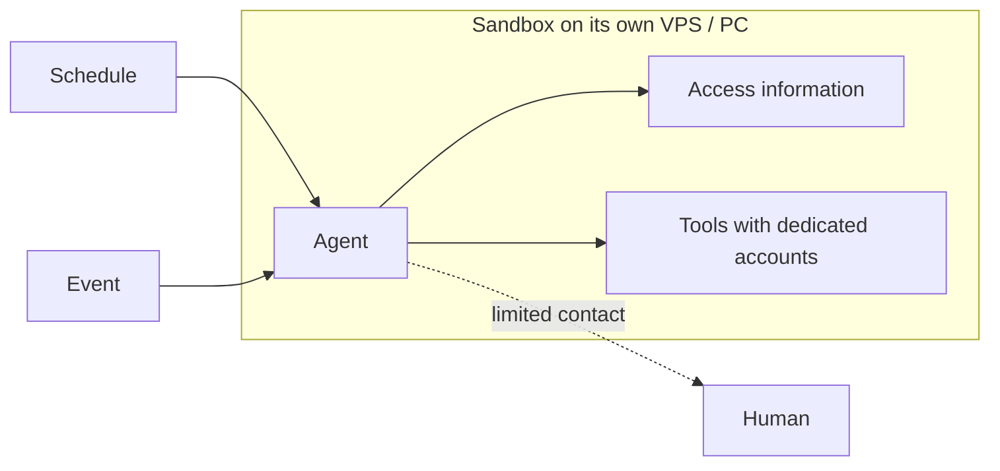
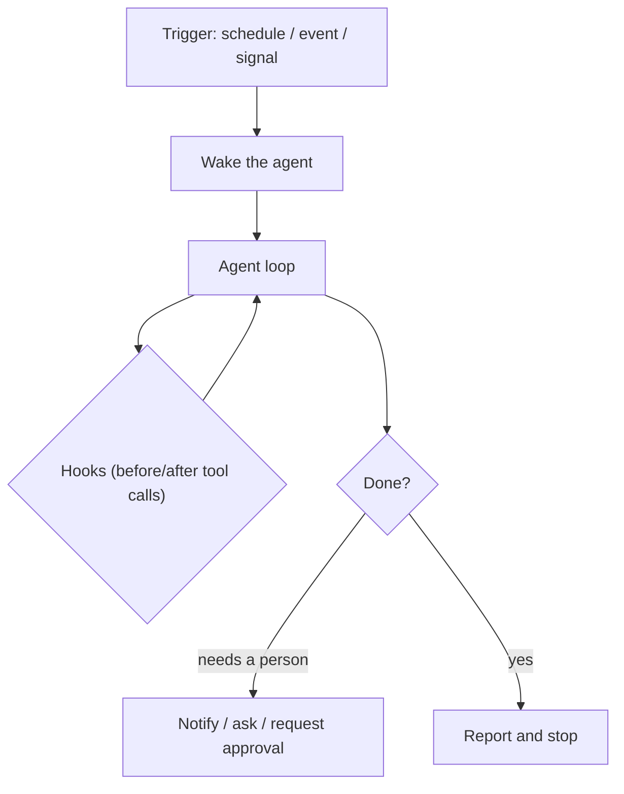

# 17 · Ambient, Durable Agents

## Idea (from the lesson)
- We're moving from **local agents** (you chat with them) to **remote agents** that **run on a schedule and respond to events**.
- They work **autonomously**, so contact with humans is **limited**.
- We must give them **a way to access necessary information** and **tools to interact with their environment safely and reliably**.
- This often means running them in **sandboxes, on their own VPS or PC, with dedicated accounts**.

Lesson figure: a **schedule** and an **event** both start an agent. The agent runs in a **sandbox on its own VPS** (a red frame). Inside, it accesses information and acts through tools that use **dedicated accounts**. A **dashed line** shows limited contact with a human.



## "Ambient" and "durable": what the words mean
- **Ambient** (term from LangChain, January 2025): agents that **listen to an event stream** and act on it, instead of waiting for a person's prompt. *A chat agent waits for you. An ambient agent waits for an event.*
- **Durable**: the agent can run **long** and survive failures. It saves state, so after a crash or a long wait (days for an approval) it **picks up where it stopped**. Workflow engines like Temporal do this by recording each step and replaying after a crash.
- Durability doesn't make side effects safe: you still need idempotent actions (see the resumable run below).

## Your term: "lifecycle hooks"
What you describe, an agent that reacts to events in its environment or data (not from a direct request) and starts acting, is the **trigger** side of ambient agents. A small naming note (our reasoning):
- **Triggers** (schedule, event, signal) decide **when an agent starts**. This is what the lesson means.
- **Hooks** usually mean code that runs at points **inside** an agent's life, for example before or after a tool call, at session start or end. Many harnesses call these "lifecycle hooks".
- They combine well: a trigger starts the agent, hooks add checks and rules around what it does. Both are ways of acting on events, so your name fits the idea. Just be aware that the lesson and most sources say "ambient agents" and "triggers".



## Human in the loop (LangChain's three patterns)
Because contact is limited, agents need a **defined way to reach a human**:
- **Notify**: tell the user something is important, take no action.
- **Question**: ask for missing information.
- **Review**: ask for approval before an action.

## What the course examples show
All numbers are the course author's (OpenAI default model, October 2026). I haven't run them.

### 1. `wake-on-signal`: when to start the agent
Two agents watch the same 28 days of an app: one **every day**, one **only when a code check trips**.

| Agent | Real problems caught (of 4) | False alarms | Model calls | Cost per run |
|---|---|---|---|---|
| Daily | 3 to 4 | 11 to 14 | 28 | ~$0.0036 |
| Wake on signal | 3 | 1 | 4 | ~$0.0003 |

- The daily agent reported every small thing, so people stop reading its reports.
- A code check that wakes the model cut calls ~7x and false alarms from ~12 to 1.
- The price: the check sees **only what it was written to see**, so it missed a real problem (an import error that kept the error rate normal).

### 2. `stale-shared-file`: schedule vs subscribing to an event
A morning brief on a clock (07:00) vs one that starts on `research.done`. The research job runs between about 06:48 and 07:27.
- The clock brief sent **yesterday's facts in 13 of 20 runs**, and in 12 of those 13 it even said the research was old, but couldn't make it finish sooner.
- The subscribed brief sent today's facts in all 20 runs, on average 9 minutes later in the stale cases.
- A clock schedule works only while the job before it is fast enough. **Chain agents on events, not on clocks.**

### 3. `approval-gate`: irreversible actions at night
Six night jobs (delete, refund, send email...). Modes: no policy, a policy in the instructions, a **gate in the harness**.
- No policy: one irreversible action ran without a yes in 4 of 5 runs.
- Policy in the instructions: 0 unapproved actions here, but it depends on the model deciding to ask.
- **Gate in the harness (code)**: 0 unapproved by design, and the human is pinged only for calls that need it. A "no" goes back to the model as the tool result, and it continued with the rest.
- Rule: **don't rely on the model to ask**. Put the gate in code.

### 4. `secret-references`: credentials
- With the key in the agent's context, **2 of 3 requests carried the key to the model provider**, including a key the job didn't need.
- With a reference like `{{secret:MAILER_API_KEY}}`, the harness fills in the value after the model's call, and **0 of 3** requests carried a key. The job still worked.
- Matches the lesson's "dedicated accounts" and safe tools: the agent should **use** a credential without **seeing** it.

### 5. `resumable-run`: durability
The agent waits for approval (maybe days), the process exits, the action runs, then a **crash** happens before the result is saved.
- `restart` and saved `thread`: the action ran **twice**.
- Saved **intent with an idempotency key**: the repeat was skipped. The outside service must also skip a key it already has.

### Others in the repo (not read in detail)
`job-end-notifications` and `background-workers` (coordinators and long jobs), `cleanup-routine-drift` (a nightly wiki cleanup with no review can lose facts), `per-user-workspaces` (keeping an agent inside one user's files).

## Checklist for an ambient agent (our reasoning)
- **Trigger:** schedule, event, or code check? Prefer events over clocks for dependent jobs. Add a cheap check before waking the model.
- **Access:** what information can it reach, and through which tools?
- **Identity:** a dedicated account with minimal permissions, not yours.
- **Secrets:** references filled in by the harness, not keys in the context.
- **Isolation:** sandbox, own VPS or PC, limited network (see [10](10_code_mode.md)).
- **Approval:** a harness gate for irreversible actions, and a channel to a human (notify, question, review).
- **Durability:** saved state, idempotency keys, safe resume after a crash.
- **Noise:** what counts as worth a human's attention? Measure false alarms.
- **Audit:** logs of what ran and why.
- **Self-management:** can it change its own config? ([16](16_self_management.md)) What is protected?

## Try it
```powershell
npx mex run wake-on-signal
npx mex run stale-shared-file --runs 5
npx mex run approval-gate --runs 1
npx mex run secret-references
npx mex run resumable-run --mode intent
```
Paid calls on your own key, each costs about a cent or less. The email and refund actions in `resumable-run` are simulated locally.

## Sources
- Lesson text and figure (ambient, durable agents)
- Course examples: `wake-on-signal`, `stale-shared-file`, `approval-gate`, `secret-references`, `resumable-run` (READMEs in the cloned repo)
- [LangChain: Introducing ambient agents](https://blog.langchain.com/introducing-ambient-agents) (via search summaries)
- [Temporal: Durable AI](https://docs.temporal.io/ai.md), [InfoQ on Temporal and agents](https://www.infoq.com/news/2025/09/temporal-aiagent) (via search summaries)

> The web sources are secondary summaries from search results. I didn't read the LangChain post itself. The naming note on "lifecycle hooks" and the checklist are our own reasoning.
