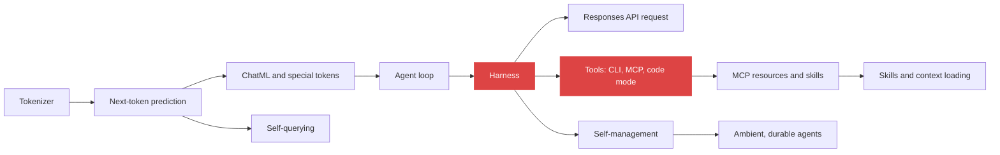

# Lecture 1: Mechanics behind generative AI

> How a model turns text into tokens and predicts the next one, how a harness wraps that loop with tools, MCP and skills, and where agents are heading.

Source: the lecture video, its written lesson pages and my own notes, one topic per file. Related: [Lecture 2: Context, AGENTS.md, skills and tools](../Lecture_2_Context_Agents_md_Skills_Tools/README.md) · [root README](../README.md)

## What this lecture covered

## Notes

### Model basics

| File | Name | What it covers | Keywords |
|---|---|---|---|
| [01_tokenizer_encoder_decoder.md](01_tokenizer_encoder_decoder.md) | Tokenizer: encoder and decoder | Text is split into token chunks, encoded to IDs, and the model's output IDs are decoded back to text | tokens, tokenizer, encode, decode, token ids |
| [02_next_token_prediction.md](02_next_token_prediction.md) | Predicting the next token | The model produces next-token probabilities, one token is selected from them, and the loop repeats until an end token | next token, generation loop, confidence, chatml prompt |
| [06_reasoning_visible_and_silent.md](06_reasoning_visible_and_silent.md) | Reasoning: visible and silent | Why visible thinking helps the model, and what silent reasoning (the J-space) is | reasoning, visible thinking, silent reasoning, j-space |
| [08_chatml.md](08_chatml.md) | ChatML | The text format that turns a chat into one text the model can autocomplete, using special tokens | chatml, special tokens, autocomplete, tokenizer, system user assistant |
| [09_multimodality.md](09_multimodality.md) | Multimodality | Each input type has its own encoder, and models still struggle in certain places | multimodality, encoders, input types, model struggles |
| [14_attachments_and_what_the_model_sees.md](14_attachments_and_what_the_model_sees.md) | Attachments: what the model sees | Attachments are often presented as fully visible to the model, but visibility can break at several layers | attachments, layers, base64, what the model sees |

### Requests, harness and tools

| File | Name | What it covers | Keywords |
|---|---|---|---|
| [03_video_chatml_tools_agent_loop.md](03_video_chatml_tools_agent_loop.md) | The video: ChatML, tools, agent loop | The video walks from ChatML and special tokens to knowledge cutoff, stop sequences and tool calls | chatml, special tokens, knowledge cutoff, stop sequence, tool call |
| [04_lesson_model_mechanics_and_tools.md](04_lesson_model_mechanics_and_tools.md) | Lesson page: model mechanics and tools | Confabulation, reasoning, the Responses API request, context window, compaction and multimodality | confabulation, reasoning, responses api, context window, compaction |
| [05_lesson_harnesses_providers_steering.md](05_lesson_harnesses_providers_steering.md) | Lesson page: harnesses, providers, steering | What a harness is and its parts: agent loop, system prompt, tool execution, context management | harness, agent loop, system prompt, tool definitions, instruction files |
| [07_responses_api_request_example.md](07_responses_api_request_example.md) | Example: Responses API request | A worked request body with three parameters, and the response | responses api, request body, parameters, response |
| [10_code_mode.md](10_code_mode.md) | Code mode | Instead of many tools, the model gets two (find and execute) and calls the API by writing code | code mode, function calling, find, execute, sandbox |
| [11_cli_and_mcp.md](11_cli_and_mcp.md) | CLI and MCP tools | CLI and MCP are two ways to give an agent more tools, and the model cannot tell them apart | cli, mcp, tools, function calling, code mode |
| [12_mcp_resources_and_skills.md](12_mcp_resources_and_skills.md) | MCP: resources and skills | Resources and the Skills extension, which an MCP server can expose besides tools; MCP prompts are not covered here | mcp, resources, skills over mcp, tools |
| [13_skills_and_context.md](13_skills_and_context.md) | Skills: loading, context, unloading | How a skill reaches the model, why the description drives selection, and three ways to give skills | skills, context, description, selection, unloading |

### Agent behaviors

| File | Name | What it covers | Keywords |
|---|---|---|---|
| [15_self_querying.md](15_self_querying.md) | Self-querying | Ask the model questions before the task, or have it ask itself, so facts sit in the context when it answers | self-querying, working memory, context, next token |
| [16_self_management.md](16_self_management.md) | Self-management | Software is heading toward self-configuration, with agents managing their own settings | self-management, self-configuration, self-evolution |
| [17_ambient_durable_agents.md](17_ambient_durable_agents.md) | Ambient, durable agents | A move from local chat agents to remote agents that run on schedules and events, often in sandboxes | ambient, durable, remote agents, lifecycle hooks, sandboxes |

I read this lecture's notes on tools together with the MCP material in [Week 2, Lecture 3](../Week2_Lecture_3_MCP_MCP+Resources_Skills/README.md).
