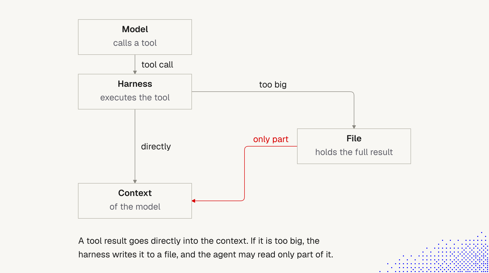

# 10. Tool results: context to file and back

> After a model delivers a payload, the harness executes it and returns a result so the model can decide what to do next. **Whatever comes back from a tool becomes part of the context, so it affects the model's behavior.** The one exception: when the result is **too big**, the harness writes it to a **file**, and the agent may read only part of it.

This stays in the Tools block, but it is really about **managing context length**, and about **moving data between context and files** (memory, knowledge base, and working only with very relevant data). Related: [4 Context window](4_context_window.md), [1 Harness](1_Harness.md), [8 Tools](8_tools_native_and_external.md), [9 Prompt injection](9_tools_prompt_injection.md).

## The flow (diagram)

**The story behind the picture.** The model calls a tool. The harness executes it. Two paths follow:
- **Directly:** the result goes straight into the model's context.
- **Too big:** the harness writes the full result to a **file**, and only **part** of it reaches the context (the red arrow). The file holds everything. The context holds a slice.

**Important:**
- **Small results are not "free".** A result that goes directly into context is paid for in tokens, stays in the thread, and **steers the model**, including any injected text inside it ([9 Prompt injection](9_tools_prompt_injection.md)).
- **The file is the safety valve for context size.** It protects the window, but it moves the problem: the agent now decides what part to read.
- **"Only part" is the red arrow, and the risk.** The agent can answer from a partial view without knowing it. The missing part might be the one that mattered.
- **Context to file and back is a pattern, not just a fallback.** We can use it on purpose to keep bulky data out of the window and bring back only the relevant slice.

**Not important:**
- The exact threshold for "too big". It varies by harness and tool, so check yours.
- Box labels and layout.

## What happens to a result

| Step | What it means | Why it matters |
|---|---|---|
| Result returned | text becomes part of the thread | costs tokens now, and in every later request until compaction |
| It is read as context | the model weighs it with everything else | it can steer behavior, helpful or harmful |
| Compaction | tool results are typically dropped or summarized (lecture 1, note 05: "Tool results are dropped") | details from an old result may be gone, even if the file still exists |
| Large result | saved to a file, preview in context | the agent must go and read the rest |

## Seen in this very session

While preparing these documents, Claude Code did exactly this. A fetch of the memory docs returned a message like *"Output too large (54KB). Full output saved to: ...tool-results\...txt. Preview (first 2KB)"*. The agent then **searched the file** and **read targeted line ranges** instead of loading all 54 KB. Another page (65 KB) behaved the same way. So the pattern is real, and it worked because the agent used search first and reading second.

Typical ways an agent reads "only part":
- **Search first** (grep) to find where the answer is, then read that region.
- **Offset and limit** to read a slice, or continue from a given character position.
- **Head or preview only**, which is fast and risky if the answer is later in the file.

## Risks of reading only part

| Risk | Example | Mitigation |
|---|---|---|
| **Missed information** | the answer is on line 900, the agent read lines 1-200 | search before reading, ask for specific terms, say "check the whole file for X" |
| **Confident partial answer** | the agent summarizes the preview as if it were the whole | require the agent to state **what it read** and what it didn't |
| **Wrong slice** | the preview is the header, not the data | design tools to put the key facts first |
| **Silent truncation** | the harness cut the result and the agent didn't notice (see "silent issues" in [4 Context window](4_context_window.md)) | tool results should say "showing 20 of 340" |
| **Injection through the file** | the saved file contains planted instructions, and reading a slice brings them into context | treat file contents as data ([9](9_tools_prompt_injection.md)) |
| **Sensitive data on disk** | the harness keeps saved results in a local folder | know where they land, and keep restricted data out of tools you haven't approved |

## Use the pattern on purpose: context to file and back

The idea: **keep the context for what is relevant now, and keep everything else in files you can fetch.**

| Where data lives | Role | How it gets back into context |
|---|---|---|
| **Tool result file** (harness-made) | the full output of a big call | search, then read a slice |
| **Working file** (we or the agent write) | notes, intermediate results, plans, a task list | read it when needed, update it as the work moves |
| **Memory** (e.g. `MEMORY.md` plus topic files) | what the agent learned about us and the work | the index loads at start, topic files on demand ([1 Harness](1_Harness.md)) |
| **Knowledge base** | product and process facts, versioned in git | a pointer from AGENTS.md or a skill, read on demand ("docs by pointer", [5 Skills](5_skills.md)) |
| **Subagent report** | a subagent reads the big thing and returns a short answer | the report, not the raw material (Subagents block, to come) |
| **Code mode / script** | a script processes the data outside the context | only the final answer returns ([lecture 1, 10 Code mode](../Lecture_1_Mechanics_Behind_Generative_AI/10_code_mode.md)) |

Guidelines:
1. **Write down before you lose it.** Before compaction or a new thread, save decisions and open items to a file, so the next session reads a short file and not a long history ([4 Context window](4_context_window.md): short-lived sessions).
2. **Fetch narrow.** Ask for the field, the section or the page you need, not the whole document.
3. **Search, then read.** Use search to locate and a bounded read to confirm.
4. **Bring back references, not copies.** Keep a path or ID in context and read it again when needed.
5. **Compress at boundaries.** Summarize a long result into a few lines with a pointer to the file for details.
6. **Verify partial reads.** For answers that depend on completeness (counts, "none found", totals), check that the whole source was covered.

## For tools we build (our own agents)

Design results so they are safe in context and easy to continue from:
- **Limit and paginate.** Default to a small page, return a `next` cursor, and say how much was returned of how much exists.
- **Select fields.** Let the caller ask for the columns it needs, not the whole record.
- **Summarize and link.** Return a short summary plus a handle (file path, ID, URL) for detail.
- **Put key facts first.** If the result is cut, the start should still be useful.
- **State truncation explicitly.** "Truncated: 2 KB of 54 KB. Use `offset` to continue."
- **Filter noise at the source.** Strip logs, boilerplate and repeated data before returning.
- **Mark untrusted text.** Return external content in a clearly labeled field, and don't mix it with instructions ([9](9_tools_prompt_injection.md)).
- **Stable, short IDs** so the agent can refer back without pasting data.

These feed directly into the next topics in this block: hints and errors.

## Experiments to try

1. **Watch the pattern.** Ask the agent to fetch a very large page. See whether it saves to a file, what the preview shows, and how it reads the rest.
2. **Needle test.** Put a unique fake fact deep inside a large test file. Ask for it. Does the agent search, read the right slice, or answer from the preview? Repeat across models.
3. **Count tokens.** Compare reading the whole file with search plus a slice. Record input tokens and correctness.
4. **Completeness test.** Ask "how many times does X appear?" on a large file and see whether the answer is exact or guessed.
5. **Survive compaction.** Do a long task, compact, and check which results the agent can still use, and which it must re-read.

Use synthetic data only.

## Open questions for discussion

- What is the size threshold at which our harness writes results to a file, and can we change it?
- Which of our tools return large results today, and do they paginate or state truncation?
- Where do we keep working notes (files) so a new session can pick up quickly?
- Which facts belong in memory, and which in the knowledge base, so the agent works only with relevant data?
- Do our agents state what they read and what they skipped?

## Sources

- Lecture text: "Response" (tool results and large results) and the diagram "Context to file and back to context"
- Lecture 1 notes: [05 Harnesses](../Lecture_1_Mechanics_Behind_Generative_AI/05_lesson_harnesses_providers_steering.md), [10 Code mode](../Lecture_1_Mechanics_Behind_Generative_AI/10_code_mode.md)
- The "seen in this session" section reflects what Claude Code did while we wrote these documents (large fetch results saved to files with a short preview)
- Risk table, tool-design guidelines, experiments and the placement of this topic are our reasoning, not from the lecture
