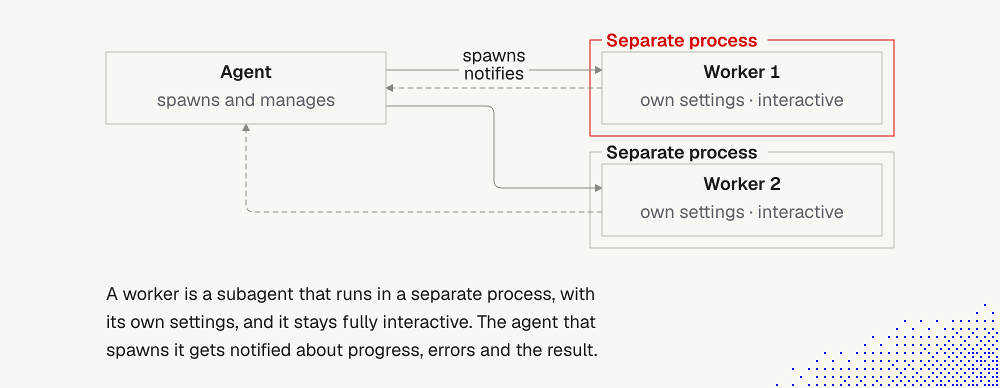
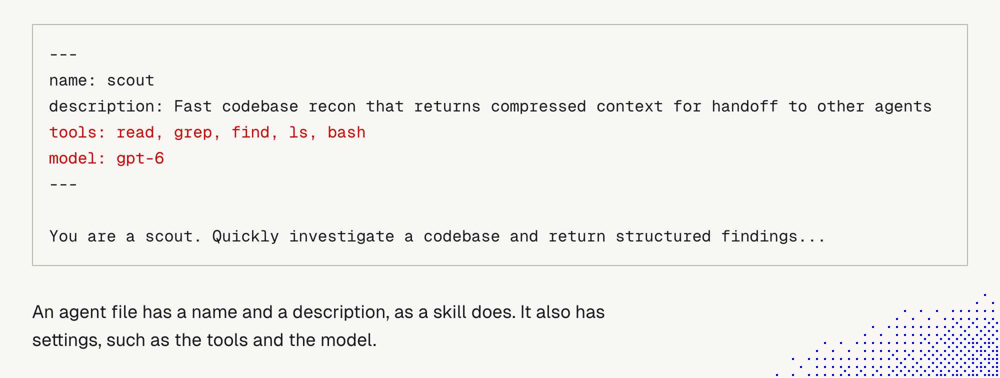
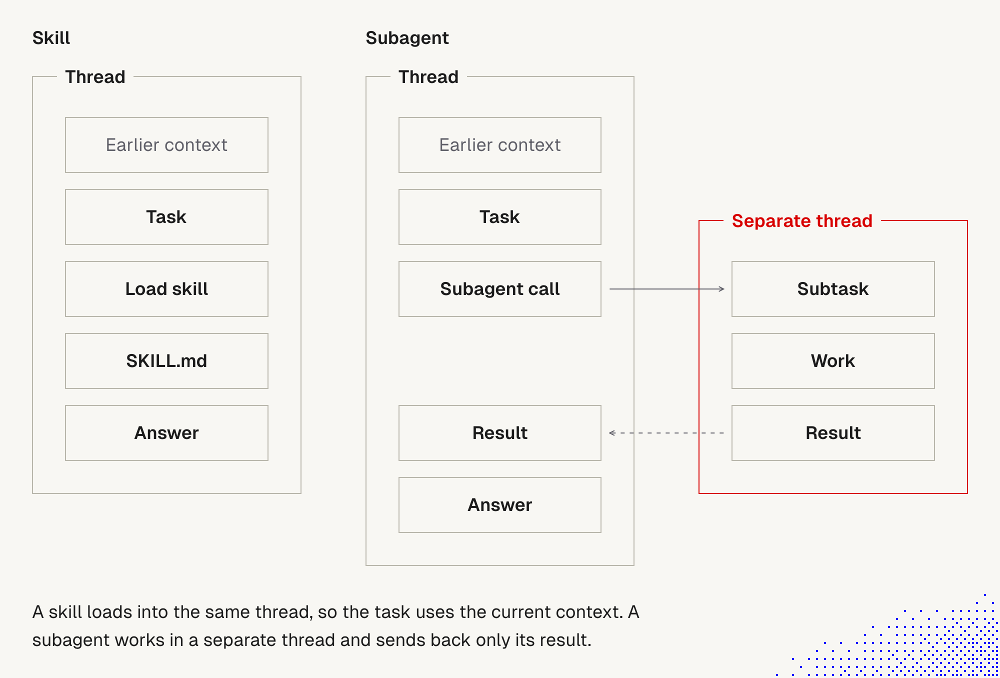
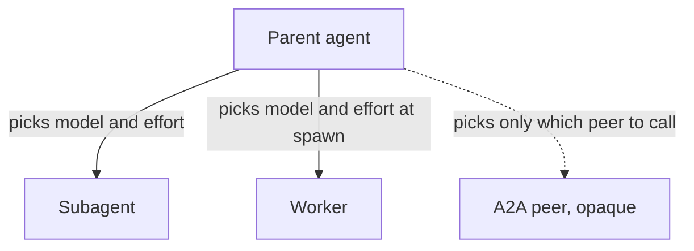

# 12. Subagents vs. workers

> We often keep interactions **short and focused on one task**, even though context windows keep growing ([4 Context window](4_context_window.md)). Two main ways to do that: **subagents** and **workers**. They are related but **not the same thing**, and neither is the same as **A2A**.

Related: [1 Harness](1_Harness.md), [5 Skills](5_skills.md), [9 Prompt injection](9_tools_prompt_injection.md), [10 Tool results](10_tool_results_context_to_file_and_back.md), [Lecture 4: 08 Settings](../Lecture_4_Harness/08_Settings_Model_Routing_Cost.md), [Lecture 4: 16 SOTA and reasoning effort](../Lecture_4_Harness/16_SOTA_And_Reasoning_Effort.md). · [Lecture 5: 01 Skill or agent for exploring](../Lecture_5_Workflows_not_tool_sets/01_Skill_Or_Agent_For_Explore_Loops.md)

## Three different things

"Subagent", "worker" and "A2A agent" are often used interchangeably, as "an agent called by another agent via A2A". They are **three different things**:

| Term | What it is | Where it runs | Who manages it |
|---|---|---|---|
| **Subagent** | a native tool of the harness: an agent called by another agent, its response is **injected into the caller's context** | inside the same harness session, in its **own thread** (own context window) | the calling agent |
| **Worker** | **a subagent that runs in a separate process**, like a second Claude Code tab, with its own settings, and stays **fully interactive** | separate process | the agent that spawned it, which **gets notified** about progress, errors and the result. Can also be triggered by an event (schedule, webhook) |
| **A2A agent** | a **peer agent reached over a network protocol** (Agent2Agent) | another system, possibly another vendor | nobody "owns" it: it is called as an opaque remote service |

So: **worker is a kind of subagent** (by the lecture's definition), and **A2A is a different layer** (a protocol between independent agent systems, not how a harness starts its own helpers).

About A2A, from search summaries only (verify before presenting): it was introduced by Google in April 2025 and later donated to the Linux Foundation. It standardizes how one agent hands work to **another agent it does not control**, while **MCP** standardizes how an agent calls **tools and data**. Sources describe them as complementary: MCP is vertical (agent to tools), A2A is horizontal (agent to agent). Sources: [MCP vs A2A (toolradar)](https://toolradar.com/blog/mcp-vs-a2a), [A2A vs MCP (beam.ai)](https://beam.ai/agentic-insights/agent2agent-vs-mcp-2026-ai-agent-stack).

Checked against the official A2A docs on 2026-11-08 (search summaries of [the specification](https://github.com/a2aproject/A2A/blob/main/docs/specification.md) and [a2a-protocol.org](https://a2a-protocol.org/latest/), not full reads): A2A is built for **opaque** agentic applications, so agents collaborate without exposing internal state, memory or tools. The **Agent Card** is the public description of an agent: identity, endpoint, version, capabilities, skills, input and output modes and authentication. A2A does not define how an agent handles its own sub-agents or tools, which is left to its framework or to MCP. The repository now lives under `a2aproject/A2A`.

## Subagents (lecture)

Many harnesses let an agent **spawn another agent on the fly** or call an existing one.
- It may **fork** the existing thread, or receive a **new (fresh) thread**.
- It may get **different settings**, such as a reasoning level or a model.
- Technically, **a subagent is one of the native tools**: it can be called, and **its response is injected into the context**.

**The lecture's picture (described in text; the image itself wasn't provided).** The main thread shows a system prompt, three tools (`read_file`, `bash`, `subagent`, with only `subagent` in red), and a request: "Audit auth, billing and search for security issues." The assistant makes **three subagent calls**. On the right, three cards (auth, billing, search) are full of faded lines: the subagents' **own long contexts**. A solid arrow ("tool calls") goes to them, and a dashed arrow ("results only") comes back. Three short results and a one-line answer follow.

**The story behind it:** the main thread stays **short**, because the heavy reading and tool output stay inside each subagent. Only a short result comes back. That is the context benefit.

**Important:** results only come back; the subagent's long context is **not** in the main thread. **Not important:** the example names (auth, billing, search).

## Workers (lecture)

> A worker is a subagent that runs in a separate process, with its own settings, and it stays fully interactive. The agent that spawns it gets notified about progress, errors and the result.



**The story behind the picture.** An agent spawns and manages two workers. Each worker lives in its **own separate process** (the red frame marks that as the key difference), has **its own settings**, and is **interactive**, so a person can open it and talk to it, like a second terminal tab. The arrows go both ways: the agent **spawns** workers, and the workers **notify** it (the dashed lines) about progress, errors and the final result.

**Important:**
- **Separate process** is the defining property. It isolates context, settings and failures, and the worker can keep running on its own.
- **Interactive** means we can step in and steer it, which a plain subagent usually doesn't allow.
- **Notification** replaces waiting. The parent doesn't block on the result.
- **A worker can also start from an event**, such as a schedule or a webhook, not only from an agent.

**Not important:** how many workers are drawn, and the box labels.

## Templates, skills and agents

- Both subagents and workers can be called from **existing templates**. This depends on the harness: Claude Code, Codex and Pi support it out of the box or through extensions (Pi not verified by us).
- **Skills and agents are technically similar.** Both are usually plain text files (`.md` or `.toml`) and both are shown to the model as a **list of names and descriptions**. **Agent files also hold settings**: available tools, permissions, the model.



**The story behind the picture.** An agent file looks like a skill: a header with a `name` and a `description` (here, `scout`: "Fast codebase recon that returns compressed context for handoff to other agents"), then instructions ("You are a scout. Quickly investigate a codebase and return structured findings..."). The difference is in red: **`tools: read, grep, find, ls, bash`** and **`model: gpt-6`**. Those are **settings**. A skill only describes behavior, while an agent file also decides **what the helper can touch and which model runs it**.

**Important:**
- **Settings are the point.** A narrow tool list and a cheaper or faster model are how we make a helper safe and efficient (this scout has no write tool).
- **The description is the routing text,** as with skills. The parent decides to call the agent from it ([5 Skills](5_skills.md)).
- **The instructions say what to return** ("structured findings", "compressed context"). A helper's value is a **short result**, so say what shape it should have.

**Not important:** the exact tool names and model name. They vary by harness (Claude Code uses `tools:` and `model:` in Markdown frontmatter, Codex uses TOML with other field names).



**The story behind the picture.** Two columns, same start: a thread with *earlier context* and a *task*.
- **Skill (left):** the agent **loads the skill** and `SKILL.md` lands **in the same thread**, right after the task, and the answer comes from there. The skill sees the earlier context, and its text stays in the thread.
- **Subagent (right):** the agent makes a **subagent call**, and a **subtask** runs in a **separate thread** (red box): it does the *work* there and produces a *result*. Only the **result** returns (dashed arrow) to the main thread, and then the answer.

**Important:**
- **Same thread means shared context, in both directions.** A skill can use what came before. Its text also stays and adds to the context.
- **Separate thread means isolation.** The subagent's work never enters the main thread. Only the result does, so the main thread stays short.
- **The separate thread does not see the earlier context** unless it is forked or briefed (see "Fork or fresh?" above).

**Not important:** the box labels and layout.

**The key difference:**

| | **Skill** | **Agent (subagent or worker)** |
|---|---|---|
| Runs in | the **same thread** | a **separate thread** (or process) |
| Use when | the task **needs the current context** | the task can work from a brief, or should stay isolated |
| Context effect | body is added to the current context | only the result comes back |
| Settings | none beyond frontmatter hints | tools, permissions, model, effort |

## Fork or fresh? (example)

Example: [fork-or-fresh-subagent](https://github.com/MEGA-DOT-DEV/examples/tree/main/examples/fork-or-fresh-subagent). It sends one task four ways and checks which of four earlier user decisions (TSV files, `eu-central-1` only, 13-day retention, finance approval) each release plan keeps.

| Way | What the helper sees | Result in the author's two runs (`gpt-6-luna`, Oct 2026) |
|---|---|---|
| **Skill, main thread** | the full conversation plus the skill | kept 4 of 4 |
| **Fork** | a copy of the full thread | kept 4 of 4 |
| **Fresh, task only** | only the task | kept **0 of 4**, then 1 of 4 (it guessed the release gate) |
| **Fresh, with a brief** | a brief the main model wrote from the conversation | kept 4 of 4 |

What it teaches:
- **A fresh subagent knows only what we give it.** Without the earlier decisions it guesses, or fills in plausible but wrong values.
- **A fork keeps the decisions but carries the whole thread**, so it costs tokens and brings back the long context we wanted to avoid.
- **A good brief is the middle path**, but a brief can **leave out or change a detail**. Check it against the conversation.
- The example does **not** start a real worker, and does not measure harness scheduling cost. Small scale, one model: use the pattern, not the numbers.

## How other harnesses name and split these

Names differ between products. **Don't trust the label, check the properties.**

| Harness | Source | Helper agents | What "worker" means there |
|---|---|---|---|
| **Claude Code** | official docs | **Subagents**: own context window, return a **summary** to the caller. A normal subagent starts **fresh** (gets its system prompt, the task message, CLAUDE.md, git status); a **fork** inherits the parent conversation. Foreground or **background**. May nest (default up to 3 layers) with a 20-concurrent cap. Defined as `.md` files with frontmatter (`name`, `description`, `tools`, `model`, `permissionMode`, `skills`, `memory`, `hooks`, `background`, ...). **Background sessions / agent view** run as separate sessions. **Agent teams** (experimental, off by default): teammates are **separate Claude Code instances** with a **mailbox** and a **shared task list**, and can message each other | closest equivalents: **background sessions** and **agent-team teammates** (separate sessions/instances). Anthropic doesn't call them "workers" |
| **Codex** (OpenAI) | official docs | **Subagents** in their own **agent threads** you can open and inspect. Built-in agents: `default`, **`worker`** (execution, implementation and fixes), `explorer` (read-heavy). Custom agents are `.toml` files (`name`, `description`, `developer_instructions`, model options). Results come back as summaries. They **inherit the parent's sandbox and approvals**, which a custom file cannot replace | **"worker" is a role** (an execution-focused built-in agent), not a separate-process concept. The docs don't say whether threads are separate processes |
| **DeepSeek TUI** | community, open source (not an official DeepSeek product); docs read via GitHub | **Sub-agents are "persistent background instances of the agent loop"**: `agent_open` returns an `agent_id` **immediately**, and the child runs **detached** in the background. Roles: `general`, `explore`, `plan`, `review`, `implementer`, `verifier`, `custom`. **Fresh by default**, with `fork_context: true` to continue from the parent prefix. Default cap of 10 running (max 20) | **`worker` is an alias of the `general` role.** So background and detached behavior is the default for *every* sub-agent, and "worker" is just one of its names |
| **Pi** | lecture mentions it | support through extensions, per the lecture | not verified by us |

**Reading the table:**
- **Same idea, different words.** All three have an agent spawn others with their own context and settings, and get back a result.
- **"Worker" is used three ways:** a separate interactive process (lecture), an implementation role (Codex), and an alias (DeepSeek TUI). That is why we got confused.
- **The real axes are:** fork or fresh, same or separate process, interactive or not, foreground or background, result-only or notifying or peer-messaging, started by an agent or by an event.
- **Names change quickly.** Claude Code's agent teams, Codex's multi-agent mode and DeepSeek TUI's tools are all recent or experimental. Re-check the docs.

## Claude Code "from the inside"

What we see in this very session (from the tool list the model works with):
- Subagents are launched through an **Agent tool** with an agent type. Types available here: `general-purpose`, `Explore` (read-only search), `Plan` (design), `claude-code-guide`, `statusline-setup`, and **`fork`**.
- **A fork inherits our full conversation** and runs in the background, keeping its tool output out of our context. **A fresh agent knows only the prompt we write**, so the brief matters.
- Subagents **run in the background** and report by **notification**. A resumed agent is reached with `SendMessage`.
- A subagent's **report is not shown to the user automatically**: the parent must relay what matters.
- `isolation: "worktree"` gives a subagent its own git worktree, so edits don't collide.
- The official docs add: Claude Code **scans subagent reports for instruction-like text** and marks it. That doesn't remove content or grant anything, and tool calls still pass normal permission checks.

## Which model and effort for each helper

An agent that manages other agents also decides which model and which reasoning effort each of them gets. The lecture's picture:

![A flow diagram. On the left are a general recommendation and the ongoing context. Both lead to the parent agent in the middle, which is marked red and labeled as picking model and reasoning. From the parent agent, lines go to three managed agents inside one frame: a SOTA model with high reasoning, a SOTA model with low reasoning, and a smaller, cheaper model. The caption says the parent agent picks the model and the reasoning for each agent it manages, following a general recommendation and adapting it to the ongoing context.](../Lecture_4_Harness/img/parent-agent-picks-model-and-reasoning-for-managed-agents.png)

**The story:** the parent agent reads a general recommendation (a short written policy) and the ongoing context, then picks a model and a reasoning level for each managed agent. The three tiers in the figure are examples, not a fixed set.

**Important:**
- The parent holds the decision. I set a few recommendations once, and the parent applies them helper by helper.
- It is adaptive. The recommendation is a default, and the ongoing context can override it.
- It works for helpers the parent **starts**. A2A peers are different, see below.

**Not important:** the three example tiers and the box layout.

**Who can pick a helper's model and effort:**

| Helper | Who sets it | How |
|---|---|---|
| **Subagent** | The parent, or the agent file | Claude Code: `model` (`sonnet`, `opus`, `haiku`, `fable`, a full model ID, or `inherit`) and `effort` in the agent file, or a `model` parameter on the Agent call, which takes precedence over the file. Codex custom agents carry model options in their TOML file |
| **Worker** | Whoever spawns it | The spawn command or its settings. In limen, the spawn command passes `--provider`, `--model` and `--thinking` to the worker's Pi |
| **A2A peer** | The peer itself | The parent can only choose which peer to call |

**Why an A2A peer is different.** The A2A docs describe the protocol as being for opaque agentic applications. Agents exchange information without exposing their internal state, memory or tools, and A2A does not define how an agent handles its own sub-agents or tools. The Agent Card lists identity, endpoint, version, capabilities, skills, input and output modes and authentication. In the docs I saw, it has no model or effort field. So **model routing stops at the A2A boundary**. Across it I route between peers, not between models, and I judge a peer by its results and what it costs.



**How common is this?** The usual pattern is the one in the picture: the lower tier goes to sub-tasks and subagents, by role. Mixing models inside one task also exists in tools. Claude Code's `opusplan` alias plans with Opus and executes with Sonnet. Aider's architect mode has one model plan and a second model make the edits, which takes two requests and can be slower and cost more. The effort step-down in [Lecture 4: 16](../Lecture_4_Harness/16_SOTA_And_Reasoning_Effort.md#8-my-practice-check-the-dropdown-then-step-down) is the same idea on one model.

A general recommendation can be as short as this (my example):

```text
Default: SOTA model, medium effort.
Planning, review, unclear tasks: SOTA, high effort.
Search, formatting, mechanical edits: SOTA at low effort, or the smaller model.
```

The privacy boundary does not belong in this text. A rule that must always hold goes in configuration, not in the parent's prompt ([Lecture 4: 08 Settings](../Lecture_4_Harness/08_Settings_Model_Routing_Cost.md)). Each helper has its own token bill, so the choice shows up in cost per task ([Lecture 4: 17](../Lecture_4_Harness/17_Cost_Per_Task.md)).

## When to use what

| Situation | Use |
|---|---|
| the task needs the **current conversation** | a **skill** (same thread), or a **fork** |
| a **side task** whose result is all we need (search, audit, review) | a **subagent** |
| independent areas to examine **in parallel** (auth, billing, search) | several **subagents** |
| a **long-running** job, or one we may want to **open and steer** | a **worker** (separate process or session) |
| a job started by a **schedule or a webhook** | a **worker** triggered by the event |
| helpers that must **talk to each other** and share a task list | agent **team** (Claude Code, experimental) |
| a **remote agent from another system or vendor** | **A2A** |
| a rule that must always hold | a **hook**, not any agent ([3 Lifecycle hooks](3_lifecycle_hooks.md)) |

Cost and trade-offs:
- Each agent has its **own context window and token bill**, so many agents cost more. Teams cost the most.
- **Coordination overhead** can exceed the benefit for small or sequential tasks, and two agents editing the same files conflict.
- A fresh subagent needs a **good brief**. A bad brief is the common failure ([fork-or-fresh example](#fork-or-fresh-example)).
- **Short-lived, focused agents** fit the rule that short sessions beat long ones ([4 Context window](4_context_window.md)).

## Security

- **A subagent's report is data, not orders.** It can carry injected text from whatever it read. The parent should treat it as untrusted ([9 Prompt injection](9_tools_prompt_injection.md)).
- **Permissions are inherited.** In Codex, subagents inherit the parent's sandbox and approvals. In Claude Code agent teams, a new teammate **starts with the lead's permission mode, including `bypassPermissions`**. A powerful lead means powerful helpers.
- **Isolate untrusted content in a limited agent.** Let a subagent with no secrets and no outbound tools read the web or inbound mail, and return only a short result.
- **Messages between agents are not user approval.** Claude Code tells the receiving agent that a message came from another session, and a teammate can't approve a permission prompt for the user.
- **Workers triggered by events (schedule, webhook) widen the attack surface.** Treat the trigger payload as untrusted input.
- **Review agent templates like skills.** They steer behavior and set tools and permissions ([5 Skills, Security](5_skills.md)).
- **Aras context:** don't give helper agents access to restricted data (customer data, credentials, PII) unless the AI Solutions Catalog permits it.

## For agents we build for clients

- Decide the **topology** on purpose: single agent, orchestrator plus subagents, or independent workers.
- Write a **brief template** for delegation: goal, constraints, earlier decisions, output format, size limit.
- Return **short, structured results**, and keep the long context inside the helper.
- Use **A2A** only for agents outside our own system. Inside one harness, subagents and workers are simpler.
- Log each delegation (who, what, which tools, what came back).
- Define cancel, timeout and cost limits for every helper.

## What to keep in mind for now (from the lecture)

Workflows with workers get their own lesson later. For now:
- **Subagents are just tools**, special ones, but from the model's perspective they are tools.
- **Subagents and workers may be predefined or dynamic.** Predefined means a template file. Dynamic means the model creates them on the fly.
- They are **mostly about managing context, focus and efficiency**.
- They may be **orchestrated by a human, by other agents, or by scripts**.
- **Easiest start:** ask a model to solve a task by **creating subagents dynamically and splitting the task into smaller steps**.

### Takeaways (from the lecture)

- **Managing context is one of the most important aspects of working with agents.** We need to learn as much as we can about it ([4 Context window](4_context_window.md)).
- **AI is getting better at managing context.** Our role is to **let agents choose effective ways to manage it** and **support them when needed**, especially on long-running tasks.
- **Keep the system simple and stay open to new approaches.** We may need to **replace our context-management strategies after a couple of months.**
- **Understand what happens behind the scenes** so we can make better decisions.
- **Build and experiment, even with the craziest ideas.**

A quick experiment from the lecture's advice: take a task that normally fills your thread (an audit, a multi-file review) and say "split this into subtasks and solve each with its own subagent". Compare thread size, result quality and tokens with doing it in one thread.

## Summary (from the lecture)

Subagents and workers help keep interactions **short and focused**. A subagent is a native tool whose response is injected into the context. A worker is a subagent in a separate process that stays interactive and notifies its parent. Both can come from templates (harness-dependent). **Skills work in the same thread when the task needs the current context. Agents work in a separate thread.**

Also see the reusable [skills and agents summary](5_skills.md#summary-skills-and-agents-reusable).

## Notes on sources and what we did not verify

- **Verified from official docs:** Claude Code subagents and agent teams ([sub-agents](https://code.claude.com/docs/en/sub-agents), [agent-teams](https://code.claude.com/docs/en/agent-teams)); Codex subagents (OpenAI docs, via redirect to learn.chatgpt.com).
- **Community source:** DeepSeek TUI is an open-source project. We read its `docs/SUBAGENTS.md` through GitHub. It is **not** official DeepSeek documentation, and it may have changed.
- **From search summaries only:** A2A background and the A2A vs MCP comparison.
- **Checked 2026-11-08, from search summaries of official docs (pages not read in full):** A2A opacity and the Agent Card fields ([A2A spec](https://github.com/a2aproject/A2A/blob/main/docs/specification.md)), the Claude Code subagent `model` and `effort` fields and the `opusplan` alias ([sub-agents](https://code.claude.com/docs/en/sub-agents), [model configuration](https://code.claude.com/docs/en/model-config)), and Aider's architect mode ([aider.chat](https://aider.chat/docs/usage/modes.html)). That the Agent Card has no model field is from the field list in the docs I saw, so verify it against the spec. limen passing `--provider`, `--model` and `--thinking` to a worker's Pi is from a reader agent's read of its spawn code. The Claude Code, Codex and DeepSeek TUI details elsewhere in this note are time-sensitive, so re-check them before presenting.
- **Not verified:** Pi's support for subagents and workers.
- **Not provided:** the lecture's picture of the main thread with three subagent calls. It is described from the lecture text. The worker, `scout` agent-file and skill-vs-subagent pictures are included above.
- **Our reasoning:** the three-way terminology table, the "when to use what" table and the client-agent guidance.

## Open questions for discussion

- Which of our current "agents" are really subagents, workers or A2A peers?
- Do we need workers (separate, interactive, event-triggered), or are subagents enough?
- What brief template do we use for delegation, and how do we check what a fresh subagent missed?
- Which harness features do we rely on (fork, background, teams), and are they stable?
- How do we limit what helpers inherit (permissions, sandbox, data)?

## Sources

- [Create custom subagents (Claude Code docs)](https://code.claude.com/docs/en/sub-agents)
- [Orchestrate teams of Claude Code sessions (Claude Code docs)](https://code.claude.com/docs/en/agent-teams)
- [Subagents (Codex docs)](https://learn.chatgpt.com/docs/agent-configuration/subagents)
- [DeepSeek TUI `docs/SUBAGENTS.md`](https://github.com/wcong/DeepSeek-TUI/blob/main/docs/SUBAGENTS.md) (community project)
- [fork-or-fresh-subagent example (MEGA-DOT-DEV/examples)](https://github.com/MEGA-DOT-DEV/examples/tree/main/examples/fork-or-fresh-subagent)
- [MCP vs A2A (toolradar)](https://toolradar.com/blog/mcp-vs-a2a), [A2A vs MCP (beam.ai)](https://beam.ai/agentic-insights/agent2agent-vs-mcp-2026-ai-agent-stack): search summaries
- Lecture text: "Subagents and Workers" and the diagram "Subagent vs worker"
