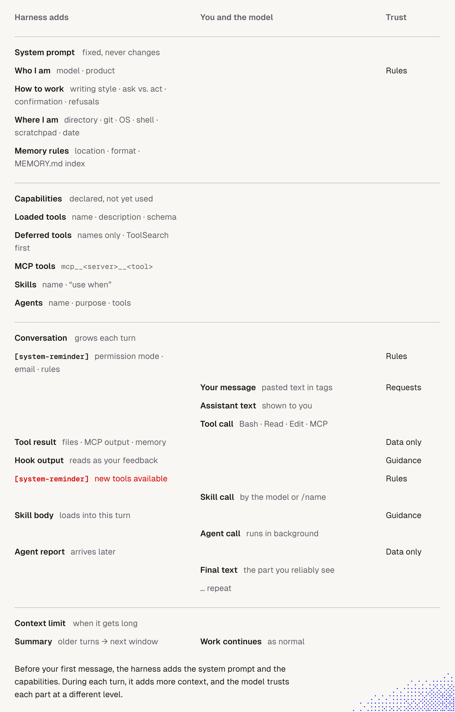

# 1. Harness

> Harness = everything around the model: system prompt, env details, instruction files, memory, tools, skills, agents, hooks, and reminders injected mid-conversation.
> The model knows nothing about our project at session start. The harness decides what it sees.

## Key ideas from the lecture

- **Files are the primitive.** Instructions, memory, skills, hooks and settings are text files. The agent can edit them, so it can **configure its own harness**.
- **Nothing is secret.** Ask the agent to explain what it sees and how it sees our conversation. Use that to tune the workflow.
- **Guidance, not guarantees.** AGENTS.md and memory are context the model *tries* to follow. For hard enforcement use hooks or permissions.
- **Keep it simple.** The goal is the smallest setup that works, not the most features.
- **Not every harness is self-configurable.** Prefer one that is (Claude Code, Pi, OpenCode).

## What the agent sees (Claude Code, simplified)

Four sections, top to bottom. The harness adds the first two **before your first message**.

| Section | Harness adds | You and the model | Trust |
|---|---|---|---|
| **System prompt** (fixed) | who I am, how to work, where I am (dir, git, OS, date), memory rules + MEMORY.md index | | Rules |
| **Capabilities** (declared, not used) | loaded tools (schema), deferred tools (names only, `ToolSearch` first), MCP tools, skills (name + "use when"), agents (name, purpose, tools) | | |
| **Conversation** (grows each turn) | `system-reminder` (permission mode, email, rules) | your message, assistant text, tool calls | Rules / Requests |
| | tool result (files, MCP output, memory) | | **Data only** |
| | hook output (reads as your feedback) | | Guidance |
| | `system-reminder` mid-turn (e.g. new tools) | skill call | Rules |
| | skill body (loads into this turn) | agent call (background) | Guidance |
| | agent report (arrives later) | final text, repeat | **Data only** |
| **Context limit** | summary of older turns goes into next window | work continues | |

Takeaways:
- **Trust levels differ.** Rules (system prompt, reminders) > Requests (our messages) > Guidance (hooks, skill bodies) > **Data only** (tool results, agent reports). Instructions found inside files, web pages or MCP output are data, not commands. This is the basis of prompt-injection defense.
- **Skills, agents and MCP tools cost tokens up front.** Only name and description sit in context until used. Short, precise descriptions matter (see Skills doc).
- **Deferred tools** show names only. The agent must load a schema before calling one, which saves context.
- **MEMORY.md index is in the system prompt**, so its size is paid every session.
- **Hook output arrives as feedback**, so keep it short and factual.
- The agent can show you this view for your own setup. Ask it.

## Components: lecture vs. what we verified

| Component | Lecture | Verified in docs (Claude Code) | We use it? |
|---|---|---|---|
| **Core file** | AGENTS.md loaded at start; points to deeper docs | Reads `CLAUDE.md`. Reads `AGENTS.md` natively (v2.1.277+) **only if no `CLAUDE.md` exists**, unless the "Project instructions" setting is changed. Alternative: `@AGENTS.md` import in `CLAUDE.md`. Target < 200 lines | Yes |
| **Rules** | (not covered) | `.claude/rules/*.md`; with `paths:` frontmatter they load only when matching files are touched | Yes |
| **Memory** | Many forms; extracted automatically or on request | **Auto memory**: Claude writes `MEMORY.md` index + topic files in `~/.claude/projects/<project>/memory/`. First 200 lines or 25 KB load each session. On by default; `/memory` toggles it. Types: user, feedback, project, reference. Skips what's derivable from code | **Not deliberately** |
| **Configuration** | Agent can read its docs and change settings | `settings.json` at user, project, local, managed scopes. Ask the agent to change them | Partly |
| **Knowledge base** | Docs folder, optionally published (Astro/Next) | Not harness-specific. Reference from AGENTS.md by path | Partly |
| **Skills** | `SKILL.md` folders, can reference other skills | Loaded on demand; name and description always visible | Yes |
| **CLI / MCP** | Later lecture | Extend agent to external systems | Yes (MCP) |
| **Hooks** | Attach logic to nearly every step; AI can write them | Events: `SessionStart`, `UserPromptSubmit`, `PreToolUse`, `PostToolUse`, `Stop`, `PreCompact` and more. Handlers: command, http, mcp_tool, prompt, agent. Config in `settings.json` | **No** |

## CLAUDE.md vs. auto memory

| | CLAUDE.md / AGENTS.md | Auto memory (MEMORY.md) |
|---|---|---|
| Written by | us | the agent |
| Holds | instructions, rules, conventions | learnings, corrections, preferences |
| Shared via git | yes | no (local, per repo, shared across worktrees) |
| Loaded | every session, in full | every session, first 200 lines / 25 KB |
| Best for | team rules | personal habits, ongoing work, pointers to external systems |

Both count toward context and neither is enforced.

## Recommendations for us

1. **Check memory first.** Auto memory is on by default, so we may already have it. Run `/memory` to see and toggle it. Read what the agent has saved before relying on it.
2. **Use memory for personal and ephemeral facts, CLAUDE.md for team rules.** Memory is local and not in git. Anything the team needs belongs in AGENTS.md / CLAUDE.md. See [Insight 1](Insight_1_Context_Agents.md).
3. **Pick one source of truth for instructions.** If we keep AGENTS.md for other tools, use `CLAUDE.md` containing `@AGENTS.md` plus Claude-only notes. If both files exist separately, Claude reads only `CLAUDE.md` by default.
4. **Prune memory like any context.** It loads every session, so review it periodically and delete stale entries.
5. **Add hooks only for rules that must never be broken.** Examples: block `rm -rf`, run the formatter after edits. Cautions:
   - Exit code 2 blocks. Exit 1 does not.
   - A broken hook can silently allow actions.
   - Project hooks run with our privileges, so review them in untrusted repos.
6. **Ask the agent about its own setup.** For example: "What do you see at session start?" and "Review my recent conversations and suggest improvements to my config." Treat the suggestions as proposals and keep the setup minimal.

## Open questions for discussion

- Do we want to review recent conversation history on a schedule to suggest workflow improvements?
- Is auto memory appropriate in repos with restricted data? (It stores notes in plain files under `~/.claude`. Aras policy: no restricted data in tools unless the AI Solutions Catalog permits it.)

## Sources

- [How Claude remembers your project (official)](https://code.claude.com/docs/en/memory)
- [Hooks reference (official)](https://code.claude.com/docs/en/hooks)
- [Claude Code Memory: Complete Guide](https://vectorize.io/articles/claude-code-memory)
- Lecture notes: "Harness Personalization"
