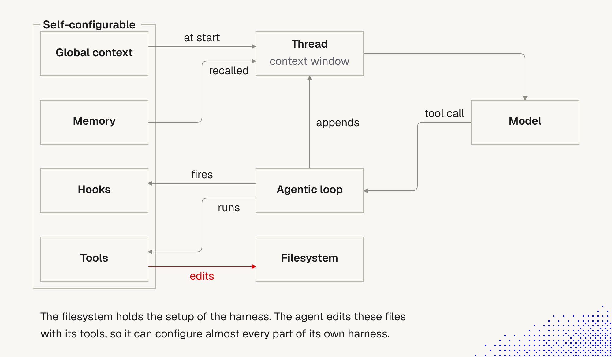
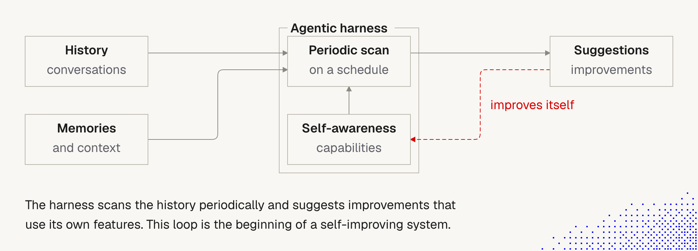

# 3. Lifecycle hooks

> Hooks attach **our own logic** to nearly every step of the agent's loop. Instructions in AGENTS.md are *requests* the model may ignore. A hook is **deterministic**: it always runs.
> AI can write hooks for us, but we still need to know what is possible and when the default setup is enough.

## Where hooks sit in the harness



**The story behind the picture.** The model never acts on its own. It only asks for a tool call. The agentic loop is the one that acts: it fires hooks, runs the tool, and appends the result to the thread, which the model reads on the next round. Global context is loaded at the start and memory is recalled later, both into the same thread. Hooks, tools, memory and global context are files, and tools can edit files (the red *edits* arrow). So the agent can reconfigure its own harness.

**Important:**
- **Hooks are fired by the loop, not by the model.** They run whether or not the model "remembers" a rule, so hooks can enforce what AGENTS.md can only request.
- **The red *edits* arrow is double-edged.** It is why the harness is self-configurable, and also why an agent that can edit its own hooks can edit away its own guardrails. Review those diffs.

**Not important:**
- The exact arrow labels and layout.
- The missing arrow from Hooks back to the Thread. In Claude Code a hook can still add context (`additionalContext`) or block an action (exit 2), so the real flow is richer than the one-way *fires*.

Not every harness can do this. Prefer one that can (Claude Code, Pi, OpenCode).

## Lifecycle events (Claude Code)

Verified against the [hooks guide](https://code.claude.com/docs/en/hooks-guide) and [reference](https://code.claude.com/docs/en/hooks).

| Phase | Events | Typical use |
|---|---|---|
| **Session** | `SessionStart` (startup, resume, clear, compact, fork), `SessionEnd`, `Setup` | load env, re-inject context, cleanup |
| **Instructions and config** | `InstructionsLoaded`, `ConfigChange`, `FileChanged`, `CwdChanged`, `DirectoryAdded` | audit what loaded, block unauthorized config edits, reload env |
| **Each turn** | `UserPromptSubmit`, `UserPromptExpansion`, `Stop`, `StopFailure` | add context to a prompt, check work before the agent stops |
| **Tool loop** | `PreToolUse` (can block), `PermissionRequest`, `PermissionDenied`, `PostToolUse`, `PostToolUseFailure`, `PostToolBatch` | guard commands, auto-format, log, auto-approve |
| **Subagents and tasks** | `SubagentStart`, `SubagentStop`, `TaskCreated`, `TaskCompleted`, `TeammateIdle` | track or gate delegated work |
| **Context** | `PreCompact`, `PostCompact` | save state, restore it after compaction |
| **Model, MCP, UI** | `PreModelSwitch`, `PostModelSwitch`, `Elicitation`, `ElicitationResult`, `Notification`, `MessageDisplay` | cost control, MCP input, desktop alerts |
| **Worktrees** | `WorktreeCreate`, `WorktreeRemove` | custom isolation |

Matching hooks run **in parallel**. A `matcher` narrows when one fires (e.g. `"Bash"`, `"Edit|Write"`, or `"compact"` for `SessionStart`). An optional `if` filters further (e.g. `Bash(rm *)`).

## Handler types

| Type | What it does | When to choose |
|---|---|---|
| `command` | runs a shell script; JSON on stdin | default; fast, deterministic |
| `http` | POSTs event JSON to a URL | central audit or logging service |
| `mcp_tool` | calls an MCP tool | reuse an existing integration |
| `prompt` | one-turn LLM yes/no decision | judgment calls that regex can't make |
| `agent` | subagent with tools verifies a condition (experimental) | "are the tests really green?" |

## How a hook talks back

- **Input:** event data as JSON on stdin.
- **Exit 0:** no objection. For `UserPromptSubmit`, `SessionStart` and a few others, stdout is **added to the agent's context**. On `PreToolUse` it does *not* approve the call; normal permission flow still applies.
- **Exit 2:** block, with the reason on stderr (the agent sees it as feedback). Some events can't be blocked (e.g. `SessionStart`).
- **Any other exit code (including 1):** non-blocking. The action proceeds.
- **JSON on stdout** gives structured control (`permissionDecision`, `additionalContext`, `decision`). Pick **either** exit codes **or** JSON per hook, not both.
- Output (`additionalContext`, stdout) is capped at 10,000 characters.

## What to build (and when)

| Need | Event | Better as a hook than as an instruction because... |
|---|---|---|
| Never run `rm -rf`, never touch `.env` or migrations | `PreToolUse` | an instruction can be ignored, a hook can't |
| Always format or lint after edits | `PostToolUse` on `Edit\|Write` | no tokens spent reminding the model |
| Get a desktop ping when the agent waits | `Notification` | we stop watching the terminal |
| Keep key rules alive after compaction | `SessionStart` with matcher `compact` | summaries lose details |
| Log or deny config changes | `ConfigChange` | compliance trail |
| Reload env on directory change | `SessionStart` + `CwdChanged` | direnv-style setups |
| Don't let the agent stop until tests pass | `Stop` | forces verification |
| Skip prompts for safe, repeated approvals | `PermissionRequest` | fewer interruptions |

Example: block destructive commands (`.claude/settings.json`):

```json
{
  "hooks": {
    "PreToolUse": [
      {
        "matcher": "Bash",
        "hooks": [
          {
            "type": "command",
            "if": "Bash(rm *)",
            "command": "${CLAUDE_PROJECT_DIR}/.claude/hooks/block-rm.sh"
          }
        ]
      }
    ]
  }
}
```

The script reads JSON on stdin and either exits `0` or exits `2` with a reason on stderr.

## Hooks in real life: the self-improving loop



**The story behind the picture.** The harness doesn't have to wait for us to notice what is wrong. It reads two inputs, our past conversations and its stored memory, on a schedule. Because it also knows its own capabilities (hooks, skills, tools, settings), it can compare "what we keep doing by hand" with "what it could already do for us" and propose a fix. Accepted fixes change those capabilities, so the next scan starts from a better harness. Repeated, this is a self-improving system.

**Important:**
- The loop closes on the **capabilities**, not on history. The system learns about itself, not only about us.
- The red dashed arrow (*improves itself*) is the step where proposals become changes. That is where a human review belongs, and nothing in the picture runs it for us.
- History and memory are **inputs**, outside the harness. The scan reads them, it does not own them.

**Not important:**
- The exact boxes and layout.
- Who triggers the scan. The picture doesn't say. In practice it is a schedule (`/loop`, cron) and us as reviewer.

We can use what we learned earlier and **talk with the agent about how to improve our workflow**. To make it personal, ask it to review our recent conversation history and see how we actually work. Then automate it: have the agent **scan history periodically** and **suggest what we could do better with the features it already has**.

The loop in the diagram:
1. **Inputs:** *history* (past conversations) and *memories and context* (memory, knowledge base).
2. **Periodic scan** runs on a schedule inside the harness.
3. **Self-awareness of capabilities:** the scan knows what the harness can do (hooks, skills, tools, settings), so it suggests improvements using those features.
4. **Suggestions** come out as proposals.
5. **It improves itself:** accepted suggestions change the harness (a new rule, skill, hook or setting), which feeds the next scan.

This is **the beginning of a self-improving system**. As our understanding grows and models get better, it moves toward autonomy through simple but powerful mechanics.

**Our role: keep it simple.** The loop must not make the system more complicated than before. Each suggestion should remove friction, not add moving parts.

### How to wire it in Claude Code

| Step | Mechanism |
|---|---|
| **Capture** what happened | `SessionEnd`, `Stop` and `PreCompact` hooks can save a short note or summary to a file or memory. Session transcripts are already stored under `~/.claude/projects/`. |
| **Bring it back** into a new session | `SessionStart` hook (matcher `startup`, `resume` or `compact`) injects `additionalContext`: recent notes, a pointer to the knowledge base, open tasks. Use it so the agent can "get back to the conversation". |
| **Run on a schedule** | the `/loop` skill, scheduled routines (`/schedule`), or an external cron job running `claude -p "..."` |
| **Scan** | a prompt or skill such as: "Review my last 20 sessions. List repeated corrections, repeated manual steps and rules I had to restate. For each, propose the simplest fix: memory note, AGENTS.md line, skill, hook or permission rule." |
| **Apply** | we review the proposals, then accept or reject. The agent edits files; we read the diff. |
| **Audit** | `ConfigChange` hook logs or blocks unwanted changes to settings and skills. |

Start with the manual version (ask once a week). Add the schedule and hooks only after the manual version proves useful.

### Why it matters for agents we build for clients

The same pattern makes a **harness and ecosystem of our own**, not just a tuned personal setup:
- **Recall hooks:** on session start, load the user's recent history, memory and the relevant knowledge-base pages, so the agent returns to the conversation instead of starting cold.
- **Capture hooks:** at session end, store decisions and open items in memory or the knowledge base.
- **Periodic scan:** review conversations across a client's usage to find failure patterns (missing tool, stale note, unclear rule) and propose fixes, in the spirit of [the context self-report](2_agent_context_self_report.md).
- **Capability map:** the scan only helps if the agent knows its own features, so keep an accurate description of tools, skills and settings available to it.
- **Human gate:** proposals go to a reviewer before changing a client's production harness.

### Cautions for this loop

- **History contains sensitive content.** It may include restricted data (customer data, credentials, PII). Aras policy: no restricted data in AI tools unless the AI Solutions Catalog permits it. For client agents, define retention, access and redaction before scanning, and get explicit client consent.
- **Self-modification needs a gate.** Never let the scan change production config unreviewed. Keep changes in git so they can be reverted.
- **Complexity creep.** Each accepted suggestion adds something to maintain. Reject any that cost more than the friction they remove, and prune old ones.
- **Suggestions are only as good as the history and the capability map.** Verify claims such as "you always do X" against the actual transcripts.
- **Token and cost.** Scanning long history is expensive. Summarize per session first, then scan the summaries.

## Hooks across several agents: a worked example

Hooks are not only for one agent. The lecture's limen setup runs a coordinator, several workers and a supervisor, and what makes it work is a handful of hooks:

- the global rules (`vision.md`, `styleguide.md`, the board) added to every prompt
- the coordinator's corrections delivered to a worker between tool calls
- a final report at the end of a worker's job (the lecture says a tool; in the limen code I read, the worker's last message is saved into the job record)
- a notification to the coordinator when a job ends

The supervisor that records how a worker ended is **not** a hook. A hook only fires while the agent loop is alive, so it cannot record a crash. The swimlane picture, the job lifecycle as a state machine, and the mapping to Claude Code events are in [Lecture 4: 07 Multi-agent coordination](../Lecture_4_Harness/07_Multi_Agent_Coordination.md#where-the-lifecycle-hooks-attach). The mechanism underneath (Pi's events, files, file watchers, Herdr and the supervisor) is in [Lecture 4: 15 Pi and limen behind the scenes](../Lecture_4_Harness/15_Pi_Limen_Behind_The_Scenes.md).

## When a hook is the wrong tool

Start with the default setup. Escalate only when needed:

1. **Occasional preference** -> AGENTS.md / CLAUDE.md line.
2. **Reusable procedure** -> a skill.
3. **Allow/deny a tool or path** -> a permission rule in `settings.json` (simpler than a hook).
4. **Must *always* happen, or must *never* happen, regardless of what the model decides** -> a hook.
5. **Needs judgment** -> `prompt` or `agent` hook, used sparingly (extra cost and latency).

Every hook is code we maintain, a failure point, and added latency on a hot path. If the model already does it reliably, don't add one.

## Workflow: let the agent build it

1. Describe the rule in plain words and the event ("block edits to `migrations/` before the tool runs").
2. Ask the agent to write the hook script and settings entry.
3. **Read the script and the settings diff.** It runs with our privileges.
4. Run `/hooks` to confirm it is registered.
5. Test both paths: one case that should pass, one that should block.
6. Debug with `claude --debug-file <path>` or `/debug`; the log shows exit codes, stdout and stderr.

## Cautions

- **Failures don't block by default.** A broken policy hook can silently allow the action. For enforcement, set `"onFailure": "block"` (needs a recent version, v2.1.295+).
- **Exit 1 does not block. Exit 2 does.** The most common mistake.
- **`if` is best-effort.** For hard allow/deny use permission rules.
- **Hooks run with our privileges.** Review hook configs in any repo we didn't write; `.claude/settings.json` from an untrusted repo can run commands on our machine.
- **`additionalContext` is context, not command.** Write it as factual statements. Text that sounds like system instructions can be flagged as prompt injection.
- **Hook output costs tokens** and is injected as a system reminder. Keep it short.
- **Timeouts:** command hooks default to 600 s; a timed-out hook's output is discarded.
- **Windows:** shell-form hooks may need Git Bash, and `.cmd`/`.bat` shims can't run in exec form.
- **Managed policy:** organizations can disable hooks (`disableAllHooks`) or allow only managed ones (`allowManagedHooksOnly`). If our hook doesn't fire at Aras, check `/status` for managed settings before debugging the script.
- **Cloud sessions** don't read local `~/.claude/settings.json`, so user-level hooks won't run there.
- **Stop hooks can loop.** Claude Code caps repeated blocking, so make the condition verifiable.

## Open questions for discussion

- Which two or three rules do we most want to enforce, not just request? Candidates: protected files, formatter, tests before stop.
- Do we share hooks via the committed `.claude/settings.json` (team-wide, needs review) or keep them personal in `settings.local.json`?
- For client agents: which lifecycle points deserve hooks (audit logging, PII filter before tool results, budget guard on model switch)?
- Do we start a weekly "review my history and suggest improvements" routine for ourselves first, before offering it to clients?
- What is our capability map for client agents, and who keeps it current?

## Sources

- [Automate actions with hooks (official guide)](https://code.claude.com/docs/en/hooks-guide)
- [Hooks reference (official)](https://code.claude.com/docs/en/hooks)
- [Settings files and precedence (official)](https://code.claude.com/docs/en/settings)
- Lecture notes: "Harness Personalization", diagram "Self-configurable harness"
