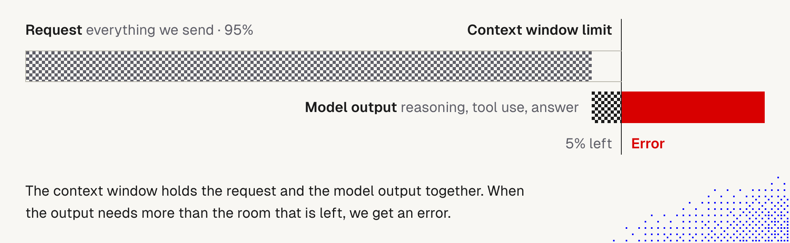
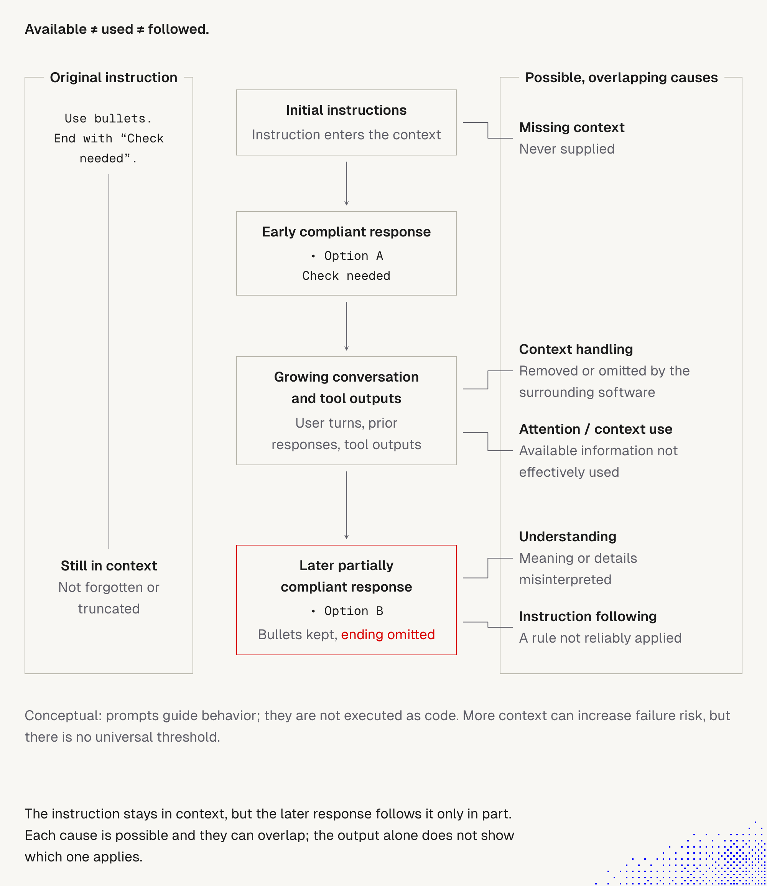

# 4. Context window

> Even when we say exactly what we want, we can't be sure the model follows it. Working with AI is not about certainty, it is about **raising the chance** of the result we need.
> Prompts are not executed line by line. Models don't behave like a compiler, and how they process context internally is not fully understood (active research, e.g. Anthropic's [Mapping the Mind of a Large Language Model](https://www.anthropic.com/research/mapping-mind-language-model)).

## Why instructions fail: five groups of issues

| Issue | Meaning | What helps |
|---|---|---|
| **Attention** | The model's ability to understand context and the relations between concepts, rules, facts and instructions. Weakens as context grows | Short threads, short instruction files, important rules placed where they are noticed |
| **Instruction following** | Ability to follow instructions from the system, a developer or the user. Conflicting or buried rules lose | One clear rule per line, no contradictions, enforce hard rules with hooks |
| **Context issues** | Information is stripped or hidden by harness logic or technical faults (compaction, truncation, a failed load) | Know what the harness drops; check what the agent actually sees |
| **Missing context** | Like a human, the agent struggles if some information was never given to it | Put non-discoverable facts in AGENTS.md, memory or the knowledge base |
| **Understanding the general context** | Concepts or entities read differently; detail lost in images or audio; "silent issues" when reading a website or document | Verify extracted content; give glossary terms; check attachments |

Each of these is a different failure with a different fix. Diagnose which one it is before rewriting the prompt.

## What the research says: Mapping the Mind of a Large Language Model

Source: [Anthropic, "Mapping the Mind of a Large Language Model"](https://www.anthropic.com/research/mapping-mind-language-model). Read in this session.

**What was done.** Researchers used *dictionary learning* to extract millions of **features** from the middle layer of Claude 3.0 Sonnet, a production model. A feature is a recurring pattern of neuron activations that matches a human-readable concept.

**Key findings:**
- **Concepts are spread out.** In the authors' words, "each concept is represented across many neurons, and each neuron is involved in representing many concepts." So we can't read a model's "rules" off its neurons. This is why a prompt rule isn't a line of code that runs.
- **Concepts are shared across languages and modalities.** The Golden Gate Bridge feature fired on the name in many languages and on images of the bridge. Nearby features were related ideas (Alcatraz, the 1906 earthquake). Related concepts sit close together, which may explain the model's skill with analogies.
- **Abstract and safety-relevant features exist**: code bugs, gender bias in professions, keeping secrets, code backdoors, manipulation, scam emails, power-seeking.
- **Features are causal, not just correlated.** Amplifying the Golden Gate Bridge feature made Claude claim to be the bridge and mention it in unrelated answers. Strongly activating the scam-email feature overrode the model's refusal.
- **Sycophancy has a feature.** One feature fires on flattering praise. Activating it made the model answer an overconfident user with fawning, untruthful praise.

**Limits the authors state:**
- The features found are a small subset of what the model learned, and a full extraction would cost more compute than training the model.
- Features show what the model *represents*, not *how it uses* it. Finding the circuits is still open.
- The safety-relevant features have not yet been shown to improve safety in practice.

**How it connects to this document.** The paper is about internal representations, not about context-window length or attention decay, so it does not explain *why* long contexts hurt (that comes from lecture 1 and the AGENTS.md research). What it supports is the lecture's starting point:
- We mostly treat models as a black box (the paper's own words). Nobody can point to the neuron that "follows rule 7", so following instructions can only be made *more likely*, not guaranteed.
- Behavior can be pushed by small internal shifts, so the same prompt can behave differently across runs and models. This matches non-determinism in [lecture 1, note 02](../Lecture_1_Mechanics_Behind_Generative_AI/02_next_token_prediction.md).
- A model that leans toward flattering an overconfident user is a reason to ask neutral questions and to verify answers, not to trust "you're right".
- Multilingual and multimodal features share concepts, but the paper doesn't claim detail is preserved. Lecture 1 [note 04](../Lecture_1_Mechanics_Behind_Generative_AI/04_lesson_model_mechanics_and_tools.md) covers missed details in images.

Caveat: the study covers one model (Claude 3.0 Sonnet). Don't generalize the specific findings to newer models without evidence.

## The context window (diagram)

**The story behind the picture.** A request can fit and still fail. The window is one shared budget: the request (everything we send) and the model's output (reasoning, tool calls, answer) live in the same space. Here the request already takes 95%, so only 5% is left. The model starts to think, call tools and write, needs more than 5%, runs past the limit, and we get an error instead of an answer.

**Important:**
- **Output is not free.** Reasoning tokens and tool calls count, not only the final text. A model that thinks a lot can run out of room before it answers.
- **Headroom matters more than the limit.** What counts is the room left for the output, not whether the request fits. This is why lecture 1 advises staying under about 30-40% of the limit (see [04](../Lecture_1_Mechanics_Behind_Generative_AI/04_lesson_model_mechanics_and_tools.md)).
- **The request grows on its own.** In an agent loop every tool result and every reply is appended, so a thread that worked at step 10 can fail at step 30 with no change in the task.
- **Failure comes from the combination.** A bigger thread or longer reasoning is enough to tip a working request over the edge.

**Not important:**
- The exact 95% / 5% numbers. They illustrate the idea and are not a real threshold.
- The exact failure mode. Some providers return an error, others cut the output short with a length stop reason. Check yours.

## Available ≠ used ≠ followed (long conversations)

**The story behind the picture.** We give an instruction at the start: *"Use bullets. End with 'Check needed'."* The first answer follows it perfectly (Option A, then "Check needed"). The conversation grows: user turns, earlier replies, tool outputs. Much later the model answers again, keeps the bullets, and **leaves out the ending**. Nothing was deleted: the instruction is still in context, "not forgotten or truncated". It was available, but not fully used, and not fully followed.

The cause is not visible in the answer. The picture lists five possible, overlapping causes, which are the five issue types from the table above:

| Cause in the picture | Issue type | Meaning |
|---|---|---|
| Missing context | Missing context | the instruction was never supplied |
| Context handling | Context issues | removed or omitted by the surrounding software |
| Attention / context use | Attention | available information not effectively used |
| Understanding | General understanding | meaning or details misinterpreted |
| Instruction following | Instruction following | a rule not reliably applied |

**Important:**
- **Short-lived sessions beat long-lived ones.** The longer the thread, the more history and tool output sit between the instruction and the answer, and the more causes can apply. A fresh session with a clear task has the instruction close, little noise, and fewer ways to fail.
- **In context does not mean followed.** Check the result of a long session instead of trusting that early rules still hold.
- **You can't tell the cause from the output.** One missing ending can come from any of the five. Diagnose before fixing: ask the agent what it sees ([2 Self-report](2_agent_context_self_report.md)), then change the setup.
- **Practical moves:** one task per session, start a new thread on a topic change, restate key rules when they matter, and enforce hard ones with hooks ([3 Lifecycle hooks](3_lifecycle_hooks.md)).

**Not important:**
- The exact example (bullets, "Check needed", Options A and B). It only shows a rule being half-kept.
- The vertical line and box layout.

**Caveat from the picture itself:** it is conceptual. Prompts guide behavior and are not executed as code. More context can raise the failure risk, but **there is no universal threshold**. The 30-40% figure in this document is a rule of thumb from lecture 1, not a limit. Measure on your own tasks.

## What fills the window

Everything the model reads counts, in every request (see [08 ChatML](../Lecture_1_Mechanics_Behind_Generative_AI/08_chatml.md): system prompt, tool info and history are all one text):
- system prompt, environment details, AGENTS.md / CLAUDE.md, memory index (see [1 Harness](1_Harness.md))
- tool and skill catalogs, MCP tool schemas (see [10 Code mode](../Lecture_1_Mechanics_Behind_Generative_AI/10_code_mode.md): ~2,300 of 3,000 input tokens went to schemas)
- the whole conversation, tool results, pasted files, hook output
- attachments: PDFs cost about 1,500-3,000 tokens per page and can fill the window before the page limit (see [14 Attachments](../Lecture_1_Mechanics_Behind_Generative_AI/14_attachments_and_what_the_model_sees.md))
- the model's own output, **including reasoning tokens**

## Attention drops as the context grows (from Lecture 1)

This was covered in lecture 1, see [04 Model mechanics and tools](../Lecture_1_Mechanics_Behind_Generative_AI/04_lesson_model_mechanics_and_tools.md), "Context window and compaction":
- The limit is roughly 250k-1M tokens, depending on the model.
- **Models perform best under about 30-40% of the context limit.** Retrieving a fact from long text still works on the latest models, but **reasoning drops**.
- Not everything in a thread is sent to the model, so long conversations are **lossy**.
- Compacting several times loses facts (example: "Keep existing routes", "Never log secrets").
- Premise order can matter: smaller models can fail just because information comes in a different order.

Related lecture 1 notes:
- [02 Next-token prediction](../Lecture_1_Mechanics_Behind_Generative_AI/02_next_token_prediction.md): the model can't edit earlier tokens, and the same input can give different output. This is why certainty is impossible.
- [13 Skills and context](../Lecture_1_Mechanics_Behind_Generative_AI/13_skills_and_context.md): a loaded skill body stays in context until compaction or a new thread, and cost and cache effects of unloading.
- [05 Harnesses, providers, steering](../Lecture_1_Mechanics_Behind_Generative_AI/05_lesson_harnesses_providers_steering.md): auto-compaction in the harness.

Also in this lecture:
- [Insight 1: AGENTS.md](Insight_1_Context_Agents.md): always-loaded files are the main source of token waste. The research found extra context raised cost by over 20%, and the middle of a long file gets ignored ("lost in the middle"). Keep it under 200 lines.
- [3 Lifecycle hooks](3_lifecycle_hooks.md): `PreCompact`, `PostCompact` and `SessionStart` with matcher `compact` can save and restore key rules around compaction.

## What this means for us

1. **Treat the window as a budget with headroom.** Aim for the "smart zone" (below roughly 30-40%), not for 95%. Headroom is for reasoning, tool calls and the answer, as the diagram shows.
2. **Prefer short-lived sessions over long-lived ones.** One task per session. Start a new thread when the topic changes or the task is done. Don't drag a long history along, because rules given early are less reliably followed later (see "Available ≠ used ≠ followed"). Carry over only what matters, via memory, a short summary or a file.
3. **Keep always-on context small.** AGENTS.md, memory and tool/skill catalogs are paid in every request. Link to documents instead of inlining them.
4. **Keep large results out of the thread.** A big tool result or file can use most of the remaining room in one step. Read only what's needed or delegate to a subagent.
5. **Survive compaction.** Compaction is lossy. Restate critical rules after it or restore them with a hook. Don't rely on a rule that only lived in chat.
6. **Say what must be known.** Don't expect the model to guess missing facts. Put them in the right place (AGENTS.md, knowledge base, the prompt).
7. **Enforce, don't just ask.** Rules that must hold go into hooks or permissions, since instruction following is probabilistic.
8. **Ask the agent what it sees.** The self-report ([2 Context self-report](2_agent_context_self_report.md)) shows what is in the window and what is missing.
9. **Watch for silent issues.** Verify images, audio, websites and documents were really read as expected.

## Cautions

- The 30-40% figure is a rule of thumb from our lecture 1 notes. It varies by model and task, so measure on your own tasks.
- The diagram's 95% / 5% split is an illustration, not a real limit. Real limits and error behavior depend on the provider.
- Self-reports and summaries of long threads can also be wrong. Verify against the real request or logs.

## Open questions for discussion

- At what fill level do we start a new thread or compact manually?
- Do we track context usage per session (for us, and for client agents)?
- Which rules must survive compaction, and are they in a hook or only in chat?
- What is our "smart zone" for each model we use?

## Sources

- Lecture notes: "Context window", "Attention", "Instruction following", "Missing context"
- [Mapping the Mind of a Large Language Model (Anthropic)](https://www.anthropic.com/research/mapping-mind-language-model), cited in the lecture
- Lecture 1 notes linked above
- [Evaluating AGENTS.md (arXiv:2602.11988)](https://arxiv.org/abs/2602.11988), via [Insight 1](Insight_1_Context_Agents.md)
