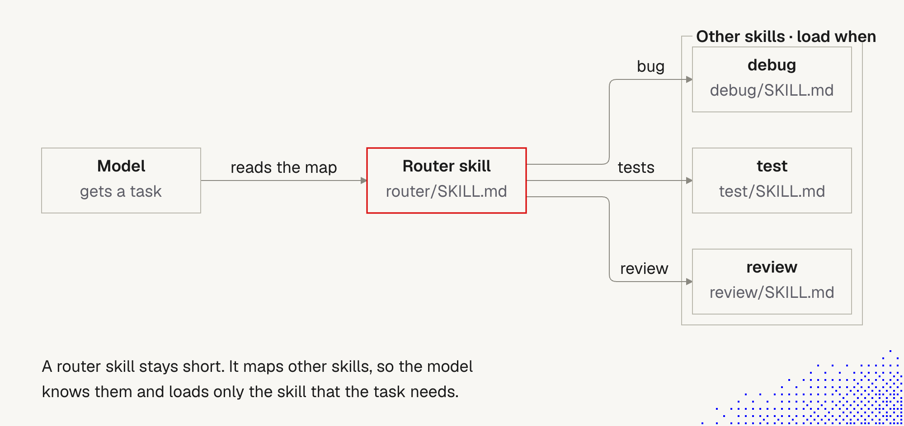

# 6. Router skills

> Many skills found online are long and complex. The chance that a model follows **all** their instructions is close to zero. The best skills are **short and extremely clear about their purpose**. When we need to cover something bigger, a **router skill** points to other skills instead of containing them.

Builds on [5 Skills](5_skills.md) and lecture 1 [13 Skills and context](../Lecture_1_Mechanics_Behind_Generative_AI/13_skills_and_context.md).

## The idea in one minute

A **router skill** is an ordinary skill whose job is not to do the work but to **say which other skill does it**. It holds a short map: *"if the task is X, use skill A; if Y, skill B"*. The model reads the map, picks one route, and loads **only** that skill.

Note: "router skill" is a pattern, not a field in the Agent Skills spec. It is just a `SKILL.md` written in a particular way.



**The story behind the picture.** The model gets a task and reads one small file, `router/SKILL.md`. That file maps situations to skills: a *bug* leads to `debug`, *tests* to `test`, a *review* to `review`. The model follows exactly one arrow and loads that one skill. The other skills are never read, so they cost nothing in this session.

**Important:**
- **The router is the only thing always in play.** It must stay short, because everything else depends on it being read and followed.
- **Each arrow carries a condition ("load when ...").** The router's value is in those conditions being clear and not overlapping.
- **One route per task.** The model loads the skill the task needs, not the whole set.

**Not important:**
- The exact skill names (`debug`, `test`, `review`) and the layout. They are placeholders.

## Why it works (links to what we know)

- **Attention and instruction following** ([4 Context window](4_context_window.md)): a long skill competes with everything else in the thread, and rules in the middle get lost. Several short skills, loaded one at a time, keep each one near the task.
- **Catalog cost** ([5 Skills](5_skills.md)): every installed skill puts its name and description in context in every session. A big family of skills makes a big catalog and more selection mistakes.
- **Three ways to give skills to a model** (from lecture 1 note 13 and the `skill-selection` example):

| Strategy | In context up front | Behavior |
|---|---|---|
| All bodies in the instructions | everything | grows with every skill |
| Catalog + load on demand | name and description per skill | what Claude Code, Codex and Pi do |
| **One router skill** | **one line, mapping tasks to sub-skills** | stays small as skills grow; the map loads only for requests that need it |

The example's token table shows the router staying at one line while the other two grow.

## Case study: ask-matt

[`ask-matt`](https://www.aihero.dev/skills-ask-matt) is a router over the skills in Matt Pocock's [skills repo](https://github.com/mattpocock/skills). We read the real `SKILL.md` for this document.

**What it is.** Its description is one line: *"Ask which skill or flow fits your situation. A router over the skills in this repo."* Its opening idea: *"You don't remember every skill, so ask."* It names the skill or the sequence of skills that fits, marks where a human decision belongs, and **stops**. It does no engineering work itself.

**How it is organized** (the map is the content):
- **Main flow, idea to ship:** grill the idea, spec, tickets, implement, review, retro. Two branches: a prototype detour if a question needs running code, and a split into spec and tickets only when the build spans several sessions.
- **On-ramps:** *bugs and requests piling up* leads to triage; *something's broken* to diagnosing bugs; *a huge foggy effort* to wayfinder. Each merges back into the main flow.
- **Codebase health, standalones, vocabulary skills** and a **precondition** (a one-time setup skill).
- **Phase boundaries:** a short decision tree for when to continue, `/clear`, hand off, use a subagent or `/compact`. The detail lives in a **separate file**, `PHASE-BOUNDARIES.md`, so the router itself stays short.

**Design choices worth copying:**

| Choice | Why it matters |
|---|---|
| `disable-model-invocation: true` | We type `/ask-matt` ourselves. The agent doesn't call the router on its own, so it can't misroute silently or load every time |
| **Hand-written map**, not a scan of what is installed | The author decides the routes and their order. Predictable, reviewable, but needs upkeep |
| *"Before stating what a skill does ... read that skill's SKILL.md: the summaries here are for orientation only."* | The router knows only one-line summaries and tells the model to verify before acting. Guards against confident wrong claims |
| **"It recommends and stops."** | No side effects. The router chooses, the chosen skill acts |
| **Situation to skill**, with a distinguishing test for look-alikes (e.g. working directory or not) | Fixes the main routing error: two skills that sound alike |
| **Detail one level down** (`PHASE-BOUNDARIES.md`) | Progressive disclosure inside the router itself |
| Mentions limits of its own context advice (smart zone, ~150k tokens) | Ties routing to context hygiene ([4 Context window](4_context_window.md)) |

**Limits its documentation reports** (secondary summary; verify on the page):
- It can say a skill is missing when it is installed, because many skills are kept out of the injected skill list.
- It routes over its own repo's skills only, not our own or third-party ones.
- It answers from short summaries, so claims about other skills can be wrong. Ask it to open the relevant `SKILL.md` before acting.
- Its guidance can lag behind the repo.

## How to write a router skill

```markdown
---
name: ask-<domain>
description: Pick the right skill or flow for <domain> tasks. Use when unsure which of the <domain> skills applies.
disable-model-invocation: true   # optional: user types /ask-<domain>
---

# <Domain> router

Read the target skill's SKILL.md before describing it. These summaries are for orientation only.

| Situation | Use | Note |
|---|---|---|
| A bug or failing test | `/debug` | reproduce first |
| New behavior to add | `/spec` then `/implement` | skip spec if tiny |
| Reviewing a PR | `/review` | |
| Two skills sound alike | see "Telling X from Y" | <one deciding test> |

## Telling X from Y
<one rule that separates them>

## Order
1. ... 2. ... (mark where a human decides)

Details: [DECISIONS.md](DECISIONS.md)
```

Guidelines:
1. **Keep it short.** If it grows past about 100 lines, move detail into a linked file.
2. **Map situations, not skill names.** The model matches the task, so write "a failing test", not "testing module".
3. **Give a deciding test for look-alikes.** One concrete question per pair.
4. **Route, then stop.** The router recommends. It does not do the work and does not duplicate the target skills' rules.
5. **Say what to do when nothing fits.** Otherwise the model forces a wrong route.
6. **Mark human decision points** and the order of steps.
7. **Decide who invokes it.** Manual (`disable-model-invocation: true`) is safer and predictable. Automatic needs a strong description and measured selection.

## When to use one (and when not)

| Use a router when | Skip it when |
|---|---|
| we have **many skills** (roughly more than 10, our rule of thumb) | we have a handful and distinct descriptions already pick correctly |
| skills form **flows** with an order | skills are independent |
| similar skills are often confused | a better description would fix selection |
| we want a **single entry point** for a team | the extra hop costs more than it saves |

A router adds one more step: load the router, then load the skill. For a single simple task that is overhead.

## Risks

- **Stale map.** Add, rename or remove a skill and forget the router: it sends the model to something that doesn't exist or misses a new skill. Update the router in the same change.
- **Wrong or overlapping routes.** The map can be wrong even if every skill is fine. Test it.
- **Summary-based claims.** A router knows one-line summaries. Make it check the real file before acting.
- **Extra hop and cost.** One more load, more tokens, one more chance to misroute.
- **Security: the router is a trust anchor.** It decides which skills the agent loads next. A poisoned router, or a poisoned line in its map, steers the agent to attacker-chosen skills. Review it with the same care as any skill ([5 Skills, Security](5_skills.md)): read the raw file, check for hidden text, and pin the source. Never let a router pull in unreviewed third-party skills automatically.
- **Hidden coupling.** If the router names skills by path or name, renaming them breaks it silently.

## Test it

Reuse the `skill-selection` example's idea ([lecture 1, note 13](../Lecture_1_Mechanics_Behind_Generative_AI/13_skills_and_context.md)):
1. Write 15-20 sample requests, including near misses that need **no** skill.
2. For each, record which skill gets loaded: hit, correct none, miss, wrong skill, unneeded skill.
3. Fix the router's wording, not the target skills, when routes are wrong.
4. Re-run after every change to the skill set. Results vary by run and model, so repeat.

Try the example:
```bash
npx mex run skill-selection --repeats 3
```
(Paid calls on your own key. The strategies table at the end compares all three ways of giving skills to a model.)

## For agents we build for clients

- A router is a good **single entry point** for a client's product: one short map in front of many capabilities.
- Keep the map in version control, review changes like code, and test routing on every release.
- Add the router's routes to the capability map the agent uses for self-review ([3 Lifecycle hooks](3_lifecycle_hooks.md)), so the map and the skills can't drift apart.
- Prefer a user-invoked router for risky flows, so a person picks the path.

## Summary

Ask the harness how skills work here, define skills globally or per project and tailor them, and keep it simple, with agents helping to shape them. Full text: [5 Skills, Summary](5_skills.md#summary-skills-and-agents-reusable). For routers specifically: keep the map short and hand-maintained, and test the routes.

## Open questions for discussion

- Which of our skills form flows that a router could order?
- How many skills do we have today, and how often do we see wrong or missed selection?
- Do we want a manual router (`/ask-<team>`) or an automatic one?
- Who owns the map and updates it when skills change?

## Sources

- [ask-matt (AIHero)](https://www.aihero.dev/skills-ask-matt) and `skills/engineering/ask-matt/SKILL.md` and `PHASE-BOUNDARIES.md` in [mattpocock/skills](https://github.com/mattpocock/skills) (read via GitHub)
- [skill-selection example (MEGA-DOT-DEV/examples)](https://github.com/MEGA-DOT-DEV/examples/tree/main/examples/skill-selection)
- [Agent Skills specification](https://agentskills.io/specification)
- Lecture 1 notes: [13 Skills and context](../Lecture_1_Mechanics_Behind_Generative_AI/13_skills_and_context.md)
- Lecture notes: "Designing and generating skills: Length", image "Router skill"
- The template, the "more than 10 skills" rule of thumb, and the risk list are our reasoning, not from the lecture
