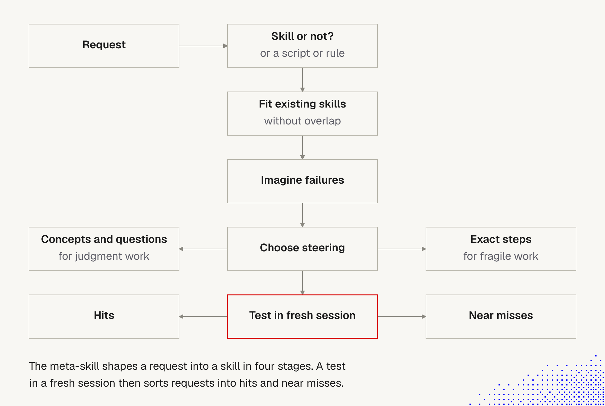

# 7. Skill shaper: how to improve skills

> A **meta-skill** for iteratively shaping new skills, or reshaping one that triggers on the wrong requests. Written by the course author for personal use. It may not fit our needs perfectly, but it is good inspiration and a starting point for shaping our own.

Source: [`skills/skill-shaper/SKILL.md`](https://github.com/overment/skills/blob/main/skills/skill-shaper/SKILL.md) in [overment/skills](https://github.com/overment/skills) (MIT license, v0.7.0 when we read it). We read the real `SKILL.md`, its `references/placement.md`, and `evals/skill-shaper.md`.

Builds on [5 Skills](5_skills.md) (short beats detailed, docs by pointer, security) and [6 Router skills](6_router_skills.md).

## Why this skill is worth studying

It follows its own advice, so it works as a worked example of a good skill:
- **Short body (about 70 lines)** with one reference file, `references/placement.md`, read only when needed (progressive disclosure).
- **Opens by admitting the model's strengths:** *"You already know how to write instructions. This skill adds the judgment calls and the few facts about skill loading you can't infer."* So it carries only what the model can't know.
- **Judgment as concepts and questions**, not a rulebook (poka-yoke, MECE, pre-mortem, Chesterton's fence). These are semantic anchors ([5 Skills](5_skills.md)).
- **Exact rules only where facts are fixed** (name format, description limits, side effects, placement).
- **Ships with evals** (`evals/skill-shaper.md`), so changes can be tested.

## The flow at a glance

**The story behind the picture.** A request arrives, and the first question is not "how do I write this skill" but **"should this be a skill at all?"** It might be a script or a rule. If it is a skill, it must **fit with the existing skills without overlap**. Then we **imagine how it will fail** before writing it. Only then do we **choose how to steer**: concepts and questions for judgment work (left), exact steps for fragile work (right). Finally the draft is **tested in a fresh session**, which sorts requests into **hits** (it loaded when it should) and **near misses** (similar requests where it should stay quiet).

**Important:**
- **The gate comes first.** Most of the savings come from deciding *not* to build a skill, or to build a smaller one.
- **Overlap is checked before writing,** not discovered later as wrong selections.
- **Failures are imagined up front** (pre-mortem), so the test has something to look for.
- **The red box is the test, in a fresh session.** The current session knows too much (curse of knowledge), so it can't judge its own skill.
- **The test result has two sides:** hits *and* near misses. A skill that only has hits will fire on everything.

**Not important:**
- Exact box wording and layout.
- The diagram shows four stages plus a test. The skill's own text groups the same work into three stages with seven checks (below), and also includes a **baseline run** and **Chesterton's fence**, which the picture leaves out.

How the two views map:

| Picture | Check in the skill |
|---|---|
| Skill or not? | Job to be done, poka-yoke |
| Fit existing skills without overlap | MECE |
| Imagine failures | Pre-mortem |
| Choose steering (judgment vs fragile) | Stage 2: steer lightly |
| Test in fresh session: hits, near misses | Stage 3: hand off (3 requests that load, 2 that shouldn't) |
| (not shown) | Baseline, newcomer test, Chesterton's fence |

## The process, in three stages

| Stage | What happens |
|---|---|
| **1. Think it through** | Gather evidence first (conversation, project, installed skills), ask only what evidence can't settle, run seven checks |
| **2. Steer the new skill** | Pick the lightest steering that works for the type of work |
| **3. Hand off** | Test in fresh subagents, cut what the baseline already did, deliver files plus a test plan |

### Stage 1: the seven checks

| Check | Question it answers | Why it helps |
|---|---|---|
| **Job to be done** | What failure does this skill fix? | Decides the rules. Label guesses: "my guess is X, because Y" |
| **Poka-yoke** (mistake-proofing) | Should this be a skill at all? | One right answer: script, CI check or hook. Always-on one-liner: `AGENTS.md`. Judgment plus a must-not-skip step: thin skill plus a guard. If it isn't a skill, say why |
| **MECE** | Does it overlap another skill? | Each request belongs to exactly one skill. On overlap, extend the neighbour or add "Not for X; use Y" |
| **Baseline** | What does a fresh agent do **without** the skill? | The agent's mistakes are the skill's job. If it makes none, the skill may not be needed. Your own run isn't a baseline (you know too much) |
| **Newcomer test** | What must the skill actually say? | Write only what the baseline got wrong plus local facts no model can know (names, paths, flags, limits, footguns). Cut general know-how |
| **Pre-mortem** | How will it fail? | Picture it firing on the wrong request, staying silent, or acting without permission. Test those. Only a failure you see, or can't test, becomes a line |
| **Chesterton's fence** | Why does this rule exist? | When reshaping, find the reason before deleting a rule |

Questions to the user go in **one message**: each in bold, then the guess and default. The agent decides name and structure itself and lists them as assumptions.

### Stage 2: steer, lightly

| Work type | How to steer |
|---|---|
| **Judgment** (writing, review, design) | One or two precise named concepts (e.g. "steelman", "inverted pyramid") and a few self-questions. Say how each concept applies. No personas, no praise |
| **Fragile** (deploys, migrations, exact formats) | Exact steps, commands and scripts |
| **Every skill** | At most one opening sentence on what goes wrong without it, then local facts. No section restating a tool's docs |

This is the same split as in [5 Skills](5_skills.md): principles and anchors for judgment, exact steps only where precision is a must.

### Stage 3: hand off

The current session suffers from the **curse of knowledge**, so test routing and the task in **fresh subagents**. Cut every line the baseline already got right. Deliver:
- the files and the description
- assumptions, with unanswered questions first
- how to invoke it (`/name` in Claude Code and Cursor, `$name` in Codex)
- **three requests that should load it and two near misses that shouldn't**
- **one real task whose output should differ with and without the skill**

## Facts the skill enforces

- **Description** (the only text an agent sees when choosing): one or two sentences, about **250 characters** at most, what it does and when to use it, third person, in the words a user would type. No lists of examples, file types or features, because *the model generalizes from one clear phrase*. Add "Not for X" only for a near miss, and name the skill that should take it.

  | | Example |
  |---|---|
  | **Slop** | "Transcribes local audio and video recordings, such as meetings, calls, interviews, lectures, podcasts and voice memos, into well-formatted Markdown with named speakers ... (.mp3, .m4a, .wav ...) ... Not for live dictation, reading text aloud, subtitle files ..." |
  | **Clean** | "Transcribes audio and video recordings with the `transcribe` CLI. Use when the user wants a transcript, notes or quotes from a recording." |

- **Spec:** `name` lowercase letters, digits, hyphens, at most 64 characters, matching the folder. `description` at most 1,024 characters, no XML. Avoid names already built in (`skill-creator`, `create-skill`).
- **Side effects are explicit-only.** A skill that deploys, sends, deletes or spends uses `disable-model-invocation: true` (Claude Code, Cursor) or `policy.allow_implicit_invocation: false` in `agents/openai.yaml` (Codex). Say what invoking it authorises and what needs a fresh yes. A plain request never loads such a skill, so add a guard or an `AGENTS.md` pointer.
- **User data** that the user edits lives in the project, not in the skill folder.
- **Portability:** frontmatter beyond the spec and agent-specific syntax (e.g. `` !`command` ``) work in one agent only.

### Placement (from `references/placement.md`)

The file says it was checked in September 2026 and agents change quickly, so re-check details before relying on them.

| Folder | Claude Code | Codex | Cursor |
|---|---|---|---|
| `~/.agents/skills/` | no | yes | yes |
| `~/.claude/skills/` | yes | no | yes |
| `<repo>/.agents/skills/` | no | yes | yes |
| `<repo>/.claude/skills/` | yes | no | yes |

Recommended layout: **one canonical copy** in `.agents/skills/<name>/`, plus a **relative symlink** into `.claude/skills/` for Claude Code users. No extra copies, because they drift and may load twice. Repo-specific skills go in the project, personal ones in the global folder. Same-name skills conflict differently per agent (Claude Code: personal wins over project; Codex: both listed).

## How to use it to polish our skills

### A. Quick audit of an existing skill (no install needed)

Ask our agent, with the skill file in view:

> Review `<path>/SKILL.md` as a skill shaper would. For each line say whether a fresh agent without this skill would already do it. Check: the description (about 250 characters, third person, no example lists), overlap with my other skills, Chesterton's fence for anything you'd cut, and whether it should be a script, hook or AGENTS.md line instead. Propose a shorter version and list what you removed and why.

Then review the diff. Keep a rule only if a baseline run shows the agent gets it wrong without it.

### B. The polishing loop (the baseline method)

1. **Baseline:** run a real task in a **fresh session without the skill**. Note every mistake.
2. **Trim:** rewrite the skill so each line fixes a baseline mistake or states a local fact.
3. **Route:** test 3 requests that should load it and 2 near misses that shouldn't. Fix the *description* first when routing is wrong.
4. **Compare:** run the real task with and without the skill. The outputs should differ in a way that matters. If not, the skill may not earn its context.
5. **Pre-mortem:** deliberately try the wrong-request, silent and no-permission cases.
6. **Record:** version, description, hits and misses, token cost, notes.

### C. Borrow the eval format

`evals/skill-shaper.md` is a ready pattern:
- **Routing:** 5 prompts that should trigger and 5 that shouldn't (including near misses with a shared word, like "review" in an unrelated task). Pass: at least 4 of 5 trigger and none of the 5 negatives does.
- **Behaviour scenarios:** each with a setup, a prompt and the expected result (e.g. asks at most one question; recommends a CI step instead of a skill; outputs differ in shape for different tasks).
- **Common checks:** at most three questions in one message, no unsourced motive, spec-compliant, no line the baseline already showed, and skill runs **better than no skill on at least half the scenarios** or it doesn't justify its context.
- **Self-rebuild:** ask a fresh session with the skill to build "a skill that helps create skills" and compare with the original. It should reach the same decisions and not come out longer.

Run each in a **fresh session**, with and without the skill, and record what loaded.

### D. Try the skill itself

1. **Review before installing** ([5 Skills, Security](5_skills.md)): read the raw `SKILL.md` and `references/placement.md`, search for hidden text, and pin a commit. License is MIT.
2. Copy it (don't auto-update) into a test project, and run the routing evals.
3. Ask it to reshape one of our weakest skills and compare with audit A.
4. Adapt it: change the description to our wording, add our naming rules and Aras-specific constraints.

## Cautions

- **One author's tool.** It is personal and versioned (0.7.0), and the author says it may not suit others. Treat it as a starting point.
- **Baseline runs cost tokens and time**, and results vary by run and model. Repeat before concluding.
- **Fresh agents differ from real use.** A fresh subagent is a better baseline than our own session, not a perfect one.
- **Placement facts age quickly.** Re-check them in each vendor's docs.
- **Trimming has a cost.** Shorter and more general skills give up control. For fragile or regulated work, keep exact steps and test.
- **It is a skill like any other.** The security rules from [5 Skills](5_skills.md) apply: it can steer the agent, so audit it.
- **Not tested here.** We read the skill and its evals, but did not install or run it in this session.

## Summary

Ask the harness how skills work here, define skills globally or per project and tailor them, and keep it simple. We can shape skills ourselves, and **agents can handle it too**: this meta-skill is exactly that. Full text: [5 Skills, Summary](5_skills.md#summary-skills-and-agents-reusable).

## Open questions for discussion

- Which two or three of our skills should we audit first, and what is each one's baseline task?
- Do we adopt this skill as is, fork it with our own rules, or only borrow the checks?
- Where do our skills live (project vs personal), and do we need the `.agents` plus symlink layout for several tools?
- Which routing evals should we keep in the repo as regression tests?

## Sources

- [skill-shaper `SKILL.md`](https://github.com/overment/skills/blob/main/skills/skill-shaper/SKILL.md), its `references/placement.md` and `evals/skill-shaper.md` ([overment/skills](https://github.com/overment/skills)), read via GitHub
- [Agent Skills specification](https://agentskills.io/specification)
- Lecture notes: skill-shaper description and process
- The audit prompt, polishing loop and open questions are our own reasoning, not from the lecture or the repo
