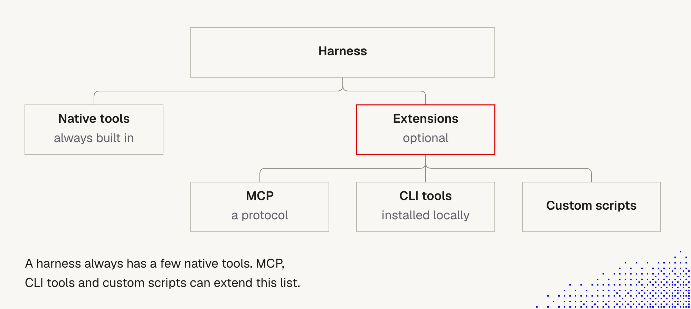

# 8. Tools: native and external

> A tool is how the agent acts on the world: read a file, run a command, call an API. Where a tool **comes from** decides what it costs, who controls it, and how much we must trust it. The model uses all of them the same way.

Status: this document starts the Tools block. It covers **native vs external** tools, **discovery**, the **request** and the **prompt-injection warning** ("Tool use under the hood"). Results, large results, hints and errors are next, as we receive that lecture text. The lecture also shows a comparison picture of the two discovery approaches, which we don't have yet. The text below is based on its description.

Builds on lecture 1: [11 CLI and MCP](../Lecture_1_Mechanics_Behind_Generative_AI/11_cli_and_mcp.md), [10 Code mode](../Lecture_1_Mechanics_Behind_Generative_AI/10_code_mode.md), [05 Harnesses](../Lecture_1_Mechanics_Behind_Generative_AI/05_lesson_harnesses_providers_steering.md).

## Where tools come from (diagram)

**The story behind the picture.** Every harness starts with a small set of **native tools** that are always built in. On top of that sit **extensions**, which are optional: **MCP** (a protocol), **CLI tools** (installed locally) and **custom scripts**. The red box marks extensions as the part we choose and control. The harness is the same, but what the agent can do depends on what we plug into it.

**Important:**
- **Native tools are the baseline.** Every agent in that harness has them, so skills and prompts can rely on them.
- **Extensions are a decision.** Each one adds capability, cost (context) and risk (trust). "Optional" means we should add them on purpose.
- **Three different kinds of extension.** MCP is a protocol (a server describes its tools). CLI tools are programs already on the machine. Custom scripts are ours. They differ in how the agent learns to use them, who runs them, and who maintains them.

**Not important:**
- Exact box labels and layout.
- The picture doesn't show how the model *calls* them. That is the same for all sources (below).

## The key point: the model can't tell the difference

From lecture 1, note 11: **where tools come from** (native, CLI, MCP) is a separate question from **how the model uses them** (function calling or code mode). The model never sees "MCP" or "CLI". It gets ordinary function tools and sends function calls, and the **harness** does the routing: runs the built-in, runs the command, or sends `tools/call` to the MCP server. So MCP and CLI change **what** tools exist, not **how** the model uses them.

## Discovery: how the agent learns what tools exist

As with skills ([5 Skills](5_skills.md)), the agent must know what tools are available. There are two ways:

| | **A. Expose every schema** | **B. Give a search tool** |
|---|---|---|
| What the request holds | the JSON schema of **every** tool | a **catalog search tool** and minimal guidance on how to explore the catalog |
| Context at the start | full of schemas | **empty** of tool schemas |
| Calling a tool | **right away** | the model **searches first**, then calls (in code mode it writes code that calls the tools) |
| Cost | every schema in context, **even when not needed** | extra steps to discover tools before calling them |
| Name | function calling | code mode, or **programmatic tool use** |

Takeaways:
- **A trades context for speed.** Fine for a small tool set. It gets expensive as the catalog grows.
- **B trades steps for context.** The catalog stays out of the window until needed, but the agent needs **basic guidance** on how to search, and each discovery step adds a round trip.
- **Tool names and code in the lecture picture are examples.** The idea is what matters.
- Details and token numbers: lecture 1 [10 Code mode](../Lecture_1_Mechanics_Behind_Generative_AI/10_code_mode.md). In Claude Code, deferred tools work like B: names only, with a search step to load a schema first.

## The request: what the model actually does

The model's role is to **specify which tool to use and generate a payload for it**.
- It may request **several tool calls, even in parallel**.
- The **shape** of the request is defined by schemas, is often very strict, and is **verified programmatically** by the harness.
- The **values** inside it are **generated from the context and the model's base knowledge**. This is where mistakes enter: a wrong ID, a guessed path, an invented parameter that still fits the schema.

So a valid call is not necessarily a correct call. The schema checks the form, not the truth. Good descriptions, constrained enums and clear examples in the tool definition reduce wrong values, and our own checks (permissions, hooks, validation in the tool) catch the rest ([3 Lifecycle hooks](3_lifecycle_hooks.md)).

## The four sources compared

| | **Native tools** | **MCP** | **CLI tools** | **Custom scripts** |
|---|---|---|---|---|
| What | built into the harness | tools served by an MCP server over a protocol | programs installed on the machine | scripts we write |
| In Claude Code (this session) | Read, Write, Edit, Glob, Grep, Bash / PowerShell, WebFetch, WebSearch, Skill, Agent | `mcp__<server>__<tool>`, e.g. the Atlassian and Context7 tools | run through the shell tool: `git`, `gh`, `rg`, `npx ...` | run through the shell tool, or shipped in a skill's `scripts/` |
| How the agent learns usage | the harness's system prompt and tool schema | the server sends a **schema** for each tool | must discover it, e.g. `--help` | the script's name, our instructions or a skill |
| Who runs it | the harness | the **MCP server** (server side) | the harness runs the command on our machine | our machine, with our privileges |
| Context cost | always in context (a small, fixed set) | one schema per tool, in every request, unless deferred | none until used; the shell tool is already there | none until used |
| Best for | everyday file, search, shell and web work | production, shared and remote integrations, widely supported | local work, existing tools the model already knows | one-off glue, project-specific tasks, things no tool exists for |
| Main risk | the harness's own permission model | third-party code and untrusted results | runs with our privileges; supply chain | our own bugs; unreviewed scripts |

(The "In Claude Code" row lists tools visible in this session. Names differ by harness.)

## Cost: schemas in context

From lecture 1 notes 10 and 11:
- Function calling puts **all tool schemas in the context, in every request**. Many MCP tools means many schemas, which is the cost that code mode addresses (one example: about 2,300 of 3,000 input tokens went to schemas).
- **Deferred tools:** in Claude Code, many tools are listed by **name only** and the agent loads a schema on demand through a search step, so a large catalog doesn't fill the window.
- **CLI discovery costs steps instead:** in the course run, MCP took 1 tool call, while the CLI took `--help` first and then the command. Input tokens roughly doubled (458 vs 217) and cost was about 1.9x. This is a tiny test with one run, so keep the pattern and not the numbers.
- This links to the context budget in [4 Context window](4_context_window.md): every always-on tool schema is paid in every request.

## How to choose

| If we need... | Prefer | Why |
|---|---|---|
| read, edit, search, run commands | **native** | already there, no extra schema, least risk |
| a well-known tool the model already knows (`git`, `gh`) | **CLI** | no schema cost, the model knows the usage |
| a shared, remote or production integration | **MCP** | one server for everyone, a schema, server-side execution |
| a repeatable task specific to our project | **custom script** (often inside a skill) | cheap, exact, reviewable |
| a must-always rule | **hook**, not a tool | deterministic ([3 Lifecycle hooks](3_lifecycle_hooks.md)) |
| usage instructions for a tool | **skill** pointing to the docs | "docs by pointer" ([5 Skills](5_skills.md)) |

Rule of thumb from the lecture: **CLI works best locally, MCP is better for production.**

## Security and trust

- **WARNING (from the lecture): models can make mistakes or be tricked into extracting data from one tool and exposing it through another.** This is **prompt injection**, which remains an **open problem**. All models are still vulnerable. The lecture points to Pliny the Liberator's public profile as a demonstration (we did not open it).
- **How it plays out with several tools.** Tool A reads something sensitive (a file, a ticket, a database row). Tool B can send data out (a web request, an email, a comment, a commit). Text in a result of any tool can tell the agent to chain them. The more tools and sources, the more such paths exist.
- **Tool results are data, not orders.** In the harness view ([1 Harness](1_Harness.md)) a tool result sits at "Data only". Anything a tool returns (a web page, a file, an MCP response) can contain text that tries to steer the agent.
- **Practical defenses** (our reasoning, not a complete fix):
  - Fewer tools and fewer sources of untrusted text in one session.
  - Don't combine **sensitive-data tools** with **outbound tools** in the same agent without approval.
  - Require a human approval for sends, writes and anything irreversible.
  - Run untrusted content (web, inbound email) in a separate, limited session or subagent.
  - Add a hook or permission rule that blocks the dangerous chain ([3 Lifecycle hooks](3_lifecycle_hooks.md)).
  - Log tool calls and review them.
- **MCP servers are third-party code.** A server we didn't write can see the arguments we send and shape what comes back. Install only trusted servers, and review what each tool can do.
- **CLI tools and scripts run with our privileges.** Check them like code, especially anything fetched from a registry or pasted from the web ([5 Skills, Security](5_skills.md)).
- **Permissions apply to all sources.** Allow, ask and deny rules can cover native, MCP and shell calls. Keep side-effect tools (send, delete, deploy, spend) behind approval.
- **Aras context:** treat external MCP servers and third-party CLIs as supply-chain risk. Don't send restricted data (customer data, credentials, PII) to a tool we haven't approved. If something sensitive was exposed, report it to legal@aras.com and infosec@aras.com.

## For agents we build for clients

- Start with a **small native set**, add MCP for shared integrations, and keep custom scripts in version control.
- Keep the visible tool list **short and precise**. More tools mean more schemas and more wrong choices.
- Use **deferred loading or code mode** when the catalog is large.
- Log every tool call and result for audit, and give each tool the least privilege it needs.

## Experiments to try

- `npx mex run mcp-tool-bridge` (lecture 1, note 11): same question through MCP and CLI. Compare steps, tokens and cost, and check in "Tool schemas" that the model can't tell them apart.
- In our own agent: list the tools it sees ([2 Context self-report](2_agent_context_self_report.md)), then remove one tool group and check whether quality changes and how many tokens we save.
- Replace a long skill that embeds a CLI's help text with a one-line "run `tool --help` first" and measure ([5 Skills, docs by pointer](5_skills.md)).

## Open questions for discussion

- Which MCP servers do we use today, and what do their schemas cost per request?
- Which CLI tools do our skills depend on, and are they installed the same way for everyone?
- Which custom scripts should become a skill, and which should stay a script?
- What is our approval process for a new MCP server?

## Sources

- Lecture 1 notes [11](../Lecture_1_Mechanics_Behind_Generative_AI/11_cli_and_mcp.md), [10](../Lecture_1_Mechanics_Behind_Generative_AI/10_code_mode.md), [05](../Lecture_1_Mechanics_Behind_Generative_AI/05_lesson_harnesses_providers_steering.md)
- Diagram "Native tools vs extensions" from the lecture
- Lecture text: "Tool use under the hood" (native and custom, discovery, request, warning). The comparison picture for discovery was not provided
- Pliny the Liberator's profile, cited in the lecture, was not opened in this session
- The comparison table, the choice table and the security notes go beyond the lecture and are our reasoning. The tool names in the Claude Code row come from this session's tool list.
- Lecture text for the rest of the Tools block (discovery, requests, prompt injection, results, large results, hints, errors) not yet added
