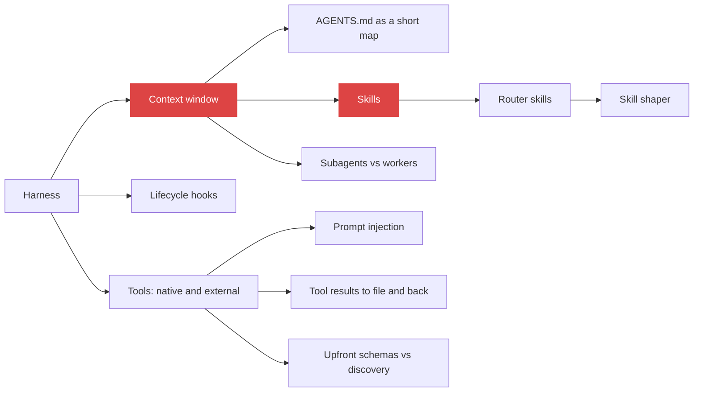

# Lecture 2: Context, AGENTS.md, skills and tools

> What the harness puts in front of the model, how AGENTS.md, hooks, skills and tools shape it, and where each one fails.

Source: the lecture video, its written lesson pages and my own notes, one topic per file. Related: [Lecture 1: Mechanics behind generative AI](../Lecture_1_Mechanics_Behind_Generative_AI/README.md) · [Lecture 3: Simplify the codebase](../Lecture_3_Simplify_Codebase_&_Knowledge_Base/README.md) · [root README](../README.md)

## What this lecture covered

## Notes

The file names keep the numbering the folder already used (`1_` to `12_`, plus `Insight_1_`).

### Harness, context and hooks

| File | Name | What it covers | Keywords |
|---|---|---|---|
| [1_Harness.md](1_Harness.md) | Harness | Everything around the model (system prompt, instruction files, memory, tools, skills, hooks, reminders) that decides what the model sees | harness, system prompt, instruction files, memory, reminders |
| [2_agent_context_self_report.md](2_agent_context_self_report.md) | Agent context self-report | Ask the agent how it sees the conversation, and the answer shows gaps in my setup | self-report, context, planted gaps, setup gaps |
| [3_lifecycle_hooks.md](3_lifecycle_hooks.md) | Lifecycle hooks | Hooks attach my own deterministic logic to steps of the agent loop, unlike AGENTS.md requests the model may ignore | hooks, lifecycle events, deterministic, agent loop |
| [4_context_window.md](4_context_window.md) | Context window | Instructions can fail, so working with AI is about raising the chance of the result, and the note groups why they fail | context window, instruction failure, raising the chance |
| [Insight_1_Context_Agents.md](Insight_1_Context_Agents.md) | Context: AGENTS.md and CLAUDE.md | AGENTS.md loads into every session, so it is the main source of token waste and should be a short map | agents.md, claude.md, token waste, map |

### Skills

| File | Name | What it covers | Keywords |
|---|---|---|---|
| [5_skills.md](5_skills.md) | Skills: design, generation, security | A skill is a Markdown file loaded into context, optionally with scripts, and must be checked before install | skill, markdown, scripts, security |
| [6_router_skills.md](6_router_skills.md) | Router skills | Long skills are rarely followed in full, so a short router skill points to other skills | router skill, short skills, ask-matt |
| [7_skill_shaper_how_to_improve_skills.md](7_skill_shaper_how_to_improve_skills.md) | Skill shaper: improving skills | A meta-skill for shaping new skills or reshaping ones that trigger on the wrong requests | skill shaper, meta-skill, triggers |

### Tools and agents

| File | Name | What it covers | Keywords |
|---|---|---|---|
| [8_tools_native_and_external.md](8_tools_native_and_external.md) | Tools: native and external | Where a tool comes from decides its cost, control and trust, while the model uses all tools the same way | tools, native, external, trust |
| [9_tools_prompt_injection.md](9_tools_prompt_injection.md) | Tools and prompt injection | Models can be tricked into extracting data from one tool and exposing it through another | prompt injection, data leak, tools |
| [10_tool_results_context_to_file_and_back.md](10_tool_results_context_to_file_and_back.md) | Tool results: context to file and back | Oversized tool results are written to a file that the agent may read back | tool results, context, file, payload |
| [11_tool_upfront_vs_tool_discovery.md](11_tool_upfront_vs_tool_discovery.md) | Tools: upfront schemas vs discovery | Sending every tool schema upfront versus letting the agent discover tools, and whether that saves context | upfront schemas, discovery, break-even |
| [12_subagents_vs_workers.md](12_subagents_vs_workers.md) | Subagents vs workers | Subagents, workers and A2A are three different things used to keep interactions short and focused | subagents, workers, a2a, focused tasks |

Over MCP, the router skill is continued in [Week 2, Lecture 3: 04](../Week2_Lecture_3_MCP_MCP+Resources_Skills/04_Router_Skill_Across_MCP_Server_Skills_And_Harness.md).
