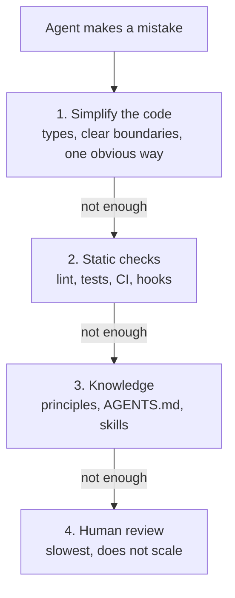

# 1. Simplify first: knowledge as guardrails

> When an agent keeps making mistakes, **fix the codebase first**. Knowledge (AGENTS.md, skills, docs) is a last resort, and every piece must have a **type** and a **way to be reviewed**.

Related: [2 Dumb questions rule](02_Dumb_Questions_Rule.md) · [3 Agent asks dumb questions](03_Agent_Asks_Dumb_Questions.md) · [4 Ask why](04_Ask_Why.md) · [5 Knowledge as files for agents](05_Knowledge_As_Files_For_Agents.md) · [10 Demos: reaching the right files](10_Demos_Reaching_The_Right_Files.md) · [11 Known techniques](11_Knowledge_Base_Problems_And_Known_Techniques.md) · [Lecture 2: 3 Lifecycle hooks](../Lecture_2_Context_Agents_md_Skills_Tools/3_lifecycle_hooks.md) · [5 Skills](../Lecture_2_Context_Agents_md_Skills_Tools/5_skills.md) · [7 Skill shaper](../Lecture_2_Context_Agents_md_Skills_Tools/7_skill_shaper_how_to_improve_skills.md)

Source: lecture s01e03 transcript. Key claims were **checked on the web on 2026-11-07**. See [Fact-check](#fact-check-of-the-lecturer).

## 1. The problem

Our agent makes silly mistakes. Where do we fix it?

| Instinct (the trap) | Lecture's answer |
|---|---|
| More rules, comments, a map of the repo, more tests | **Make the codebase simpler** so the mistake can't happen |

Every new thread is a **new hire with wiped memory**. We don't need to put everything in its head. We need clear paths so it can **find** things, and walls so it **doesn't hurt itself**.

The three techniques that find the problems are in their own notes. They are related, but they are different ideas:

| Note | Idea | Who asks whom |
|---|---|---|
| [2 Dumb questions rule](02_Dumb_Questions_Rule.md) | Make people surface confusion | New hire asks the lead |
| [3 Agent asks dumb questions](03_Agent_Asks_Dumb_Questions.md) | See the repo through a cold-start agent | Agent asks us |
| [4 Ask why](04_Ask_Why.md) | Find the cause of a mistake | We ask the agent |

This note is the hub: **what to do with what they find**.

## 2. Words refinement

| Term | Meaning here |
|---|---|
| **Knowledge system** | AGENTS.md, rules, skills, comments, docs: prose the agent must read and judge |
| **Guardrail** | A wall that stops a mistake. Best: enforced by a machine (types, lint, CI, hooks) |
| **Principle** | A short rule of judgment with a reason, e.g. "one obvious way to do it" |
| **Spaghetti** | Code that is confusing even to a human. Writing it down in docs does not fix it |
| **Over-engineering** | Complexity nobody asked for: extra layers, tests for edge cases that don't matter |
| **Bouncy house** | The lecture's picture: guidance is soft walls around the road, not the only road |

## 3. Fix order

Each step down is a bigger failure.

**Important:**
- The cheapest fix is at the top. The more you fix there, the less you need below.
- Layer 3 can't be enforced. The agent decides whether to follow it.
- Layer 4 is last because agents land code faster than people can read it.

**Not important:**
- The exact layer names. Other writers use different ones.

## 4. Knowledge: guardrails and principles, by type and reviewability

Our position: **the knowledge system stays a last resort and a cost.** We don't soften that. What makes it safe is knowing what each piece is and how we check it.

| Type | Example | Who reviews it | Enforced? | Our rule |
|---|---|---|---|---|
| **Executable guardrail** | Types, lint rule, test, CI, hook | Machine, every run | Yes | **Prefer.** Always try this first |
| **Discoverable fact** | File tree, dependencies, "where is X" | Nobody. The agent reads it | n/a | **Don't write it.** It goes stale |
| **Principle** | "One obvious way", "no new abstraction for one user" | Human at PR time | No | Few, short, **each with a reason**. If it can be checked mechanically, promote it to lint |
| **Non-discoverable fact** | Why we chose X, the exact test command, org rules | Human, with owner and date | No | Short. Prune on a schedule |
| **Procedure or judgment** (skill) | "Babysit a PR", "review an API change" | Evals: baseline, hits and near misses (see [7 Skill shaper](../Lecture_2_Context_Agents_md_Skills_Tools/7_skill_shaper_how_to_improve_skills.md)) | No | Only if a baseline run shows the agent gets it wrong without it |

**The review test for any line of knowledge:**
1. What **type** is it?
2. **Who** reviews it, and **how**? (a machine, a human with an owner, or an eval)
3. If we can't answer 2, **don't write it**.

**Important:**
- Knowledge we can't review rots silently. That is the real danger, not length.
- A principle that keeps being broken is a **lint rule waiting to be written**.
- This table is about **instruction** knowledge, which stays tiny. Large **domain** knowledge (wikis built and kept by agents) is in [5 Knowledge as files for agents](05_Knowledge_As_Files_For_Agents.md).

## 5. Simple, even oversimplified (our wording)

This section is our own reasoning, not from the lecture. The lecturer says "simple". We make it a set of tests we can run.

1. **Explain-back test.** A fresh agent and a new human can each explain this module in three sentences. If either can't, it is not simple.
2. **Both readers.** If the agent is confused and we are too, the problem is the code, not the agent.
3. **Oversimplify first.** Start with the simplest version that could work. Add complexity only when a real failure forces it. This is the baseline method from [7 Skill shaper](../Lecture_2_Context_Agents_md_Skills_Tools/7_skill_shaper_how_to_improve_skills.md).
4. **Complexity needs a receipt.** Every extra layer must have a recorded reason. No reason, no layer.
5. **Simple is cheaper to review.** Review time is the real limit when agents write fast. A small diff we understand is worth more than a big diff we trust.
6. **Don't break it.** Chesterton's fence: before removing complexity, find out why it was there. Oversimplified is fine. Broken is not.
7. **Spaghetti and over-engineering are both unacceptable.** Agents can clean code up cheaply, so "it's too hard to fix" is no longer an excuse.

**Summary line for the lecture:**
> Make it so simple that a stranger, human or agent, understands it at a glance. If it still needs a long explanation, simplify the code, not the explanation.

## Fact-check of the lecturer

Checked on **2026-11-07** with web search. Verdicts: **agrees** / **differs** / **lecture-specific** (opinion) / **unverified**. Several results were blog posts, not primary sources, and are marked.

| # | Lecturer's claim | Verdict | What we found |
|---|---|---|---|
| 1 | Don't put a map of the repo in the knowledge file. The agent finds it itself | **Agrees** | Claude Code docs: the file works best when it holds only what Claude can't work out from the code. Anthropic's guide lists "anything Claude can figure out by reading code" and "file-by-file descriptions" as things to leave out. [Best practices](https://code.claude.com/docs/en/best-practices), [Memory](https://code.claude.com/docs/en/memory). **Nuance (added 2026-11-08):** this holds for **code**. For a wiki whose context notes use other words, a short map helped a lot in the course example. See [10 Demos: reaching the right files](10_Demos_Reaching_The_Right_Files.md) |
| 2 | Keep prose minimal. Use it as a last layer | **Agrees** | Docs say to keep each file short (target under 200 lines) and to include only misleading spots, unrecorded decisions, commands, and repeated corrections. These are exactly our "non-discoverable fact" type. [Memory](https://code.claude.com/docs/en/memory) |
| 3 | Prose can't be enforced, so move rules into code and checks | **Agrees** | Docs: if something must happen every time, use a hook, a deny rule or a managed setting. CLAUDE.md is guidance, and the agent may decide it does not apply. Matches [3 Lifecycle hooks](../Lecture_2_Context_Agents_md_Skills_Tools/3_lifecycle_hooks.md). [Best practices](https://code.claude.com/docs/en/best-practices) |
| 4 | Context files may not even help, and cost more | **Agrees (supports him, goes further)** | ETH Zurich / ICLR 2026 paper: AGENTS.md-style files gave **no significant gain** in task success and raised cost by **over 20%**. LLM-written files were slightly worse; human-written files gave a small gain. Python-only, so don't over-generalize. Check the paper tables before quoting numbers. [arXiv 2602.11988](https://arxiv.org/abs/2602.11988) |
| 5 | Make the right thing the easy thing. Stronger types, clear boundaries | **Agrees** | Well-known principle "make illegal states unrepresentable" (Yaron Minsky, OCaml; sources disagree on year, 2010 or 2011). Poka-yoke (mistake-proofing) comes from Shigeo Shingo at Toyota, 1960s. Sources are blogs and encyclopedias. [DevIQ](https://deviq-hugo.pages.dev/principles/make-illegal-states-unrepresentable/), [Six Sigma DSI](https://sixsigmadsi.com/glossary/poka-yoke/) |
| 6 | Push checks into lint, tests, CI | **Agrees** | Practitioner posts describe lint rules and structural checks as machine-enforced architecture, and recommend cheapest evidence first (format and lint, then types, then small tests). Blogs only, no official Cursor source found. [Six-layer lint harness](https://understandingdata.com/posts/six-layer-lint-harness-case-study/), [Mechanical constraints](https://contexthorizon.substack.com/p/mechanical-constraints-for-agents) |
| 7 | Agents write too much code and over-engineer | **Partly supported, weak evidence** | One arXiv study looked at AI-written methods that reviewers deleted. It supports "AI code tends to be larger". We found no controlled study showing that a "keep it simple" rule fixes it. A broad "be simple" rule can backfire. [arXiv 2602.17091](https://arxiv.org/html/2602.17091) |
| 8 | The 271-line PR story | **Anecdote** | One case from one person. Good as an illustration, not as proof |
| 9 | "Use principles from the Cursor / SpaceX AI tweet to audit your code" | **Unverified** | We could not find the tweet. Only blog posts with similar ideas turned up. Mark "verify before presenting" |
| 10 | AGENTS.md is the shared place for agent instructions | **Agrees** | Open format, plain Markdown, no required fields, now stewarded by the Agentic AI Foundation (Linux Foundation). Matches our own `AGENTS.md` plus `CLAUDE.md` setup. [agents.md](https://agents.md/), [GitHub](https://github.com/agentsmd/agents.md) |

Claims about the three techniques are checked in their own notes: [2](02_Dumb_Questions_Rule.md#fact-check), [3](03_Agent_Asks_Dumb_Questions.md#fact-check), [4](04_Ask_Why.md#fact-check).

### What this changes in the lecture's message

- **Stronger than he says:** the paper suggests even a good AGENTS.md may not raise success. So keep ours short.
- **Our addition:** knowledge is acceptable only when it has a type and a review path (section 4). The lecturer gives the direction (avoid prose). We add the test.

## Cautions

- **This repo is notes, not a codebase.** The advice applies to code we build, not to these files.
- **Restricted Data.** Audit prompts that read Slack, chat or history across machines may expose PII or customer data. Under Aras policy, remove identifiers first and check the [AI Solutions Catalog](http://aitools.aras.com/).
- **Models change quickly.** Re-check before presenting.
- **Don't over-simplify blindly.** If we cut something we don't understand, we may remove a real safeguard.

## Summary

Fix the code first, then lint and CI, then (only if needed) a short line of knowledge. Every line of knowledge needs a type and a reviewer. Keep everything simple enough that a human and an agent both understand it at a glance.

## Open questions for discussion

- Which repeated mistake do we turn into a lint rule first?
- Is our `AGENTS.md` short enough? Which lines would a baseline run show the agent does not need?
- Who owns the review of non-discoverable facts, and how often do we prune?

## Sources

- Lecture s01e03 transcript (the claims we checked above)
- [Claude Code: Best practices](https://code.claude.com/docs/en/best-practices) and [How Claude remembers your project](https://code.claude.com/docs/en/memory)
- [Evaluating AGENTS.md (arXiv 2602.11988)](https://arxiv.org/abs/2602.11988)
- [AGENTS.md open format](https://agents.md/)
- [arXiv 2602.17091](https://arxiv.org/html/2602.17091) (we only saw a search summary, so read it before quoting)
- Blog posts, lower trust: [DevIQ](https://deviq-hugo.pages.dev/principles/make-illegal-states-unrepresentable/), [Six Sigma DSI](https://sixsigmadsi.com/glossary/poka-yoke/), [lint harness](https://understandingdata.com/posts/six-layer-lint-harness-case-study/), [mechanical constraints](https://contexthorizon.substack.com/p/mechanical-constraints-for-agents)
- Section 4 (knowledge types and review test), section 5 (simplicity tests) and the open questions are our own reasoning, not from the lecture
