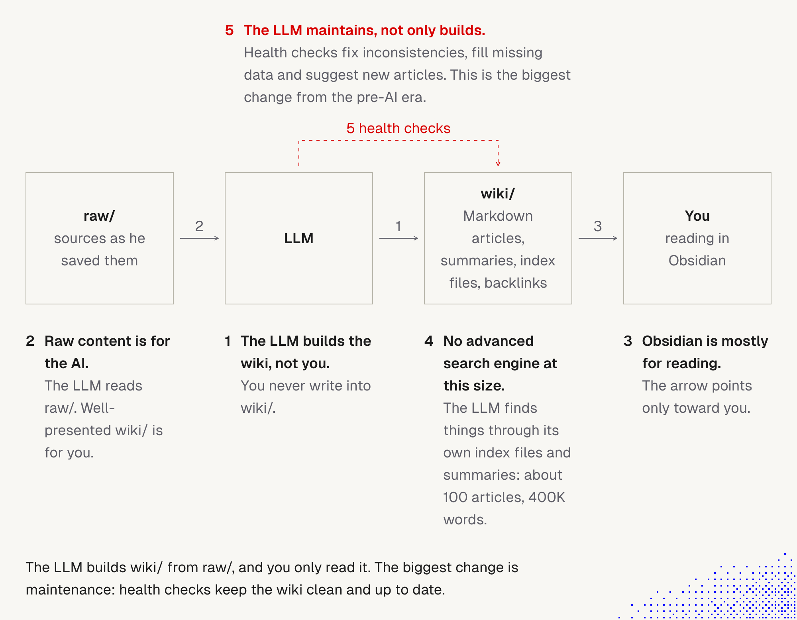
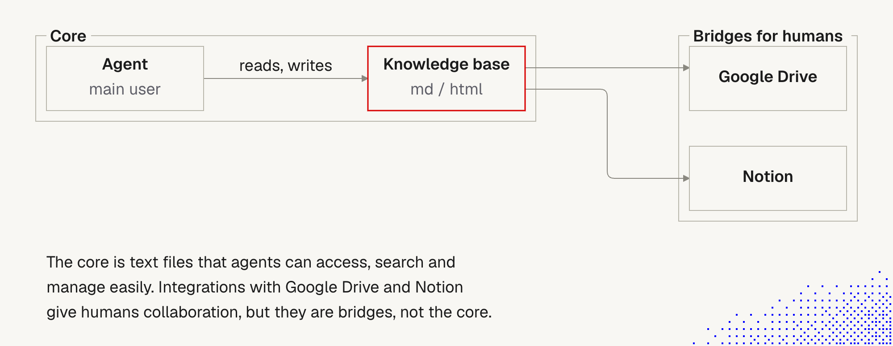
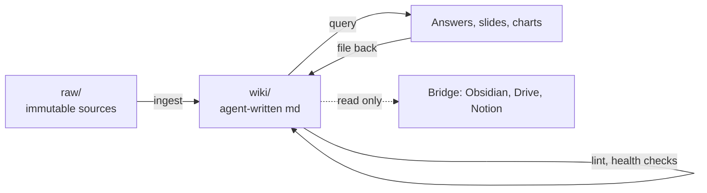
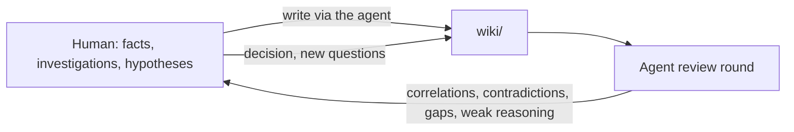

# 5. Knowledge as files, built for agents

> Build the knowledge base **for the agent first**: plain Markdown, immutable raw sources, an agent-written wiki, a short schema file. The agent maintains it. Humans get a read-only **bridge**.

Related: [1 Simplify first](01_Simplify_First_Knowledge_Guardrails.md) · [6 Beyond Markdown (mdx, svx)](06_Beyond_Markdown_mdx_svx.md) · [7 The explainer skill](07_Explainer_Skill.md) · [Lecture 2: 1 Harness (memory vs knowledge base)](../Lecture_2_Context_Agents_md_Skills_Tools/1_Harness.md) · [10 Tool results, context to file](../Lecture_2_Context_Agents_md_Skills_Tools/10_tool_results_context_to_file_and_back.md) · [9 Prompt injection](../Lecture_2_Context_Agents_md_Skills_Tools/9_tools_prompt_injection.md) · [Lecture 1: 17 Ambient agents](../Lecture_1_Mechanics_Behind_Generative_AI/17_ambient_durable_agents.md)

Source: lecture text on knowledge bases, two lecture images, and Karpathy's [X post](https://x.com/karpathy/status/2039805659525644595) (text pasted by us, the page itself was not fetchable) and [gist](https://gist.github.com/karpathy/442a6bf555914893e9891c11519de94f) (read in full). Checked on the web on 2026-11-07, see [Fact-check](#fact-check).

## 1. The problem

Who is the knowledge base **for**, and who **maintains** it? The old answer was "humans write documents for humans". The lecture asks whether that still holds when agents do most of the reading.

## 2. Words refinement

| Term | Meaning here |
|---|---|
| **Instruction file** (AGENTS.md, CLAUDE.md) | Short rules for the agent. Covered in [note 1](01_Simplify_First_Knowledge_Guardrails.md): a last resort, kept tiny |
| **Memory** | The agent's own notes between sessions |
| **Knowledge base / wiki** | Large, durable **domain** knowledge. This note |
| **Raw sources** | Original inputs (articles, papers, repos). Never edited. The source of truth |
| **Schema** | The file that tells the agent how to run the wiki (naming, workflows). Can be AGENTS.md or CLAUDE.md |
| **Bridge** | A human-facing view or sync of the base (Google Drive, Notion, Obsidian). Not the core |
| **Knowledge through the agent** | Humans get knowledge by asking the agent, not by reading documents |

**Two kinds of knowledge, kept apart.** [Note 1](01_Simplify_First_Knowledge_Guardrails.md) says prose is a cost and a last resort. That is about **instruction** knowledge (rules, skills), which must stay small. This note is about **domain** knowledge (what the product, the research or the work is), which can be large. The ETH paper from note 1 tested AGENTS.md-style files, not wikis, so it does not apply here.

## 3. The lecture's premises

> Agents are spreading, even among non-technical people. Knowledge reaches humans **through** an agent. Documents are managed and consumed by agents, rarely by humans. Agents process many documents fast. Often we need only the outcome, not the document.

The lecture adds that these points are **not true for most organizations today**, but are changing fast. So: build for agents, and use human tools only as bridges.

This is a **forecast**, not a fact. See the fact-check.

## 4. The pictures

### Karpathy's knowledge base

**The story.** Sources go into `raw/`. The LLM reads them and builds `wiki/` (Markdown articles, summaries, index files, backlinks). The human only **reads** the result in Obsidian. A loop of "health checks" lets the LLM fix inconsistencies, fill gaps and suggest new articles, so the wiki stays clean.

**Important:**
- The arrows point one way: the LLM writes, the human reads. (In our own practice the human also adds facts and investigations through the agent, see [section 7](#7-thinking-rounds-our-own-practice).)
- Maintenance is the new part. Building a wiki is old. Keeping it healthy by itself is not.
- Raw content stays separate from the wiki, so the source of truth survives.

**Not important:**
- Obsidian specifically (Karpathy calls it optional).
- The box numbering.

### Knowledge through the agent

**The story.** The agent is the main user. It reads and writes a knowledge base made of `md` or `html` files. Google Drive and Notion hang off the side as **bridges for humans**, so people can collaborate, but they are not the core.

**Important:**
- The core is text files that agents can access, search and manage easily.
- Bridges are optional views. They are not the source of truth.

**Not important:**
- Which two bridge tools are drawn.

## 5. The pattern (verified in Karpathy's own words)

| Part | What it is | Who writes it |
|---|---|---|
| `raw/` | Sources: articles, papers, repos, datasets, images. Web articles saved as Markdown with a clipper, images downloaded locally | Human adds, nobody edits |
| `wiki/` | Summaries, concept articles, backlinks, index files, in a folder tree | **LLM** ("I rarely touch it directly") |
| Schema | A conventions file, e.g. CLAUDE.md or AGENTS.md | Human and LLM together |
| Our addition: own notes | Our facts, investigations, hypotheses, decisions, entered **through the agent** | Human content, agent files it |
| Q&A | Ask complex questions. The LLM researches the wiki | LLM |
| Output | Markdown files, slides (Marp), charts. **Often filed back into the wiki**, so explorations "add up" | LLM |
| Lint | Health checks: inconsistent data, missing data (filled by web search), ideas for new articles | LLM |

The loop that matters is **file back + lint**: the base improves with use, and a periodic check keeps it honest.

## 6. Our refinement: apply the types-and-review test

From [note 1, section 4](01_Simplify_First_Knowledge_Guardrails.md#4-knowledge-guardrails-and-principles-by-type-and-reviewability): every piece of knowledge needs a **type** and a **way to be reviewed**. An agent-written wiki is the case where this matters most, because nobody reads every page.

| Part | Type | How it is reviewed | Rule |
|---|---|---|---|
| `raw/` | Source of truth | Provenance: where did it come from, when | Immutable. Keep the origin and date |
| `wiki/` page | Derived knowledge | Every claim links back to a raw source. Lint checks contradictions, stale claims, orphans. Git diff shows what changed. Humans spot-check | **No claim without a source link** |
| Schema file | Instruction knowledge | Human, short, reviewed like code | Small. Follows note 1 |
| Bridge | View | Nothing to review. It is generated | **One-way by default.** If humans edit in Notion, whose version wins? |
| Index and log | Navigation | Machine-updated, append-only log | Keep the log so changes can be traced |

**Important:**
- A wiki the agent writes and nobody can check is a rumor mill. Raw sources, source links, lint and git are what make it reviewable.
- Simple still wins: files in a folder, one index, no extra infrastructure until it hurts (see [note 1, section 5](01_Simplify_First_Knowledge_Guardrails.md#5-simple-even-oversimplified-our-wording)).

## 7. Thinking rounds (our own practice)

Karpathy uses the wiki to **learn from sources**. We also use it to **check our own thinking**. This comes from our own working practice, not from the lecture or from Karpathy.

**Scope: how we think, not Aras business.** This wiki holds the way we think, how we analyze, and what we struggle with. It does **not** hold Aras business secrets, customer data, PII, credentials or other Restricted Data. If an example needs business detail, we abstract it ("a customer", "a service") before it goes in. This keeps us inside the Aras data rules and keeps the notes safe to share and present.

**The practice.** We write our facts and investigations into the wiki **through the agent**. Then we ask the agent to review them: find correlations, contradictions and holes in our reasoning. Each round shows issues we missed, so our decisions improve.

**What this changes in the picture.** The human is not only a reader. The human is a **source author**. So the real rule is not "never write", but **keep who wrote what visible**:

| Content | Written by | Rule |
|---|---|---|
| Source material (articles, papers) | Human adds, nobody edits | Immutable, with origin and date |
| **Our own notes** (facts, investigations, hypotheses, decisions) | Human content, agent files it | Dated. The agent **must not silently rewrite** our words |
| Agent's review (correlations, issues, questions) | Agent | Kept in a separate place, so the critique is never mixed into our own text |
| Wiki summaries and concept pages | Agent | Every claim links to a source or to one of our notes |

**Label each note by type**, so the agent can review it properly:

| Label | Meaning | What the review does |
|---|---|---|
| **Fact** | Has a source or a check | Verify the source, look for conflicts |
| **Observation** | Something we saw, not yet checked | Ask how to check it |
| **Hypothesis** | Our guess | Look for evidence for and against |
| **Decision** | A choice, with the reasons | Look for weak reasons, ignored options, what would change our mind |

**Review prompts that work as a round:**
- "Which of my claims have no source or contradict something already in the wiki?"
- "Find correlations between these two investigations that I did not mention."
- "Argue against my decision as strongly as you can. What did I ignore?"
- "What would change my mind? What is the cheapest way to test it?"

These reuse ideas we already have: a pre-mortem and steelman from [7 Skill shaper](../Lecture_2_Context_Agents_md_Skills_Tools/7_skill_shaper_how_to_improve_skills.md), and the verify-the-answer step from [4 Ask why](04_Ask_Why.md#5-how-to-verify-the-answer).

**The main danger: agreeing too much.** An agent reviewing our thinking may flatter us. See fact-check row 14. So ask it to **attack**, not to confirm. Ask for evidence, not praise. Run important rounds in a **fresh session**, because a long session has already absorbed our view.

**Our fix: give the agent the opponent's role.** We ask it to find issues in our thinking and to **argue against us**. A role with a job pushes back harder than a plain "what do you think?". This keeps the discussion balanced instead of drifting into agreement.

An assigned opponent has its own risk: it may **invent objections** just to do its job. So we ask for:

| Ask for | Why |
|---|---|
| The **strongest** counterargument, not a list of ten | Quality over volume |
| Evidence or a source for each objection | Separates a real issue from a made-up one |
| A verdict per objection: **holds / weak / unclear** | Stops us from treating every objection as equal |
| What the opponent got **right about our side** | Keeps the round honest in both directions |

Then we decide which objections hold, and write that down as a **decision** note, with the reasons.

## 8. Our own repo as an example

This is our own reasoning.

- This repo is a **human-read** knowledge base: `AGENTS.md` says its output is Markdown that we re-read and present. So it sits in the middle: written together with an agent, read by a human.
- We already have the seed of a **lint**: the rule to keep `Related:` lines, numbers and links in sync, and the "verify before presenting" marks.
- A possible health check: ask an agent to scan the notes for broken relative links, mismatched numbers, and claims still marked "verify before presenting" or dated long ago. Review the result before changing anything.
- A bigger move (a raw/ folder for sources, a compiled wiki) is a choice for later, not a need today.

## Fact-check

Checked on **2026-11-07**. The X post text was pasted by us. The gist was fetched. Verdicts: **agrees** / **differs** / **lecture-specific** (opinion) / **unverified**.

| # | Claim | Verdict | What we found |
|---|---|---|---|
| 1 | The pattern: raw sources, LLM-written wiki, schema, ingest/query/lint | **Agrees** | Karpathy's [gist](https://gist.github.com/karpathy/442a6bf555914893e9891c11519de94f) (created April 4, 2026): raw sources are immutable, the wiki is LLM-owned Markdown, the schema (CLAUDE.md or AGENTS.md) is co-evolved. His [X post](https://x.com/karpathy/status/2039805659525644595) (April 2, 2026) describes the same flow |
| 2 | "About 100 articles, 400K words" | **Agrees** | In the X post, for one wiki on a research topic. The gist says "~100 sources, ~hundreds of pages" and no word count. One person, one wiki |
| 3 | "You never write into the wiki" (lecture image) | **Differs, slightly** | Post: "I rarely touch it directly". Gist: "never (or rarely)". Not an absolute rule. Our practice goes further on purpose: we add our own facts and investigations **through the agent** (section 7). The sources describe humans adding sources and questions, not their own reasoning |
| 4 | No advanced search engine needed at this size | **Agrees, with a nuance** | The LLM keeps index files and short summaries. But he also vibe-coded a small search engine, used by hand and as a CLI tool for the LLM. Gist: the index is enough small, "as the wiki grows you want proper search" |
| 5 | The biggest change is that the LLM maintains the base | **Lecture's emphasis** | Both sources describe linting as one part of five. Neither gives accuracy or error data. Plausible, unmeasured |
| 6 | (missing from the lecture list) Outputs are filed back, so knowledge compounds | **Adds** | In both sources. We include it in section 5 |
| 7 | The five premises: knowledge reaches humans through agents, documents are read by agents, often only the outcome matters | **Lecture-specific forecast** | No source found. The lecturer says it is not true for most organizations today |
| 8 | This works for a company, not just one person | **Unverified** | Karpathy's setup is personal ("personal knowledge bases for various topics of research interest"). The gist's only team note: "possibly with humans in the loop reviewing updates". Nothing at company scale |
| 9 | Agent-written wikis stay accurate | **Unverified, real risk** | Neither source gives error rates or hallucination data. Our [17 Ambient agents](../Lecture_1_Mechanics_Behind_Generative_AI/17_ambient_durable_agents.md) notes that a nightly wiki cleanup with no review can lose facts |
| 10 | Humans and the agent can both edit the wiki | **Unverified** | The gist gives no procedure for human edits or for conflicts between human and LLM edits |
| 11 | Finetune a model to "know" the wiki in its weights | **His speculation** | The post lists it under "further explorations". Not a recommendation |
| 12 | Popular, so it works | **Not evidence** | The post had 22M views and Lex Fridman said he has a similar setup. That is social proof only |
| 13 | A product could replace the "hacky scripts" | **His opinion** | The post's last line. Today it is a personal workflow, not a standard |
| 14 | An agent reviewing our own thinking can be trusted to push back | **Risk, supported** | Sharma et al. (Anthropic, ICLR 2024): five assistants (Claude 1.3 and 2.0, GPT-3.5 and GPT-4, Llama 2 70B) consistently showed sycophancy, meaning they favour answers that match the user's views. Human feedback is a likely cause. Models are newer now, so re-test. [arXiv 2310.13548](https://arxiv.org/abs/2310.13548) |
| 14b | Assigning the agent an opponent's role fixes the agreeing problem | **Our practice, unverified** | It works for us in practice. We found no source that tests it. The opposite risk (an opponent that invents objections to fill its role) is our own reasoning, not measured. Hence the evidence and verdict columns above |
| 15 | Using the wiki to review our own reasoning ("thinking rounds") | **Our own practice, unverified** | Karpathy's lint finds inconsistent data and connections for new articles. Reviewing the author's **reasoning** and **decisions** is our extension. Neither source covers it, and we found no study. Judge it by our results: did the rounds change a decision for the better? |

## Cautions

- **Restricted Data.** A knowledge base built from raw sources can swallow PII, customer data, credentials or trade secrets. Under Aras policy, do not put them in. One comment under the post describes exporting all personal data from every service into one place. We would not do that, and the policy forbids it for Restricted Data. Check the [AI Solutions Catalog](http://aitools.aras.com/).
- **Prompt injection.** Web-clipped raw sources are untrusted text the agent will read. See [9 Prompt injection](../Lecture_2_Context_Agents_md_Skills_Tools/9_tools_prompt_injection.md).
- **Silent drift.** An agent that rewrites its own wiki can lose or distort facts. Keep raw sources, source links, a log and git history, and review diffs.
- **Bridges can fork the truth.** If humans edit in Notion or Drive, decide which side wins before syncing.
- **Scale.** The index-only approach was shown at about 100 sources. Re-check when the base is much larger.
- **Forecast, not fact.** Treat the "agents will read everything" premises as a direction, not a plan.
- **Human review.** AI-written knowledge that others will use needs a human to review and own it.
- **Flattery in thinking rounds.** The agent may agree with us too easily (fact-check row 14). Ask it to attack, use a fresh session, and ask for evidence.
- **Keep to thinking, not business data.** We write about how we think, analyze and struggle. No Aras business secrets, customer data, PII or credentials. Investigations drift toward real details, so check each note before the agent files it, and abstract any example. Same Restricted Data rule as above.
- **Mixing voices.** If the agent rewrites our notes, we lose track of what we actually thought. Keep our words, the agent's review and the agent's summaries apart.

## Summary

For domain knowledge, files beat documents: plain Markdown that an agent can read, search and maintain, with immutable raw sources, source links on every claim, and a regular health check. Humans read through a one-way bridge. We add our own facts and investigations through the agent, then run review rounds that ask it to find contradictions and weak reasoning, while keeping our words and the agent's critique apart. Instruction knowledge stays tiny, as in note 1.

## Open questions for discussion

- Which of our knowledge (product, process, research) is a candidate for a `raw/` plus `wiki/` structure?
- Who reviews the agent-written wiki, and how often?
- Do we need a bridge for non-technical colleagues, and is it one-way?
- Do we try a small health check on this repo first?
- Which labels (fact, observation, hypothesis, decision) do we actually use, and where do we keep the agent's reviews?
- How do we measure whether thinking rounds improve decisions, and how do we keep the agent from just agreeing?
- How do we tell a real objection from one the opponent invented to fill its role?

## Sources

- Karpathy, [LLM Knowledge Bases](https://x.com/karpathy/status/2039805659525644595), X post, April 2, 2026 (text pasted by us, the page itself returned HTTP 402 when fetched)
- Karpathy, [llm-wiki.md](https://gist.github.com/karpathy/442a6bf555914893e9891c11519de94f), gist, April 4, 2026 (read in full)
- Lecture text and two lecture images (copied to `img/`)
- Third-party write-ups of the pattern were seen only as search snippets and are not relied on
- Sharma et al., [Towards Understanding Sycophancy in Language Models (arXiv 2310.13548)](https://arxiv.org/abs/2310.13548), ICLR 2024 (seen as a search summary, read the paper before quoting details)
- Section 6 (types-and-review table), section 7 (thinking rounds) and section 8 (our repo) are our own reasoning, not from the lecture or from Karpathy
