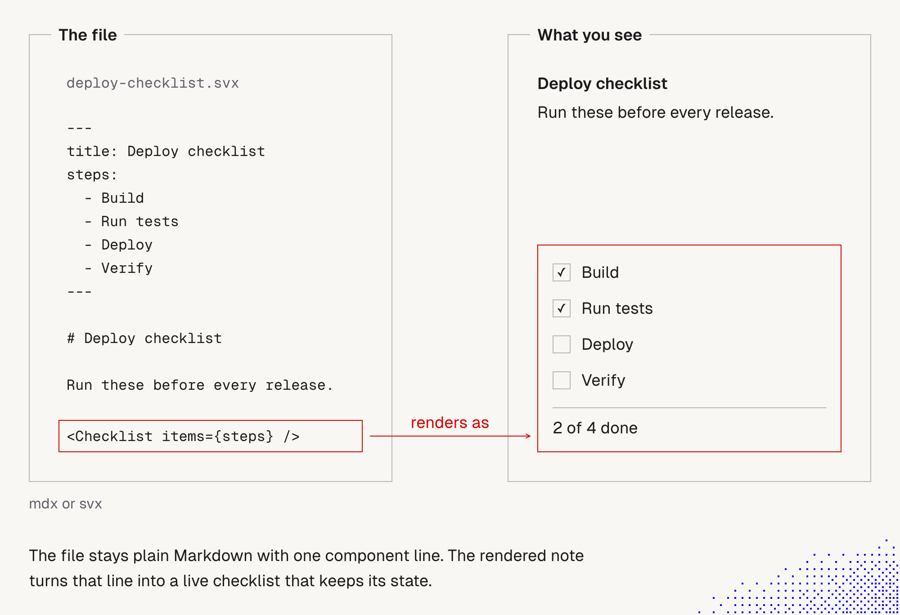
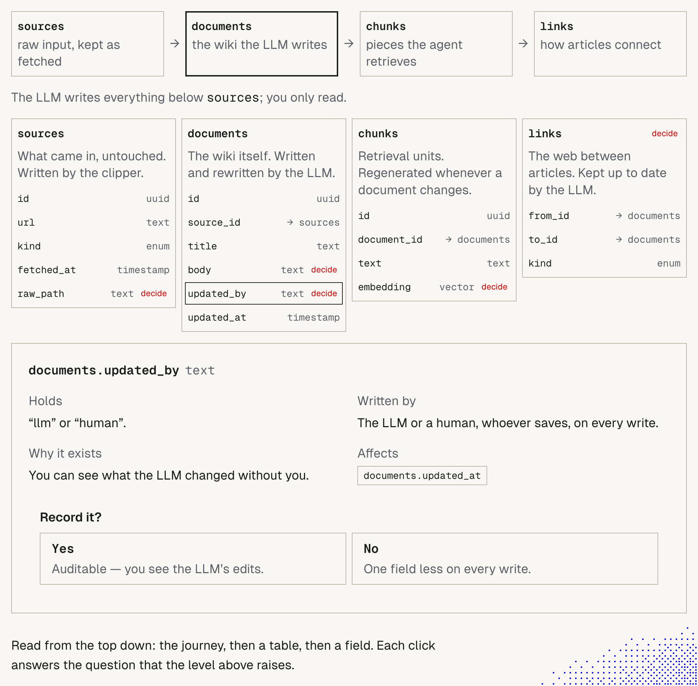

# 6. Beyond Markdown: mdx and svx

> Plain Markdown stays the core. mdx and svx add **components** to a file, so a note can be interactive. Use them only where the interaction pays for itself.

Related: [5 Knowledge as files for agents](05_Knowledge_As_Files_For_Agents.md) · [7 The explainer skill](07_Explainer_Skill.md) · [1 Simplify first](01_Simplify_First_Knowledge_Guardrails.md) · [Lecture 2: 9 Prompt injection](../Lecture_2_Context_Agents_md_Skills_Tools/9_tools_prompt_injection.md)

Source: lecture text "Beyond Markdown" and two lecture images. Key claims checked on the web on 2026-11-07, see [Fact-check](#fact-check).

## 1. The problem

Markdown is easy to read and easy for agents to write, but it is flat. For a complex idea we want a broad view first, with detail on demand, without a wall of text. Can we get that and still keep simple files?

## 2. Words refinement

| Term | Meaning here |
|---|---|
| **Markdown (md)** | Plain text with light formatting. The core of our notes |
| **HTML** | Markup a browser renders. Can hold anything, but is harder to read raw |
| **MDX** | Markdown plus JSX components, compiled to JavaScript. [mdxjs.com](https://mdxjs.com/docs/what-is-mdx/) |
| **svx / mdsvex** | The same idea for Svelte, "MDX for Svelte". Files end in `.svx`. [mdsvex docs](https://mdsvex.pngwn.io/docs) |
| **Component** | A reusable piece of interface, such as a checklist, placed in a file with one tag |
| **State** | What a component remembers, such as which boxes are ticked |
| **Artifact** | A rendered page we generate from source. Not the source itself |

## 3. The pictures

### A file that renders as a live checklist

**The story.** On the left is the file `deploy-checklist.svx`. It has front matter with a title and four steps (Build, Run tests, Deploy, Verify), a heading, one sentence, and one line: `<Checklist items={steps} />`. On the right, that line renders as a checklist with two boxes ticked and the text "2 of 4 done".

**Important:**
- The source stays plain Markdown with **one component line**.
- The data (the steps) lives in front matter, so the component can be reused in many files.
- The rendered note keeps its state.

**Not important:**
- The checklist content.

### A complex idea, top-down

**The story.** A strip at the top shows a journey: sources, documents (selected), chunks, links. Under it are four table cards with fields and types. Red "decide" tags mark open decisions. At the bottom, a card explains the selected field, `documents.updated_by`: it holds "llm" or "human", so you can see what the LLM changed without you. It asks "Record it?" and gives both sides: Yes (auditable) and No (one field less on every write).

**Important:**
- It reads in **three levels**: the journey, then a table, then a field. Each click answers the question the level above raises.
- Open decisions are **marked**, and each comes with its trade-off.
- `updated_by` is the same idea as our rule in [note 5](05_Knowledge_As_Files_For_Agents.md): keep who wrote what visible.

**Not important:**
- Field names, uuids and URLs. The lecture says they are illustrative.

**Where the picture comes from.** The lecture calls it an interactive schema explainer and points to a skill in a repository for examples. We did **not** find `decide` tags or an `updated_by` example in the explainer skill we copied. So we do not know what tool made this picture. See [note 7](07_Explainer_Skill.md).

## 4. The formats side by side

| | md | html | mdx | svx |
|---|---|---|---|---|
| Readable as raw text | Yes | Poor | Mostly (tags show) | Mostly (tags show) |
| Components, interaction | No | Yes (hand-written) | Yes (JSX) | Yes (Svelte) |
| Needs a build or renderer | No | A browser | Yes | Yes |
| Agent writes it easily | Yes | Yes | Yes | Yes |
| Where state lives | n/a | In the page | In the component | In the component |

The first rows and the build cost are our own reading of how these formats work. Treat them as our reasoning, not as verified facts.

## 5. Our rule: components only where interaction pays (proposed wording)

This is our own reasoning, not from the lecture. Please edit it.

Use a component only if **all** of these hold:

1. **The reader needs to explore**, not just read. Otherwise a table or a Mermaid diagram does the job.
2. **The file stays readable raw.** A person or an agent opening the source sees clear text and one tag, not a wall of code.
3. **State is not knowledge.** If the reader ticks a box, that tick lives in the browser, not in the file. Anything that must be kept goes into the file.
4. **The component is reused**, or it is clearly worth building once.
5. **The content is trusted.** MDX compiles to code, so untrusted text must not reach it (see cautions).

If any answer is no, stay with plain Markdown.

## 6. Fit with our rules

- **Diagrams in notes stay Mermaid.** mdx, svx and explainer pages are separate, generated artifacts. No conflict with our diagram rule.
- **Types and review** ([note 1](01_Simplify_First_Knowledge_Guardrails.md#4-knowledge-guardrails-and-principles-by-type-and-reviewability)): a component is **code**. It is reviewed like code, and state is not reviewable at all.
- **Source versus artifact** ([note 5](05_Knowledge_As_Files_For_Agents.md)): the source stays Markdown. The rich page is a one-way bridge for readers.

## Fact-check

Checked on **2026-11-07**. Verdicts: **agrees** / **differs** / **lecture-specific** (opinion) / **unverified**.

| # | Claim | Verdict | What we found |
|---|---|---|---|
| 1 | mdx lets us use components within Markdown | **Agrees** | MDX is JSX in Markdown, compiled to JavaScript, for any framework that supports JSX. [What is MDX?](https://mdxjs.com/docs/what-is-mdx/) |
| 2 | svx does the same for Svelte | **Agrees** | mdsvex is a preprocessor that lets Svelte components and Markdown work together, often described as MDX for Svelte. Docs list `.svx` as the extension. Older docs mention `.svexy`, so check your version. [mdsvex](https://mdsvex.pngwn.io/docs), [Svelte CLI docs](https://svelte.dev/docs/cli/mdsvex) |
| 3 | Components can be reused across many files | **Agrees** | Both tools work by importing components. Not tested by us |
| 4 | "Even state" | **Partly, and unclear where state lives** | A component can hold state. The lecture does not say whether the tick is saved, where, or for whom. **Unverified** |
| 5 | The source stays simple | **Plausible, unverified** | True for the one-line example. Real components in real notes may need imports and code blocks |
| 6 | Useful for complex ideas, broad view first, detail on demand | **Lecture-specific, plausible** | Matches progressive disclosure, which we already use ([7 Skill shaper](../Lecture_2_Context_Agents_md_Skills_Tools/7_skill_shaper_how_to_improve_skills.md)). No study found |
| 7 | Security of mdx | **Unverified here** | MDX compiles to JavaScript, so untrusted content is a risk. Check the security section of the MDX docs before relying on this |

## Cautions

- **Code, not text.** An mdx or svx file can run code. Do not put untrusted text into it. Agents read raw sources that may contain injections ([9 Prompt injection](../Lecture_2_Context_Agents_md_Skills_Tools/9_tools_prompt_injection.md)).
- **State outside the file.** A tick in a rendered page is not versioned or reviewed.
- **Tool lock-in.** mdx suits React-style stacks, svx suits Svelte. Pick one only if we have that stack.
- **Raw view.** In a plain Markdown viewer, the tags may show as text.
- **Restricted Data.** Same rule as before: no Aras business secrets, customer data or PII in any file or rendered page.

## Summary

Keep plain Markdown as the source. Add a component only where interaction pays for itself, the file stays readable, and no truth is stored in browser state. Rich pages are generated artifacts for readers.

## Open questions for discussion

- Is our wording of the rule right, and which test would you drop or add?
- Where do we have a note that is really hard to read flat (a candidate for a first component)?
- Do we have a Svelte or React stack that makes mdx or svx a natural fit?

## Sources

- Lecture text "Beyond Markdown" and the two lecture images (copied to `img/`)
- [What is MDX?](https://mdxjs.com/docs/what-is-mdx/)
- [mdsvex docs](https://mdsvex.pngwn.io/docs) and [Svelte CLI: mdsvex](https://svelte.dev/docs/cli/mdsvex) (seen as search summaries)
- Sections 4 (rows and build cost), 5 (our rule) and 6 are our own reasoning
