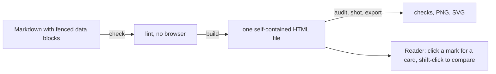
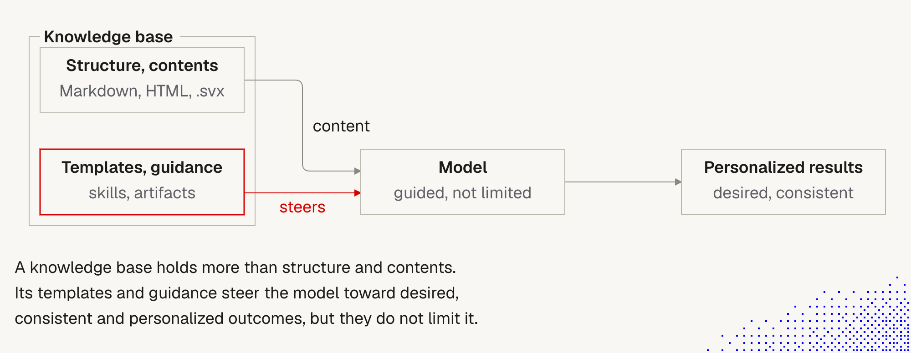
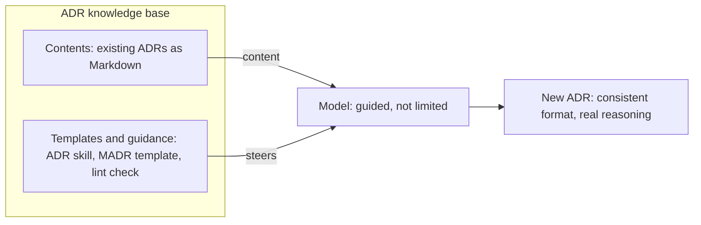

# 7. The explainer skill: a skill as an example

> A well-made skill that turns Markdown with data blocks into a clear, interactive HTML explainer. I keep a copy as an **example of how to build a skill**, and I plan to learn from it for my own skills, starting with ADR writing.

Related: [6 Beyond Markdown](06_Beyond_Markdown_mdx_svx.md) · [5 Knowledge as files for agents](05_Knowledge_As_Files_For_Agents.md) · [1 Simplify first](01_Simplify_First_Knowledge_Guardrails.md) · [13 Knowledge skill anatomy](13_Knowledge_Skill_Anatomy.md) · [Lecture 2: 5 Skills](../Lecture_2_Context_Agents_md_Skills_Tools/5_skills.md) · [7 Skill shaper](../Lecture_2_Context_Agents_md_Skills_Tools/7_skill_shaper_how_to_improve_skills.md)

Source: the skill itself, copied to [`.claude/explainer/`](../.claude/explainer/SKILL.md) (see [`SOURCE.md`](../.claude/explainer/SOURCE.md)). I read `SKILL.md` and one template. I did **not** run it and did **not** review its scripts.

## 1. The problem

Without help, an agent explains a system as a wall of text, or draws hand-made SVG where every box looks different, arrows cross boxes, and the diagram needs its own explanation. Can a skill make explanations consistent, and let a reader see the whole first and dig in later?

## 2. Words refinement

| Term | Meaning here |
|---|---|
| **Explainer** | A generated, reader-facing HTML page. It is an artifact, not source |
| **Fenced data block** | A code fence with structured data (for example `schema`, `sequence`, `flow`). This is the skill's input |
| **Template** | A starter document the skill copies. The copy has **42** templates |
| **Engine** | The code that places parts on a grid and builds the page. It decides the look, so the author does not style |
| **Bare and full view** | Bare: diagrams only. Full: plus title, prose, a reading panel and numbered notes |
| **Skill, not mdx or svx** | The explainer is **not** an mdx or svx tool. Its own description says "Not for Svelte or .svx documents". See [note 6](06_Beyond_Markdown_mdx_svx.md) |

## 3. What it is (verified in `SKILL.md`)

- **Input:** a Markdown document with data blocks. The agent decides **what** to show. The engine decides **how** it looks.
- **Output:** one HTML file. The skill says it makes no network requests. I have not tested that.
- **Interaction:** a click opens a card with computed facts and the `about` text. The whole state (selection, theme, view) lives in the **URL**, so a screenshot shows exactly what a reader saw.
- **Commands:** `new`, `build`, `watch`, `check`, `audit`, `shot`, `export`, `gallery`. Needs Bun 1.4 or later. Chrome is needed for `audit`, `shot`, `export` and `gallery`.
- **Blocks:** about thirty kinds: flows, sequences, states, charts, Gantt, kanban, schemas, UML, Wardley maps, reports and more.

## 4. What makes it a good example of a skill

Each point is checked against the file. The right column links to a rule I already have.

| What the skill does | Why it is good | My rule |
|---|---|---|
| Opens with **who reads the result** and **what goes wrong without the skill** | Gives the model the failure to avoid | [7 Skill shaper](../Lecture_2_Context_Agents_md_Skills_Tools/7_skill_shaper_how_to_improve_skills.md): "job to be done" |
| `SKILL.md` is **115 lines**. Details sit in `references/` and are read on demand | Progressive disclosure | [5 Skills](../Lecture_2_Context_Agents_md_Skills_Tools/5_skills.md) |
| A numbered **workflow**: read the real source, plan and say the plan, write, check, build, audit, report | The agent knows the order | note 7 |
| **Executable checks** (`check`, `audit`) before handing over | A machine catches what prose cannot | [1 Simplify first](01_Simplify_First_Knowledge_Guardrails.md): layer 2 |
| **Templates** and a **theme file**: style lives in one place, "never restyle inside a document" | Consistent output, less to decide | Guardrails over prose |
| **Budgets and "deletion first"**: 9 nodes, 12 connectors, 2 focal parts per figure | A simple, checkable limit | [1, section 5](01_Simplify_First_Knowledge_Guardrails.md#5-simple-even-oversimplified-my-wording) |
| **Plain technical English**: short sentences, `check` warns on sentences over 25 words | Clear for people and agents | My "simple" tests |
| A **Trust** section: Markdown text is escaped, but a `widget` body is code that runs in the reader's browser | Says where the danger is | [9 Prompt injection](../Lecture_2_Context_Agents_md_Skills_Tools/9_tools_prompt_injection.md) |
| An **"Ask yourself before building"** checklist | Self-review | note 7 |
| **Read the real source. Never invent a part** | Truthful output | [4 Ask why](04_Ask_Why.md): verify, don't assume |

## 5. Where it is not a perfect example (my view)

- **Size and prerequisites.** 179 files, about 2.3 MB, needs Bun and Chrome. That is a lot to carry for most skills. Most of mine need none of it.
- **The description is long.** It is about 890 characters and lists many chart types. My [skill shaper note](../Lecture_2_Context_Agents_md_Skills_Tools/7_skill_shaper_how_to_improve_skills.md) advises about 250 characters and no lists of examples. The skill follows its own style in the body but not that advice in the description.
- **One author's tool,** version 0.5.0. Treat it as inspiration, not a standard.
- **Not reviewed.** I have not read the scripts. Do not enable it before a review.
- **Works best with strong models.** The lecture says so. I have no source for it.

## 6. The picture: templates and guidance steer the model

**The story.** A knowledge base has two parts. The first is **structure and contents** (Markdown, HTML, `.svx`). It feeds the model with **content**. The second, drawn in red, is **templates and guidance** (skills, artifacts). It **steers** the model. The model is "guided, not limited". The result is **personalized results**: desired and consistent.

**Important:**
- A knowledge base holds more than facts. **Templates and guidance** are part of it, and they are the part that makes output consistent.
- "Guided, not limited" is the goal: the model still decides the content and keeps its options.
- The red box is the point of the picture. The explainer skill is exactly that box: templates, a theme and a workflow.

**Not important:**
- The exact box labels and the layout.

**My reading of "not limited".** It holds for **what to show**: the skill's author says "you decide what to show". It does not hold for **how it looks**: the engine decides, and the skill says "don't fight it with styling". So the explainer guides content and **limits** style, on purpose. This matches [note 7 (skill shaper)](../Lecture_2_Context_Agents_md_Skills_Tools/7_skill_shaper_how_to_improve_skills.md): concepts for judgment work, exact rules for fragile work. It also matches the "walls of a bouncy house" idea in [note 1](01_Simplify_First_Knowledge_Guardrails.md).

## 7. Idea: use it for ADRs

This section is my own reasoning.

The picture fits ADRs directly. The ADRs themselves are the **contents**. The ADR skill (template, rules, a lint check) is the **templates and guidance** that steers the model, so every new ADR is consistent but still has real reasoning.

An Architecture Decision Record (ADR) is a decision with options and trade-offs. That is the same shape as the card in the second picture of [note 6](06_Beyond_Markdown_mdx_svx.md): open decision, option A, option B, what each costs.

| Part | Idea |
|---|---|
| **Source** | The ADR stays plain Markdown in a standard format (MADR). It is reviewed like any file |
| **Artifact** | A generated explainer shows the options side by side, the drivers, and the trade-offs, with detail on click |
| **Rule** | The generated page is never the source. Regenerate it, do not edit it |
| **Skill** | My ADR skill learns from the explainer: a clear opening, a real workflow, a lint step, and templates |

I have a review of my existing ADR skill against these points. It is the next step, and it is not part of this note yet.

## Fact-check

Checked on **2026-11-07**. Verdicts: **agrees** / **differs** / **lecture-specific** (opinion) / **unverified**.

| # | Claim | Verdict | What I found |
|---|---|---|---|
| 1 | The explainer is a skill with templates and logic, not just a prompt | **Agrees** | Confirmed in the copy: `SKILL.md`, 42 templates, a TypeScript engine, themes and references. [Original repo](https://github.com/overment/skills/tree/main/skills/explainer) |
| 2 | It uses mdx or svx | **Differs** | It does not. It reads Markdown with fenced data blocks and builds HTML. Its description says "Not for Svelte or .svx documents" |
| 3 | The picture in note 6 was made with this skill | **Unverified, probably not** | I found no `decide` tags or `updated_by` example in the copy. The lecture only says an example exists in the skills repository |
| 4 | The output has no network requests, and runs offline | **Unverified** | The skill states it. I have not run it |
| 5 | Works best with state-of-the-art models | **Lecture-specific** | No source found |
| 6 | Skills like this can inspire others (issue explainers, reports, architecture decisions) | **Lecture-specific, plausible** | The skill ships a `report` template for incidents and releases. I have not tested other uses |
| 7 | Artifacts and skills become part of the knowledge base | **Lecture-specific** | An opinion. It fits my [note 1](01_Simplify_First_Knowledge_Guardrails.md) view that templates are guardrails |
| 8 | License | **Agrees** | MIT. Bundled Geist fonts under OFL-1.1. See `LICENSE-overment-skills` and `assets/fonts/OFL.txt` in the copy |
| 9 | Templates and guidance steer the model but do not limit it | **Partly agrees** | True for content: the skill says the agent decides what to show. Not true for style: the engine decides the look and the skill says not to fight it. So the explainer limits style on purpose |
| 10 | Templates and guidance make results consistent and personalized | **Lecture-specific, plausible** | The explainer's templates and theme fit this. I found no measurement. Note 1's ETH result was about AGENTS.md-style context files, not skills or templates, so it neither supports nor contradicts this. Test it with a baseline run, as in [7 Skill shaper](../Lecture_2_Context_Agents_md_Skills_Tools/7_skill_shaper_how_to_improve_skills.md) |

## Cautions

- **Not enabled, not run, not reviewed.** The copy lives at `.claude/explainer/`, which Claude Code does not load as a skill. Review the scripts before moving it to `.claude/skills/`.
- **Pinned.** Commit `43b5981`. Do not auto-update.
- **Executable code.** The engine launches Chrome for some commands. Check that before running.
- **Widgets are code.** Never put untrusted text in a `widget` body (the skill says this itself).
- **Restricted Data.** No Aras business secrets, customer data or PII in any explainer input.
- **Source versus artifact.** Do not edit the generated HTML. Change the Markdown and rebuild.

## Summary

The explainer skill is a good model of a skill: it names the reader and the failure, keeps `SKILL.md` short, has a workflow, checks its output with code, and uses templates as guardrails. It is not an mdx or svx tool, and it is heavy. I keep it as an example, and I plan to apply its lessons to my ADR skill.

## Open questions for discussion

- Is the ADR skill I have the one you meant, and where should an adjusted version live?
- Do I want a generated ADR explainer at all, or only the better skill and a lint check?
- Do I want a security review of `scripts/` before anything runs?

## Sources

- The skill: [overment/skills, explainer](https://github.com/overment/skills/tree/main/skills/explainer), copied at commit `43b598199f2c843b3a874590c3c92338d9b6af6c` (2026-10-02), MIT
- My copy and its status: [`.claude/explainer/SOURCE.md`](../.claude/explainer/SOURCE.md)
- Lecture text "Beyond Markdown" and the lecture's example description
- Lecture image "knowledge base steers the model" (copied to `img/`)
- Section 5 (my view), the "not limited" reading in section 6, and section 7 (ADR idea) are my own reasoning, not from the lecture or the skill's author
