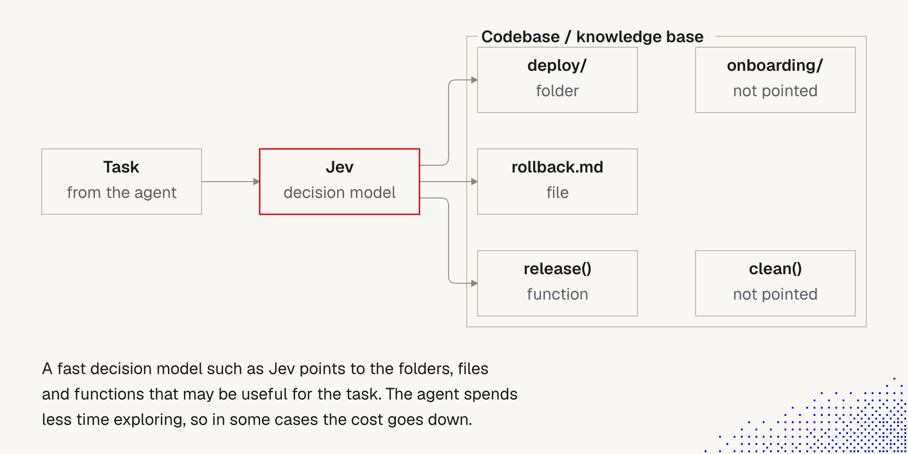
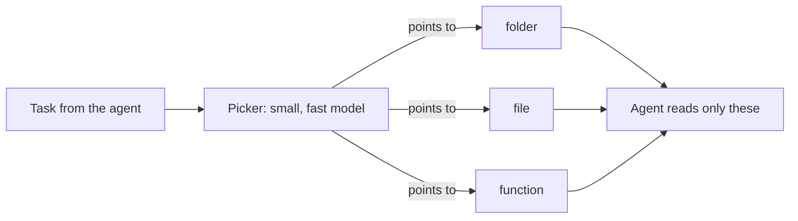
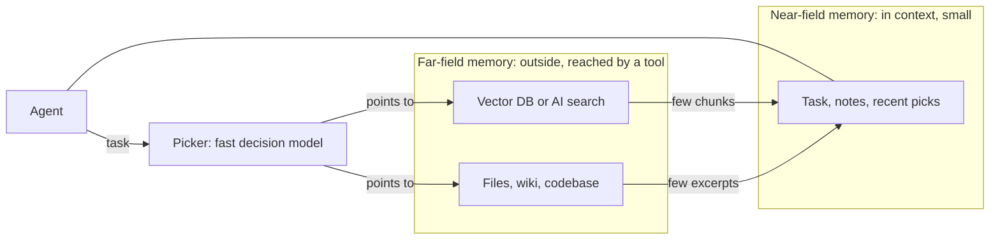

# 8. Decision models: pointing the agent where to look

> A small, fast model reads the task and **points** to the folders, files and functions worth reading. The agent explores less. It can save cost, but only when exploring is expensive. The same idea may fit agent memory, as a router between near and far memory.

Related: [5 Knowledge as files for agents](05_Knowledge_As_Files_For_Agents.md) · [1 Simplify first](01_Simplify_First_Knowledge_Guardrails.md) · [4 Ask why](04_Ask_Why.md) · [9 Jevgrep](09_Jevgrep.md) · [10 Demos: reaching the right files](10_Demos_Reaching_The_Right_Files.md) · [Lecture 2: 12 Subagents vs workers](../Lecture_2_Context_Agents_md_Skills_Tools/12_subagents_vs_workers.md) · [10 Tool results, context to file](../Lecture_2_Context_Agents_md_Skills_Tools/10_tool_results_context_to_file_and_back.md) · [4 Context window](../Lecture_2_Context_Agents_md_Skills_Tools/4_context_window.md)

Source: lecture text on decision models, one lecture image, the [jevgrep README](https://github.com/dzhng/jevgrep) (read in full), and the course example [file-picker](https://github.com/MEGA-DOT-DEV/examples/tree/main/examples/file-picker) (its README read, not run). Checked on the web on 2026-11-08, see [Fact-check](#fact-check).

## 1. The problem

Every unfamiliar task starts with finding the right files. The agent greps, lists folders and reads files, and each step re-sends the whole conversation. Can a cheap, fast model do the finding, so the expensive agent starts in the right place?

## 2. Words refinement

| Term | Meaning here |
|---|---|
| **Decision model** | The lecture's name for a fast model that makes a choice, here "which paths matter". In the course example it is **a role**, played by a small general model with structured output |
| **Picker** | The same thing in the course example: a small model that returns up to 5 paths with short reasons |
| **jevgrep (`jg`)** | An open-source command line tool that asks a model called Jev to judge relevance over a repository, then returns files and source excerpts |
| **Jev** | The model jevgrep uses. In jevgrep it acts as a classifier that scores yes/no relevance questions. See fact-check row 5 and [9 Jevgrep](09_Jevgrep.md) |
| **Grep** | Exact text search. Fast and free, but it matches words, not meaning |
| **Vector or hybrid search** | Search over embeddings, often combined with keywords, built on chunked and indexed documents |
| **Near-field memory** (my term) | What sits **inside the agent's context**, always visible. Small and costly |
| **Far-field memory** (my term) | What lives **outside** the agent (vector database, AI search, files, wiki) and is reached through a tool |

## 3. The picture

**The story.** The agent's **task** goes to **Jev**, the decision model, in red. Jev points to three things in the codebase or knowledge base: the folder `deploy/`, the file `rollback.md` and the function `release()`. It does **not** point to `onboarding/` or `clean()`. The agent reads only what was pointed to, spends less time exploring, and in some cases the cost goes down.

**Important:**
- The pointer works at **three sizes**: folder, file, function.
- The value is also in what it **leaves out**: the agent does not wander into `onboarding/`.
- The model **points**. The agent still reads and decides.
- "In some cases" is the honest part. See the measurements below.

**Not important:**
- The names `deploy`, `rollback`, `release`, `clean`.

## 4. What the sources say

### jevgrep

A command line tool that asks the Jev model to judge relevance over folders, files and declarations, then returns files and verbatim excerpts for the agent. The authors measured about 28.6% lower main-agent cost on ten tuned tasks, but the picture changes once Jev's own cost is counted, and almost all of one rerun's saving came from a single task. The details, numbers, data flow and a test plan are in [9 Jevgrep](09_Jevgrep.md).

### The course example: file-picker

A coding agent answers four questions about a made-up codebase of 469 files, alone and with a small model that picks files first. With the default agent, the picker cut cost and time by about a third at the same accuracy. With a small agent it improved accuracy but cost more, and an earlier version of the example cost more too. The rule: **a picker pays off when exploring costs more than the picker.** The full results, my own run and a side-by-side with the map demo are in [10 Demos: reaching the right files](10_Demos_Reaching_The_Right_Files.md#4-demo-b-file-picker-a-small-model-points-the-agent).

### Related work in the industry

- **Fast context subagents.** Cognition's SWE-grep and SWE-grep-mini (October 2025) are small models trained to retrieve context quickly. Cognition says agents were spending over 60% of the first turn finding context. They use parallel search calls and run on fast hardware. The numbers are Cognition's own. [Cognition blog](https://cognition.com/blog/swe-grep)
- **Claude Code's Explore subagent.** A fast, read-only agent for searching code (Write and Edit are denied). It starts **without** your CLAUDE.md files and the git status snapshot, to keep research cheap. By default it uses **the main conversation's model**. Exception: when the main model is Fable, on a Claude subscription, Console account or an `ANTHROPIC_BASE_URL` gateway, it runs on the Opus model instead. To run it on a cheaper model, define your own subagent named `Explore` with `model: haiku`. *Corrected 2026-11-08: older write-ups say Explore runs on Haiku by default. The current docs do not say that.* [Subagents docs](https://code.claude.com/docs/en/sub-agents) (read in full on 2026-11-08)
- **Tiered memory.** MemGPT and Letta already split memory into an in-context part ("core") and an out-of-context part ("archival"), and the agent moves data between them with tools. [Letta docs](https://docs.letta.com/letta_memgpt)

## 5. My view: search

You wrote that you have used vector and hybrid search a lot, and that with good chunking and overlap you never had problems. That is a fair data point, and the sources do not contradict it: **none of them compares a decision model with vector or hybrid search.** The course example compares only "agent alone" and "agent with a picker".

How the two approaches differ, in my reading (not verified):

| | Vector or hybrid search | Decision-model navigation |
|---|---|---|
| Needs an index | Yes. Chunk, embed, keep fresh | No index mentioned in the README. It reads the live tree |
| Freshness | Index can go stale | Always current |
| Works on | Prose and documents especially | Code and folder hierarchies, where structure carries meaning |
| Cost per query | Cheap lookup | A model call, plus the cost of reading previews |
| Explains why | Similarity score | Short reasons per pick (in the course example) |
| Data leaves the machine | Depends on where embeddings are made | Yes, previews go to the model provider |

**Hybrid search** (keyword plus similarity, so a document missed by one can be caught by the other) is the most complex of these and often gives the best results, per the lecture. I know it, so no more on it here.

So this is **not** a replacement for what you already do well. It is one more option, most useful for **code and structured trees**, and for questions in words the code does not use.

## 6. My view: near-field and far-field agent memory

This is your idea, with my mapping. The terms are mine, not an industry standard.

**The constraint.** An agent's memory is limited by its context window. Vector databases and AI search live **outside** the agent and are reached through a tool. But to keep a line of thought, the agent still needs an **internal** memory in context.

| My term | What it holds | Industry term (checked) |
|---|---|---|
| **Near-field** | In context, always visible: current task, a few notes, recent picks | Letta "core memory", in-context memory |
| **Far-field** | Outside: vector database, AI search, files, wiki | Letta "archival memory", out-of-context memory. By default a vector database, but it can be swapped for a traditional database or a flat file |

**What a decision model adds.** It is the **router between far and near**: it decides which few things are worth pulling into the small near-field space. It is cheap, fast and read-only, which is what a small near-field needs.

**You are right that it is not fresh.** Tiered memory is the MemGPT idea, from 2023. Fast retrieval subagents already exist (SWE-grep, Explore). What may be newer is the form: a small model that **chooses along a hierarchy** and returns structured pointers, in place of embeddings. Whether that beats hybrid search for memory is open.

**Link to note 5.** Karpathy's LLM-maintained **index files and summaries** are the cheap cousin of a picker: the agent reads a small index first, then the pages it points to. A decision model does the same job when the tree is too big for one index.

## 7. Fit with my rules

- **Pointers are evidence, not truth** ([note 4](04_Ask_Why.md#5-how-to-verify-the-answer)). The agent still reads the file and checks. jevgrep says so itself.
- **Simple first** ([note 1](01_Simplify_First_Knowledge_Guardrails.md)). Before adding a picker, ask whether a clearer folder structure or one `rg` would do. If a well-named tree solves it, I do not need a model.
- **Baseline method** ([7 Skill shaper](../Lecture_2_Context_Agents_md_Skills_Tools/7_skill_shaper_how_to_improve_skills.md)). The course example is a clean baseline: same tasks, with and without, code-checked answers. I should test my own case the same way.

## Fact-check

Checked on **2026-11-08**. Verdicts: **agrees** / **differs** / **outdated** / **lecture-specific** (opinion) / **unverified**.

| # | Claim | Verdict | What I found |
|---|---|---|---|
| 1 | A fast model that points to files can help an agent find code | **Agrees, with limits** | jevgrep README and the course example both show gains in some setups, and Cognition built a whole model family for it. Gains depend on how costly exploring is |
| 2 | jevgrep "visibly reduces costs" | **Agrees, with big caveats** | It depends on what is counted. Main-agent cost only: 28.6% lower. Including Jev: 25.8% lower in one rerun, and at most about 8% lower in the first cohort. Almost all of one rerun's saving came from one task. Details: [9 Jevgrep](09_Jevgrep.md) |
| 3 | "In some cases" the cost goes down | **Agrees** | Course example: down a third for the default agent, **up** for the small agent, and **up** in the earlier version. The lecture's wording is the honest one. Not re-run by me. [file-picker](https://github.com/MEGA-DOT-DEV/examples/tree/main/examples/file-picker) |
| 4 | The agent spends less time exploring | **Agrees** | Course example: first read of the answer file at step 5.3 alone, 1.7 with the picker |
| 5 | Jev is a "decision model", a distinct kind of model | **Partly verified** | The jevgrep architecture doc says "Jev classifies repository content", and its gateway spec shows yes/no questions answered with a score from 0 to 1. So in jevgrep it acts as a scoring classifier. I found no primary source for "non-generative". In the course example the picker is a small general model with structured output, so there it is a role |
| 6 | The idea is not fresh | **Agrees with you** | Tiered memory (MemGPT, 2023) and fast context subagents (SWE-grep, Explore) exist. [Letta docs](https://docs.letta.com/letta_memgpt), [Cognition](https://cognition.com/blog/swe-grep) |
| 7 | Source code is sent to a provider | **Agrees (verified)** | README: searches send eligible source content to the provider chosen at auth. Filtering is best-effort, not redaction |
| 8 | Claude Code's Explore subagent runs on Haiku (older write-ups) | **Outdated, corrected in section 4** | The docs say it uses the main conversation's model (Opus when the main model is Fable, on some account types). Haiku is only an option you set in your own `Explore` subagent. Setting `CLAUDE_CODE_SUBAGENT_MODEL` alone does not change Explore and Plan. Read on 2026-11-08, no last-updated date on the page. [Docs](https://code.claude.com/docs/en/sub-agents) |
| 9 | SWE-grep matches frontier models at a tenth of the time | **Unverified** | Cognition's own internal benchmarks. Not independently confirmed |
| 10 | Near-field and far-field memory | **My terms, not standard** | They map to Letta's core (in-context) and archival (out-of-context) memory. The paper is arXiv 2310.08560, which I only saw cited, not read |
| 11 | A decision model beats vector or hybrid search | **Unverified** | No source compares them. Your experience with good chunking is a valid counterpoint |
| 12 | The 30% figure is general | **Differs** | It is one benchmark on ten tasks, and the README itself says savings are not guaranteed on every repository |
| 13 | Hybrid search often gives the best results | **Lecture-specific, matches your experience** | Not checked against a source here. Out of scope for this note |

## Cautions

- **Source code leaves the machine.** jevgrep sends file previews to a model provider. Under Aras policy this is internal source code, so check the [AI Solutions Catalog](http://aitools.aras.com/) first and confirm the tool and provider are approved. I did not install or run it.
- **Best-effort filtering.** The README says credential detection is not redaction. Choose the search root on purpose.
- **Keys.** The course example needs your own paid API key. Do not paste keys into notes or chats. Check the catalog before using an external provider.
- **The picker can be wrong.** It can point away from the file that matters. The agent must verify, and I must measure.
- **Savings are conditional.** They depend on the agent's model, the repo, and how you word questions. The example's earlier version lost money.
- **Vendor numbers.** Two of the three sources are the vendors' own benchmarks. Treat them as claims.
- **Terms.** "Near-field" and "far-field" are my words. Say so when presenting.

## Summary

A decision model is a cheap pointer: it tells the agent where to look, and the agent reads and decides. It pays off only when exploring costs more than the picker, as the course example shows both ways. I see it as one more option next to vector and hybrid search, best for code trees, and as a possible **router between far-field and near-field agent memory**.

## Open questions for discussion

- Where do I have a tree big enough, with words that differ from the code's words, to try a picker?
- Is my own near-field and far-field split useful, or do Letta's "core" and "archival" say it well enough?
- Would a picker or an LLM-maintained index file be the simpler first step for my knowledge base?
- Which approved model and provider could I use, given the Aras policy?

## Sources

- [jevgrep README](https://github.com/dzhng/jevgrep) (canonical repo, MIT). The `yasfaa/jevgrep` repo is a fork. Deeper reading is in [9 Jevgrep](09_Jevgrep.md)
- Course example [file-picker](https://github.com/MEGA-DOT-DEV/examples/tree/main/examples/file-picker) (README only, not run)
- Lecture text on decision models and one lecture image (copied to `img/`)
- [Cognition: SWE-grep](https://cognition.com/blog/swe-grep) (search summary, internal benchmarks)
- [Claude Code: subagents](https://code.claude.com/docs/en/sub-agents) (read on 2026-11-08; the page was truncated, the Explore and model sections were complete)
- [Letta: MemGPT](https://docs.letta.com/letta_memgpt) (search summary). The MemGPT paper is arXiv 2310.08560, cited there, not read by me
- Sections 5 and 6 (comparison table, near-field and far-field mapping) are my own reasoning, not from the lecture or the sources
