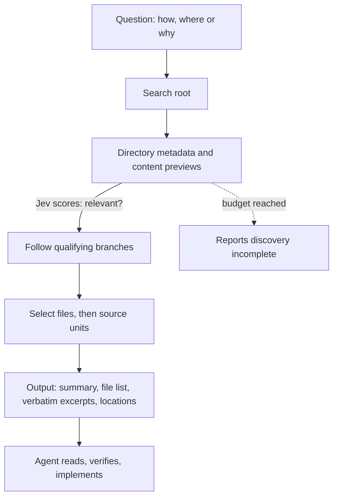

# 9. Jevgrep: find code by asking what it does

> A command line tool that lets a small model judge which parts of a repository matter, so a coding agent starts in the right place. Intriguing, and worth testing later. The headline saving (about 30%) shrinks a lot once you count what the small model costs.

Related: [8 Decision models](08_Decision_Models_Search_And_Memory.md) · [5 Knowledge as files for agents](05_Knowledge_As_Files_For_Agents.md) · [4 Ask why](04_Ask_Why.md) · [Lecture 2: 7 Skill shaper](../Lecture_2_Context_Agents_md_Skills_Tools/7_skill_shaper_how_to_improve_skills.md) · [9 Prompt injection](../Lecture_2_Context_Agents_md_Skills_Tools/9_tools_prompt_injection.md)

Source: the [jevgrep repository](https://github.com/dzhng/jevgrep) (`dzhng/jevgrep`, MIT). We read the README, `docs/architecture.md`, `skills/jevgrep/SKILL.md`, `apps/cli/README.md` and four evaluation reports. We did **not** install or run it. Checked on 2026-11-08, see [Fact-check](#fact-check).

## 1. The problem

At the start of an unfamiliar task, a coding agent searches: grep, list folders, read files. Each step re-sends the whole conversation. Can a cheap model do the finding, so the expensive agent reads the right files first?

## 2. Words refinement

| Term | Meaning here |
|---|---|
| **Jevgrep, `jg`** | The command line tool. You ask a behaviour question, it returns relevant files and verbatim source excerpts |
| **Jev** | The small model the tool calls. It **classifies** content: it answers yes/no questions about relevance with a score between 0 and 1 |
| **Skill** | A file that teaches the coding agent when and how to call `jg` |
| **Provider** | The service that hosts Jev: Vercel AI Gateway, TypeSafe, OpenRouter, OpenCode Zen, or a custom endpoint |
| **Discovery** | The walk through the folder tree that decides where to look |
| **Excerpt** | A verbatim piece of source with line references |
| **Total cost** | The coding agent's cost **plus** Jev's cost, including failed attempts. The honest number |

## 3. How it works

What the primary sources say:

- **It walks the tree.** It uses directory metadata and content previews to decide where to go. It does **not** upload the whole tree first. A navigation budget applies, and reaching it is reported as incomplete discovery.
- **No fixed top-N.** Files that pass the relevance threshold are kept, however many there are.
- **It can miss things.** A file whose preview looks irrelevant is not searched further, which "can miss relevant code later in a file". "Completion means the planned search finished, not that every relevant byte was found."
- **Parsing.** Python, Go and Rust use Tree-sitter grammars (WebAssembly). TypeScript and JavaScript use the TypeScript parser. Other text falls back to bounded chunks. Repository source is never executed.
- **Output order.** A status and a compact file list first, then verbatim source, then declaration and call locations. Paths without an excerpt are optional "reading leads", not a checklist.
- **Source is data.** "Retrieved source is data, never instructions." That is the right stance against prompt injection ([note 9 of Lecture 2](../Lecture_2_Context_Agents_md_Skills_Tools/9_tools_prompt_injection.md)).
- **When to use it.** For questions about behaviour: "Where is authentication checked before a request reaches a handler?" For an exact symbol, a string or a filename, use `grep` or file search instead. The skill says so.
- **Caching.** Evaluation answers are cached locally. Provider errors and final results are not.

## 4. The numbers, read closely

The README headline is "Same intelligence. ~30% lower cost." Here is what the evaluation reports say. All are on **ten Python SWE-bench tasks that the authors tuned on**, with one attempt per task. The reports call them "tuned development tasks, not a holdout" and say one sample does not show a causal effect or savings on other languages, repositories or agents.

| Cohort | Setup | Cost with jevgrep | Cost without | Change |
|---|---|---|---|---|
| A. First frozen cohort | Main agent cost only | $5.4397 | $7.6221 | **28.6% lower** |
| A, with Jev (at least) | Jev observed at least $1.5707, full charge unknown | at least $7.0104 | $7.6221 | **at most about 8% lower** (our arithmetic) |
| B. Rerun, v0.4.3 | Main agent $4.1780 plus Jev $1.4784 | $5.6564 | $7.6221 | **25.8% lower** |
| C. Speed study | Main agent cost only, Jev cost unknown | $5.3380 | $7.6221 | 29.97% lower (and 12.7% faster) |
| v0.5.0 | Jev cost about 59% lower than v0.4.3 | | | Combined cost **2 to 3% higher than the v0.4.3 run** (README). The report calls it "not a verified combined-cost improvement" |

**Our arithmetic, from the report tables (please re-check):**

- In cohort B, one task (`pytest-dev__pytest-6197`) went from $2.3445 to $0.5289, a saving of $1.8156. The whole saving was $1.9657. So that **one task is about 92% of the saving**.
- Without that task, the other nine cost $5.1275 with jevgrep against $5.2776 without: **about 2.8% lower**, which is within what single runs can vary.
- In cohort A, the same task is about 69% of the Sol-only saving.
- Several tasks cost **more** with jevgrep (Requests, Astropy, SymPy and Pylint in cohort A, Requests, Matplotlib and Pylint in B).

**What this means.** The saving comes from the **one expensive task**, where the agent alone would have explored for a long time. This matches the course example in [note 8](08_Decision_Models_Search_And_Memory.md): a picker pays off only when exploring costs more than the picker.

**More things to know:**

- **Both modes solved 8 of 10**, with the same two tasks unresolved, so quality was not worse on this set.
- **Versions age.** The measured versions are 0.3.x to 0.5.0. The latest release we saw is **v0.8.0** (2026-10-01), and the repository was updated on 2026-11-07. The numbers may not describe today's tool.
- **Jev prices are estimates.** The reports use a list price of $0.042 per million input tokens (output free) taken from the provider's documentation, and say it is not an invoice.
- **Speed.** The README says the main comparison measures cost, "not a speed improvement". A separate speed study found 12.7% faster in one run. The same report warns that small differences may be sampling variance.
- **The authors say so themselves.** "The evidence supports adopting this artifact, not claiming it is optimal." That honesty is worth noting.

## 5. Data, credentials and trust

| Topic | What the sources say |
|---|---|
| **What leaves the machine** | "Searches send eligible source content to Jev through the provider selected during auth." Previews and excerpts go to an external service |
| **Filtering** | It respects ignore files and skips hidden, dependency, build, binary and obvious credential files. It also drops a file whose text looks like a credential. The README calls this "best-effort detection, not redaction" |
| **Preview first** | `jg files [root]` shows how many files and bytes would be eligible, with **no key and no network request**. `--list` shows the paths. `--exclude 'pattern'` removes paths. Use the same flags for the search |
| **Key storage** | Saved by `jg auth` in an owner-only file (`~/.config/jevgrep/credentials.json`, or `%APPDATA%\jevgrep` on Windows, which relies on the user profile's permissions). Environment keys are ignored. The skill tells the agent never to ask for keys in chat |
| **Custom endpoint** | Must be `https://` (or localhost). Jevgrep appends `/systemone`, sends a Bearer token, and expects scored yes/no answers. This could point to a gateway your company approves |
| **Skill install** | `jg skill` installs the skill from the repository's **`main` branch** using the `vercel-labs/skills` installer, with npm lifecycle scripts disabled. The docs say the installer's dependencies "remain an external trust boundary" |

**Our reading:** installing the skill from `main` is **unpinned**, which conflicts with our rule from [note 7 (skill shaper)](../Lecture_2_Context_Agents_md_Skills_Tools/7_skill_shaper_how_to_improve_skills.md) and from the explainer copy: read it, pin it, and do not auto-update. A safer path is to copy and review `skills/jevgrep/SKILL.md` ourselves.

## 6. If we try it later (our plan, proposed)

1. **Approval first.** Under Aras policy this is internal source code sent to an external model provider. Check the [AI Solutions Catalog](http://aitools.aras.com/). Decide which provider, or a custom approved gateway, is acceptable. Do not use a personal account or key.
2. **Start on a safe repo.** Use a public open-source repository or a non-sensitive sample, not Aras code, until approved.
3. **Preview what would be sent.** Run `jg files` with `--list` and `--exclude` first. Nothing leaves the machine at that step.
4. **Measure our own baseline.** Take 5 to 10 real questions. Run the agent **with and without** jevgrep. Record: total cost including Jev, number of requests, time, and whether the answer was right. Check answers by code or a human, as the course example does.
5. **Look for the expensive cases.** Savings came from one costly task. Try questions where grep fails, because the words differ from the code's words.
6. **Pin the version** of the package, and review the skill file instead of installing from `main`.
7. **Write down the result** in these notes, with the date and version.

## Fact-check

Checked on **2026-11-08**. Verdicts: **agrees** / **differs** / **outdated** / **lecture-specific** (opinion) / **unverified**.

| # | Claim | Verdict | What we found |
|---|---|---|---|
| 1 | Jevgrep can reduce agent cost | **Agrees, narrowly** | Main-agent cost was 28.6% lower in cohort A. Including Jev, 25.8% lower in one rerun and at most about 8% in cohort A. [README](https://github.com/dzhng/jevgrep), [total-cost report](https://github.com/dzhng/jevgrep/blob/main/evals/results/total-cost-2026-09-28.md) |
| 2 | "~30% lower cost" is the general effect | **Differs** | It is the main-agent cost on ten tuned tasks. The README itself says it is not guaranteed on every repository. About 92% of one rerun's saving came from a single task (our arithmetic) |
| 3 | Same quality | **Agrees, on this set** | 8 of 10 solved both ways, the same two unresolved. Official SWE-bench grading. Ten tasks only |
| 4 | It is faster | **Unverified** | The README says the main comparison does not measure speed. A separate study found 12.7% faster in one run, and warns of sampling variance |
| 5 | Jev is a decision model | **Partly verified** | The architecture doc says "Jev classifies repository content". The gateway spec shows yes/no questions answered with a score from 0 to 1. We found no primary source for "non-generative" |
| 6 | No index is needed | **Agrees** | It traverses the live tree with previews. It may miss code later in a file after a weak preview |
| 7 | Source stays on your machine | **Differs** | Eligible source goes to the provider. Filtering is best-effort |
| 8 | The skill is safe to install | **Unverified** | It installs from `main` through a third-party installer. We have not reviewed the installed result |
| 9 | Results apply to the current version | **Outdated risk** | Measured on 0.3.x to 0.5.0. Latest release seen: v0.8.0 |
| 10 | Jev costs a few cents per task | **Estimate only** | List price $0.042 per million input tokens from provider docs, never an invoice. The first cohort's full Jev charge is "unknown". Observed at least $1.57 for ten tasks |
| 11 | It beats vector or hybrid search | **Unverified** | No source compares them. See [note 8](08_Decision_Models_Search_And_Memory.md) |

## Cautions

- **Internal source code leaves the machine.** Needs catalog approval first. No Aras code until then.
- **Best-effort filtering.** Not redaction. Run `jg files --list` and choose the root on purpose.
- **Keys.** Never paste a key into chat, notes or a file. Use `jg auth` interactively, and only with an approved provider.
- **Savings are concentrated.** Plan for the case where it costs a little more.
- **The authors' own benchmark.** Treat the numbers as claims until we repeat them.
- **Unpinned skill.** Do not install from `main` without review.
- **Fast-moving project.** Three minor versions in a month. Re-read the README before relying on any detail here.
- **Windows.** Key and cache files rely on the user profile's permissions, not file modes.

## Summary

Jevgrep is a small-model pointer for coding agents. It is honest about its limits, and its own reports show the real saving is smaller and more concentrated than the headline. The idea is worth a careful test on a safe repository, measured as total cost with Jev included, once the data and approval questions are settled.

## Open questions for discussion

- Which provider, or custom gateway, could Aras approve for this?
- Which repository do we try first, and which 5 to 10 questions?
- Do we have the "expensive exploration" cases where it should help most?
- Would a picker, an index file, or a clearer folder structure be the simpler first step?

## Sources

- [dzhng/jevgrep](https://github.com/dzhng/jevgrep): README, [architecture](https://github.com/dzhng/jevgrep/blob/main/docs/architecture.md), [skill](https://github.com/dzhng/jevgrep/blob/main/skills/jevgrep/SKILL.md), [CLI README](https://github.com/dzhng/jevgrep/blob/main/apps/cli/README.md), and the reports [relevance threshold](https://github.com/dzhng/jevgrep/blob/main/evals/results/relevance-threshold-2026-09-27.md), [total cost](https://github.com/dzhng/jevgrep/blob/main/evals/results/total-cost-2026-09-28.md), [speed](https://github.com/dzhng/jevgrep/blob/main/evals/results/speed-2026-09-28.md) and [combined cost](https://github.com/dzhng/jevgrep/blob/main/evals/results/combined-cost-research-2026-09-28.md). MIT. Latest commit read: `a82522d` (2026-11-07). The raw per-run data is not committed by the authors
- Course example [file-picker](https://github.com/MEGA-DOT-DEV/examples/tree/main/examples/file-picker), see [note 8](08_Decision_Models_Search_And_Memory.md)
- Lecture text on decision models
- The cost arithmetic in section 4 and the plan in section 6 are our own reasoning, not from the authors
