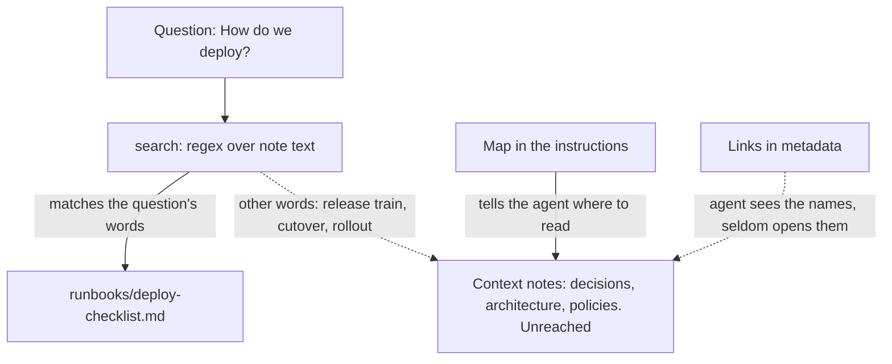
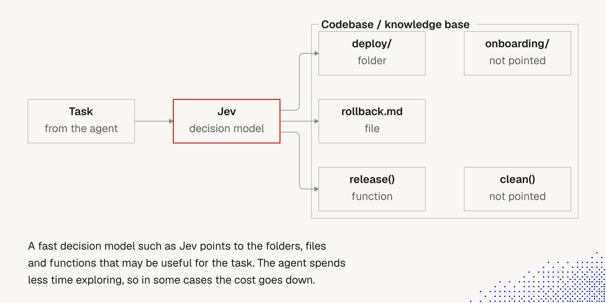

# 10. Demos: reaching the right files and notes

> Two course demonstrations of the same problem: an agent answers from what it reaches, and misses the rest. Demo A fixes it with a **map** (for a wiki). Demo B fixes it with a **picker**, a small fast model (for a codebase). Both look complete when they fail.

Related: [8 Decision models](08_Decision_Models_Search_And_Memory.md) · [9 Jevgrep](09_Jevgrep.md) · [5 Knowledge as files for agents](05_Knowledge_As_Files_For_Agents.md) · [1 Simplify first](01_Simplify_First_Knowledge_Guardrails.md) · [Lecture 2: 4 Context window](../Lecture_2_Context_Agents_md_Skills_Tools/4_context_window.md)

Source: two course examples, [unreached-notes](https://github.com/MEGA-DOT-DEV/examples/tree/main/examples/unreached-notes) and [file-picker](https://github.com/MEGA-DOT-DEV/examples/tree/main/examples/file-picker) (READMEs read, code not read), and our own runs from our fork [Glareone/mega-dev-examples](https://github.com/Glareone/mega-dev-examples) (the file lists match upstream). Checked on 2026-11-08, see [Fact-check](#fact-check).

## 1. The problem

An agent answers from the files it reaches. The notes or files that matter often use **other words** than the question, so search does not match them. The answer looks complete, but facts are missing, or the agent spends a long time exploring.

Two ways to point the agent at the right place:

| | Demo A: map and links | Demo B: picker |
|---|---|---|
| Corpus | A wiki of 32 notes | A codebase of 469 files |
| Why search fails | Context notes say "release train", "cutover", "rollout" for a deploy question | The customer's words are not the code's words ("send an item back" is `returns/eligibility`) |
| The fix | **Static guidance:** a short map in the instructions, or links in metadata | **Dynamic pointing:** a small, fast model picks files first |
| Main cost | Map tokens in every run, and the map can go stale | One extra request per question, and the file tree goes to a model provider |

## 2. Words refinement

| Term | Meaning here |
|---|---|
| **Unreached note** | A note the agent never read, because its words did not match the search |
| **Seen, not read** | The agent saw the name (search result, folder list or link) but did not open it |
| **Map** | `map.md` in the instructions: what each folder holds, and which notes to read before a production change. "Project context" from [note 5](05_Knowledge_As_Files_For_Agents.md#beyond-search-more-context-and-metadata-short) |
| **Links in metadata** | A `related:` field in each note's frontmatter, returned with each search result and read |
| **Picker** | A small, fast model that reads the file tree and the question and returns up to 5 paths with short reasons. The "decision model" role from [note 8](08_Decision_Models_Search_And_Memory.md) |
| **Fact covered** | An answer names the **exact value** (for example "Tuesday" and "Thursday"). General advice does not count |

## 3. Demo A: unreached notes (map, links, search)

- **The wiki:** 32 short notes of a made-up invoicing team, in 8 folders, held in memory.
- **Tools:** `search` (a case-insensitive regular expression, at most 3 lines per note and 12 notes), `read`, `list`. Nothing is written to disk.
- **Four modes:** search only, with a map, with links, with both.
- **Scoring is code,** not a judge model. The run records which notes the agent read and which it only saw by name.

### The authors' results (README, default model, 5 runs per mode)

| Question | Search only | With a map | With links | Map and links |
|---|---|---|---|---|
| How do we deploy? | 9 of 30 | **26 of 30** | 13 of 30 | **28 of 30** |
| Can I push a hotfix tonight? | 12 of 15 | 11 of 15 | 8 of 15 | 12 of 15 |

- On the deploy question, search only **never read** the architecture note or the rollback policy, even when a search showed the policy by name.
- With the map, the agent read all three context notes in every run.
- **Links alone helped little:** the agent saw the related notes by name but seldom opened them.
- **The map has a cost.** It names three notes, so the agent sometimes reads only those and **skips notes the map does not name**. With map and links, the agent opened the release process in only 1 of 5 runs.
- **Agents vary.** An earlier batch scored 8 of 15 for search only on the hotfix question, not 12.

### Our partial run (hotfix question, 5 runs, `openai/gpt-6-luna` through OpenRouter)

The run hit a provider limit ("…to 20 requests per minute for this model. Please retry shortly." The start of the message is cut off). Only the **search only** column finished. The other three show 0 of 0.

| Fact | Search only |
|---|---|
| Hotfix: branch from the last tag | 5 / 5 |
| Only on a train: Tuesday and Thursday | 0 / 5 |
| Freeze from Friday 12:00 to Monday 09:00 | 0 / 5 |
| **All facts** | **5 / 15** |
| Read `process/release-process` | 5 / 5 |
| Read `decisions/why-we-deploy-this-way` | **0 / 5** |
| Requests, cost | 17 requests, $0.0013 |

**It is not a result:** three of four modes did not run, so there is no comparison. But the one column that ran shows the problem: in all five runs the agent read the release process and gave the hotfix steps, and in none did it read the decisions note, so the train days and the freeze window were missing. The answers looked complete. The score (5 of 15) is below the authors' 12 of 15 and 8 of 15, which fits their warning that agents vary.

**To finish it** (flags from the README): run one mode at a time with a pause (`--question hotfix --mode map --runs 5`, then `links`, then `both`), or use `--runs 2`, or `--provider openai`. Add `--answers` to read the answers. Repeat a few times.

## 4. Demo B: file picker (a small model points the agent)

*The lecture picture of the idea, from [note 8](08_Decision_Models_Search_And_Memory.md#3-the-picture).*

- **The setup:** a coding agent answers four questions about **Larder**, a made-up grocery delivery app of **469 files**, in two modes: agent alone, and with a picker. Code checks each answer against the one right number.
- **The picker:** a small model gets the file tree (one folder per line, about 2,300 tokens, the same for every question so the provider can cache it) and the question, and returns up to 5 paths with short reasons. Code drops paths that do not exist.
- **The agent's tools:** `list` (one folder), `grep` (30 lines at most), `read` (150 lines at most), up to 12 steps.

### The authors' results (README, October 2026, OpenAI, estimated prices, 12 runs per mode)

| | Agent alone | With a picker |
|---|---|---|
| **Default agent** | | |
| Right answers | 12 of 12 | 12 of 12 |
| Requests | 76 | 44 |
| Cost | $0.0060 | $0.0038 (picker $0.0010 included) |
| Time (sum of runs) | 87 s | 57 s |
| First read of the answer file | step 5.3 | step 1.7 |
| **Small agent** | | |
| Right answers | 7 of 12 | 11 of 12 |
| Cost | $0.0060 | **$0.0067** (more) |
| Time | 88 s | **96 s** (more) |

- With the default agent, the picker cut cost and time by about a third at the same accuracy.
- With a small agent, the picker mostly improved **accuracy** and did **not** save money.
- An **earlier version** of the example (about 940 files, questions whose words appear in the file) showed the picker costing **more**: $0.0098 against $0.0076.
- The rule the authors state: **a picker pays off when exploring costs more than the picker.**

### Our run (one question: `card-retries`)

Command: `npx mex run file-picker --task card-retries`. The picker was `openai/gpt-5-nano` at effort minimal (1.5 s). The right answer is 3, in `services/payments/src/dunning/policy.ts`.

| | Agent alone | With a picker |
|---|---|---|
| Right answers | 1 of 1 | 1 of 1 |
| Requests | 3 | 3 |
| Input tokens | 2,384 | 3,605 |
| Cached tokens | 0 | 0 |
| Cost | $0.00031 | $0.00032 (picker $0.00018) |
| Time | 4.4 s | 4.1 s |
| First read of the answer file | step 2 | step 1 |

**How to read it.**
- **One question, one run: no conclusion.** Both modes were right and cost about the same.
- **The direction matches the README:** the picker moved the first read of the right file one step earlier (step 2 to step 1), and the picker's own request ate the saving ($0.00018 of $0.00032).
- **This was an easy question.** The agent alone found the file in 3 requests. The README says the agent alone needs 4.7 to 9 requests per question on average, and that a picker pays off when exploring is expensive. Here exploring was cheap, so there was little to save.
- **The picker is noisy.** It listed five paths, and the first was labelled "Not related; skip". Only the second was the right file. The agent still got it, but the list carries noise.
- **Cached tokens were 0.** The README says the tree is the same for every question so the provider can cache it. With one question there may be nothing to reuse yet. This is our guess and is unchecked.
- **Try next:** run all four questions with `--runs 3`, as the authors did, and try the README's "Try this" ideas (the picker using the agent's own model, a small agent, and a question in the code's own words).

## 5. Side by side: our view

This is our own reasoning, built on the two demos.

**Both demos show a silent miss.** In A the answer lacked the freeze window. In B the agent alone may take many steps, or settle on a nearby file (the small agent gave the wrong number in 5 of 12 runs). Neither looks wrong from outside. In both, **code checks the answer**, not a judge model. That is the executable-guardrail idea from [note 1](01_Simplify_First_Knowledge_Guardrails.md).

**Static or dynamic.**

| | Map (A) | Picker (B) |
|---|---|---|
| Cost | Tokens in every run | One request per question |
| Freshness | Stale unless reviewed | Reads the live tree |
| Reviewable | Yes, a human reads and owns it | The picks are visible, but the model is a black box |
| Fits | A wiki with a few key notes | A big tree with many places to look |
| Risk | Tunnel vision: unnamed notes go unread | Noise or a wrong pick. Data goes to a provider |

**It narrows the rule in note 1.** [Note 1](01_Simplify_First_Knowledge_Guardrails.md) says not to put a map of the codebase in the instructions. Demo A shows that in a **wiki**, whose context notes use other words, a short map helped a lot (9 to 26 of 30 on the deploy question). It did not help on the hotfix question (12 to 11 of 15). For **code**, Demo B suggests a picker, not a map, when exploring is expensive.

**Keep a map short, reviewable and checked by code.** A map is a "non-discoverable fact" in the types table of note 1, and rots like any other. A small lint can check that every named note exists and every context note is listed. Say what to read **for which kind of question**, not only "read these three", to reduce tunnel vision.

**Not tested here:** hybrid search (similarity could catch "release train" for "deploy"), vector search, or a map plus a picker. We do not know how they compare.

**Our own repo.** `AGENTS.md` has a tiny map ("How it's organized") but no list of which notes to read for which question. Each note's `Related:` line is close to "links in metadata", which Demo A found were seen more than opened. A sentence in the text the agent reads is a stronger link (an untested suggestion from the README).

## Fact-check

Checked on **2026-11-08**. Verdicts: **agrees** / **differs** / **lecture-specific** (opinion) / **unverified**. The authors' numbers come from their READMEs and were not re-run by us.

| # | Claim | Verdict | What we found |
|---|---|---|---|
| 1 | Search misses notes whose words differ from the question | **Agrees** | Authors: no run read the architecture or rollback notes on the deploy question. Our partial run: the decisions note was read in 0 of 5 runs |
| 2 | A map in the instructions helps | **Agrees, on one question** | Deploy: 9 to 26 of 30. Hotfix: 12 to 11 of 15, no gain |
| 3 | Links in metadata help little | **Agrees** | Deploy 13 of 30, hotfix 8 of 15 |
| 4 | The map causes tunnel vision | **Agrees** | Authors saw skipped notes on both questions |
| 5 | A link inside the note's text beats one in metadata | **Unverified** | The README only suggests it under "Try this" |
| 6 | A picker pays off when exploring costs more than the picker | **Agrees** | Authors: a third cheaper for the default agent, more expensive for the small agent, and more expensive in the earlier version |
| 7 | The picker helps accuracy of a small agent | **Agrees, README only** | 7 of 12 to 11 of 12. Not re-run by us |
| 8 | Our single file-picker run | **No conclusion** | One question, one run. Same cost, first read one step earlier |
| 9 | Our unreached-notes run | **Incomplete, not a result** | A rate limit stopped three of four modes |
| 10 | The tree is cached so the picker is cheap | **Unverified in our run** | Cached tokens were 0 with one question. We do not know why |
| 11 | Results hold in general | **Unverified** | Made-up data, small samples, one model family. The README says agents vary |
| 12 | Map or picker beats hybrid or vector search | **Unverified** | Neither demo tests them |

## Cautions

- **Our two runs prove nothing about the ideas.** One is incomplete, the other has n=1. Finish them before drawing conclusions.
- **Made-up data only.** Both examples use a fictional wiki and codebase. Do not point them at Aras material. Check the [AI Solutions Catalog](http://aitools.aras.com/) first. Never paste API keys into notes or chats.
- **A picker sends file names (and in real tools, previews) to a provider.** See [9 Jevgrep](09_Jevgrep.md) for the real tool's data rules.
- **A map can hide notes, and goes stale.** Give it an owner and a check.
- **Small samples.** Five runs per mode and four questions are a teaching demo.

## Summary

Search reaches notes that share words with the question, and the bigger picture often does not. For a wiki, a short, checked map helped most. Links in metadata barely helped. For a large codebase, a cheap picker helps when exploring is costly, and does little when the question is easy, as our single run showed. Both demos fail silently, so both need code that checks the answer.

## Open questions for discussion

- Which of our knowledge bases has context notes that a question's words would miss?
- Who owns the map, and what lint keeps it true?
- Should we finish the runs for all modes and all four questions, and add the numbers here?
- How would hybrid search do on the same wiki and the same codebase?

## Sources

- [unreached-notes](https://github.com/MEGA-DOT-DEV/examples/tree/main/examples/unreached-notes) and [file-picker](https://github.com/MEGA-DOT-DEV/examples/tree/main/examples/file-picker) (READMEs only), and our fork [Glareone/mega-dev-examples](https://github.com/Glareone/mega-dev-examples)
- Our run outputs: unreached-notes (hotfix question, 5 runs, search only column) and file-picker (`card-retries`, one run)
- Lecture picture of the picker (copied to `img/`)
- Section 5 (static or dynamic, the narrowing of note 1, the lint idea, our repo) is our own reasoning
