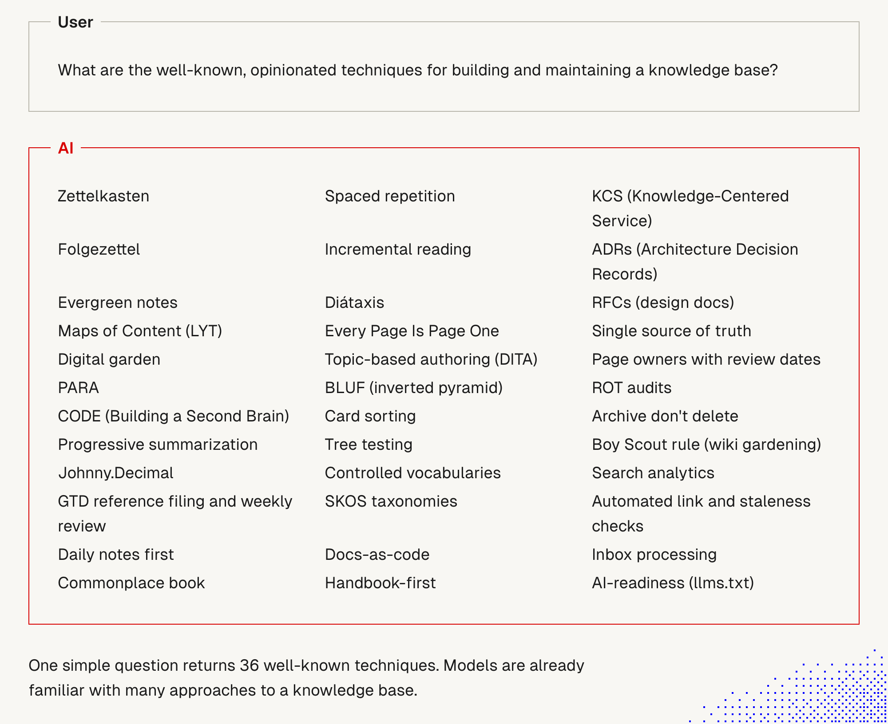
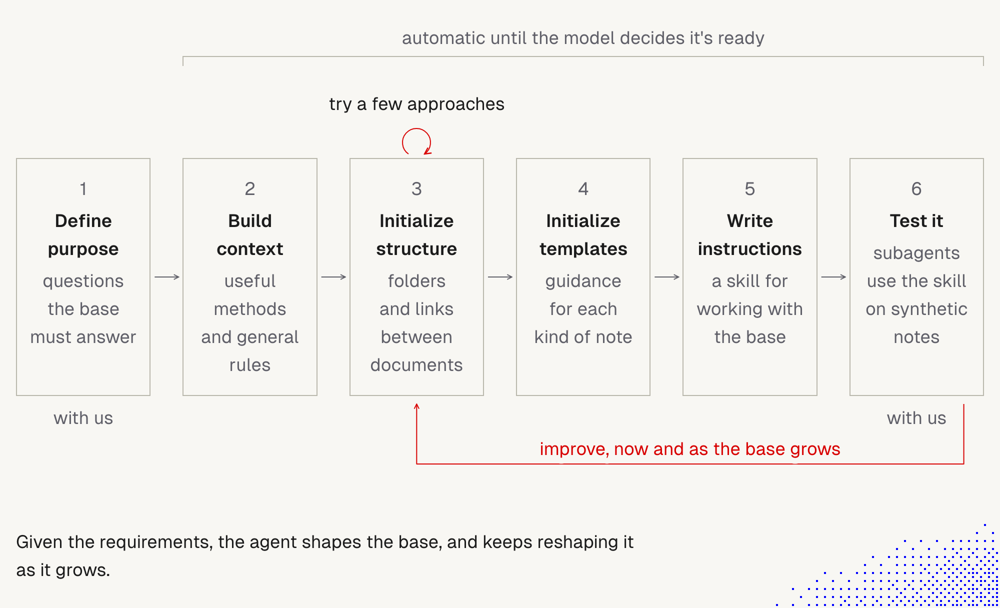
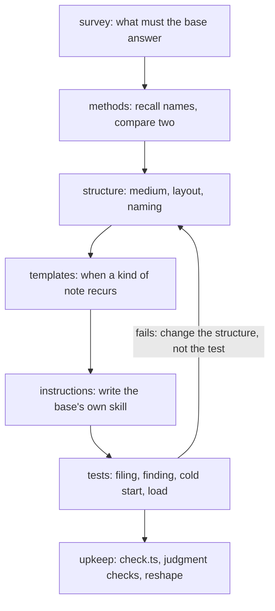

# 11. Knowledge base problems and known techniques

> Models already know many named techniques for building a knowledge base. We don't invent rules. We **name the technique for each problem**, pick one per problem, and check the result with tests. About a third of the well-known list matters for agents today.

Related: [5 Knowledge as files for agents](05_Knowledge_As_Files_For_Agents.md) · [1 Simplify first](01_Simplify_First_Knowledge_Guardrails.md) · [10 Demos: reaching the right files](10_Demos_Reaching_The_Right_Files.md) · [7 The explainer skill](07_Explainer_Skill.md) · [12 Update triggers](12_Knowledge_Base_Update_Triggers.md) · [13 How a skill is built](13_How_A_Skill_Is_Built_Why_References.md) · [Lecture 2: 5 Skills](../Lecture_2_Context_Agents_md_Skills_Tools/5_skills.md) · [7 Skill shaper](../Lecture_2_Context_Agents_md_Skills_Tools/7_skill_shaper_how_to_improve_skills.md)

Source: lecture picture of 36 techniques, the lecture text and diagram on the `knowledge` skill, and the skill itself, copied to [`.claude/knowledge/`](../.claude/knowledge/SKILL.md) (see [`SOURCE.md`](../.claude/knowledge/SOURCE.md)). We read `SKILL.md` and five reference files, and ran a small recall test. We did **not** run the skill. Checked on 2026-11-08, see [Fact-check](#fact-check).

## 1. The problem

Building a knowledge base from nothing invites invented rules. Many problems already have a named technique: how to organize, how to write a page, how to keep notes true. Which techniques help **agents** today, and how do we use them without mixing them into a mess?

## 2. Words refinement

| Term | Meaning here |
|---|---|
| **Technique** | A named, opinionated way to do one job, such as filing, writing or auditing |
| **Semantic anchor** | A name the model already knows, which brings in a whole idea at once ([5 Skills](../Lecture_2_Context_Agents_md_Skills_Tools/5_skills.md)) |
| **Opinionated** | The technique makes choices for you, so two of them can decide the same thing and clash |
| **Knowledge skill** | A skill that designs a knowledge base, and leaves behind a skill of the base's own so later agents keep it consistent |
| **Filing test, finding test** | The skill's tests: can each item be filed in one obvious place, and can each question reach its answer in a few steps |

## 3. The two pictures

### One question, 36 techniques

**The story.** The user asks "What are the well-known, opinionated techniques for building and maintaining a knowledge base?" The AI returns **36** names in three columns of 12 (we counted). Models already know many approaches.

**Important:**
- We don't need to explain a technique in our instructions. We can name it.
- The list is **the model's answer**, not an authority. It mixes personal note-taking with team documentation.

**Not important:**
- The order of the names.

### The knowledge skill flow

**The story.** Six boxes in a row: **1 Define purpose** (the questions the base must answer, done "with us"), **2 Build context** (useful methods and general rules), **3 Initialize structure** (folders and links between documents, with a small loop "try a few approaches"), **4 Initialize templates** (guidance for each kind of note), **5 Write instructions** (a skill for working with the base), **6 Test it** (subagents use the skill on synthetic notes, done "with us"). A bracket says steps 2 to 6 are **automatic until the model decides it's ready**. A red arrow from step 6 back to step 3 says **improve, now and as the base grows**.

**Important:**
- A person is involved at the start (purpose) and at the end (test). The middle runs on its own.
- The loop never ends: the base is reshaped as it grows.
- The output is a **skill for the base**, not only a folder structure.

**Not important:**
- The exact box wording.

## 4. The 36 techniques, by problem, and our filter for agents

The grouping and the verdicts are our own judgment. The skill's own list in `references/methods.md` groups names by problem in a similar way, without filtering them.

**Our test for "relevant for agents":** the technique (a) shortens the path from a question to its answer, (b) keeps content true, (c) keeps reads bounded, or (d) can be checked by code or by a fresh agent.

### Keep (16 techniques, 12 groups)

| Problem | Techniques | Why it matters for an agent |
|---|---|---|
| Writing a page | **BLUF** (conclusion first) | A reader, or a retrieval snippet, gets the point in the first lines |
| Writing a page | **Every Page Is Page One** | A note must make sense to an agent that lands on it from search, with no context |
| Writing a page | **Diátaxis** (tutorial, how-to, reference, explanation) | One type per page gives a predictable shape and makes the right page easy to pick |
| One unit per idea | **Evergreen (atomic) notes** | One idea per note, titled by its point, avoids duplicates |
| Finding | **Maps of Content** | A short map of where things are. See [Demo A](10_Demos_Reaching_The_Right_Files.md): a map reached notes that search missed |
| Finding | **Controlled vocabularies** (and metadata, see [OKF in note 5](05_Knowledge_As_Files_For_Agents.md#beyond-search-more-context-and-metadata-short)) | Synonyms are what search misses. A fixed term list reduces that |
| Testing the structure | **Card sorting** and **tree testing** | They become the skill's *filing* and *finding* tests, run by a fresh agent |
| Keeping it true | **Single source of truth** | One home per fact. Everything else links to it |
| Keeping it true | **Page owners with review dates** and **automated link and staleness checks** | Executable guardrails ([note 1](01_Simplify_First_Knowledge_Guardrails.md)) |
| Keeping it true | **ROT audits** (redundant, outdated, trivial) and **archive, don't delete** | Stale pages pollute retrieval and give wrong answers. Archiving keeps old links working |
| Team process | **Docs-as-code** and **ADRs** | Markdown in git, reviewed like code. Decisions get a record |
| Compression | **Progressive summarization** | Layered compression. It matches our "verbose, then compress" rounds |

### Maybe (5)

Search analytics (log what agents search for and miss), inbox processing (an intake queue), the Boy Scout rule (clean as you touch), KCS (fix an article when you find it wrong), Johnny.Decimal (its useful part is stable, unique IDs).

### Skip for agents (15)

| Technique | Why we skip it |
|---|---|
| Zettelkasten, Folgezettel, Digital garden | Human thinking and publishing habits. Agents navigate by links and search, and the skill says identity should be stable, not encode position |
| PARA, CODE | Human folder and attention schemes (by actionability). The agent has no "projects due this week" |
| Commonplace book, Daily notes first, GTD reference filing and weekly review | Human productivity habits |
| Spaced repetition, Incremental reading | Aids for human memory |
| DITA, SKOS | Heavy, for large scale or publishing. Revisit only when scale demands it |
| RFCs, Handbook-first | Team culture and process, outside the knowledge structure |
| llms.txt | Aimed at public websites. Evidence of use is weak (see fact-check) |

## 5. How to use them: pick one per problem

The knowledge skill states the rules, and we adopt them:
- **Don't let two methods decide the same thing.** "PARA and Johnny.Decimal both want the folders." Methods that decide different things combine freely.
- **Tie each choice to a question** the base must answer, and drop any method that answers none.
- **Name every change** to a method, with the reason: "PARA areas, but no Resources folder: sources are linked from the notes that use them."
- **Warning signs:** every base comes out the same ("always PARA, always Zettelkasten"), a method adopted whole including parts no question needs, and method names in the skill that the structure does not reflect.
- **Recall before you design.** The skill asks the agent to name fitting methods, look across at least two fields, and **compare two options** before picking. This is the lecture's picture of 36 techniques turned into a step.

## 6. The knowledge skill (what the real thing contains)

The lecture diagram has six steps. The real skill (v0.4.0) is bigger:

- **Ten rules** that hold at every level, for example "Purpose first (BLUF)", "One home per fact", "Every page is page one", "Nothing is orphaned", "Reads stay bounded", and "Structure is earned" (add a level around the third time content needs it).
- **Four tests:** filing (card sorting), finding (tree testing), **cold start** (a fresh agent with only the base's skill loads it unprompted and passes both tests), and **load** (grow a copy to the expected size and test again).
- **A checker:** `scripts/check.ts` checks links, required fields and drift. Errors fail the run. Signals are left to judgment. No script does the ROT audit.
- **Scale:** it lists what starts to break at about 10,000, 100,000 and 500,000 notes, and what to decide early (stable IDs, sharding, a registry of entities, a closed vocabulary). These thresholds are the author's estimates.
- **How it asks and acts:** read the sources first, ask **at most three questions** in one message, each with a guess and a default. In a new base, create freely. **In an existing one, show a plan and get a yes before moving, renaming, merging or rewriting anything**, then work in small batches. Archive instead of deleting, except for content that must be gone.
- **Not for:** a codebase's `AGENTS.md` or skills, retrieval or vector-search pipelines, writing a single note, or answering questions from an existing base.

## 7. Our own practice: rounds of compression

You do not use the named techniques. You work in rounds: **verbose, then compression, then point to the implementation, then find the gap, then understand how to improve.** This is our reading of how it maps. It is your practice, not an established method:

| Your round | Closest known idea |
|---|---|
| Verbose | Write freely first (capture) |
| Compression | Progressive summarization, BLUF, "deletion first" ([note 7](07_Explainer_Skill.md)) |
| Point to the implementation | Single source of truth, docs by pointer: link the claim to the code or source instead of repeating it |
| Find the gap | ROT audit, tree testing, lint: which question fails? |
| Understand how to improve | The skill's test, then change the structure loop |

So you already run a version of the skill's loop, without the names. The value of the names is that an agent can follow the same loop without being taught each step.

**An experiment for later.** Our repo is a knowledge base. We could run the skill's **finding test** on it: ask a fresh agent five questions ("What is our diagram rule?", "What did we conclude about jevgrep's cost?") and count the files it reads. Too many files means the structure needs work.

## 8. Recall test: do models know these techniques?

We asked a fresh subagent, with no tools, to explain seven techniques from memory (one run, our grading against sources found by search).

| Technique | Core idea | Originator or date | Our grade |
|---|---|---|---|
| Folgezettel | Branching IDs such as 1, 1a, 1a1 that show lineage | Luhmann (date from memory, unverified) | **Correct core.** Sources disagree on branching limits, and the model claimed none |
| Diátaxis | Four types by need | Procida, "Divio" origin from memory | **Correct.** Matches the official site |
| ROT audit | Redundant, outdated, trivial | "Unsure, no single originator" | **Correct, and well calibrated** (low confidence). Sources show no single originator |
| KCS | Capture, structure, reuse, improve in the work | Consortium for Service Innovation | **Correct, but the name may be dated.** It said "Service". The Consortium now also uses "Success" (verify) |
| Johnny.Decimal | Areas and categories, IDs like 11.01, limit of 10 | Johnny Noble, 2019 to 2020 (unverified) | **Correct core** |
| Evergreen notes | Atomic, concept-oriented, densely linked | Matuschak, 2019 to 2020 (unverified) | **Correct core** |
| llms.txt | A Markdown file with links for LLMs | Howard, September 2024 | **Correct, and flagged as a proposal, not a standard** |

**Result:** the core ideas were right for all seven, and the model was honest about its doubt (low confidence on ROT, "verify adoption" on llms.txt). Originators and dates came from memory and were **not checked** by us. One name looks outdated.

**Limits:** one run, one model family, seven **popular** techniques. It does not show the model knows obscure ones, or that it will **apply** them well. Test applying with the skill's cold-start test.

## Fact-check

Checked on **2026-11-08**. Verdicts: **agrees** / **differs** / **outdated** / **lecture-specific** (opinion) / **unverified**.

| # | Claim | Verdict | What we found |
|---|---|---|---|
| 1 | Models already know many knowledge base techniques | **Agrees, narrowly** | Our recall test: core ideas correct for seven well-known techniques. One run, dates unchecked |
| 2 | The list has 36 techniques | **Agrees** | Counted: 12 per column |
| 3 | Diátaxis has four kinds of docs | **Agrees** | Official site: tutorials, how-to guides, reference, explanation. It says it is not four rigid buckets. [diataxis.fr](https://diataxis.fr/) |
| 4 | Johnny.Decimal: at most 10 areas of 10 categories, IDs like 12.03 | **Agrees, secondary sources** | Blogs. Not the author's site. It suits stable reference, less so ideas in progress |
| 5 | PARA: Projects, Areas, Resources, Archive | **Agrees, secondary sources** | Blogs, not Forte's own text |
| 6 | Evergreen notes: atomic, concept-oriented, densely linked | **Agrees** | Matuschak's own notes. [notes.andymatuschak.org](https://notes.andymatuschak.org/z5E5QawiXCMbtNtupvxeoEX) |
| 7 | KCS has practices in two loops | **Agrees** | Consortium guide v6: eight practices, a Solve Loop and an Evolve Loop. The method is also called Knowledge-Centered **Success** now (search summary, verify). [Consortium](https://library.serviceinnovation.org/KCS/KCS_v6/KCS_v6_Practices_Guide) |
| 8 | ROT means redundant, outdated, trivial | **Agrees** | Several content governance guides. Trivial is the most disputed. No single originator found |
| 9 | llms.txt is an "AI readiness" technique | **Differs** | A proposal by Jeremy Howard (2024-09-03), not an IETF standard. Sources say major AI providers have not committed to reading it. Server-log claims are unverified secondary reporting |
| 10 | Folgezettel branching limits | **Sources disagree** | Forum posts disagree on how many branches a note may have. We state none |
| 11 | The knowledge skill's six steps | **Agrees, simplified** | The real skill has nine reference nodes, ten rules and four tests. The diagram is a summary |
| 12 | The process can run automatically as the base grows | **Differs, slightly** | The skill requires a plan and a yes before restructuring an **existing** base, and asks at most three questions. So the loop is gated by a human |
| 13 | A base with thousands of notes is hard but AI can do more than we can alone | **Lecture-specific** | The skill gives scale thresholds (about 10,000, 100,000, 500,000) and a load test. The thresholds are the author's estimates, not measured by us |
| 14 | Our rounds map to known ideas | **Our reading** | Your practice. No source names it |
| 15 | The skill works | **Unverified** | We have not run it or its checker |

## Cautions

- **The 36-name list is a model's answer.** Verify any technique before relying on it.
- **Don't adopt whole systems.** Two techniques that decide the same thing will clash.
- **The skill is one author's work** (v0.4.0), and its design changed between versions. Not enabled, not run, not code reviewed.
- **Automatic reshaping needs a gate.** The skill asks for a plan and a yes on existing bases. Keep that.
- **Data scope.** Our notes hold how we think, not Aras business data. Do not feed company knowledge into a base-building run without checking the [AI Solutions Catalog](http://aitools.aras.com/).
- **Dates and names age.** KCS's name, llms.txt adoption and the skill itself may change.

## Summary

Name the technique, don't invent one, and choose one per problem. For agents, about a third of the 36 matter: they shorten the path to an answer, keep content true, keep reads bounded, or can be tested by code or a fresh agent. The knowledge skill turns this into a loop with tests. Your own rounds of compression already follow the same shape.

## Open questions for discussion

- Is our filter right? Which "skip" would you move to "keep", and which "keep" would you drop?
- Do we run the skill's finding test on this repo as a first experiment?
- Do we want a short knowledge skill of our own for these notes, modelled on this one?
- Who reviews the map, the owners and the review dates in our notes?

## Sources

- Lecture picture of 36 techniques, lecture text and diagram on the knowledge skill (copied to `img/`)
- The skill: [overment/skills, knowledge](https://github.com/overment/skills/tree/main/skills/knowledge), copied at commit `ab5cc432e435ca51da4ec0b035a4de27ac15ac3d` (2026-10-02), MIT. Our copy: [`.claude/knowledge/SOURCE.md`](../.claude/knowledge/SOURCE.md)
- [Diátaxis](https://diataxis.fr/), [Evergreen notes](https://notes.andymatuschak.org/z5E5QawiXCMbtNtupvxeoEX), [KCS v6 Practices Guide](https://library.serviceinnovation.org/KCS/KCS_v6/KCS_v6_Practices_Guide), [ROT analysis guide](https://www.smashingmagazine.com/2015/06/dealing-with-redundant-out-of-date-trivial-rot-content/) (search summaries)
- llms.txt: secondary sources only (for example [PPC Land](https://ppc.land/llms-txt-adoption-stalls-as-major-ai-platforms-ignore-proposed-standard/)); check the [llmstxt.org](https://llmstxt.org/) spec and provider documentation
- Johnny.Decimal, PARA and Folgezettel: blogs and forum threads only, not the originators' own material
- Our recall test (one subagent run, no tools)
- Section 4 (grouping and the keep, maybe and skip filter), section 7 (our rounds) and the experiment idea are our own reasoning
