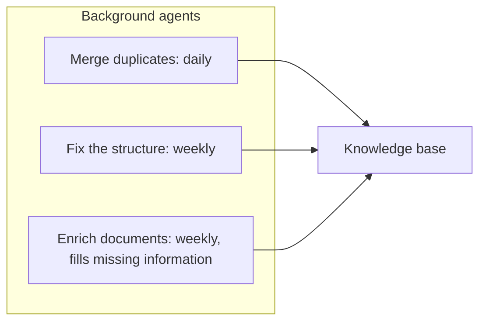
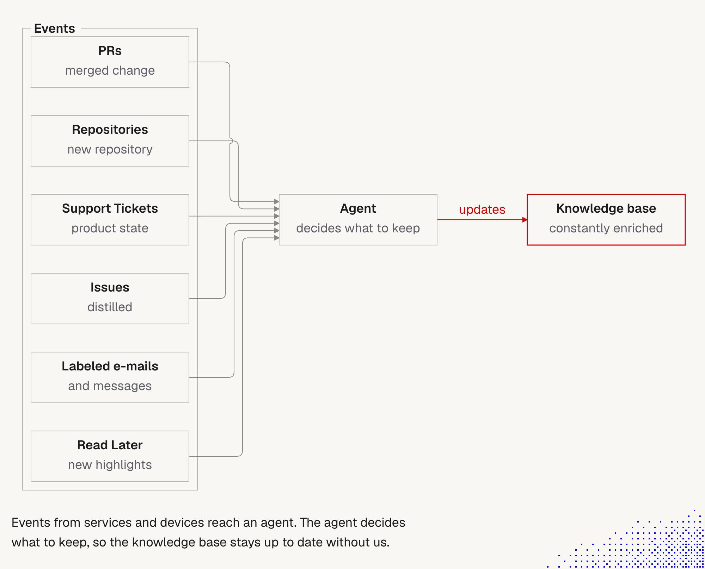

# 12. Knowledge base update triggers: schedules and events

> A knowledge base stays healthy only if something keeps updating it. Two kinds of trigger can do this without a person: **schedules** (cleanup routines) and **events** (merged PRs, new repositories, tickets, labeled mail). The design question is not "can we automate it" but "how do we stop it from damaging or losing information".

Related: [11 Known techniques](11_Knowledge_Base_Problems_And_Known_Techniques.md) · [5 Knowledge as files for agents](05_Knowledge_As_Files_For_Agents.md) · [10 Demos: reaching the right files](10_Demos_Reaching_The_Right_Files.md) · [Lecture 1: 17 Ambient and durable agents](../Lecture_1_Mechanics_Behind_Generative_AI/17_ambient_durable_agents.md) · [Lecture 2: 3 Lifecycle hooks](../Lecture_2_Context_Agents_md_Skills_Tools/3_lifecycle_hooks.md)

Source: lecture text on schedules and events. Course examples (READMEs read, not run): [cleanup-routine-drift](https://github.com/MEGA-DOT-DEV/examples/tree/main/examples/cleanup-routine-drift) and [knowledge-health-check](https://github.com/MEGA-DOT-DEV/examples/tree/main/examples/knowledge-health-check). The `knowledge` skill we copied ([`.claude/knowledge/`](../.claude/knowledge/SKILL.md)). Claude Code and GitHub documentation, seen as search summaries. Checked on 2026-11-08, see [Fact-check](#fact-check). **This is design thinking only. We do not set anything up.**

## 1. The problem

A knowledge base rots: duplicates appear, structure drifts, notes go stale, new projects are not recorded. People forget to maintain it. Agents can do it on a clock or when something happens. But each run starts from what the last run left, so a bad run is not a one-off. It compounds.

## 2. Words refinement

| Term | Meaning here |
|---|---|
| **Trigger** | What starts an agent: a schedule, an event or a signal ([note 17](../Lecture_1_Mechanics_Behind_Generative_AI/17_ambient_durable_agents.md)) |
| **Schedule** | A clock: daily or weekly. Good for cleanup and synchronization |
| **Event** | Something happened in a system: a PR merged, a repository created, a ticket opened |
| **Webhook** | A service calls a URL of ours when an event happens |
| **Background agent / routine** | An agent that runs without a person watching |
| **Durable agent** | A background agent that survives crashes and waits (see note 17) |
| **Guard** | Code that checks each change before it is saved |
| **Standing rule** | A routine change the owner agreed to in advance, written in the base's skill |

## 3. The picture (from the lecture text)

The lecture describes a flow diagram. We redrew it:

**The story.** Three routines live in one frame, "Background agents". Each has a line to the knowledge base. The daily and weekly cadences are **examples**, not a recommendation.

**Important:**
- Three different jobs, three different rhythms.
- "Enrich" adds information, which is the riskiest job, because it can add wrong facts.

**Not important:**
- The exact cadences.

## 4. Schedules: the risk is losing information

The lecture says the hard part is routines that are fully autonomous but simple, so the risk of degrading the base or losing information is minimal. Two course examples test exactly this.

### Example A: cleanup-routine-drift (README, not re-run)

A nightly cleanup on a made-up wiki of 16 notes with **30 tracked facts** and 3 real duplicate pairs. Same instruction in two modes: the model **rewrites whole notes**, or it returns **small edits that code checks** before saving.

| Mode (default model, effort `none`, 6 runs of 5 nights) | Facts left | Notes deleted |
|---|---|---|
| Rewrite whole notes | 28 of 30 in 4 of 6 runs, 30 of 30 in 2 | 3 to 7 per run |
| Checked edits | **30 of 30 in every run** | none |

- The rewrite lost facts the same way each time: it deleted a note called `scratch` as clutter, and the facts in it went with it. It happened on night 2, 3 or 4, never night 1.
- The checked mode lost nothing, but **cleaned up less**: it resolved all 3 duplicate pairs in only 3 of 6 runs. Code skipped edits such as deleting `scratch`, or merging a duplicate before its facts were saved elsewhere.
- At effort `low`, the rewrite kept all 30 facts in every run, but still deleted 4 or 5 notes per run, after first moving their facts.
- A failed night (invalid JSON, a cut answer, a timeout) **saves nothing**. 13 of 88 requests failed at effort `none`.
- The guard knows the 30 tracked values only because the example has an answer key. **A real routine has no answer key.** It can protect what a script can find: numbers, codes, dates, names, links. Other values are not protected.
- Each night is cheap (about $0.0015 to $0.0030 per run of five nights), so the risk is not cost.

### Example B: knowledge-health-check (README, not re-run)

A script finds the **mechanical** problems, a model finds the problems of **meaning**, and the script **checks every fix** the model proposes.

- **Script:** found the 4 mechanical problems (broken link, missing owner, orphan, past review date) in every run, in milliseconds, for $0.
- **Model:** at effort `none`, found 28 of 36 problems of meaning in 9 runs, with 5 false alarms. At effort `low`, 27 of 28 in 7 runs with 1 false alarm.
- **Guard:** rejected 4 of 36 fixes at `none` and 1 of 28 at `low`. Every rejected fix we can read was a merge that deleted a note another note still linked to.
- **The guard checks mechanics only.** It cannot tell whether the freeze really starts on Thursday or Friday. That stays a judgment.

### What both say

**Split the work: scripts for mechanics, the model for meaning, a guard on every change.** This is the same rule the knowledge skill gives: "Scripts for mechanics, agents for meaning" and run routine bulk changes "under a rule the owner agreed to", with each note keeping its **source and batch** "so a bad batch can be reverted".

## 5. Our design rules for a cleanup routine

This is our own reasoning, built on the two examples and the knowledge skill.

1. **Small edits, not rewrites.** Let the model return a list of edits, not whole notes.
2. **Never delete. Archive or leave a stub.** The skill says "Archive instead of deleting". Content that must be gone (personal data, a secret) is the exception.
3. **A guard on every edit,** in code: links still resolve, required fields remain, tracked values remain.
4. **Reversible.** Keep provenance and a batch ID. Use git so any night can be undone.
5. **A failed run saves nothing.** The next run starts from the last good state.
6. **A cheap check before waking the model.** Note 17 found a code check that wakes the model cut calls about seven times and false alarms from about 12 to 1.
7. **Events over clocks for dependent jobs.** A clock schedule fails when the job before it runs late (note 17: stale facts in 13 of 20 runs).
8. **A human gate for meaning changes and irreversible actions.** Note 17: do not rely on the model to ask. Put the gate in code.
9. **A weekly judgment sample.** No script does the ROT audit. A person reads a sample of recent changes.

## 6. Events: what can trigger an update

**The story.** A frame called **Events** holds six sources, each with a short label of what is taken: **PRs** (merged change), **Repositories** (new repository), **Support Tickets** (product state), **Issues** (distilled), **Labeled e-mails** (and messages), **Read Later** (new highlights). All six lines reach one **Agent** that "decides what to keep". A red arrow "updates" goes to the **Knowledge base**, "constantly enriched", in a red frame. The caption: events from services and devices reach an agent, and the agent decides what to keep, so the knowledge base stays up to date without us.

**Important:**
- **The agent is the filter.** It does not mirror the sources. The small labels say what is taken: a merged change, a new repository, the product state, a distilled issue, only labeled mail, new highlights.
- **Six sources, one agent, one write path.** Everything goes through the same place, so one guard and one log can cover all of it ([section 5](#5-our-design-rules-for-a-cleanup-routine)).
- **The red box is the knowledge base.** "Constantly enriched" says only that things are added. Our rules from sections 4 and 5 add what the picture leaves out: checks, no deletion, and a way to undo.
- **"Without us" is the risk.** The picture shows no human. We keep a gate for meaning changes, and under the Aras policy this needs approval first (see cautions).

**Not important:**
- The routing of the lines and the order of the boxes.

The lecture lists six sources. We add what to keep, what **not** to copy, and the data class.

| Event source | What to keep | Do not copy | Data class |
|---|---|---|---|
| **Merged PR** | The reason and effect of the change, if worth keeping. The agent decides | The diff | Internal source code |
| **New repository** | A new project entry in the global context, so the agent knows it | Code | Internal |
| **Support tickets** | The overall state of the product and the main themes | The tickets themselves | **Customer data, PII: Restricted** |
| **Issues** | Distilled project and feature context | The issues themselves | Internal, may contain customer data |
| **Labeled e-mails and messages** | Content of labeled items only, filed as documents | Everything unlabeled | **May contain PII: Restricted** |
| **Read later** | New bookmarks and highlights, linked to existing notes | Whole pages without source | Public mostly. Prompt-injection risk |

The pattern in the lecture: **distill, don't mirror.** The knowledge base holds what the work learned, not a copy of the tracker.

### How an agent can listen (checked, partly)

- **GitHub merged PR.** The documented pattern is the `pull_request` event with the `closed` activity, then checking that the `merged` flag is true. In GitHub Actions the check is `github.event.pull_request.merged == true`. (Search summary of GitHub Docs.)
- **New repository.** An **organization-level** webhook can see events across all repositories in an organization and org-level events. A repository-level webhook cannot. We could **not** confirm the exact `repository` event action for "created" from the docs we saw. **Verify** on the GitHub webhook events page, and test in a sandbox organization.
- **Claude Code scheduled tasks** (formerly called routines): run in Anthropic's cloud and start on a **schedule**, an **API call** or a **GitHub event**. Minimum interval one hour. GitHub triggers need the Claude GitHub App on the repository, and each event starts a new session. Described as a **research preview** with per-task and per-account caps. The pages we saw were cached four to six months ago, so **confirm current limits** at code.claude.com.
- **Local daemons and devices.** The lecture mentions them. We found no source and have not checked.

## 7. With or without durable agents

| | Without durable agents | With durable agents |
|---|---|---|
| **Trigger** | A person, a pre-commit hook, CI, or a scheduled job on a machine | Cloud schedules, webhooks, or a long-running agent |
| **Checks** | The same guard script, run where nobody has to remember it | The same script, run inside the agent's loop |
| **Fallback** | The base's skill tells agents to run the check when they start work | The agent runs unattended, so gates and logs matter more |
| **Extra needs** | Little | Dedicated accounts, secret references, approval gates, idempotency (note 17) |

The knowledge skill gives the minimum version: run the full check "where nobody has to remember it: a pre-commit hook or CI job for a base under git, or a scheduled job otherwise. Without any of these, the base's skill tells agents to run it when they start work in the base."

**Webhooks deliver more than once.** The skill's term is **idempotent intake**: the same item always lands on the same note. Note 17's `resumable-run` example makes the same point: a saved intent with an idempotency key stopped an action from running twice after a crash.

## 8. Our repo

Our repo is a small, human-read knowledge base. The smallest useful step is **no durable agent at all**:
- A script, run before each commit, that checks relative links, `Related:` lines and note numbers, and that no Restricted Data slipped in (idea from [note 10](10_Demos_Reaching_The_Right_Files.md)).
- A weekly manual run of an agent that **proposes** fixes for a person to review, in line with the "Archive, don't delete" and "show a plan and get a yes" rules.

## Fact-check

Checked on **2026-11-08**. Verdicts: **agrees** / **differs** / **outdated** / **lecture-specific** (opinion) / **unverified**. The example numbers are from the course README and were not re-run by us.

| # | Claim | Verdict | What we found |
|---|---|---|---|
| 1 | Scheduled cleanup can improve a base's health | **Agrees, with a big caveat** | A rewrite routine lost facts in 4 of 6 runs. Checked edits lost none but cleaned less |
| 2 | The challenge is routines that are autonomous but safe | **Agrees** | Both examples and the knowledge skill treat guards, provenance and reversibility as the core |
| 3 | A cleanup with no review can lose facts | **Agrees** | Same mechanism in the example: the model deletes a note it calls clutter |
| 4 | A script can find mechanical problems, a model can find meaning | **Agrees** | Script 4 of 4 for $0. Model 28 of 36 and 27 of 28 in two settings. Guard rejected some fixes |
| 5 | A guard solves the problem | **Differs, partly** | It protects only what a script can see. It cannot judge meaning. The example had an answer key, real routines do not |
| 6 | Events like merged PRs can trigger updates | **Agrees** | GitHub documents `pull_request` with `closed` and the `merged` flag (search summary) |
| 7 | A new repository can trigger an update | **Unverified** | Org-level webhooks exist. The exact "created" action was not confirmed |
| 8 | Claude Code can run tasks on a schedule or a GitHub event | **Agrees, with caveats** | Scheduled tasks (formerly routines): schedule, API or GitHub event. Research preview, caps, cached docs. Verify |
| 9 | Local daemons can observe devices | **Unverified** | No source found |
| 10 | Tickets, issues and mail belong in a knowledge base | **Lecture-specific** | The lecture says distill, don't copy. We add that tickets and mail may hold customer data |
| 11 | Daily and weekly cadence | **Lecture-specific, examples only** | The lecture calls them examples |
| 12 | Events are better than clocks | **Agrees, our own note 17** | A clock brief used yesterday's facts in 13 of 20 runs. An event-triggered one used today's in 20 of 20 |

## Cautions

- **Aras policy: high-risk use.** Connecting an agent to Aras systems (repositories, tickets, mail) is an agentic action in company systems. Under the Aras AI policy this is a **High-Risk Use that needs AI Governance Committee approval first**. This note is design thinking. We set nothing up.
- **Restricted Data.** Support tickets, issues and e-mails may contain customer data or PII. They must not flow into a knowledge base that is not approved for them. Check the [AI Solutions Catalog](http://aitools.aras.com/). Our own notes hold how we think, not business data.
- **Webhook content is untrusted.** A ticket, issue or e-mail can contain prompt injection ([Lecture 2: 9](../Lecture_2_Context_Agents_md_Skills_Tools/9_tools_prompt_injection.md)).
- **Autonomous reshaping is gated.** The knowledge skill asks for a plan and a yes before restructuring an existing base.
- **"Enrich" adds facts,** and can add wrong ones. Require a source on every added claim.
- **Secrets.** Use references, not keys in the agent's context (note 17).
- **Fast-moving docs.** Scheduled-task limits and GitHub event lists change. Re-check before relying on them.

## Summary

Updates can run on a schedule or on an event. The lesson from the course examples is that the model should propose **small checked edits**, scripts should handle mechanics, and a guard should check every change, because a whole-note rewrite loses facts. Prefer events to clocks, never delete, keep a log, and keep a human gate on meaning. Without durable agents, a pre-commit check is enough to start.

## Open questions for discussion

- Which of the six event sources would be useful for us, and which hold data we must not touch?
- Do we start with a pre-commit check on this repo and a weekly agent proposal?
- Who approves and reviews an autonomous routine under the Aras policy?
- What is our "answer key" of tracked values for a real wiki?

## Sources

- Lecture text on schedules and events, its flow diagram (described in text, redrawn here), and the lecture picture of the six event sources (copied to `img/`)
- [cleanup-routine-drift](https://github.com/MEGA-DOT-DEV/examples/tree/main/examples/cleanup-routine-drift) and [knowledge-health-check](https://github.com/MEGA-DOT-DEV/examples/tree/main/examples/knowledge-health-check) (READMEs only)
- [Lecture 1: 17 Ambient and durable agents](../Lecture_1_Mechanics_Behind_Generative_AI/17_ambient_durable_agents.md)
- The `knowledge` skill: [`.claude/knowledge/`](../.claude/knowledge/SKILL.md) (`SKILL.md`, `references/upkeep.md`, `references/scale.md`)
- [GitHub webhook events and payloads](https://docs.github.com/en/webhooks/webhook-events-and-payloads) and [events that trigger workflows](https://docs.github.com/actions/learn-github-actions/events-that-trigger-workflows) (search summaries)
- [Claude Code scheduled tasks](https://code.claude.com/docs/en/routines) (search summary, cached pages)
- Sections 5 (design rules), 6 (the table of what to keep) and 8 (our repo) are our own reasoning
