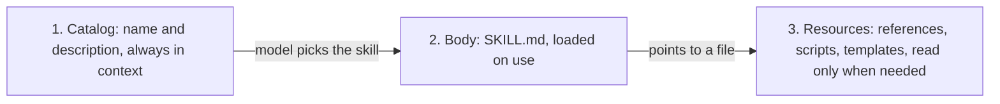
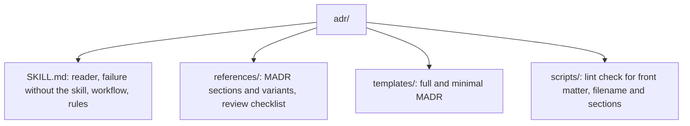

# 13. How a skill is built, and why it has a `references/` folder

> A good skill is a **short entry file** plus folders for everything else. Each folder has one job and is read only when needed. We keep two real skills in `.claude/` as examples. This note explains what each folder is for.

Related: [7 The explainer skill](07_Explainer_Skill.md) · [11 Known techniques (the knowledge skill)](11_Knowledge_Base_Problems_And_Known_Techniques.md) · [1 Simplify first](01_Simplify_First_Knowledge_Guardrails.md) · [Lecture 2: 5 Skills](../Lecture_2_Context_Agents_md_Skills_Tools/5_skills.md) · [7 Skill shaper](../Lecture_2_Context_Agents_md_Skills_Tools/7_skill_shaper_how_to_improve_skills.md)

Source: the two skill copies in this repo ([`.claude/explainer/`](../.claude/explainer/SKILL.md) and [`.claude/knowledge/`](../.claude/knowledge/SKILL.md)), our Lecture 2 skills notes, and the Agent Skills specification as summarized there. We did not run either skill. Checked on 2026-11-08, see [Fact-check](#fact-check).

## 1. The problem

Why did we copy two big skill folders into `.claude/`, and why do they have a `references/` folder and many others? Could the skill simply be one long file?

## 2. Words refinement

| Term | Meaning here |
|---|---|
| **Skill** | A folder with a `SKILL.md` file that an agent loads when it is relevant |
| **Catalog** | The name and description of every skill, always in context, about 100 tokens each. The model picks a skill **only from this** |
| **Body** | The text of `SKILL.md`, loaded when the skill is used |
| **Resources** | Files in the skill's other folders, read only when the skill points to them |
| **Progressive disclosure** | Load a little first and the rest on demand |
| **Reference** | A document the agent opens when a step needs it |

## 3. How a skill reaches the model (from Lecture 2)

This is why the folders exist. The catalog must stay small, because every skill costs tokens in every session. The body must stay short, because attention drops as context grows (the spec advice we noted: under 500 lines). Everything else goes where it costs nothing until it is read.

## 4. What each folder is for

| Folder | Job | Loaded when | In the explainer skill | In the knowledge skill |
|---|---|---|---|---|
| **`SKILL.md`** | Entry point: when to use it, the workflow, the concepts, and a table of where to look | On use | 115 lines | 80 lines |
| **`references/`** | Long documents read **on demand**: formats, rules, syntax, examples | When a step points to one | Format, layouts, writing rules, interactions, capture, design law, one file per block family | Nine "nodes": survey, methods, structure, templates, content, instructions, upkeep, scale, examples |
| **`scripts/`** | **Exact, repeatable work** done by code, not by prose | When the agent runs a command | The engine and commands: `check`, `build`, `audit`, `shot` | `check.ts`: checks links, required fields and drift |
| **`templates/`** | Starter documents the agent copies | When creating something | 42 starter documents, one per diagram shape | (none) |
| **`themes/`** | Style in one place, so documents never restyle themselves | At build time | One theme file | (none) |
| **`assets/`** | Binary or data files the skill needs | By the scripts | Fonts | (none) |

### Why `references/`

- **It keeps the body short.** The explainer's body is 115 lines, yet the whole skill is about 2.3 MB. The body carries the workflow and a table. The detail lives in references.
- **It saves tokens.** A reference costs nothing until it is opened. The skill points to it only when the task needs it.
- **The body works as a router.** The knowledge skill has a table "Open only what the task needs", with a column "Open when". Its own rule: "A new base usually walks survey through instructions in order, then upkeep for the checks. 'Our tags are a mess' starts at upkeep." This is a small version of a router skill ([Lecture 2: 6](../Lecture_2_Context_Agents_md_Skills_Tools/6_router_skills.md)).
- **Keep it one level deep.** Our Lecture 2 note says references should be one level deep, so the agent never chases links through links.

### Why `scripts/`

Fragile or exact work (checking every link, building a page, placing boxes on a grid) is done better by code than by instructions. This is the "exact steps only where precision is a must" split from [note 7 (skill shaper)](../Lecture_2_Context_Agents_md_Skills_Tools/7_skill_shaper_how_to_improve_skills.md), and it is layer 2 of [note 1](01_Simplify_First_Knowledge_Guardrails.md): a machine checks what prose cannot. Both skills run a check before they hand over their work.

### Why `templates/`, `themes/` and `assets/`

They are **guardrails for consistent output**. The explainer's author says the engine decides how it looks and the agent decides what to show ([note 7](07_Explainer_Skill.md)). A template fixes the shape, a theme fixes the style, and assets keep it self-contained.

## 5. Where to put what (a rule of thumb, our reasoning)

| If it is... | Put it in... |
|---|---|
| The reason the skill exists, the order of steps, a few principles | `SKILL.md` |
| A fact the model cannot know (local names, paths, limits, footguns) | `SKILL.md`, or a reference if long |
| Long, and needed only sometimes | `references/` |
| Exact and repeatable | `scripts/` |
| A starting shape for an output | `templates/` |
| Look and feel | `themes/` |
| Files the scripts use | `assets/` |
| Something that must **never** happen | **Not a skill.** A hook or permission rule ([Lecture 2: 3](../Lecture_2_Context_Agents_md_Skills_Tools/3_lifecycle_hooks.md)) |

A small skill needs only `SKILL.md`. Do not add a folder until there is something to put in it ("structure is earned", a rule from the knowledge skill).

## 6. Why we keep the copies in `.claude/explainer/` and `.claude/knowledge/`

- **As examples to study.** We want to see how a well-made skill is organised, and to reuse the ideas for our own skills, starting with ADRs.
- **Not enabled on purpose.** Claude Code looks for project skills in `.claude/skills/<name>/` (the placement table in [note 7](../Lecture_2_Context_Agents_md_Skills_Tools/7_skill_shaper_how_to_improve_skills.md), checked in September 2026 by its author, so re-check). Our folders are one level up, so the harness does not load them. That also means their descriptions cost no catalog tokens and nothing runs.
- **Pinned and reviewable.** Each copy has a `SOURCE.md` with the repository, commit, version and license. We do not auto-update, because a skill is instructions the agent obeys and sometimes code it runs ([Lecture 2: 5](../Lecture_2_Context_Agents_md_Skills_Tools/5_skills.md)).
- **A copy beats a link.** A link can change under us. A pinned copy is what we actually read.
- **Why not delete the heavy parts?** We kept all files so the structure stays intact for study. The cost is size (the explainer is about 2.3 MB) and code we have not reviewed.

## 7. For our own skill (for example, ADR)

A proposed layout, our own idea, to be tested with the baseline method from note 7:

Start with `SKILL.md` only. Add `templates/` when two shapes recur, `references/` when the body grows past what is read each time, and `scripts/` when a check is worth running by code. For several tools, note 7's placement table recommends one canonical copy under `.agents/skills/<name>/` and a relative symlink into `.claude/skills/`.

## Fact-check

Checked on **2026-11-08**. Verdicts: **agrees** / **differs** / **outdated** / **lecture-specific** (opinion) / **unverified**.

| # | Claim | Verdict | What we found |
|---|---|---|---|
| 1 | A skill is a folder with `SKILL.md` and optional `scripts/`, `references/`, `assets/` | **Agrees** | Our Lecture 2 note, citing the Agent Skills specification. Both copies match, and add `templates/` and `themes/` |
| 2 | The catalog is always in context and the body loads on demand | **Agrees, from our Lecture 2 note** | About 100 tokens per skill in the catalog. Not re-checked today |
| 3 | `SKILL.md` should be short | **Agrees** | Spec advice quoted in note 5: under 500 lines. Explainer body 115 lines, knowledge body 80 |
| 4 | Both copies keep detail in `references/` and exact work in `scripts/` | **Agrees (read in the files)** | Verified in both `SKILL.md` files |
| 5 | Our copies are not loaded by Claude Code | **Agrees, re-check** | Because they are not under `.claude/skills/`. Based on the placement table read in September 2026. Placement details change, so verify in the current docs |
| 6 | `templates/` and `themes/` are standard folders | **Differs** | They are not in the specification as we noted it. The explainer adds them for its own needs |
| 7 | The knowledge skill has no `templates/`, `themes/` or `assets/` | **Agrees** | Its folders are `references/` and `scripts/` |
| 8 | A reference should be one level deep | **Agrees, from note 5** | Lecture 2 design principle |

## Cautions

- **Do not enable the copies without review.** They hold code we have not read. See each `SOURCE.md`.
- **More folders are not better.** Every extra folder is something to keep true. Add one only when something earns it.
- **Folders do not enforce anything.** A skill is guidance. For must-never rules use a hook or a permission rule.
- **Resources load only if the body points to them.** A reference nobody links to is dead weight.
- **Untrusted content.** A skill folder can hide instructions in any file ([Lecture 2: 5, Security](../Lecture_2_Context_Agents_md_Skills_Tools/5_skills.md)). Read every file you copy.

## Summary

A skill is a short entry file plus folders that cost nothing until used. `references/` holds long documents read on demand, `scripts/` holds exact work as code, and `templates/`, `themes/` and `assets/` keep the output consistent. We keep two real skills in `.claude/` as pinned examples, not enabled, so we can study the structure and borrow it for our own skills.

## Open questions for discussion

- Which folders does our ADR skill actually need, and in what order do we add them?
- Do we want to move one copy into `.claude/skills/` for a trial, after a review?
- Do we keep both copies, or trim the explainer to its documentation once we have learned from it?

## Sources

- The two skill copies and their `SOURCE.md` files in this repo
- [Lecture 2: 5 Skills](../Lecture_2_Context_Agents_md_Skills_Tools/5_skills.md), [6 Router skills](../Lecture_2_Context_Agents_md_Skills_Tools/6_router_skills.md) and [7 Skill shaper](../Lecture_2_Context_Agents_md_Skills_Tools/7_skill_shaper_how_to_improve_skills.md) (placement table)
- The [Agent Skills specification](https://agentskills.io/specification), as summarized in Lecture 2
- Sections 5 (where to put what), 6 and 7 (our reasoning and the ADR layout) are our own, not from the skills' authors
