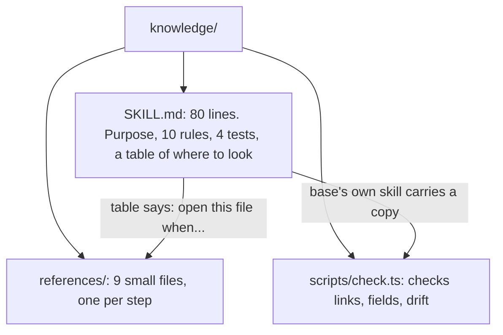
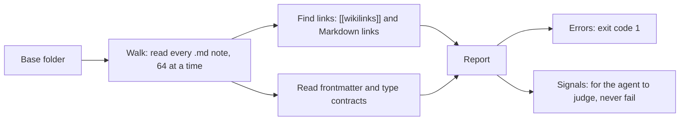
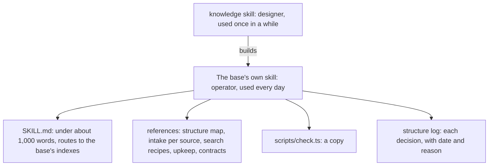
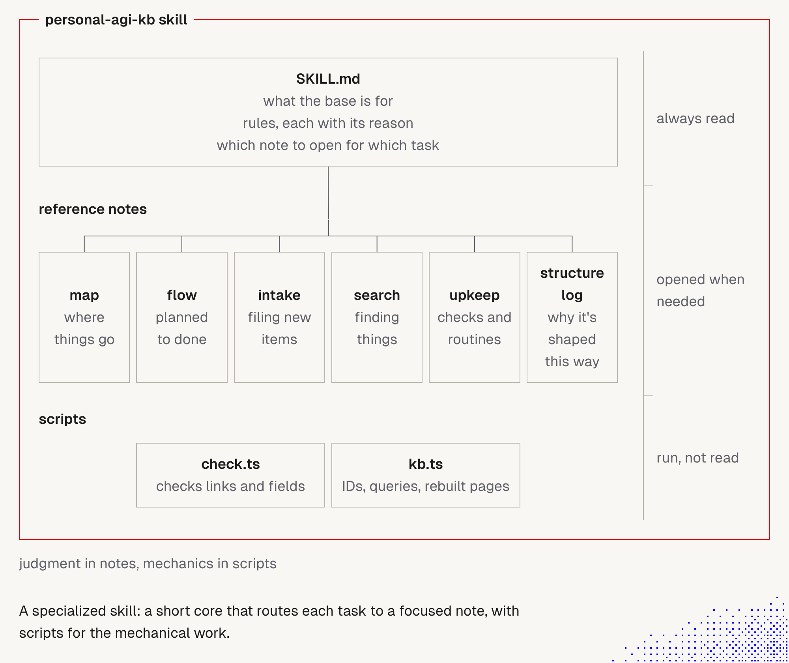

# 13. How the knowledge skill is built, and what to copy

> Three parts: a **short `SKILL.md`** (rules and a map), **`references/`** (one small file per step, opened only when needed), and **one script** that checks the result. The skill also builds a **skill of its own** for each knowledge base. This is a recipe I can reuse.

Related: [11 Known techniques](11_Knowledge_Base_Problems_And_Known_Techniques.md) · [12 Update triggers](12_Knowledge_Event_&_Triggers.md) · [14 Task board](14_Broader_Context_Task_Board.md) · [7 The explainer skill](07_Explainer_Skill.md) · [1 Simplify first](01_Simplify_First_Knowledge_Guardrails.md) · [Lecture 2: 5 Skills](../Lecture_2_Context_Agents_md_Skills_Tools/5_skills.md) · [7 Skill shaper](../Lecture_2_Context_Agents_md_Skills_Tools/7_skill_shaper_how_to_improve_skills.md) · [Lecture 4: 03 Skill and folder orchestration](../Lecture_4_Harness/03_Skill_And_Folder_Orchestration.md) (fleet metadata per skill — harness, scope, model, origin tracking)

Source: the `knowledge` skill copy in [`.claude/knowledge/`](../.claude/knowledge/SKILL.md) (v0.4.0, pinned, see its [`SOURCE.md`](../.claude/knowledge/SOURCE.md)). I read `SKILL.md`, six reference files and the first 170 lines and the usage text of `check.ts`. I did **not** run it. Checked on 2026-11-08, see [Fact-check](#fact-check).

## 1. The idea in four lines

1. `SKILL.md` is short. It holds the **rules** and a **table of where to look**.
2. `references/` holds one small file per step. The agent opens **only the one it needs**.
3. `scripts/check.ts` checks the base **by code**, so the agent does not have to.
4. The skill's last job is to **write a skill for the base** and leave a copy of the script in it.

## 2. The picture

Only `SKILL.md` is read first. A reference is read when the table points to it. The script is run, not read.

## 3. `SKILL.md`: the short entry

It has six parts, in 80 lines:

| Part | What it says |
|---|---|
| **Why it exists** | Without a shared design each session invents its own structure, and the base decays into duplicates, filler and orphans |
| **Recall first** | Name the fitting methods, look across at least two fields, compare two options ([note 11](11_Knowledge_Base_Problems_And_Known_Techniques.md)) |
| **Ten rules** | For example "Purpose first", "One home per fact", "Nothing is orphaned", "Structure is earned" |
| **Four tests** | Filing, finding, cold start, load |
| **Nodes** | A table: which reference to open, and **when** |
| **Asking and acting** | At most three questions, each with a guess and a default. Plan and a yes before changing an existing base. Archive, don't delete |

## 4. `references/`: why one file per step

The `SKILL.md` table, with its "open when" column:

| Reference | Open when |
|---|---|
| `survey` | starting a base, or when one no longer fits |
| `methods` | choosing how the base is organized, written and kept true |
| `structure` | choosing the medium, layout and naming |
| `templates` | a kind of note recurs |
| `content` | deciding what goes in and how it is written |
| `instructions` | writing the base's own skill |
| `upkeep` | checking, cleaning or reshaping a base |
| `scale` | the base will grow past a few thousand notes |
| `examples` | seeing how different needs lead to different shapes |

**Why this is good:**
- **The agent opens only what the task needs.** The skill says so: "'Our tags are a mess' starts at upkeep." A new base walks from `survey` to `instructions`, then `upkeep`.
- **Each file is small** (1.4 to 4.4 KB), so reading one costs little.
- **Each file ends with "Next: ..."**, so the files form a path.
- **Names, not explanations.** `methods.md` "lists names, not explanations, because you already know them". The model recalls the rest ([semantic anchors](../Lecture_2_Context_Agents_md_Skills_Tools/5_skills.md)).
- **Each file has "warning signs"**, a short list of how it goes wrong, for example "always PARA, always Zettelkasten".

**The rule:** if a step needs more than a few lines, give it its own reference and put a row in the table.

## 5. `scripts/check.ts`: how it works

**What it does.** You give it the folder of a Markdown base. It reads every note once, and reports problems. Nothing is written.

**Two kinds of finding:**

| Kind | Meaning | Examples |
|---|---|---|
| **Errors** (stop with exit code 1) | A broken rule | `broken-link`, `ambiguous-link`, `frontmatter` that does not parse, `missing-field`, `bad-value`, `contract` malformed |
| **Signals** (reported, never fail) | An observation to judge | `orphan` (nothing links to the note), `overdue` (a review date passed), `relative-date` ("yesterday", "last week"), `long-note` (over 1,500 words), `tag-variants`, `crowded-folder` (over 1,000 notes in a folder) |

**Type contracts.** A note with `defines: decision` is the **contract** for notes with `type: decision`. Its `required` fields and allowed `values` are checked on every note of that type. So the rules for a note type live in a note, not in a prompt.

**How to run it** (from the usage text):
- `bun check.ts <base-dir>` checks the whole base.
- `--files <paths>` checks only the notes just touched (fast, for each intake). Orphans and tag drift need a full run.
- `--json` gives machine output. `--today YYYY-MM-DD` fixes the date for the overdue check.
- Exit codes: `0` no errors, `1` errors, `2` wrong usage.

**Why a script, not a prompt.** Counting links and checking required fields is exact work. Code does it in milliseconds and never forgets. The agent keeps the judgment: whether a long note is long for a reason, whether two notes really say the same thing. The skill's own line: "No script does the judgment checks (ROT audit)."

**It is one file with no dependencies** (it needs Bun 1.4 or later). That is on purpose: the base's own skill carries a copy, so the base can check itself without the knowledge skill.

**Where it runs.** "Where nobody has to remember it": a pre-commit hook or CI job for a base under git, or a scheduled job otherwise. Without any of these, the base's skill tells agents to run it when they start work.

## 6. The trick: a skill that builds a skill

The knowledge skill is used **rarely**, to design a base. It leaves behind a **skill for the base**, used **every day** by later agents.

**The story (the tutor's picture).** A red frame named `personal-agi-kb skill` is the **generated skill of one base**. A right-hand margin shows three levels. At the top, **`SKILL.md`** (what the base is for, rules each with its reason, which note to open for which task) is **always read**. Below it, six **reference notes** hang from it: **map** (where things go), **flow** (planned to done), **intake** (filing new items), **search** (finding things), **upkeep** (checks and routines), **structure log** (why it is shaped this way). They are **opened when needed**. At the bottom, two **scripts**: **`check.ts`** (checks links and fields) and **`kb.ts`** (IDs, queries, rebuilt pages). They are **run, not read**. The captions: "judgment in notes, mechanics in scripts", and "a specialized skill: a short core that routes each task to a focused note, with scripts for the mechanical work."

**Important:**
- **Three levels of reading:** always read, opened when needed, run and not read. This is how the catalog, body and resources of a skill load ([Lecture 2: 5](../Lecture_2_Context_Agents_md_Skills_Tools/5_skills.md)), applied to one base.
- **One job per note.** Each reference answers one question: where, how it flows, how to file, how to find, how to keep it healthy, why it is shaped this way.
- **Judgment in notes, mechanics in scripts.** The same split as "scripts for mechanics, agents for meaning" in note 12.
- **`flow` is the task board.** "Planned to done" is the life of a task from [note 14](14_Broader_Context_Task_Board.md).

**Not important:**
- The exact box names. Each base picks its own.

**How it maps to what I read in the skill:**

| In the picture | In the knowledge skill's files |
|---|---|
| `SKILL.md`: purpose, rules with reasons, which note to open | `instructions.md`: "say what the base is for", every rule carries its reason, list the reference notes "with when to open each" |
| map | The structure map: "what goes where" |
| intake | "Intake per source" |
| search | "Search recipes" |
| upkeep | `upkeep.md`: the checks, run on a schedule |
| structure log | "Each structural decision with its date and reason" |
| `check.ts` | The script I copied, `scripts/check.ts` |
| `kb.ts` (IDs, queries, rebuilt pages) | **Not in my copy.** `scale.md` says to wrap a search that takes more than one line of shell in a **query script** kept beside `check.ts`, to build **indexes** from front matter, and to use **stable IDs**. So `kb.ts` is a per-base script, written when the base needs it |

What the generated skill must let a fresh agent do: say what the base is for (the survey's questions word for word), file new items, find things with exact commands, write to the content bar, know what it may change alone and what needs a yes, and run the checks. Two details worth copying:
- **Every rule carries its reason on the same line.** "Archive, don't delete: old notes link here, and the archive keeps those links working." A bare rule is applied too literally or dropped at the first odd case.
- **A structure log** records each structural decision with its date and reason, so a later agent sees why a fence is there before removing it.

## 7. The recipe to reuse in my own skills

| Step | What to do |
|---|---|
| 1 | Write a short `SKILL.md`: the reader, what goes wrong without it, a few rules with reasons, and a table of where to look |
| 2 | One small reference per step or decision. Add a row to the table. End each with the next step |
| 3 | In references, list **names** the model knows, not long explanations |
| 4 | Put exact checks in **one dependency-free script**. Split **errors** (stop) from **signals** (judge). Add a second script (IDs, queries, generated pages) once searching takes more than one line of shell |
| 5 | Add a test a **fresh agent** can run (the knowledge skill uses filing, finding and cold start) |
| 6 | Ask **at most three questions** per message, each with a guess and a default |
| 7 | Plan and get a yes before changing existing work. Archive, don't delete |

**My ADR skill, as an example** (my own idea, to test later):
- `SKILL.md`: who reads ADRs, what goes wrong without the skill, the workflow, rules with reasons.
- `references/`: the MADR sections and variants, and a review checklist.
- `scripts/check-adr.ts`, using the same split:
  - **Errors:** front matter missing, an invalid status, a filename that is not `YYMMDD-slug`, a required section missing, the chosen option not among the considered options, a "superseded by" link that does not resolve.
  - **Signals:** no "bad" consequence listed, a very long record, relative dates ("recently"), a review date that passed.

## Fact-check

Checked on **2026-11-08**. Verdicts: **agrees** / **differs** / **outdated** / **lecture-specific** (opinion) / **unverified**.

| # | Claim | Verdict | What I found |
|---|---|---|---|
| 1 | `SKILL.md` is short with a table of reference nodes | **Agrees** | 80 lines, nine nodes with an "open when" column. Read in the file |
| 2 | Each reference is small and ends with a next step | **Agrees** | File sizes 1.4 to 4.4 KB. The files I read end with "Next:" |
| 3 | `check.ts` splits errors from signals, with exit code 1 only for errors | **Agrees (read in the file)** | Usage text and the last lines of the script. Exit codes 0, 1 and 2 |
| 4 | It checks type contracts through `defines` and `type` fields | **Agrees (usage text)** | I did not read the contract code |
| 5 | It works on very large bases | **Lecture-specific, author's claim** | Comment says it reads one note at a time and keeps little in memory. I did not run it or measure it |
| 6 | The skill builds a skill for each base and leaves `check.ts` in it | **Agrees** | `instructions.md` and `upkeep.md`. v0.4.0's commit message says it generates a skill instead of an `AGENTS.md` |
| 7 | The checks run without anyone remembering | **Agrees** | Pre-commit, CI, a schedule, or "run it at the start of work" |
| 8 | The script is safe to run | **Unverified** | I read about a fifth of it and ran a text search. No network, shell or write patterns were found. This is not a review |
| 9 | The ADR layout and checks | **My own idea** | Not from the author. To be tested |
| 10 | The tutor's picture shows a generated skill for one base, not the designer skill | **Agrees** | `instructions.md` describes exactly this: a base skill with a short core, reference notes that say when to open each, scripts, and a structure log |
| 11 | The picture's `kb.ts` is part of the knowledge skill | **Differs** | My copy has only `check.ts`. `scale.md` tells the agent to write a query script and generated indexes for the base when needed. So `kb.ts` is generated per base |
| 12 | The picture's six notes are the standard set | **My reading: no** | The skill's own nodes are survey, methods, structure, templates, content, instructions, upkeep, scale and examples. A base skill picks the notes its base needs. `flow` is the picture's own |

## Cautions

- **I have not run `check.ts`.** It is not reviewed in full. Read it before running, and run it on a copy first.
- **One author's design** (v0.4.0), and it changed between versions. Re-read before updating.
- **Errors only catch what the script can see.** A passing check does not mean the base is true.
- **Copies are not enabled.** `.claude/knowledge/` is not under `.claude/skills/`, so Claude Code does not load it (placement in [note 7 of Lecture 2](../Lecture_2_Context_Agents_md_Skills_Tools/7_skill_shaper_how_to_improve_skills.md), checked September 2026, so re-check).
- **Scope.** The skill is for bases agents maintain. It is not for a codebase's `AGENTS.md`, or for retrieval pipelines.
- **Data.** My notes hold how I think, not Aras business data. Do not feed company knowledge into a base-building run without checking the [AI Solutions Catalog](http://aitools.aras.com/).

## Summary

The knowledge skill is a short `SKILL.md` with a table, nine small references opened one at a time, and one script that checks the result by code. It leaves a skill of its own behind, with a copy of the script. For my own skills: keep the entry short, give each step its own small file, move exact checks into a script with errors and signals, and give every rule its reason.

## Open questions for discussion

- Is the seven-step recipe the right one for my skills, or too much for a small skill?
- Do I build the ADR skill on this layout, and do I write its check script?
- Do I read and test `check.ts` on a copy of this repo's notes?

## Sources

- The `knowledge` skill copy: [`.claude/knowledge/SKILL.md`](../.claude/knowledge/SKILL.md), `references/` and `scripts/check.ts`, from [overment/skills](https://github.com/overment/skills/tree/main/skills/knowledge) at commit `ab5cc432e435ca51da4ec0b035a4de27ac15ac3d` (MIT)
- The tutor's picture of a generated skill (copied to `img/`)
- [Lecture 2: 5 Skills](../Lecture_2_Context_Agents_md_Skills_Tools/5_skills.md) and [7 Skill shaper](../Lecture_2_Context_Agents_md_Skills_Tools/7_skill_shaper_how_to_improve_skills.md)
- Section 7 (the recipe and the ADR layout) is my own reasoning, not from the skill's author
