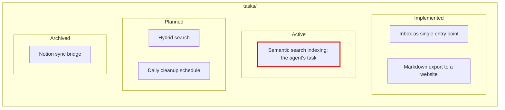

# 14. Broader context: a task board next to AGENTS.md

> `AGENTS.md` holds what is **stable**: how the repo is organized and how the agent should behave. What is **changing** (what is active, planned, archived, and what gaps I found) lives in files next to it, on a small task board. `AGENTS.md` only points to it.

Related: [1 Simplify first](01_Simplify_First_Knowledge_Guardrails.md) · [10 Demos: reaching the right files](10_Demos_Reaching_The_Right_Files.md) · [12 Update triggers](12_Knowledge_Event_&_Triggers.md) · [13 Knowledge skill anatomy](13_Knowledge_Skill_Anatomy.md) · [5 Knowledge as files for agents](05_Knowledge_As_Files_For_Agents.md) · [Lecture 2: 4 Context window](../Lecture_2_Context_Agents_md_Skills_Tools/4_context_window.md) · [Lecture 2: 1 Harness](../Lecture_2_Context_Agents_md_Skills_Tools/1_Harness.md)

Source: the lecture text on broader context (its picture is described in the text, redrawn here), my `AGENTS.md`, Anthropic's engineering post on long-running agents and the Cline Memory Bank docs (both seen as search summaries). Checked on 2026-11-08, see [Fact-check](#fact-check).

## 1. The problem

An agent knows only what is in its context. A knowledge base shows only what is in it **now**. The agent cannot see what came before or what comes next. So it may rebuild what exists, collide with work in progress, design with no room for what is planned, or propose again an idea I already dropped.

Meanwhile `AGENTS.md` is the easy place to dump "what we are doing now". That makes it long and stale.

## 2. Words refinement

| Term | Meaning here |
|---|---|
| **Narrow context** | The task the agent is working on |
| **Broader context** | What surrounds the task: what exists, what is active, what is planned, what was dropped |
| **Task board** | A short list of features by status. Not the same as git history |
| **Implemented, Active, Planned, Archived** | The four statuses of a feature |
| **Gap** | Something I found missing or unclear, not yet fixed |
| **Structure and behavior** | The stable content of `AGENTS.md`: how the repo is laid out and how the agent should work |
| **State** | The changing content: status, recent updates, gaps |

## 3. The picture (from the lecture text)

The lecture describes a frame named `tasks/` with four columns. I redrew it. The feature names are the lecture's **examples**.

**The story.** The agent's own task, "Semantic search indexing", is the only item in **Active** (marked red). Around it the agent sees what already exists (Implemented), what is coming (Planned: Hybrid search, Daily cleanup schedule), and what was dropped (Archived: Notion sync bridge).

**Important:**
- The agent gets its **narrow** context (the red task) **and** the **broader** one in a single place.
- The board is a list of **features**, not a copy of the git history.
- Archived items are kept so the agent does not suggest them again.

**Not important:**
- The feature names and the number of items.

## 4. What the board gives the agent

Using the lecture's example:

| The agent sees | And so it can |
|---|---|
| **Implemented:** inbox, Markdown export | Reuse them. Not rebuild |
| **Active:** semantic search indexing (its task) | Know it owns this, and that nobody else is on it |
| **Planned:** hybrid search, daily cleanup | Shape the index so hybrid search can be added later. Not block the cleanup |
| **Archived:** Notion sync bridge | Not propose a Notion sync again. The archived entry should say **why** it was dropped |

The lecture says this helps in implementation, and also when the agent **shapes requirements and ADRs**. A planned item is where an ADR starts.

## 5. My idea: split `AGENTS.md` by how fast the information changes

This is my own reasoning, built on your idea.

| Information | Where it lives | Changes | Why there |
|---|---|---|---|
| **Structure** (how the repo is organized) | `AGENTS.md` | rarely | The agent needs it in every session |
| **Behavior** (rules for how to work) | `AGENTS.md` | rarely | Same |
| **State**: what is active, planned, archived | The task board, next to `AGENTS.md` | often | It changes every week and would bloat `AGENTS.md` |
| **Gaps found** | In the task file (a "Gaps" part) | often | Belongs to the work it blocks |
| **What changed** | **Git history** | every commit | Git already records it. Copying it is a discoverable fact ([note 1](01_Simplify_First_Knowledge_Guardrails.md)) |
| **Why I decided** | An ADR, linked from the task | rarely | A decision outlives the task |

**Keep the "why" and drop the "what".** Git tells the agent *what* changed. It does not tell it the intent, the status, or the gap. Those are what the board adds.

**How I get back to this information.** `AGENTS.md` should say where the state is, in one line, for example: "Before planning, read `tasks/README.md`." Note 10 explains why: the board's words ("Active", "Planned") rarely match a question, so search will not find it. In the course demo a **short map in the instructions** reached the unreached notes (9 to 26 of 30), while links in metadata barely helped. So the pointer lives in `AGENTS.md`, and the board lives next to it.

Four ways back to the information:
1. **A pointer line** in `AGENTS.md`.
2. **The board index**, one line per task, with links.
3. **A status field** in each task file, so a script can list tasks by status.
4. **Git history**, for what actually changed.

## 6. A layout for my repo (my proposal)

**Option 1: a folder per status** (`implemented/`, `active/`, `planned/`, `archived/`). Simple to see. But moving a file to change its status breaks links.

**Option 2: one board file and one file per task, with the status in front matter.** The board is an index. Links never break, because a file does not move. A small script checks the board.

I lean to **option 2**. The knowledge skill gives the reason: rule 9, "Identity is stable: names survive reorganizations and links survive moves."

| Part | Content |
|---|---|
| `tasks/README.md` | The board: four sections (Implemented, Active, Planned, Archived), one line per task, linked. The agent reads this first |
| `tasks/<slug>.md` | One task. Front matter: `status` (planned, active, implemented, archived) and `updated` (a date). Body: the goal in one line (BLUF), why, **gaps**, links to an ADR or the relevant notes |
| `AGENTS.md` | One pointer line to `tasks/README.md` |
| A check script | Every task file is on the board, has a valid `status` and an `updated` date, and every board link resolves (the same errors-and-signals split as `check.ts`, [note 13](13_Knowledge_Skill_Anatomy.md)) |

**An illustration for this repo** (from my own work, not a decision):

| Status | Items |
|---|---|
| Implemented | Notes 1 to 14. `AGENTS.md` rules: fact-check, Mermaid only, content scope |
| Active | The Lecture 3 notes |
| Planned | A draft of my ADR skill. The remaining runs of the two course demos. A sweep of time-sensitive claims in Lectures 1 and 2. The finding test on this repo. A test of jevgrep on a safe repository, after approval |
| Archived | (none yet) |

## 7. Keeping the board true

Boards rot unless something keeps them honest. From [note 12](12_Knowledge_Event_&_Triggers.md):
- **Events can update it.** A merged change can move a task to Implemented. A new repository can add an entry. The agent proposes, a person confirms.
- **A guard checks it.** A script catches a task missing from the board, a bad status, or a task marked Active that has not been updated for a long time (the "overdue" idea from `check.ts` and the freshness field in the [Open Knowledge Format](05_Knowledge_As_Files_For_Agents.md#beyond-search-more-context-and-metadata-short)).
- **Archive, don't delete.** A dropped idea moves to Archived with its reason.
- **Keep reads bounded.** The board lists titles. Details sit in the task files, opened on demand.

## 8. Industry check

- **Anthropic, long-running agents.** Their post describes a setup where an initializer session prepares the environment, and a **progress log file** plus **git history** let a fresh context window see where the work stands. That is the same idea: state in files next to the work, read by a new session. (Search summary. The JSON feature list that the post may describe was not confirmed.)
- **Cline Memory Bank.** A community pattern with six files: `projectbrief`, `productContext`, `activeContext`, `systemPatterns`, `techContext` and `progress`. The docs say `activeContext.md` changes most often, and `progress.md` holds status, known issues and milestones. It is the same split: **stable files** and **changing files**. Cline's docs describe it as community-created, not built in.
- **A warning from that pattern.** A comparison source says the Memory Bank loads every file on every task, so the context grows. My version avoids this: the agent reads the board **on demand** through a pointer, and the board lists titles only.

## Fact-check

Checked on **2026-11-08**. Verdicts: **agrees** / **differs** / **outdated** / **lecture-specific** (opinion) / **unverified**.

| # | Claim | Verdict | What I found |
|---|---|---|---|
| 1 | An agent's understanding is limited to what is in its context | **Agrees** | My [Lecture 2: 4 Context window](../Lecture_2_Context_Agents_md_Skills_Tools/4_context_window.md) |
| 2 | A board of implemented, active, planned and archived features gives useful broader context | **Lecture-specific, plausible** | No study found. Related practice: Anthropic's long-running-agent setup uses a progress file and git history for the same purpose |
| 3 | It helps when shaping requirements and ADRs | **Lecture-specific** | No source. Fits how an ADR starts from a planned item |
| 4 | Keep `AGENTS.md` for structure and behavior, and put state elsewhere | **Agrees, my reasoning** | Claude Code docs say the instruction file should hold what the agent cannot work out itself, and be short ([note 1](01_Simplify_First_Knowledge_Guardrails.md)). The Cline pattern also separates stable from changing files |
| 5 | A changelog belongs in `AGENTS.md` | **Differs** | What changed is derivable from git. Keep the why, not the diff |
| 6 | Link the board from `AGENTS.md` | **Agrees** | Demo A in [note 10](10_Demos_Reaching_The_Right_Files.md): a short map in the instructions reached context notes that search missed |
| 7 | Anthropic uses a feature list and a progress file | **Partly verified** | The progress file and git history are in the summaries. The JSON feature list was **not** confirmed |
| 8 | Cline's Memory Bank splits stable and changing files | **Agrees** | Six files. `activeContext.md` changes most. Community-created |
| 9 | A status-in-front-matter board is better than folders per status | **My reasoning** | Based on the knowledge skill's rule 9. Not tested |

## Cautions

- **A board rots.** Without a guard and an owner, "Active" turns into a graveyard.
- **"Planned" is not a promise.** An agent may treat it as committed. State it plainly on the board.
- **Do not copy trackers into it.** Distill. Tickets and issues may hold customer data. My notes hold how I think, not Aras business data ([note 12](12_Knowledge_Event_&_Triggers.md)).
- **Do not load everything.** Keep Archived short and details in task files, or the board becomes the context bloat it was meant to fix.
- **Statuses can be wrong.** The agent proposes status changes, a person confirms them.
- **Aras policy.** Connecting an agent to company trackers is a high-risk use that needs approval first. This note is design only.

## Summary

Keep `AGENTS.md` for what is stable: structure and behavior. Put what changes, such as active, planned and archived work and the gaps I found, on a small board next to it, with one pointer line in `AGENTS.md`. Git already records what changed, so the board keeps the why, the status and the gaps. A script keeps the board true.

## Open questions for discussion

- Do I create `tasks/` in this repo, with the layout of option 2?
- My `AGENTS.md` is growing. Which rules could move to a file it points to, as the knowledge skill does with `references/`?
- What is the guard: how old can an Active task be before I flag it?
- Who confirms a status change, and when does an item go to Archived?

## Sources

- Lecture text on broader context (picture described in text, redrawn here)
- My `AGENTS.md`
- [Anthropic: Effective harnesses for long-running agents](https://www.anthropic.com/engineering/effective-harnesses-for-long-running-agents) (search summary)
- [Cline: Memory Bank](https://docs.cline.bot/best-practices/memory-bank) (search summary)
- The `knowledge` skill ([`.claude/knowledge/`](../.claude/knowledge/SKILL.md)), rule 9
- Sections 5 and 6 (the split, the layout and the illustration for this repo) are my own reasoning
