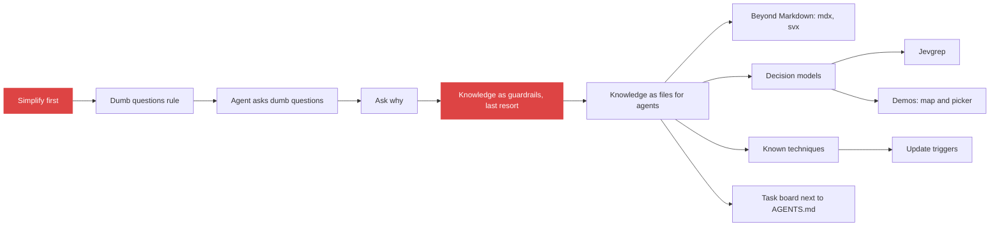

# Lecture 3: Simplify the codebase and the knowledge base

> When an agent keeps erring, I fix the codebase first and keep knowledge as a last resort, then build that knowledge for agents as plain files and help the agent reach the right ones.

Source: the lecture video, its written lesson pages and my own notes, one topic per file. Pictures are in `img/`. Related: [Lecture 2: Context, AGENTS.md, skills and tools](../Lecture_2_Context_Agents_md_Skills_Tools/README.md) · [Lecture 4: Working with AI harnesses](../Lecture_4_Harness/README.md) · [root README](../README.md)

## What this lecture covered

## Notes

### Simplify the codebase first

| File | Name | What it covers | Keywords |
|---|---|---|---|
| [01_Simplify_First_Knowledge_Guardrails.md](01_Simplify_First_Knowledge_Guardrails.md) | Simplify first: knowledge as guardrails | When an agent keeps erring, I fix the codebase first, and knowledge is a last resort with a type and a review path | simplify, guardrails, fix order, agents.md, skills |
| [02_Dumb_Questions_Rule.md](02_Dumb_Questions_Rule.md) | Dumb questions rule | Every newcomer asks at least one dumb question, because confusion is the signal to simplify | dumb questions, onboarding, confusion |
| [03_Agent_Asks_Dumb_Questions.md](03_Agent_Asks_Dumb_Questions.md) | Agent asks dumb questions | I treat each new thread as a new hire and use its confusion as a map of what to simplify | new hire, explore, confusion, technique |
| [04_Ask_Why.md](04_Ask_Why.md) | Ask why | After a mistake I ask the agent why, treat the answer as a hypothesis, and fix the cause at the lowest layer | ask why, hypothesis, mistake, lowest layer |

### Knowledge base design

| File | Name | What it covers | Keywords |
|---|---|---|---|
| [05_Knowledge_As_Files_For_Agents.md](05_Knowledge_As_Files_For_Agents.md) | Knowledge as files, built for agents | Plain Markdown, immutable raw sources, an agent-written wiki, a short schema file | markdown, raw sources, wiki, schema file |
| [06_Beyond_Markdown_mdx_svx.md](06_Beyond_Markdown_mdx_svx.md) | Beyond Markdown: mdx and svx | Markdown stays the core, and mdx and svx add components where interaction pays for itself | markdown, mdx, svx, components |
| [07_Explainer_Skill.md](07_Explainer_Skill.md) | The explainer skill | A skill that turns Markdown with data blocks into an interactive HTML explainer | explainer, skill, html, data blocks |
| [11_Knowledge_Base_Problems_And_Known_Techniques.md](11_Knowledge_Base_Problems_And_Known_Techniques.md) | Knowledge base problems and known techniques | I name the known technique for each problem, pick one per problem, and check the result with tests | named techniques, problems, tests |
| [12_Knowledge_Event_&_Triggers.md](12_Knowledge_Event_&_Triggers.md) | Knowledge base update triggers | Schedules and events keep a knowledge base updated without a person, without damaging information | schedules, events, triggers, cleanup |
| [13_Knowledge_Skill_Anatomy.md](13_Knowledge_Skill_Anatomy.md) | Knowledge skill anatomy | A short SKILL.md, a references folder with one small file per step, and one checking script | skill.md, references, script |
| [14_Broader_Context_Task_Board.md](14_Broader_Context_Task_Board.md) | Broader context: task board | AGENTS.md holds what is stable, and what changes lives on a small task board next to it | agents.md, task board, stable, changing |

### Helping the agent reach the right files

| File | Name | What it covers | Keywords |
|---|---|---|---|
| [08_Decision_Models_Search_And_Memory.md](08_Decision_Models_Search_And_Memory.md) | Decision models: pointing the agent | A small fast model points to the folders, files and functions worth reading, so the agent explores less | decision model, small model, search, router |
| [09_Jevgrep.md](09_Jevgrep.md) | Jevgrep: find code by intent | A command line tool where a small model judges which parts matter, though the saving shrinks with its own cost | jevgrep, small model, cli, code search |
| [10_Demos_Reaching_The_Right_Files.md](10_Demos_Reaching_The_Right_Files.md) | Demos: reaching the right files | Two demos of an agent missing what it cannot reach: one fixed with a map, one with a picker | map, picker, unreached notes, search |
