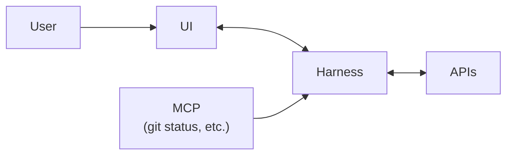
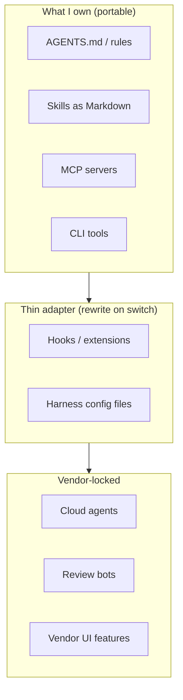

# 1. Harness lock-in — keep the doors open

> Treat the harness as a **replaceable middle layer** between the UI and my tools/APIs. Keep substance in the repo, not in vendor features. The moment I couple to the UI, I'm stuck.

Related: [02 Agent runner portability](02_Agent_Runner_Portability.md) · [Lecture 3: 5 Knowledge as files](../Lecture_3_Simplify_Codebase_&_Knowledge_Base/05_Knowledge_As_Files_For_Agents.md) · [Lecture 3: 13 Knowledge skill anatomy](../Lecture_3_Simplify_Codebase_&_Knowledge_Base/13_Knowledge_Skill_Anatomy.md) · [Lecture 2: 1 Harness](../Lecture_2_Context_Agents_md_Skills_Tools/1_Harness.md)

Source: S01E04 transcript (lecture diagram + discussion on harness-agnostic setup), web research checked 2026-11-08, see [Fact-check](#fact-check).

## 1. The problem

I pick a harness — Claude Code, Cursor, Pi, Codex — and build my workflow around it. Skills, hooks, extensions, cloud agents. One day something better appears, or the vendor changes pricing, or my project needs a different model. How locked am I?

## 2. The lecturer's architecture

The lecturer draws the harness as a **middle box** in a chain:

The point: the **UI is not the harness.** The harness is the runtime that connects tools (MCP, CLI), APIs (LLM providers), and my configuration (AGENTS.md, skills). The UI — whether it's a terminal, an IDE panel, or a web app — is just a front-end for that runtime.

**If I couple my workflow to the UI, I'm locked.** If I keep the substance in the harness layer and below, I can swap the UI or swap the entire harness.

### The vendor incentive problem

Vendors don't want me to separate these layers. Cursor bundles IDE + harness into one product. Claude Code ties cloud agents, artifacts, and the web UI into a single experience. That's not evil — it's a natural business incentive. But it means **I have to be deliberate** about where I put my work.

## 3. Where lock-in actually sits

Research on 11 coding-agent systems (["Harness Engineering", arxiv 2609.00006](https://arxiv.org/pdf/2609.00006)) and practitioner experience point to the same conclusion: **lock-in is in configuration, not in code.**

| Layer | Portable? | Notes |
|---|---|---|
| AGENTS.md / rules files | **Yes** | Plain text in repo. Every harness reads them. |
| Skills (Markdown + support files) | **Mostly yes** | Format differs slightly (Claude Code skills vs Pi extensions vs Cursor rules), but the substance — the instructions — transfers. |
| MCP servers | **Yes** | Open protocol. Any harness that speaks MCP uses them. **This is the strongest portability lever.** |
| CLI tools | **Yes** | Shell commands work everywhere. |
| Model choice | **Low risk** | Models converge. Swapping provider = changing a config line. |
| Hooks / extensions | **No** | Pi extensions ≠ Claude Code hooks ≠ Cursor rules. Vendor-specific packaging and lifecycle. |
| Cloud agents / managed environments | **No** | Tied to vendor infrastructure. No portability. |
| Vendor-specific review bots | **No** | GitHub Actions wiring, vendor auth, policy — all coupled. |

**The rule:** the more a feature lives in my repo as plain text, the more portable it is. The more it lives in the vendor's infrastructure, the more locked I am.

## 4. Practical strategies

### Keep substance in the repo

Everything I care about — architecture decisions, coding standards, skill instructions, tool definitions — should be **files I own**, not vendor configuration I rent.

- `AGENTS.md` / `CLAUDE.md` / `.cursorrules` → all do the same job. I keep one source of truth and symlink or copy.
- Skills → write as plain Markdown with a clear structure. The harness-specific wrapper is thin.
- Tool integrations → build as MCP servers once. Every harness that speaks MCP gets them for free.

### Separate the layers deliberately

Following the lecturer's diagram, I should be conscious of three boundaries:

My goal: maximize what's in "MINE", keep "THIN" genuinely thin, and use "VENDOR" knowing the cost.

### Rehearse the exit

One practitioner recommendation I found valuable: **periodically run a real task on a different harness.** Not as a permanent switch — just to verify that my setup actually transfers. If it doesn't, I know which pieces are coupled and can decide whether to fix that.

### Shared setup script

If I use multiple harnesses (or want to), a single repo-level setup script that every harness's bootstrap calls means no vendor owns my install logic.

## 5. My take

The lecturer frames this as "harness-agnostic setup" and points to [Kody](https://github.com/kentcdodds/kody) as an example of config that moves between harnesses with almost no changes. That's the ideal.

In practice, I notice I drift toward vendor features because they're convenient — cloud agents, built-in artifacts, managed hooks. The discipline is: **use them, but don't build on top of them.** Use vendor features for convenience, keep the core logic in portable files.

MCP is the biggest unlock here. Before MCP, every tool integration was harness-specific. Now I write an MCP server once and it works in Claude Code, Cursor, Pi, Codex, and anything that comes next. **If I'm going to invest in one portability strategy, it's MCP.**

## Fact-check

| # | Claim | Verdict | Source | Checked |
|---|---|---|---|---|
| 1 | All harnesses implement a similar set of features (MCP, skills, subagents) | **Agrees** | [arxiv 2609.00006](https://arxiv.org/pdf/2609.00006) — systematic study of coding-agent anatomy confirms convergence | 2026-11-08 |
| 2 | AGENTS.md, skills, MCP servers move between harnesses with little friction | **Agrees** | [developertoolkit.ai](https://developertoolkit.ai/en/org/lock-in-and-portability/), practitioner reports | 2026-11-08 |
| 3 | Hooks and extensions are vendor-specific and don't transfer | **Agrees** | Pi extensions vs Claude Code hooks vs Cursor rules — different APIs, different lifecycles | 2026-11-08 |
| 4 | Cloud agents are vendor-locked | **Agrees** | Each vendor's cloud agent runs in their infra with their auth; no portability standard exists | 2026-11-08 |
| 5 | MCP is an open protocol any harness can implement | **Agrees** | [modelcontextprotocol.io](https://modelcontextprotocol.io/) — open spec, adopted by Claude Code, Cursor, Codex, Pi, and others | 2026-11-08 |
| 6 | Kody project moves between harnesses with almost no config | **Lecture-specific (opinion)** | [Kody repo](https://github.com/kentcdodds/kody) exists; "almost no config" is the lecturer's characterization. Kody uses plain Markdown instructions, which supports the claim. | 2026-11-08 |
| 7 | Vendors deliberately couple UI + harness | **My interpretation** | Not a factual claim — my reading of vendor incentives. Cursor and Claude Code do bundle UI + runtime tightly, but whether that's "deliberate lock-in" vs "product integration" is perspective. | 2026-11-08 |
