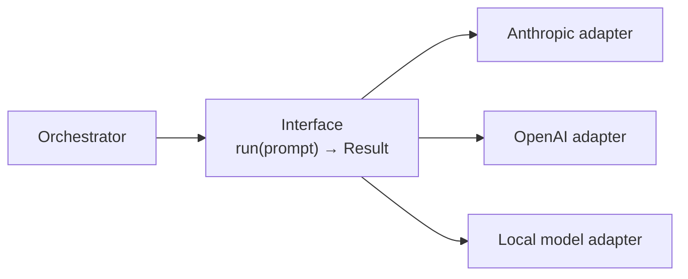
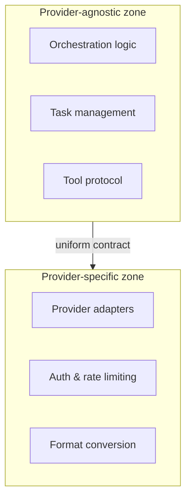
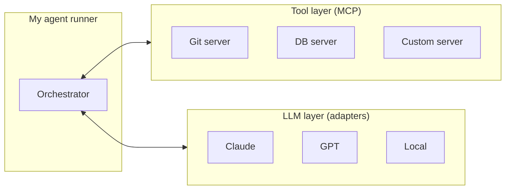

# 2. Agent runner portability — everything is a plugin

> When I build my own agent system, **lock-in is my own code.** The fix: plugin architecture, open contracts, adapter boundaries. No component should know which LLM provider sits behind the interface.

Related: [01 Harness lock-in](01_Harness_Lock-in_Keep_Doors_Open.md) · [Lecture 3: 13 Knowledge skill anatomy](../Lecture_3_Simplify_Codebase_&_Knowledge_Base/13_Knowledge_Skill_Anatomy.md) · [Lecture 2: 1 Harness](../Lecture_2_Context_Agents_md_Skills_Tools/1_Harness.md)

Source: S01E04 transcript, 2026 study of 11 coding-agent systems, web research checked 2026-11-08, see [Fact-check](#fact-check).

## 1. The problem

I build an agent runner — my own orchestration around LLMs. I wire it to Anthropic's SDK, use Claude-specific features, structure prompts for one model family. Then I need to swap the provider, or run part of the pipeline on a local model for privacy, or the next-gen model from a different lab is 3x better at my task. How much do I rewrite?

This is the **architect's version** of harness lock-in: the lock is in my own code, and I put it there.

## 2. Key questions to evaluate any agent architecture

These come from studying real agent systems. I use them as a checklist when designing or reviewing an agent runner:

1. **Can I swap the LLM provider without changing orchestration logic?**
   If calling `anthropic.messages.create(...)` is scattered across my codebase, every provider change is a rewrite. If it's behind an adapter, it's a config change.

2. **Does each component declare what it needs, or does it assume what it gets?**
   A runner that declares "I need: text completion, tool calling, structured output" is portable. A runner that assumes "I have Claude Opus with 200k context and prompt caching" is welded to one provider.

3. **Can I test orchestration logic without a live LLM?**
   If my adapter contract is clean, I can slot in a `mockAdapter` or a local model and test the flow. If not, every test needs an API key and real tokens.

4. **Can I add a new provider without touching existing ones?**
   Open/closed principle for LLM providers. If adding Gemini means editing my Anthropic adapter, the boundary is leaking.

5. **Can I route different tasks to different providers in the same pipeline?**
   Example: Claude for reasoning, a local model for PII-sensitive steps, GPT for a specific format. If my architecture supports this, it's genuinely pluggable. If not, I have a single-provider system with an abstraction veneer.

6. **Where does provider-specific knowledge live?**
   Token limits, tool-call format, system-prompt behavior, rate-limit handling — these differ by provider. In a portable system, they live in the adapter, not in the orchestrator.

## 3. The patterns

### Pattern 1: LLM abstraction layer

The simplest form of portability. Put a uniform interface between my orchestrator and the provider SDK.



Real-world implementations: LiteLLM (100+ providers behind one API), OpenHands and Aider both use this pattern. The contract is simple: `run(prompt) → uniform result type`.

**Caveat:** abstraction leaks under non-standard features. Tool calling, vision, structured outputs, prompt caching — these work differently across providers. The adapter either hides the difference (lossy) or exposes a capability system (complex).

### Pattern 2: Adapter boundary

Separate the codebase into two zones:



The orchestrator never imports a provider SDK. It calls the adapter contract. Model selection lives in config, not in code.

### Pattern 3: Runner contract

Each runner declares what it supports and exposes a standard interface:

```typescript
interface Runner {
  capabilities: Set<'completion' | 'tools' | 'vision' | 'structured_output'>;
  run(prompt: RunnerInput): Promise<RunnerResult>;
}
```

The orchestrator resolves a runner from config. Fallback wrappers retry on a secondary runner for retriable errors. Auth errors bubble up — they're not the orchestrator's problem.

### Pattern 4: MCP as portable tool protocol

MCP decouples tools from both the harness and the provider. My tools don't know which LLM calls them — they expose a standard interface (tool name, schema, handler). Any harness or runner that speaks MCP can use them.

This is the **tool-side** equivalent of the LLM adapter: instead of abstracting the LLM, I abstract the tool.



Both sides are pluggable. The orchestrator is the only piece that's truly mine — and it should contain only the orchestration logic, nothing provider-specific.

## 4. Where abstraction leaks (and what to do about it)

Honesty check: no abstraction is perfect. These are the known leak points:

| Feature | Problem | Mitigation |
|---|---|---|
| Tool calling | Format differs (Anthropic `tool_use` blocks vs OpenAI function calling) | Adapter translates; test with each provider. |
| System prompt | Anthropic separates system from messages; others concatenate | Adapter handles placement. |
| Prompt caching | Anthropic-specific feature; no equivalent elsewhere | Treat as optimization, not dependency. Don't build logic that requires caching. |
| Structured output | JSON mode, tool-forced output, grammar-constrained — all different | Define in schema; adapter enforces per-provider mechanism. |
| Context window | 200k vs 128k vs 32k — changes what fits | Capability declaration; orchestrator adjusts strategy per runner. |
| Rate limits / pricing | Differ wildly | Adapter reports; orchestrator decides (retry, fallback, queue). |

**The principle:** leaks are acceptable in the adapter. They're not acceptable in the orchestrator.

## 5. My take

Two principles I keep coming back to:

**Everything is a plugin.** Every component — LLM provider, tool server, storage backend, even the prompt formatter — should be replaceable without rewriting the orchestrator. This isn't theoretical: the 2026 study found that OpenClaw's pluggable provider system (auth rotation, failover, cooldown) gave it resilience that monolithic agent systems didn't have.

**Interfaces and open contracts.** The adapter contract is the most important design decision in an agent runner. Get it right and adding a provider is a day of work. Get it wrong and every provider change ripples through the codebase.

The hardest part is resisting the convenience of tight coupling. Anthropic's SDK is excellent — prompt caching, batching, streaming all work beautifully when I use it directly. The discipline is wrapping those features in an adapter so my orchestrator never sees them.

## Fact-check

| # | Claim | Verdict | Source | Checked |
|---|---|---|---|---|
| 1 | LiteLLM supports 100+ providers behind one API | **Agrees** | [litellm.ai](https://docs.litellm.ai/) — lists 100+ providers | 2026-11-08 |
| 2 | OpenHands, Aider use LLM abstraction layers | **Agrees** | [2026 study of 11 coding-agent systems](https://arxiv.org/pdf/2609.00006), confirmed in source repos | 2026-11-08 |
| 3 | Tool-calling format differs between providers | **Agrees** | Anthropic uses `tool_use` content blocks; OpenAI uses `function` in message; formats are not interchangeable | 2026-11-08 |
| 4 | MCP is an open tool protocol usable by any runner | **Agrees** | [modelcontextprotocol.io](https://modelcontextprotocol.io/) — open spec, multiple harness implementations | 2026-11-08 |
| 5 | Prompt caching is Anthropic-specific | **Outdated as absolute claim** | Google added context caching for Gemini; OpenAI has automatic prompt caching. But mechanisms differ, so "don't build logic that requires caching" remains good advice. Corrected 2026-11-08: was "Anthropic-only", now "differs by provider". | 2026-11-08 |
| 6 | No LLM can reliably select a model for privacy boundaries | **Agrees** | Lecturer's claim, supported by [privacy-boundary example](https://github.com/MEGA-DOT-DEV/examples/tree/main/examples/privacy-boundary); deterministic separation is recommended in industry practice. | 2026-11-08 |
