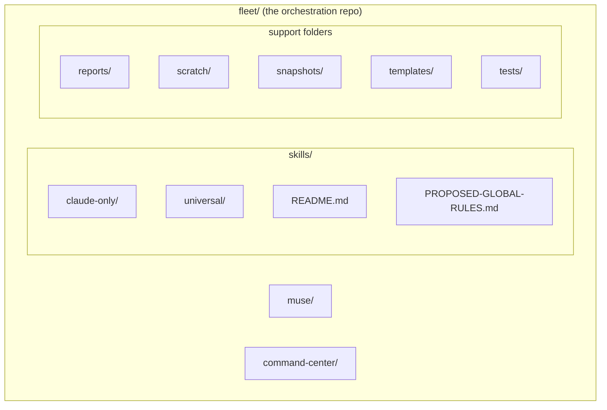
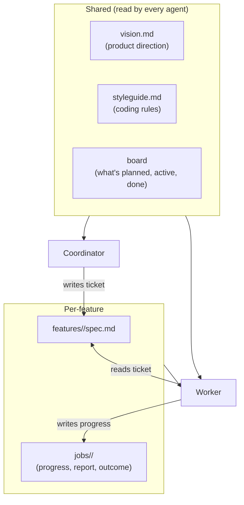
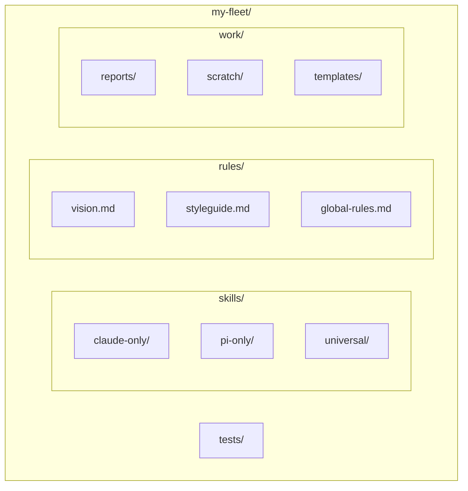

# 3. Skill and folder orchestration — organizing the agent fleet

> Separate skills by **harness**, **scope**, and **origin**. Give each concern its own folder. Track upstream sources like dependencies. This is what makes a multi-agent, multi-project setup manageable.

Related: [18 Sharing approved skills](18_Sharing_Approved_Skills_AI_Marketplace.md) · [01 Harness lock-in](01_Harness_Lock-in_Keep_Doors_Open.md) · [02 Agent runner portability](02_Agent_Runner_Portability.md) · [Lecture 2: 5 Skills](../Lecture_2_Context_Agents_md_Skills_Tools/5_skills.md) · [Lecture 2: 12 Subagents vs workers](../Lecture_2_Context_Agents_md_Skills_Tools/12_subagents_vs_workers.md) · [Lecture 1: 16 Self-management](../Lecture_1_Mechanics_Behind_Generative_AI/16_self_management.md) · [Lecture 3: 13 Knowledge skill anatomy](../Lecture_3_Simplify_Codebase_&_Knowledge_Base/13_Knowledge_Skill_Anatomy.md)

Source: S01E04 transcript (shared resources, limen project), Theo Browne's "fleet" project structure (screenshot), web research checked 2026-11-08, see [Fact-check](#fact-check).

## 1. The problem

I have multiple projects, multiple agents, skills from different sources (my own, Anthropic's, community), rules that apply globally vs per-project, and harness-specific vs universal config. Without a clear folder structure and metadata scheme, this turns into a mess fast — skills conflict, rules drift, and I can't tell what came from where or what I changed.

## 2. The "fleet" pattern (from Theo Browne)

The screenshot shows a project called **fleet** — a centralized repo that organizes everything the agent fleet needs:



### Skills organized by harness

Inside `skills/`, the first split is by **harness compatibility**:

- `claude-only/` — skills that depend on Claude Code features (its runtime check, tool set, or behavior).
- `universal/` — skills that work on any harness. Plain Markdown instructions, no harness-specific assumptions.

This directly supports the portability principle from [01 Harness lock-in](01_Harness_Lock-in_Keep_Doors_Open.md): I know exactly which skills are portable and which aren't.

### Skill metadata — treating skills like dependencies

Each skill has a `SKILL.md` with YAML frontmatter that carries rich metadata:

```yaml
name: anthropics-frontend-design
description: Use when building new UI or redesigning existing UI
  to guide visual direction, typography, color, and layout.
disable-model-invocation: false
license: Complete terms in LICENSE.txt
metadata:
  harness: [claude]
  platform: [darwin, linux]
  scope: fleet
  origin: external
  source: https://github.com/anthropics/skills/tree/<commit>/skills/...
  upstream: anthropics/skills @ 5304866, fetched 2026-...
  local_changes: "Added fleet metadata, prefixed the
    Claude Code runtime check, clarified the automatic
    model invocation. Design instructions..."
```

The key fields and what they solve:

| Field | Purpose |
|---|---|
| `harness` | Which harness(es) can run this skill. Guards against using a Claude-only skill in Pi. |
| `platform` | OS constraints (darwin, linux). Some skills use OS-specific tools. |
| `scope` | `fleet` = applies to all projects. Could also be project-specific. |
| `origin` | `external` (forked from upstream) vs `internal` (I wrote it). |
| `source` | Exact commit URL of the upstream version. I can diff my fork against it. |
| `upstream` | Short reference + fetch date. I know how stale my fork is. |
| `local_changes` | What I changed from upstream and why. The skill's changelog. |

**This is dependency management for skills.** The same thinking I apply to npm packages or NuGet — pin the version, track the source, document local modifications.

### Support folders — each concern gets a home

The rest of the structure separates distinct concerns:

| Folder | Purpose |
|---|---|
| `reports/` | Output from agent runs — reviews, audits, analysis. |
| `scratch/` | Working space for agents. Temporary, disposable. |
| `snapshots/` | Point-in-time captures of state (code, config, metrics). |
| `templates/` | Reusable starting points for tasks, tickets, prompts. |
| `tests/` | Validation for skills and workflows — does the skill still work? |
| `muse/` | Ideas, explorations, experiments. Not committed to. |
| `command-center/` | Orchestration logic — how agents are started, steered, monitored. |

The principle: **an agent should never wonder where to put something.** Reports go in `reports/`, scratch work goes in `scratch/`, templates go in `templates/`. No ambiguity.

### Global rules

`PROPOSED-GLOBAL-RULES.md` holds rules that apply across the entire fleet — all projects, all agents. This maps to the lecturer's concept of **vision.md** and **styleguide.md** in the limen project: shared documents that every agent reads, injected into the context to keep behavior consistent.

## 3. The lecturer's approach (limen project)

The transcript describes a complementary pattern from the [limen](https://github.com/overment/limen) project:



Key differences from the fleet pattern:

| Aspect | Fleet (Theo) | Limen (lecturer) |
|---|---|---|
| Focus | Multi-project skill organization | Single-project task orchestration |
| Skills | Centralized repo with metadata | Injected via extensions into every prompt |
| Shared rules | `PROPOSED-GLOBAL-RULES.md` | `vision.md` + `styleguide.md` |
| Coordination | `command-center/` | Coordinator agent + file-based messaging |

**They're not competing patterns — they're complementary.** Fleet organizes the skill layer. Limen organizes the work layer. I can use both.

## 4. How I plan to use this

### The structure I'm adopting



### Three principles I'm committing to

1. **Every skill gets metadata.** Origin, upstream, local changes, harness, scope. No exceptions. If I can't fill these fields, I don't understand the skill well enough to use it.

2. **Harness split is the first folder boundary.** Before I think about domain (frontend, backend, infra), I separate by harness. A skill that only works in Claude Code is fundamentally different from one that works anywhere.

3. **Upstream tracking is mandatory for external skills.** When Anthropic updates their frontend-design skill, I want to know I'm running a fork from commit `5304866` and exactly what I changed. Without this, skill rot is invisible.

## Fact-check

| # | Claim | Verdict | Source | Checked |
|---|---|---|---|---|
| 1 | Skills can be shared via git repo, npx, or MCP | **Agrees** | Transcript mentions all three; [npx skills](https://github.com/vercel-labs/skills) exists; [Skills over MCP](https://modelcontextprotocol.io/community/working-groups/skills-over-mcp) is an active working group | 2026-11-08 |
| 2 | Limen project uses vision.md + styleguide.md injected into every prompt | **Agrees** | [Limen source](https://github.com/overment/limen/tree/01fc400e916e05f4f92ff881b48cd1b40eee99e6) — confirmed in repo structure | 2026-11-08 |
| 3 | Theo Browne's fleet project uses the structure shown | **Agrees** | Screenshot from lecture video, structure visible in VS Code explorer | 2026-11-08 |
| 4 | Anthropic publishes official skills with source tracking | **Agrees** | [anthropics/skills repo](https://github.com/anthropics/skills) exists; the SKILL.md in the screenshot references it with a commit hash | 2026-11-08 |
| 5 | vision.md and styleguide.md differ from AGENTS.md — they're injected more often | **Lecture-specific (opinion)** | The lecturer claims styleguide is injected into context "more often" to keep it top-of-mind. This is a design choice in limen's Pi extensions, not a universal practice. | 2026-11-08 |
