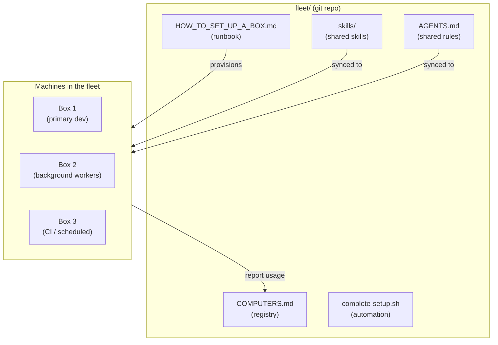
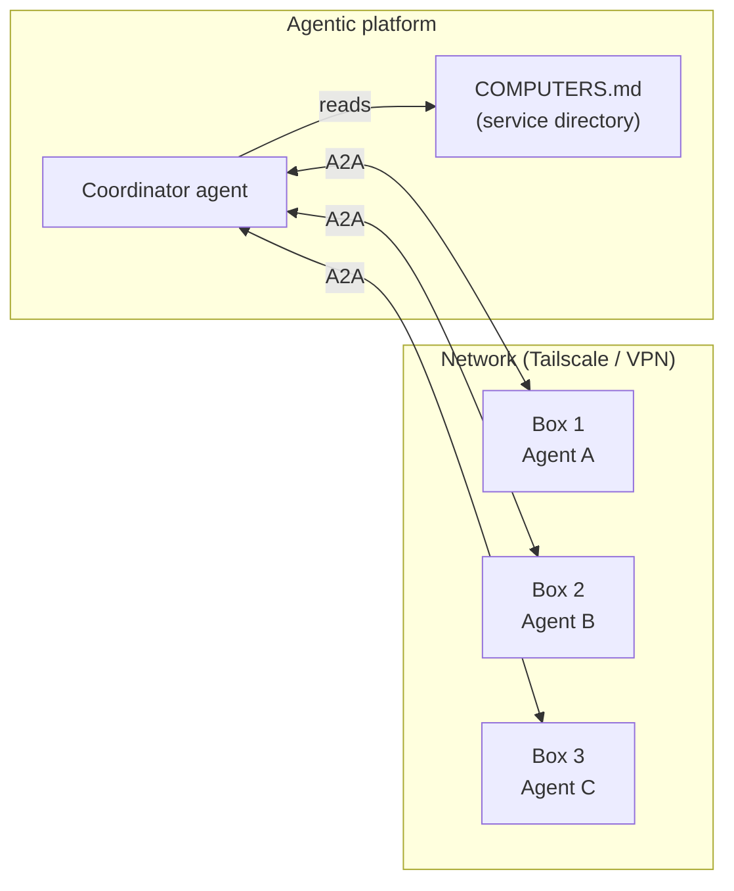
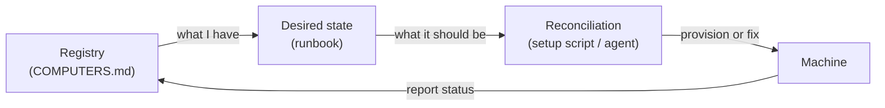

# 4. COMPUTERS.md — fleet infrastructure as a registry

> Every machine where agents run gets an entry in a single registry file. A runbook provisions new boxes to match the fleet standard. This is the **infrastructure layer** that makes the skill and folder orchestration from [03](03_Skill_And_Folder_Orchestration.md) actually work across multiple environments.

Related: [03 Skill and folder orchestration](03_Skill_And_Folder_Orchestration.md) · [02 Agent runner portability](02_Agent_Runner_Portability.md) · [01 Harness lock-in](01_Harness_Lock-in_Keep_Doors_Open.md) · [Lecture 2: 12 Subagents vs workers](../Lecture_2_Context_Agents_md_Skills_Tools/12_subagents_vs_workers.md) · [Lecture 1: 17 Ambient agents](../Lecture_1_Mechanics_Behind_Generative_AI/17_ambient_durable_agents.md)

Source: S01E04 lecture video (Theo Browne's "fleet" project screenshots), see [Fact-check](#fact-check).

## 1. The problem

I have agents running in different places — my laptop, a VPS, a CI runner, a colleague's machine. Each environment has different tools installed, different harness versions, different skills loaded. When something breaks, I don't know what's where. When I need to add a new environment, I start from scratch. When I want to move an agent between environments, I can't guarantee it will work.

This gets worse with A2A: if my agent platform talks to agents on other machines, I need to know what each machine is capable of, what's reachable, and how to provision a new node.

## 2. The "fleet" pattern (from Theo Browne)

Theo's project treats agent environments like infrastructure — with a registry and a runbook.

### COMPUTERS.md — the registry

A single Markdown file that lists every machine in the fleet. Each entry records:
- **Hostname** — how to find it
- **Role** — what it's used for (development, background workers, CI)
- **Status** — active, retired, offline
- **Installed agents** — which harnesses are on it (Codex, Claude Code, etc.)
- **Path to usage tracking** — where `ccusage` reports are stored

This is the fleet's **inventory**. An agent (or a human) can read it to answer: "What machines do I have? What can each one do? Which ones are alive?"

### HOW_TO_SET_UP_A_BOX.md — the runbook

A step-by-step document for provisioning a new machine to match the fleet standard. From the screenshot, a "finished box" should have:

- Stable hostname and SSH target
- Tailscale installed and reachable (network mesh)
- Public-key SSH from the primary machine
- A `main` tmux session with the machine's identity
- Git, GitHub CLI, `rg`, `fd`, `jq`, `tmux`, `btop`, and build tools
- Codex and Claude Code installed
- `~/.claude/CLAUDE.md` and `skills/universal/` synced from the fleet repo
- Usage tracking (`ccusage`) installed and registered in `COMPUTERS.md`

The runbook has a companion script (`complete-setup.sh`) that automates most of it.

### The full picture

**The key insight:** the fleet repo is the single source of truth for infrastructure. Machines are cattle, not pets — if one dies, the runbook rebuilds it.

## 3. Why this matters for an agentic platform

This pattern solves problems at two levels:

### Level 1: Engineering the agent fleet

When I run multiple agents across multiple machines (my own, a VPS, team members' environments), I need answers to:

| Question | What answers it |
|---|---|
| What machines exist and what's their status? | `COMPUTERS.md` |
| How do I add a new machine? | `HOW_TO_SET_UP_A_BOX.md` + `complete-setup.sh` |
| Are all machines running the same harness versions? | Registry + runbook enforce consistency |
| Which machine should run this task? | Registry lists capabilities per machine |
| What happened on machine X? | Usage tracking (`ccusage`) per machine |

Without this, every machine is a snowflake and "works on my machine" applies to agents too.

### Level 2: A2A and cross-machine agent communication

The COMPUTERS.md registry becomes the **service directory** for A2A:

Each entry in `COMPUTERS.md` is a potential A2A peer. The registry tells the coordinator: this machine exists, it runs these agents, it's reachable at this address, it supports these capabilities. That's the minimum a coordinator needs to route work.

This connects to the adapter/contract pattern from [02 Agent runner portability](02_Agent_Runner_Portability.md): if each box declares its capabilities in the registry, the coordinator can route tasks based on what each box supports — without hardcoding machine-specific logic.

## 4. The architecture principle underneath

This is **infrastructure as data** — the same principle behind Kubernetes manifests, Terraform state, or Ansible inventories, applied to agent environments. The pattern is:

1. **Registry** — a structured file that lists all resources and their current state
2. **Desired state** — a runbook/spec that describes what each resource should look like
3. **Reconciliation** — a process (script or agent) that makes reality match the spec
4. **Reporting** — each resource reports its status back to the registry

The only difference is that the "resources" here are machines running agents, and the "reconciliation" can be done by an agent reading the runbook.

An agent that can read `COMPUTERS.md`, read `HOW_TO_SET_UP_A_BOX.md`, SSH into a machine, and run the setup script can **self-provision the fleet**. That's the path from "I manually set up each box" to "I tell the coordinator I need a new node and it handles the rest."

## 5. My take — what I want to use

Two applications I see for my work:

**For the agent fleet:** I want a `COMPUTERS.md` in my own fleet repo, even if I start with just two entries (my laptop and one VPS). The discipline of maintaining a registry forces me to think about what each environment needs, and the runbook makes adding a new one cheap.

**For the agentic platform:** the registry pattern maps directly to how I think about service discovery in distributed systems. Each agent environment is a node that advertises capabilities. A2A is the protocol. The registry is the discovery mechanism. The runbook is the provisioning contract. These are not new ideas — they're infrastructure patterns applied to a new domain.

The interesting part is that the agent itself can maintain this infrastructure. It can read the registry, detect a drifted machine, run the setup script, and update the entry. That's what Theo's setup enables with the self-managing fleet.

## Fact-check

| # | Claim | Verdict | Source | Checked |
|---|---|---|---|---|
| 1 | Theo Browne's fleet project uses COMPUTERS.md as a machine registry | **Agrees** | Screenshot from lecture video shows the file and its role | 2026-11-08 |
| 2 | HOW_TO_SET_UP_A_BOX.md is a provisioning runbook with a specific target state | **Agrees** | File content visible in screenshot: hostname, Tailscale, SSH, tmux, agents, skills, ccusage | 2026-11-08 |
| 3 | Tailscale provides network mesh for the fleet | **Agrees** | [tailscale.com](https://tailscale.com/) — WireGuard-based mesh VPN, widely used for dev environments | 2026-11-08 |
| 4 | A2A standardizes agent-to-agent communication | **Agrees** | [A2A spec](https://github.com/google/A2A), now under Linux Foundation; see [Lecture 2: 12 Subagents vs workers](../Lecture_2_Context_Agents_md_Skills_Tools/12_subagents_vs_workers.md) for details | 2026-11-08 |
| 5 | The registry pattern maps to infrastructure-as-code concepts (K8s, Terraform, Ansible) | **My interpretation** | The analogy is mine. The underlying patterns (registry, desired state, reconciliation) are well-established in infrastructure engineering. | 2026-11-08 |
| 6 | An agent can self-provision fleet infrastructure by reading the runbook | **Lecture-specific (opinion)** | Theo demonstrates self-managing agents in the fleet, but fully autonomous provisioning depends on SSH access, permissions, and error handling that the screenshot doesn't show. | 2026-11-08 |
