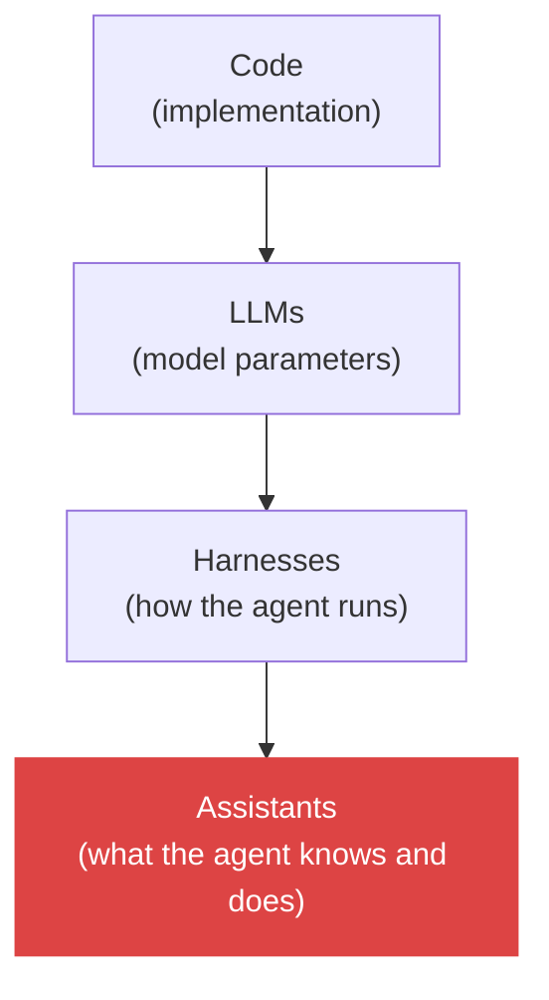
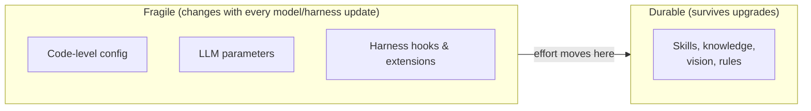

# 5. Don't overspecify — work at the Assistants level

> The stack is Code → LLMs → Harnesses → Assistants. The higher I work, the more scalable my setup is. Overspecifying the harness is the same trap as tuning temperature was — investing effort in a layer the model will outgrow.

Related: [12 Context language models](12_Context_Language_Models.md) · [01 Harness lock-in](01_Harness_Lock-in_Keep_Doors_Open.md) · [02 Agent runner portability](02_Agent_Runner_Portability.md) · [03 Skill and folder orchestration](03_Skill_And_Folder_Orchestration.md) · [Lecture 2: 5 Skills](../Lecture_2_Context_Agents_md_Skills_Tools/5_skills.md) · [Lecture 3: 1 Simplify first](../Lecture_3_Simplify_Codebase_&_Knowledge_Base/01_Simplify_First_Knowledge_Guardrails.md)

Source: S01E04 lecture slide (the four-layer stack), transcript discussion on native capabilities and heavy guidance, see [Fact-check](#fact-check).

## 1. The problem

I can invest my configuration effort at any layer of the stack. The question is: **which layer gives me the best return, and which will rot?**

## 2. The four layers

The lecturer shows a stack with a slider pushed to the top:

Each layer, from bottom to top:

| Layer | What I configure here | Example |
|---|---|---|
| **Code** | Implementation logic, scripts, tools | A custom MCP server, a setup script |
| **LLMs** | Model parameters — temperature, top-p, reasoning effort, model choice | `temperature: 0.3`, `model: opus` |
| **Harnesses** | Hooks, extensions, lifecycle rules, routing, permissions | Pi extensions, Claude Code hooks, Cursor rules |
| **Assistants** | Purpose, knowledge, skills, vision, styleguide | AGENTS.md, skills, vision.md, knowledge base |

**The higher I go, the more portable and scalable the configuration is.** The lower I go, the more brittle and coupled it becomes.

## 3. The trap at each layer

### Code level (2022 trap)

Early LLM apps hard-coded prompt logic, parsing, retry loops, and output formatting in code. When models improved, the code fought the model — parsing logic for outputs the model no longer produced, retry loops for failures the model no longer had.

### LLM level (2023 trap)

Everyone tuned temperature, top-p, frequency penalty. Built workflows around specific parameter combinations. Then new models came with different optimal ranges, reasoning models made temperature mostly irrelevant, and all that tuning work became waste.

### Harness level (2025–2026 trap)

This is where I am now. I can spend days building elaborate hook chains, custom extensions, complex routing rules, harness-specific workflows. But:

- **Models get smarter.** The transcript cites [Context Language Models (arxiv 2609.37725)](https://arxiv.org/abs/2609.37725). Corrected 2026-11-08: was "LLMs are better at context management than the best strategies I can build around them, and my hooks may degrade performance", now: in the paper, a model that edits its own context file with Bash beat the **named baselines** (such as Codex-style summarization) on several benchmarks, tied on one and trailed on one, mostly at 32K context. It did not test commercial harnesses, and it says nothing about my hooks. I read the full PDF text. See [12 Context language models](12_Context_Language_Models.md).
- **Harnesses converge.** The transcript and research ([arxiv 2609.00006](https://arxiv.org/pdf/2609.00006)) confirm that harnesses adopt each other's features quickly. My harness-specific optimizations become standard features.
- **Heavy guidance degrades.** The transcript warns that if I build logic around an agent — even a skill with heavy guidance — I may end up with a setup that **degrades the model's performance** without a clear sign of who's to blame.

### Assistants level (where the value stays)

Skills, knowledge bases, vision documents, architectural rules — these describe **what I want**, not **how to get it**. They survive model upgrades, harness switches, and parameter changes. A well-written AGENTS.md is more valuable a year from now than a perfectly tuned hook chain.

## 4. The principle

**The rule:** configure at the highest level that gives me the control I need. Drop down to a lower layer only when the higher one can't express what I want — and keep that lower-layer config thin, knowing it will need replacing.

This is the same principle as [01 Harness lock-in](01_Harness_Lock-in_Keep_Doors_Open.md): the more my setup lives at the Assistants level, the less I'm locked to any specific harness, model, or implementation.

## 5. My take

I've seen this cycle before in infrastructure — people over-optimized VM configurations, then containers made those optimizations irrelevant. People over-optimized container orchestration, then managed services absorbed that complexity. The pattern is: **the platform eats the layer below.**

In the AI stack, the model is eating the layers below. Context management, output formatting, error recovery, even task decomposition — models handle these better with each generation. My job is to stay at the layer the model can't eat: **what I want, why I want it, and what good looks like.** That's the Assistants level.

The practical test: if I removed all my harness config and hooks tomorrow and kept only my skills and AGENTS.md, would the agent still do 80% of what I need? If yes, I'm working at the right level. If no, I've pushed too much value into the fragile layers.

## Fact-check

| # | Claim | Verdict | Source | Checked |
|---|---|---|---|---|
| 1 | Context Language Models paper suggests LLMs are better at context management than manual strategies | **Differs: narrower than stated** (corrected 2026-11-08; the first version said "Agrees" after I had only confirmed the paper exists) | [arxiv 2609.37725](https://arxiv.org/abs/2609.37725). The paper shows wins over named baselines on several benchmarks, a tie and a trail, no commercial harness tested. Details in [12](12_Context_Language_Models.md). | 2026-11-08 |
| 2 | Heavy guidance can degrade model performance | **Agrees** | Transcript: "we may end up with a setup that degrades the model's performance without a clear sign of who's to blame." Also consistent with Anthropic's [best practices](https://www.anthropic.com/research/claude-code-best-practices) recommending simpler prompts. | 2026-11-08 |
| 3 | Harnesses converge on features quickly | **Agrees** | [arxiv 2609.00006](https://arxiv.org/pdf/2609.00006) — confirms feature convergence across coding-agent systems | 2026-11-08 |
| 4 | Temperature tuning became mostly irrelevant with reasoning models | **Agrees** | Reasoning models (o1, o3, Claude with extended thinking) generally ignore or clamp temperature. OpenAI's o1 docs explicitly state temperature is not used. | 2026-11-08 |
| 5 | The platform eats the layer below (infra analogy) | **My interpretation** | Analogy to VMs → containers → managed services is mine. The general pattern is well-established in platform engineering but applying it to the AI stack is my projection. | 2026-11-08 |
