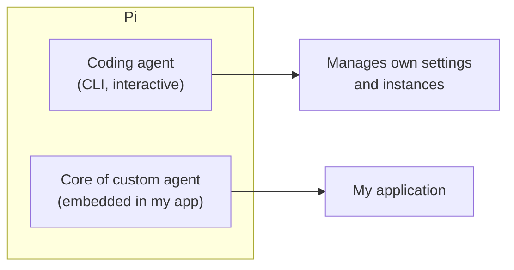
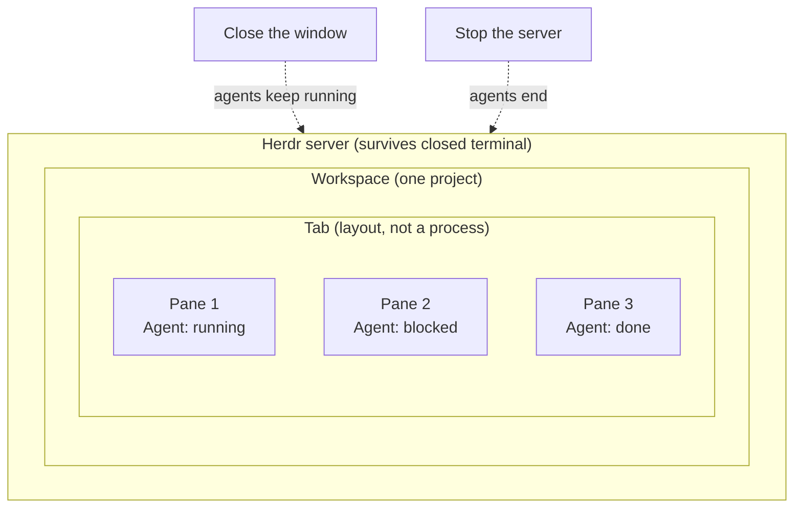
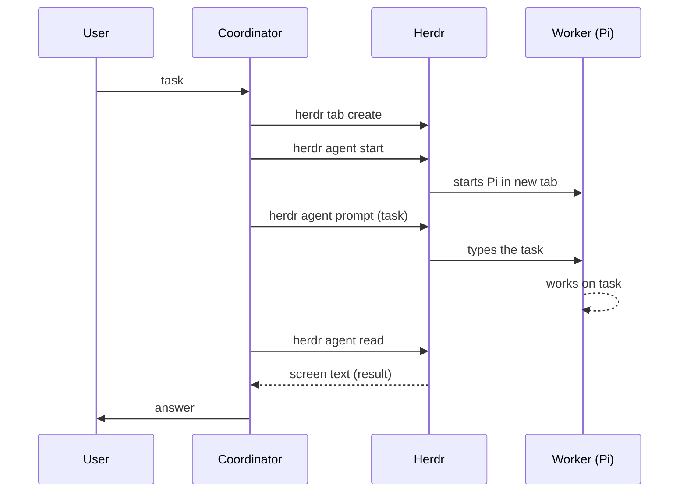

# 6. Self-management — agents that configure themselves

> An agent that can read its own docs, change its own settings, spawn its own workers, and survive a closed terminal is fundamentally different from one I have to babysit. Pi + Herdr is one implementation; the principle is general.

Related: [13 Herdr vs Orca](13_Herdr_vs_Orca_Agent_Orchestration.md) · [01 Harness lock-in](01_Harness_Lock-in_Keep_Doors_Open.md) · [04 COMPUTERS.md](04_Computers_md_Fleet_Infrastructure.md) · [05 Don't overspecify](05_Dont_Overspecify_Work_At_Assistants_Level.md) · [07 Multi-agent coordination](07_Multi_Agent_Coordination.md) · [Lecture 1: 16 Self-management](../Lecture_1_Mechanics_Behind_Generative_AI/16_self_management.md) · [Lecture 2: 12 Subagents vs workers](../Lecture_2_Context_Agents_md_Skills_Tools/12_subagents_vs_workers.md)

Source: S01E04 transcript (Pi + Herdr sections), see [Fact-check](#fact-check).

## 1. The problem

I configure my agent manually — install tools, set preferences, wire up hooks. When I need a second instance, I do it again. When the terminal closes, my agent dies. When I want the agent to adjust its own behavior, I edit config files myself. This doesn't scale.

## 2. Pi as harness

The lecturer picks [Pi](https://pi.dev/) as the main harness for two reasons:

1. **As a coding agent** — CLI harness that can manage its own settings and instances
2. **As the core of a custom agent** — Pi can be embedded, not just used interactively

Pi's [extensions](https://pi.dev/docs/latest/extensions) let me modify behavior at a low level: lifecycle, custom tools, commands, shortcuts, event handlers, prompt manipulation.

## 3. Herdr — the process manager

[Herdr](https://herdr.dev/) solves the durability problem. Corrected 2026-11-08: was "wraps around Pi", now: Herdr is an agent multiplexer that keeps **any** terminal program alive and tracks the agent's state. Pi is one documented integration (`herdr integration install pi`). Two products share the name, the Herdr TUI and a newer desktop app, and they do not share agents. Details and sources in [13 Herdr vs Orca](13_Herdr_vs_Orca_Agent_Orchestration.md).

Each agent gets its own pane. Herdr reports whether an agent is alive, detects stalls, and can close finished tabs. Closing the terminal window does not kill the agents.

## 4. Self-configuration

Both Pi and Herdr expose documentation that agents can read. The workflow:

1. Ask the agent to **read its own docs**
2. The agent suggests **initial settings** based on what it learns
3. I review and approve
4. The agent applies the settings **without restarting**

This is [self-configuration](https://github.com/MEGA-DOT-DEV/examples/tree/main/examples/self-configuring-agent) — one of the most important aspects of generative apps.

What an agent can manage through Herdr:
- Spawn another agent
- Tell another agent about something
- Organize workspaces, tabs, and panes
- Change nearly every setting
- Review history and suggest workflow changes

## 5. Spawning workers

The coordinator agent can start a worker via Herdr. Corrected 2026-11-08: the four commands exist in the Herdr TUI CLI reference, but `herdr agent start` needs an existing shell pane id (returned by `herdr tab create`), so the real sequence has that extra step. See [13](13_Herdr_vs_Orca_Agent_Orchestration.md).

**Try it (the lecture's exercise):** start Herdr, run Pi inside it, and ask the agent to create a Hello World tab with a simple hello message for another agent. I watch it explore its environment, open a tab, start a new Pi, send a prompt, then wait and read the result. The original sequence figure and a comparison with other result channels are in [13](13_Herdr_vs_Orca_Agent_Orchestration.md#herdr-and-pi-together-the-hello-world-exercise).

This is technically a **subagent**, but the worker is fully interactive, can be customized independently, can have its own hooks, and can be started in the background. A single coordinator can orchestrate many workers that survive terminal close.

## 6. My take

The self-management principle matters more than Pi or Herdr specifically. The key capabilities:
- Agent reads its own configuration docs
- Agent changes its own settings at runtime
- Agent spawns and monitors other agents
- Agents survive process lifecycle (durability)

Any harness that enables these four is a candidate. The principle from [05 Don't overspecify](05_Dont_Overspecify_Work_At_Assistants_Level.md) applies: self-management is an Assistants-level capability, not a harness-level hack.

## Fact-check

| # | Claim | Verdict | Source | Checked |
|---|---|---|---|---|
| 1 | Pi supports extensions for lifecycle, tools, commands, event handlers | **Verify before presenting** | Transcript references [Pi docs](https://pi.dev/docs/latest/extensions); not independently checked | 2026-11-08 |
| 2 | Herdr keeps agents alive after terminal closes | **Agrees** (corrected 2026-11-08, was "verify before presenting") | [herdr.dev/core](https://herdr.dev/core/) via a reader agent: programs survive closing the window and app crashes, not a reboot or stopping the server. See [13](13_Herdr_vs_Orca_Agent_Orchestration.md). | 2026-11-08 |
| 3 | Self-configuration is demonstrated in the course examples | **Agrees** | [self-configuring-agent example](https://github.com/MEGA-DOT-DEV/examples/tree/main/examples/self-configuring-agent) exists | 2026-11-08 |
| 4 | Pi can be used as both CLI agent and core of a custom agent | **Verify before presenting** | Lecturer's claim; Pi docs not independently checked | 2026-11-08 |
