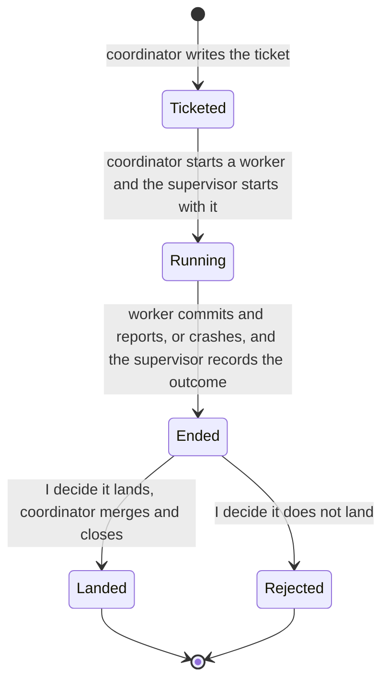
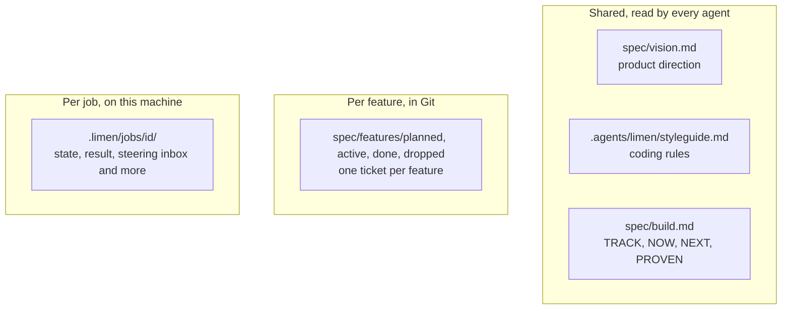

# 7. Multi-agent coordination — coordinator, workers, and files as messages

> Agents don't talk to each other directly. Everything goes through **files** (everyone reads), and a **supervisor** watches each worker. The coordinator gets notified when jobs end. No database, no message queue — just text, git, and a small CLI tool.

Related: [15 Pi and limen behind the scenes](15_Pi_Limen_Behind_The_Scenes.md) · [14 What an agent fleet needs beyond spawning workers](14_What_Agent_Fleets_Need_Beyond_Spawning.md) · [06 Self-management](06_Self_Management_Pi_Herdr.md) · [03 Skill and folder orchestration](03_Skill_And_Folder_Orchestration.md) · [04 COMPUTERS.md](04_Computers_md_Fleet_Infrastructure.md) · [Lecture 2: 3 Lifecycle hooks](../Lecture_2_Context_Agents_md_Skills_Tools/3_lifecycle_hooks.md) · [Lecture 2: 12 Subagents vs workers](../Lecture_2_Context_Agents_md_Skills_Tools/12_subagents_vs_workers.md) · [Lecture 3: 14 Task board](../Lecture_3_Simplify_Codebase_&_Knowledge_Base/14_Broader_Context_Task_Board.md)

Source: S01E04 transcript (multi-agent setup, limen project), the lecture's swimlane figure (`img/pi-lifecycle-hooks-job-states-swimlane.png`) and its job-record figure (`img/pi-orchestration-spec-job-record-branch.png`). The mechanism behind them, checked against Pi's docs and the limen repo, is in [15 Pi and limen behind the scenes](15_Pi_Limen_Behind_The_Scenes.md). See [Fact-check](#fact-check).

## 1. The problem

I have multiple agents working on the same project. They need to coordinate without stepping on each other. They need to share information, follow the same rules, and report results. How do I wire this up without building a distributed system?

## 2. The architecture

The lecturer describes the [limen](https://github.com/overment/limen/tree/01fc400e916e05f4f92ff881b48cd1b40eee99e6) project — a working implementation:

![Swimlane diagram with five stages from left to right: Ask, Hand off, Work, Finish, Land, and four lanes from top to bottom: You, Coordinator, Workers, Supervisor. You ask for an outcome and the Coordinator writes the ticket. At hand-off the Coordinator starts a Worker, the Worker gets its own space, and the Supervisor starts with the Worker. During work the Coordinator stays with you, the Worker does the task, and the Supervisor watches. At finish the Coordinator gets a job-ended notice, the Worker commits and reports, and the Supervisor records the outcome. At land, you decide what lands and the Coordinator merges and closes. The Workers are drawn as a small stack because several run side by side.](img/pi-lifecycle-hooks-job-states-swimlane.png)

**The story:** the coordinator is the only role that talks to me. It turns my request into a ticket and hands it off. A worker does the job in its own space, a supervisor watches that worker, and when the job ends the coordinator is told. I decide what lands, and the coordinator merges and closes.

**What is important:**
- **Four roles, five stages.** Each role does one thing in each stage. Nothing in the picture is a free-for-all.
- **The supervisor starts and ends with the worker.** It is a separate role that records how the job ended, even after a crash.
- **I am in two places only:** at the start (ask for an outcome) and at the end (decide what lands). Everything between is delegated.
- **No arrow runs from the Workers or the Supervisor to the Coordinator.** The coordinator learns that a job ended through the job record (below), not from a message.

**What is not important:** the exact box wording and the stack drawing for workers (it only says several run in parallel).

The same flow as a job lifecycle, which is how I read it as a state machine:

"Rejected" is my addition. The figure only says I decide what lands, which implies some jobs do not.

How the coordinator learns the result, from the lecture's job-record figure:

**The story:** three records sit in the middle, and the roles only touch them. The coordinator writes the **spec** and merges the **branch**. The worker reads the spec, writes progress to the **job record**, and commits. The supervisor writes the outcome to the job record. The red arrow, *job ended*, goes from the job record to the coordinator.

**What is important:** the spec and the branch are in Git, shared and versioned. The job record is on this machine, as runtime state. The mechanism behind each arrow, checked against Pi's docs and the limen code, is in [15 Pi and limen behind the scenes](15_Pi_Limen_Behind_The_Scenes.md).

Corrected 2026-11-08: the first version of this note drew a direct "commit, report" arrow from the workers to the coordinator. The lecture's figure says no arrow joins them. The worker writes to the job record, and the coordinator is notified from that record.

Key design decisions:
- **No direct agent-to-agent communication.** Workers and coordinator never talk directly.
- **Files are the message bus.** Everyone reads files; updates go through files.
- **Supervisor is separate.** It watches workers and records outcomes, even after crashes.
- **Coordinator stays with the user.** It's interactive and gets notifications.

## 3. The components

### Git worktrees — isolation

Each worker gets its own copy of the code via [git worktrees](https://git-scm.com/docs/git-worktree). Workers don't interfere with each other because they work on separate branches in separate directories.

### Files as messages

Three types of files carry information:

| File type | Who writes | Who reads | Purpose |
|---|---|---|---|
| `spec/vision.md` | Human + coordinator | Everyone | Product direction, feature map |
| `.agents/limen/styleguide.md` | Human + coordinator | Everyone | Coding rules agents must follow |
| `spec/build.md` | Coordinator | Everyone | The board: TRACK, NOW, NEXT, PROVEN |
| `spec/features/<state>/F001-slug/ticket.md` | Coordinator | Worker | The ticket. The folder is the state: `planned`, `active`, `done`, `dropped` |
| `.limen/jobs/<id>/` | Worker, supervisor and the limen CLI | Coordinator | State, result, commits, steering inbox, notification records |

Corrected 2026-11-08: these are the names in the limen repo at the pinned commit (README and source, read through a reader agent). My first version used generic names (`board/`, `features/<name>/spec.md`, `jobs/<id>/`) that I took from the figure text.

### Steering

The coordinator can steer a worker between tool calls. In limen, the coordinator drops a numbered file into the job's `steer/inbox/`. A Pi extension in the worker (`hook/steering.ts`) picks it up and delivers it with `pi.sendUserMessage(text, { deliverAs: "steer" })`. Pi then delivers it after the current turn's tool calls and before the next model call. The course's [worker-steering example](https://github.com/MEGA-DOT-DEV/examples/tree/main/examples/worker-steering) demonstrates the delivery modes, but it is a simulation on a custom harness, not a Pi extension. See [15](15_Pi_Limen_Behind_The_Scenes.md).

### Notifications

A Pi extension in the coordinator (`hook/wake.ts`) watches `.limen/jobs` with a file watcher and sends the coordinator a message when a job ends. The course's [job-end-notifications example](https://github.com/MEGA-DOT-DEV/examples/tree/main/examples/job-end-notifications) shows polling versus being notified, also as a simulation. See [15](15_Pi_Limen_Behind_The_Scenes.md).

### Where the lifecycle hooks attach

Every behavior that makes this setup work is a small extension that attaches to a moment in an agent's loop. That is the same idea as the lifecycle hooks in [Lecture 2: 3](../Lecture_2_Context_Agents_md_Skills_Tools/3_lifecycle_hooks.md): logic the loop always runs, not an instruction the model may ignore.

| Moment | What runs in limen (Pi extension) | Nearest Claude Code event | Note |
|---|---|---|---|
| Every run, any agent | `before_agent_start` appends the vision, styleguide and a board digest to the system prompt (workers get a lighter cue). `tool_result` adds reminders after edits | `UserPromptSubmit` adds context. `SessionStart` with the `compact` matcher keeps rules alive after compaction | Both cost tokens every time, so the files stay short |
| Worker, between tool calls | `session_start` starts a watcher on the steering inbox. `pi.sendUserMessage` with `deliverAs: "steer"` delivers the correction | `PostToolUse` is the closest event | My mapping. I did not check whether it can carry steering text |
| Worker, at the end | The lecture says a final-report tool. In the code I read, the worker's last message is saved from the session log into the job's `result` | `Stop`: a hook can refuse to let the agent stop until a report exists | Different mechanism: a tool the agent calls vs a gate the loop applies |
| Coordinator, when a job ends | `session_start` starts a recursive file watcher on `.limen/jobs`. `agent_settled` and the message events track idle or busy. A plain message when idle, a `followUp` when busy | No direct event. `FileChanged` is the nearest | My mapping, unverified |
| Supervisor | Plain code in a separate detached process. In hosted mode it polls Herdr about once a second and writes the job's final state | None | **Not a hook.** See below |

**Why the supervisor is not a hook:** a hook only fires while the agent's loop is alive. A crash is exactly the case where nothing inside the worker can record what happened. That is why the supervisor sits outside the agent, and why the lecture says code is needed for the things text and in-loop logic cannot do reliably.

Claude Code also has `SubagentStart`, `SubagentStop`, `TaskCreated` and `TaskCompleted`. Those cover subagents inside one harness session. A worker here is a separate process (see [Lecture 2: 12](../Lecture_2_Context_Agents_md_Skills_Tools/12_subagents_vs_workers.md)), so the job record and the watcher take their place.

## 4. What code does vs what text does

The lecturer emphasizes: **code does only what text cannot do reliably.**

| Code handles | Text handles |
|---|---|
| Start a job | What to build (spec) |
| Watch a job | How to write it (styleguide) |
| Record the result | When to ask for review |
| Send the notification | Project direction (vision) |

Everything else — what to build, how to build it, coding standards, review criteria — is text that agents read.

## 5. Vision and styleguide

Two special files injected into every agent's context:

- **`vision.md`** — general product description, direction, feature map. Points to separate files for important modules.
- **`styleguide.md`** — coding rules the agent follows. Differs from AGENTS.md in that it's injected more frequently (via Pi extensions) to keep it top-of-mind.

Both must be **concise** because they're injected often and cost context tokens every time.

## 6. My take

This is the simplest multi-agent architecture that could work. No infrastructure beyond git and a file system. The tradeoffs:

**Strengths:**
- Easy to understand and debug — everything is in files I can read
- No infrastructure to maintain
- Files are version-controlled automatically (git)
- Any agent that can read files can participate

**Weaknesses:**
- File-based messaging doesn't scale to high throughput
- Steering between tool calls is Pi-specific (extension)
- In hosted mode the supervisor polls Herdr to detect that the worker ended. Detached jobs use a wrapper I did not read

For my purposes, the file-based approach aligns well with [03 Skill and folder orchestration](03_Skill_And_Folder_Orchestration.md) — the fleet repo becomes the coordination hub.

## Fact-check

| # | Claim | Verdict | Source | Checked |
|---|---|---|---|---|
| 1 | Limen project uses this architecture | **Agrees** | [Limen source](https://github.com/overment/limen/tree/01fc400e916e05f4f92ff881b48cd1b40eee99e6) — repo exists at pinned commit | 2026-11-08 |
| 2 | Workers use git worktrees for isolation | **Agrees** | Transcript + limen repo structure | 2026-11-08 |
| 3 | Worker steering is done via Pi extensions between tool calls | **Agrees**. Corrected 2026-11-08: the support is limen's code, not the example | limen's `hook/steering.ts` uses `pi.sendUserMessage` with `deliverAs: "steer"`, which Pi's docs say arrives after the current turn's tool calls. The course [worker-steering example](https://github.com/MEGA-DOT-DEV/examples/tree/main/examples/worker-steering) exists but is a simulation on a custom harness, not a Pi extension. See [15](15_Pi_Limen_Behind_The_Scenes.md). | 2026-11-08 |
| 4 | Job-end notifications via Pi extensions | **Agrees**. Corrected 2026-11-08: the support is limen's code, not the example | limen's `hook/wake.ts` watches `.limen/jobs` and messages the coordinator. The course [job-end-notifications example](https://github.com/MEGA-DOT-DEV/examples/tree/main/examples/job-end-notifications) is a simulation. `wake.ts` was only partly read. | 2026-11-08 |
| 5 | styleguide.md is injected more often than AGENTS.md | **Agrees** for limen. Corrected 2026-11-08: was "lecture-specific" | limen's `hook/communication.ts` appends the vision, styleguide and a board digest at `before_agent_start` (every run) and adds reminders after tool results. It is limen's design choice, not a universal practice. | 2026-11-08 |
| 6 | The flow has four roles (You, Coordinator, Workers, Supervisor) and five stages (Ask, Hand off, Work, Finish, Land) | **Agrees with the lecture** | The lecture's swimlane figure (`img/pi-lifecycle-hooks-job-states-swimlane.png`) and its description in the transcript | 2026-11-08 |
| 7 | No arrow joins the workers or the supervisor to the coordinator. The coordinator is notified from the job record | **Agrees** | The lecture's job-record figure shows it, and limen's `wake.ts` watches the job folder. See [15](15_Pi_Limen_Behind_The_Scenes.md). | 2026-11-08 |
| 8 | Pi extensions do the four jobs in the lifecycle table (global files, steering, final-report tool, job-end notification) | **Partly agrees**. Corrected 2026-11-08 | Three are in limen's code: global files, steering and the job-end wake. I found no final-report tool. The worker's last message is saved into the job's `result`. | 2026-11-08 |
| 9 | The Claude Code events in the "nearest event" column exist and behave as described | **Agrees** for `UserPromptSubmit`, `SessionStart`, `Stop`, `SubagentStop`, `TaskCompleted` (checked in [Lecture 2: 3](../Lecture_2_Context_Agents_md_Skills_Tools/3_lifecycle_hooks.md) against the hooks docs). **Unverified** for using `PostToolUse` to steer and `FileChanged` to watch jobs | [Hooks reference](https://code.claude.com/docs/en/hooks) | 2026-11-08 |
| 10 | The supervisor cannot be a hook because hooks only run while the loop is alive | **My interpretation** | My reasoning from how hooks are fired by the loop. Not stated by the lecture. | 2026-11-08 |
| 11 | "Rejected" is a possible end state | **My interpretation** | Implied by "decides what lands". The figure has no rejected state. | 2026-11-08 |
