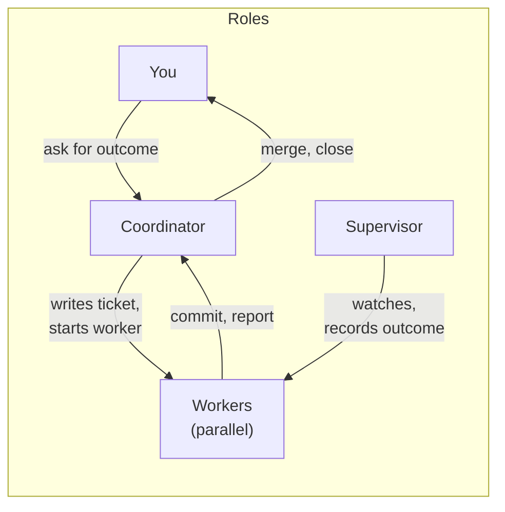
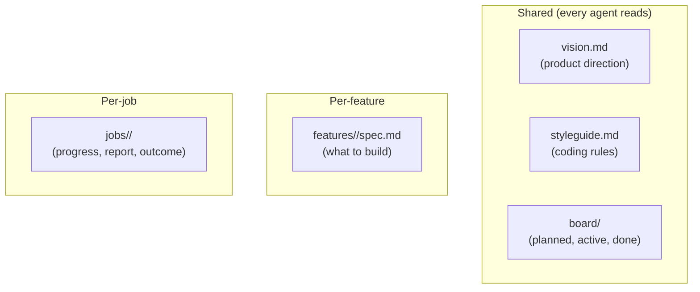

# 7. Multi-agent coordination — coordinator, workers, and files as messages

> Agents don't talk to each other directly. Everything goes through **files** (everyone reads), and a **supervisor** watches each worker. The coordinator gets notified when jobs end. No database, no message queue — just text, git, and a small CLI tool.

Related: [14 What an agent fleet needs beyond spawning workers](14_What_Agent_Fleets_Need_Beyond_Spawning.md) · [06 Self-management](06_Self_Management_Pi_Herdr.md) · [03 Skill and folder orchestration](03_Skill_And_Folder_Orchestration.md) · [04 COMPUTERS.md](04_Computers_md_Fleet_Infrastructure.md) · [Lecture 2: 12 Subagents vs workers](../Lecture_2_Context_Agents_md_Skills_Tools/12_subagents_vs_workers.md) · [Lecture 3: 14 Task board](../Lecture_3_Simplify_Codebase_&_Knowledge_Base/14_Broader_Context_Task_Board.md)

Source: S01E04 transcript (multi-agent setup, limen project), see [Fact-check](#fact-check).

## 1. The problem

I have multiple agents working on the same project. They need to coordinate without stepping on each other. They need to share information, follow the same rules, and report results. How do I wire this up without building a distributed system?

## 2. The architecture

The lecturer describes the [limen](https://github.com/overment/limen/tree/01fc400e916e05f4f92ff881b48cd1b40eee99e6) project — a working implementation:

Key design decisions:
- **No direct agent-to-agent communication.** Workers and coordinator never talk directly.
- **Files are the message bus.** Everyone reads files; updates go through files.
- **Supervisor is separate.** It watches workers and records outcomes, even after crashes.
- **Coordinator stays with the user.** It's interactive and gets notifications.

## 3. The components

### Git worktrees — isolation

Each worker gets its own copy of the code via [git worktrees](https://git-scm.com/docs/git-worktree). Workers don't interfere with each other because they work on separate branches in separate directories.

### Files as messages

Three types of files carry information:

| File type | Who writes | Who reads | Purpose |
|---|---|---|---|
| `vision.md` | Human + coordinator | Everyone | Product direction, feature map |
| `styleguide.md` | Human + coordinator | Everyone | Coding rules agents must follow |
| `board/` | Coordinator | Everyone | What's planned, active, done |
| `features/<name>/spec.md` | Coordinator | Worker | The ticket — what to build |
| `jobs/<id>/` | Worker + supervisor | Coordinator | Progress, report, outcome |

### Steering

The coordinator can steer a worker between tool calls. A Pi extension in the worker [delivers corrections from the coordinator](https://github.com/MEGA-DOT-DEV/examples/tree/main/examples/worker-steering) while the worker is running.

### Notifications

A Pi extension in the coordinator [watches the job folders](https://github.com/MEGA-DOT-DEV/examples/tree/main/examples/job-end-notifications) and adds a message to the chat when a job ends.

## 4. What code does vs what text does

The lecturer emphasizes: **code does only what text cannot do reliably.**

| Code handles | Text handles |
|---|---|
| Start a job | What to build (spec) |
| Watch a job | How to write it (styleguide) |
| Record the result | When to ask for review |
| Send the notification | Project direction (vision) |

Everything else — what to build, how to build it, coding standards, review criteria — is text that agents read.

## 5. Vision and styleguide

Two special files injected into every agent's context:

- **`vision.md`** — general product description, direction, feature map. Points to separate files for important modules.
- **`styleguide.md`** — coding rules the agent follows. Differs from AGENTS.md in that it's injected more frequently (via Pi extensions) to keep it top-of-mind.

Both must be **concise** because they're injected often and cost context tokens every time.

## 6. My take

This is the simplest multi-agent architecture that could work. No infrastructure beyond git and a file system. The tradeoffs:

**Strengths:**
- Easy to understand and debug — everything is in files I can read
- No infrastructure to maintain
- Files are version-controlled automatically (git)
- Any agent that can read files can participate

**Weaknesses:**
- File-based messaging doesn't scale to high throughput
- Steering between tool calls is Pi-specific (extension)
- Supervisor needs the process manager (Herdr) to detect crashes

For my purposes, the file-based approach aligns well with [03 Skill and folder orchestration](03_Skill_And_Folder_Orchestration.md) — the fleet repo becomes the coordination hub.

## Fact-check

| # | Claim | Verdict | Source | Checked |
|---|---|---|---|---|
| 1 | Limen project uses this architecture | **Agrees** | [Limen source](https://github.com/overment/limen/tree/01fc400e916e05f4f92ff881b48cd1b40eee99e6) — repo exists at pinned commit | 2026-11-08 |
| 2 | Workers use git worktrees for isolation | **Agrees** | Transcript + limen repo structure | 2026-11-08 |
| 3 | Worker steering is done via Pi extensions between tool calls | **Agrees** | [worker-steering example](https://github.com/MEGA-DOT-DEV/examples/tree/main/examples/worker-steering) exists | 2026-11-08 |
| 4 | Job-end notifications via Pi extensions | **Agrees** | [job-end-notifications example](https://github.com/MEGA-DOT-DEV/examples/tree/main/examples/job-end-notifications) exists | 2026-11-08 |
| 5 | styleguide.md is injected more often than AGENTS.md | **Lecture-specific (opinion)** | Design choice in limen's Pi extensions. Not a universal practice. | 2026-11-08 |
