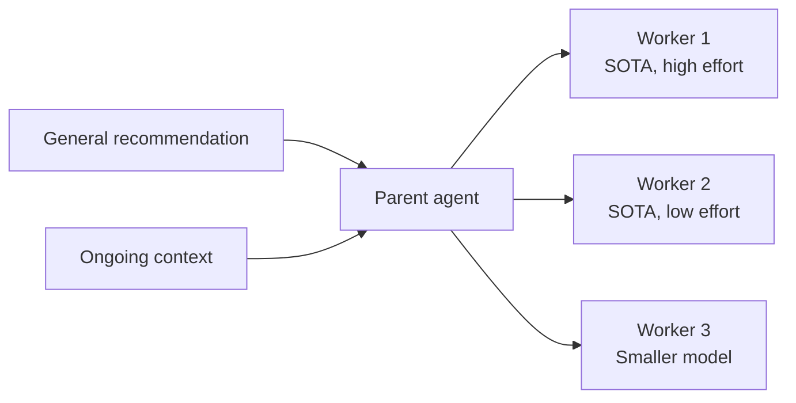
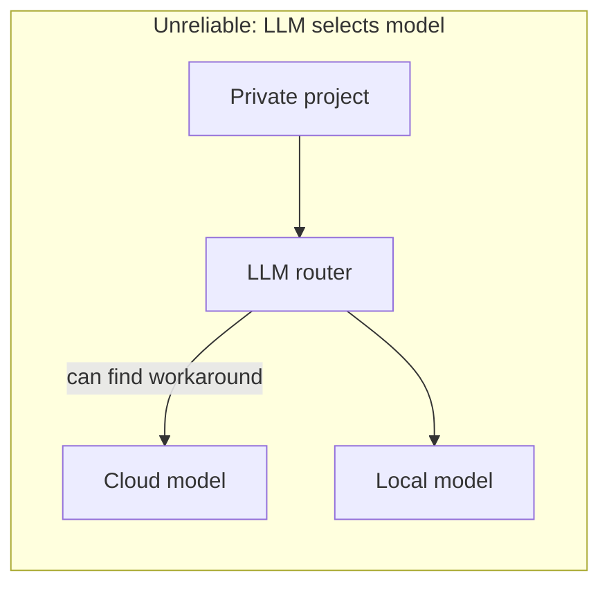
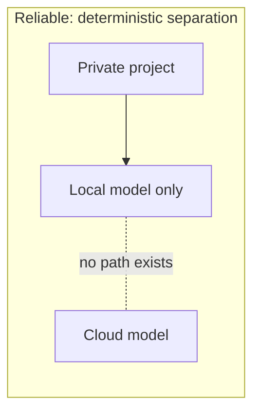

# 8. Settings — model routing, reasoning effort, and cost per task

> Don't measure models by token price. Measure by **cost per task**. Use SOTA models with lower reasoning effort for easy work, and a clear **deterministic boundary** when privacy requires a local model.

Related: [17 Cost per task](17_Cost_Per_Task.md) · [16 SOTA and reasoning effort](16_SOTA_And_Reasoning_Effort.md) · [05 Don't overspecify](05_Dont_Overspecify_Work_At_Assistants_Level.md) · [02 Agent runner portability](02_Agent_Runner_Portability.md) · [07 Multi-agent coordination](07_Multi_Agent_Coordination.md) · [Lecture 2: 1 Harness](../Lecture_2_Context_Agents_md_Skills_Tools/1_Harness.md)

Source: S01E04 transcript (settings section), see [Fact-check](#fact-check).

## 1. The problem

Which model do I use? How hard should it think? How much does it cost? And what happens when part of my project can't touch a cloud API?

## 2. Model choice and routing

The lecturer recommends **SOTA models** (best available at any moment) as the default, with two levers to reduce cost: lower the reasoning effort, or switch to a smaller model. The 2×2 grid, what each dial changes, and the vendor details are in [16 SOTA and reasoning effort](16_SOTA_And_Reasoning_Effort.md).

In a multi-agent setup, the parent agent manages this:

The parent decides which model and effort level each worker gets, based on the task complexity.

## 3. Reasoning effort

No clear rule for which reasoning level to use — it depends on model, task, and harness. Benchmarks set a baseline, but the lecturer recommends [testing which level works for my specific tasks](https://github.com/MEGA-DOT-DEV/examples/tree/main/examples/effort-routing). What the vendors say about effort levels, and what the course example does and does not show, is in [16](16_SOTA_And_Reasoning_Effort.md).

## 4. Cost per task, not cost per token

Token price alone is misleading, because models differ a lot in how many tokens they spend on one task. The worked example from the lecture, the arithmetic, cost per solved task, and where cost-per-task numbers are published are in [17 Cost per task](17_Cost_Per_Task.md).

The lecturer notes that many workflows (multi-agent collaboration) became much more efficient since roughly Opus 4.8 — older or open-source models may not handle these workflows well.

## 5. Privacy boundaries

When privacy requires a local or open-source model, **no LLM can reliably select the model**. Current models are clever enough to find workarounds around even strong boundaries.

The fix: **deterministic separation.**

The boundary must be in **infrastructure** (network rules, config), not in prompts or agent logic. This connects to [02 Agent runner portability](02_Agent_Runner_Portability.md) — my adapter layer needs to support hard routing rules, not just preferences.

## 6. My take

Cost per task is the right metric. I've seen teams pick a cheaper model and spend more because it takes three attempts to get a working result.

The privacy boundary point is critical for enterprise work. "The model decides which model to use" is not a security architecture — it's a suggestion box.

## Fact-check

| # | Claim | Verdict | Source | Checked |
|---|---|---|---|---|
| 1 | Cost per task is more accurate than token price | **Agrees** as a concept. Corrected 2026-11-08 | Artificial Analysis publishes cost per task from actual token use (search summary of its methodology). I could not read slopalytics.com, so I cannot confirm what it provides. See [17](17_Cost_Per_Task.md). | 2026-11-08 |
| 2 | No LLM can reliably enforce privacy boundaries | **Agrees** | [privacy-boundary example](https://github.com/MEGA-DOT-DEV/examples/tree/main/examples/privacy-boundary); also consistent with known prompt injection / jailbreak research | 2026-11-08 |
| 3 | Multi-agent workflows became more efficient since Opus 4.8 | **Lecture-specific (opinion)** | Lecturer's characterization. No independent benchmark comparing multi-agent efficiency across Opus versions found. | 2026-11-08 |
| 4 | Effort routing should be tested per task type | **Agrees** as a principle. Corrected 2026-11-08 | The [effort-routing example](https://github.com/MEGA-DOT-DEV/examples/tree/main/examples/effort-routing), read by a reader agent, is a small harness: ten arithmetic tasks, low vs high effort, no measured results in its README, and test numbers from a mock model. See [16](16_SOTA_And_Reasoning_Effort.md). | 2026-11-08 |
